# @citolab tspci-examples

Example PCI's created with @citolab/tspci

[github](https://github.com/Citolab/tspci/lib/tspci) | 
[npm](https://www.npmjs.com/package/@citolab/tspci)

There are 48 examples in this repository that can give a head start while creating new Portable Custom Interactions.
Twelve of them are ports of existing open-source PCIs and keep the licence of the original (see
[Ports of open-source PCIs](#ports-of-open-source-pcis)).
To run these examples go the to folder of the specific example and run:

``` sh
npm i
npm run dev
```

## Testing PCIs

These PCIs can be tested in [qti.citolab.nl](https://qti.citolab.nl).

### Using QTI3 export (direct import)

The `package-qti3` script creates a zip file that can be directly imported into [qti.citolab.nl](https://qti.citolab.nl).

``` sh
npm run package-qti3
```

### Using TAO export

You can also import PCIs into TAO first:

1. Run `npm run package-tao`, which writes `dist/tao-pci-<typeIdentifier>_<version>.zip`
2. In TAO, go to **Settings → Portable Custom Interactions → Add Interaction** and upload the zip
3. Create an item using the PCI
4. Export the item as QTI 2.2

When you import the QTI 2.2 package into [qti.citolab.nl](https://qti.citolab.nl), it will automatically upgrade the package and ensure the PCI works.

### Storybook: stories and tests

Every example has stories next to its source (`src/<typeIdentifier>.stories.ts`), in one Storybook for the whole
repository. A story mounts the PCI the way a delivery system does (`getInstance` with settings, a status, a state or a
response) and its `play` function tests what the candidate can do with it: the response, the
`qti-interaction-changed` events, the settings, review status, restoring the state.

``` sh
npm i                    # in the root of the repository, next to npm i in each example
npx playwright install chromium
npm run storybook        # the stories, with the tests in the interactions panel
npm test                 # every play function, headless in Chromium
npm test -- tspci-likert # the tests of one example
```

In the folder of an example the same is one script away; `TSPCI_STORIES` narrows the shared Storybook to that example:

``` sh
npm run storybook        # Storybook with only the stories of this example
npm run test:stories     # its play functions, headless in Chromium
npm run prod             # runs npm test (node tests, where there are any) and test:stories first (preprod)
```

A failing test stops `npm run prod`, and so `npm pack` (`prepack`). Run `npm run package-tao` after `package-qti3`: the
qti3 export rebuilds `dist/`, which removes the TAO zip.

`.storybook/vite-plugin-tspci.ts` builds the source as `tspci` does (the CSS as a string through the example's own
Tailwind, `config.json` as its defaults, images as data URLs) and `.storybook/tspci.ts` is the delivery system of the
stories: `mountPci`, `openPci` (the instance, its shadow root and testing-library queries within it) and `remountPci`.

## Authoring systems

An item author places a PCI in an item, sets it up (the settings) and decides what counts as a correct answer (the
scoring). Every example describes both in two files it already has:

- **`src/config.json`, the settings.** A value is a plain default, or an object with a `default` and hints for the
  author's form: an `editor`, a `label` (one string or one per language), `options`, `min`/`max`:

  ```json
  "brickColorMode": {
    "default": "mixed",
    "editor": "enum",
    "label": { "en": "Brick colours", "nl": "Kleuren van de blokken" },
    "options": [
      { "value": "mixed", "label": { "en": "Multiple colours", "nl": "Meerdere kleuren" } },
      { "value": "single", "label": { "en": "One colour", "nl": "Eén kleur" } }
    ]
  }
  ```

  The editors are `text`, `textarea`, `integer`, `number`, `boolean`, `enum`, `color`, `colorList`, `hidden` and
  `pci` (the PCI edits the setting itself, see below). The bundle only gets the defaults.
- **`package.json` `config.tspci`, the response and the scoring.** `response` declares what `getResponse()` returns
  (`{ "cardinality": "single", "baseType": "integer" }`), `scoring` how the PCI may be scored (`match_correct`,
  `custom`, `human`, or `none` for a tool; the first is the default). See the
  [PCI authoring profile](https://github.com/Citolab/tspci/tree/main/docs/spec).

| example | settings (editors) | response | scoring |
| --- | --- | --- | --- |
| tspci-vanilla-js | `text`, `textarea`, `integer`, `color` | `single` `integer` | `match_correct`, `human` |
| tspci-color-proportions | `textarea`, `colorList`, `text`, `integer`, `pci` | `single` `string` | `match_correct`, `human` |
| tspci-3d-blocks | `integer`, `text`, `enum`, `colorList`, `color` | `single` `string` | `match_correct`, `human` |
| tspci-equal-expressions | `text`, `enum`, `pci`, `integer`, `boolean`; an image slot in the markup | `ordered` `float` | `none` (a tool) |
| tspci-table-graph | `text`, `number`, `integer`, `boolean`, `enum` | `ordered` `float` | `none` (a tool) |
| tspci-table-select | `textarea`, `enum`, `pci` | `single` `identifier` | `match_correct`, `human` |
| tspci-spreadsheet | `textarea`, `enum`, `pci`, `boolean` | `single` `string` | `match_correct` (answer cell), `human` (its tool mode is not scored) |
| tspci-table-entry | `textarea`, `pci`, `enum`, `integer`, `text`, `boolean` | `ordered` `string` (or a `record` when the PCI scores) | `match_correct`, `custom`, `human` |
| tspci-force-vector | `textarea`, `integer`, `number`, `boolean`, `enum`, `pci` | `ordered` `float` (4 per arrow) | `custom`, `match_correct`, `human` |
| tspci-circuit-builder | `textarea`, `pci`, `boolean`, `enum` | `record` (`score`, `maxscore`, `correct`, `check1`…`check8`, `topology`, `board`) | `custom`, `human` |
| tspci-oscilloscope | `textarea`, `enum`, `integer`, `number`, `boolean`, `pci` | `ordered` `float` (frequency, amplitude) | `custom`, `match_correct`, `human` |
| tspci-sound-level | `textarea`, `enum`, `number`, `text`, `integer`, `boolean` | `single` `float` (answer mode), `single` `string` (tool) | `match_correct`, `human` (its tool mode is not scored) |
| tspci-data-chart | `textarea`, `text`, `enum`, `integer`, `pci`, `number`, `boolean` | `single`/`multiple` `identifier` (select), `single` `string` (tool) | `match_correct`, `human` (its tool mode is not scored) |
| tspci-net-folding | `textarea`, `pci`, `boolean`, `enum` | `multiple` `identifier` (or a `record` for building a net) | `match_correct`, `custom`, `human` |
| tspci-cross-section | `textarea`, `enum`, `text`, `integer`, `pci`, `boolean`, `number` | `record` (shape, sides, area, plane) | `custom`, `human` (its tool mode is not scored) |
| tspci-measure-3d | `textarea`, `pci`, `enum`, `text`, `integer`, `number`, `boolean` | `single` `float` (or a `record`) | `match_correct`, `custom`, `human` (its tool mode is not scored) |
| tspci-light-shadow | `textarea`, `pci`, `enum`, `boolean` | `record` (shadow, umbra, penumbra, positions) | `custom`, `human` (its tool mode is not scored) |
| tspci-molecule-builder | `textarea`, `pci`, `enum`, `boolean`, `integer` | `single` `string` (formula and canonical SMILES) | `match_correct`, `custom`, `human` |
| tspci-model-hotspot | `textarea`, `enum`, `text`, `integer`, `pci`, `boolean` | `single`/`multiple` `identifier`, `multiple` `directedPair` (labels) | `match_correct`, `human` |
| tspci-technical-drawing | `textarea`, `enum`, `pci`, `boolean`, `number` | `ordered` `float`, `single` `identifier` or a `record` (drawn lines) | `match_correct`, `custom`, `human` |
| tspci-assembly | `textarea`, `pci`, `enum` | `record` (or an `ordered` `identifier` list) | `custom`, `match_correct`, `human` |
| tspci-load-planner | `textarea`, `pci`, `enum`, `boolean` | `record` (checks, metrics, placement) | `custom`, `human` |
| tspci-contour-map | `textarea`, `pci`, `number`, `boolean`, `enum` | `record` (a score and a number per task) | `custom`, `human` |
| tspci-sun-earth | `textarea`, `pci`, `enum`, `boolean` | `record` (date, time, place, sun position) | `custom`, `human` (its tool mode is not scored) |
| tspci-number-line | `textarea`, `enum`, `pci`, `integer`, `boolean` | `ordered` `float`, `single` `string` (interval) or a `record` | `match_correct`, `custom`, `human` |
| tspci-fraction-model | `textarea`, `pci`, `enum`, `boolean` | `ordered` `string` (fractions in lowest terms) or a `record` | `match_correct`, `custom`, `human` |
| tspci-chance-tools | `textarea`, `enum`, `pci`, `boolean`, `hidden` | `record` (design, tree), `single` `string` (tool) | `custom`, `human` (its tool mode is not scored) |
| tspci-text-marker | `textarea`, `pci`, `enum`, `integer`, `boolean`, `text` | `record` (a field per target, the marks) | `custom`, `human` |
| tspci-form-fill | `textarea`, `pci`, `enum`, `boolean` | `record` (a check and a value per field) | `custom`, `human` |
| tspci-message-writing | `textarea`, `enum`, `pci`, `boolean`, `integer` | `record` (the message, checks, metadata) | `human` (a human rater), `custom` |
| tspci-week-planner | `textarea`, `pci`, `boolean`, `enum` | `record` (a field per rule, the schedule) | `custom`, `human` |
| tspci-flowchart | `textarea`, `pci`, `enum`, `boolean` | `single` `string` (the graph) or a `record` | `match_correct`, `custom`, `human` |
| tspci-timeline | `textarea`, `pci`, `boolean`, `integer`, `enum` | `record` (a year or period per event, the order) | `custom`, `human` |
| tspci-measuring-instrument | `textarea`, `pci`, `boolean`, `enum` | `single` `float` | `match_correct`, `custom`, `human` |
| tspci-nutrition-label | `textarea`, `enum`, `pci`, `boolean` | `record` (meal), `single` `identifier` (choose a product) | `custom`, `match_correct`, `human` |
| tspci-likert | `textarea`, `integer`, `text`, `boolean`, `enum` | `single` `integer` | `human`, `custom` |
| tspci-math-entry | `textarea`, `enum`, `boolean`, `pci`, `hidden` | `single` `string` | `match_correct`, `custom`, `human` |
| tspci-html-template | `pci`, `textarea`, `enum` | `record` (a field per `name`) | `custom`, `human` |
| tspci-gantt-chart | `textarea`, `integer`, `text`, `boolean`, `enum` | `single` `string` | `match_correct`, `human` |
| tspci-svg-map | `pci`, `text`, `integer`, `enum`, `boolean`, `textarea` | `single` `string` | `custom`, `match_correct`, `human` |
| tspci-text-gap-match | `textarea`, `pci`, `text`, `boolean`, `integer`, `enum`; an image slot in the markup | `single` `string` | `match_correct`, `human` |
| tspci-multiple-match | `textarea`, `boolean`, `integer`, `enum` | `single` `string` | `match_correct`, `human` |
| tspci-q-sort | `textarea`, `text`, `enum`, `boolean` | `single` `string` | `none` (an opinion) |
| tspci-brainstorm | `text`, `textarea`, `integer`, `enum` | `single` `string` | `human` (a human rater) |
| tspci-paint | `textarea`, `colorList`, `color`, `text`, `integer`, `enum` | `single` `string` | `human` (a human rater) |
| tspci-voxelcraft | `colorList`, `pci`, `boolean`, `text`, `enum` | `single` `string` | `match_correct`, `human` |
| tspci-the-room | `textarea`, `text`, `enum`, `boolean`, `integer` | `single` `string` | `custom`, `human` |
| tspci-geogebra-applet | `text`, `pci`, `enum`, `integer`, `boolean` | `record` (`correct`, `candidateResponse`, `score`, `maxscore`, `applet`) | `custom`, `human` |

How an authoring system uses this depends on the system.

### TAO: what TAO supports

TAO has no standard way for a PCI to describe its settings, so `npm run package-tao` builds the creator part of the
TAO package (`imsPciCreator`) from the two files. This is what an author gets in TAO:

- **A properties form per setting.** The label, the hint as a tooltip, and a control for the editor: a number field
  with `min`/`max`, a checkbox, a dropdown for an `enum`, a colour picker for a `color`, a list of colour pickers for a
  `colorList`. Every change goes to the PCI's `trigger`, so the interaction redraws straight away.

  <p align="center">
    
  </p>

- **A "Configure…" button for `pci` settings.** tspci-color-proportions lets the author draw the shape to colour in
  the PCI itself (`getAuthoringInstance`). TAO opens it in its own modal; **Done** writes the setting back.

  <p align="center">
    
  </p>

- **Scoring by answering the PCI.** With `match_correct` the author switches the interaction to **Response** and
  answers it: what `getResponse()` reports becomes the correct response, and TAO scores with a string comparison.
  `custom` leaves the response processing to the author, `human` is for a person who scores, and `none` is for a PCI
  that is not scored (a tool). This
  is why every example reports the meaning of an answer and not the route to it: two builds with the same views give
  the same response.

  <p align="center">
    
  </p>

- **An icon** in the list of custom interactions, from `<typeIdentifier>.svg` next to `package.json`
  (`blocks.svg`, `colorProportions.svg`).

TAO's limits apply. The settings arrive in the PCI as text (`"200"`, `"true"`, `"#c91a09, #0055bf"`), and
`match_correct` can only compare one value: no margins, no partial scores. See
[@citolab/tspci-tao](https://github.com/Citolab/tspci/tree/main/lib/tspci-tao) for the details.

### Other authoring systems: a proposal for sharing settings and scoring

Other authoring systems have no PCI-specific package to read, so we propose a small descriptor that travels with the
PCI. Every build writes `dist/authoring.json` from the same two files, and `npm run package-qti3` adds it to the
package as `resources/pci/authoring.json`, listed in the manifest as a file of the PCI resource (like the SBOM). An
authoring system that knows the file can build a typed form; one that does not just ignores it. This is a proposal
(`"descriptorVersion": "0"`): qti-construction and the dev page (`npm run dev`) use it, and we'd like to hear from
other authoring systems.

```jsonc
// tspci-3d-blocks/dist/authoring.json (generated, shortened)
{
  "descriptorVersion": "0",
  "typeIdentifier": "blocks",
  "version": "1.1.0",
  "label": "3d blocks",
  "properties": {
    "brickColorMode": { "editor": "enum", "default": "mixed", "options": [{ "value": "mixed" }, { "value": "single" }] },
    "baseplateColor": { "editor": "color", "default": "#4b9f4a" }
  },
  "response": { "cardinality": "single", "baseType": "string" },
  "scoring": ["match_correct", "human"]
}
```

What we suggest an authoring system does with it:

- **Settings.** Show a control per `editor` with its `label` in the author's language, and write the values as
  `data-` attributes of the interaction, as text, just like TAO. A setting with `"editor": "pci"` gets a "Configure…"
  button that runs the PCI's `getAuthoringInstance` in a sandboxed iframe (tspci `docs/authoring-mode.md`). Delivery
  never calls it, so a PCI with an authoring mode still works everywhere.
- **Response.** Declare the item's response variable from `response`, so a PCI that reports a number is scored as a
  number (tspci-vanilla-js reports `{ "base": { "integer": 30 } }`). A PCI that reports several values uses
  `"cardinality": "record"` with typed `fields`.
- **Scoring.** Let the author answer the PCI in a preview: the reported response becomes the correct response, or one
  of several accepted answers. Margins, such as a time window or an area, belong in the item's response processing,
  which the authoring system writes, not in the PCI.

See [Authoring systems](https://github.com/Citolab/tspci/tree/main/lib/tspci#authoring-systems) in the tspci readme;
every project made with `tspci init` explains it in `AUTHORING.md`.

These examples need tspci 2.13.0 or later (the authoring descriptor): older versions pass the editor hints to the PCI
instead of the defaults.

## SBOM

Every production build writes a [CycloneDX](https://cyclonedx.org/) SBOM of the bundle to
`dist/sbom.cdx.json`. An export puts it in the package as well, next to the bundle it describes: for
`npm run package-qti3` that is `resources/pci/sbom.cdx.json`, listed as a file of the PCI resource in the
manifest. That way it survives the import into an authoring system, which is exactly the party that
needs it. A copy is also written next to the zip as `qti3-dist/qti3-pci-blocks_1.0.0.sbom.cdx.json`, for
your own technical documentation.

No flag is needed for any of this. Use `--no-include-sbom` to keep it out of the package, or `--no-sbom`
to skip generating one.

The SBOM is built from the bundler module graph, so it lists the packages whose code is actually in the
delivered file. For `tspci-3d-blocks` that is three components:

``` json
"components": [
  { "purl": "pkg:npm/%40citolab/preact-store@2.9.12", "licenses": [{ "license": { "id": "MIT" } }] },
  { "purl": "pkg:npm/preact@10.28.2",                 "licenses": [{ "license": { "id": "MIT" } }] },
  { "purl": "pkg:npm/three@0.136.0",                  "licenses": [{ "license": { "id": "MIT" } }] }
]
```

Two things this example shows nicely. The build time dependencies (`@types/three`, `archiver`,
`autoprefixer`, `tailwindcss`) are not in the SBOM, because they are not delivered. And
`three-orbitcontrols` is not in it either: `interaction.tsx` imports `OrbitControls` from
`three/examples/jsm/controls/OrbitControls`, so that code belongs to `three` itself and the separate
`three-orbitcontrols` dependency is never bundled. A dependency tree based SBOM would list both as
shipped components.

Transitive dependencies are included when their code is bundled. `tspci-color-proportions` lists six
components: next to `preact` and `preact-store` also `@react-hook/mouse-position` and the three
`@react-hook` packages it pulls in. The PCI itself is the top level entry of the `dependencies` graph in
the document, so a consumer can also read just the direct dependencies from it.

The SBOM also records a SHA-512 hash of the built bundle, so whoever integrates the PCI can verify that
the SBOM belongs to the file they received.

`tspci-3d-blocks` shows the optional `config.tspci.sbom` settings in its `package.json`, in this case a
supplier and an external reference. A real product would point those references at its vulnerability
disclosure policy and security contact. The other examples use the defaults, which need no
configuration at all. See the
[@citolab/tspci readme](https://github.com/Citolab/tspci/tree/main/lib/tspci#sbom) for all options.

## tspci-vanilla-js

A PCI without a framework: what percentage of the circle is coloured?

- The pie is drawn from its settings (number of slices, coloured slices, colour, size), so one PCI makes many items;
  the correct answer follows from them (3 of 10 → 30)
- Reports the answer as a number (`{ base: { integer: 30 } }`), so an item scores it with `match_correct`
- Plain CSS in the shadow root, no Tailwind

<p align="center">
  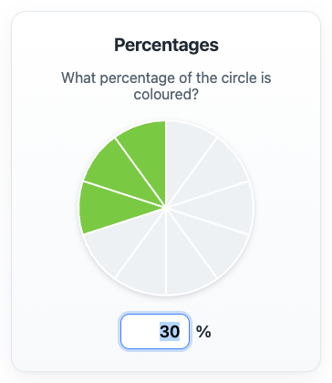
</p>

## tspci-color-proportions

PCI where the test-taker can color parts of a rectangle.

- Colours (a colour list), instruction, size and button text can be configured
- An eraser and a "start over" button
- Authoring mode: the item author draws the shape (a rectangle split by lines that snap to 1/4, 1/8 or 1/16) in the
  PCI itself, via "Configure…" in an authoring system that supports it (`getAuthoringInstance`, see tspci
  `docs/authoring-mode.md`). Without it, the PCI shows the shape it always had
- Uses tailwind for styling
- Item-author can provide the correct answer by answering the PCI (TAO, qti-construction)
- Scores automatically based on proportions: every colouring with the same proportions gives the same response

<p align="center">
  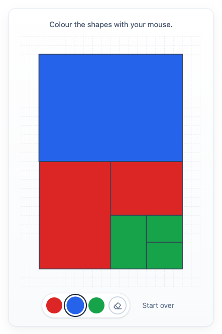
</p>

## tspci-3d-blocks

PCI where the test-taker builds with toy bricks on a baseplate.

- Grid size, brick size, the label at the front, the brick colours (multiple colours, or one) and the baseplate colour
  can be configured; an authoring system shows a dropdown and colour pickers for them
- Uses three.js (rounded bricks with studs, soft shadows, orbit controls), bundled in the PCI output file
- Item-author can provide the correct answer by building it (TAO, qti-construction)
- Scores automatically based on the front, side and top view: every build with the same views gives the same response

<p align="center">
  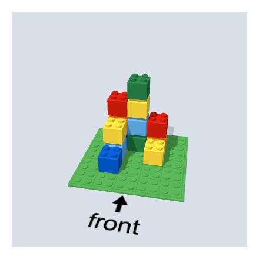
</p>

## tspci-equal-expressions

PCI for trial and improvement: at which number do two expressions give the same result? A picture stands for the
unknown number.

- The picture: an apple, a pear or an ice cream, or the author's own image, in two ways. An authoring system with a
  media bank puts an `` in the interaction markup (a markup slot in `authoring.json`, qti-construction shows a
  media picker for it); TAO and the others get "Upload own image…", the authoring mode, which shrinks the image and
  stores it in the item as a `data:` URL
- A table keeps every try with the results of both expressions; optionally a try with equal results is marked
- Buttons and messages in English or Dutch (`data-language`)
- A small expression parser instead of `eval`: `? × 12 + 3`, `:` and `÷`, brackets, powers
- A tool (`"scoring": ["none"]`): reports the numbers tried as an `ordered` `float` response; the answer goes in another
  interaction

<p align="center">
  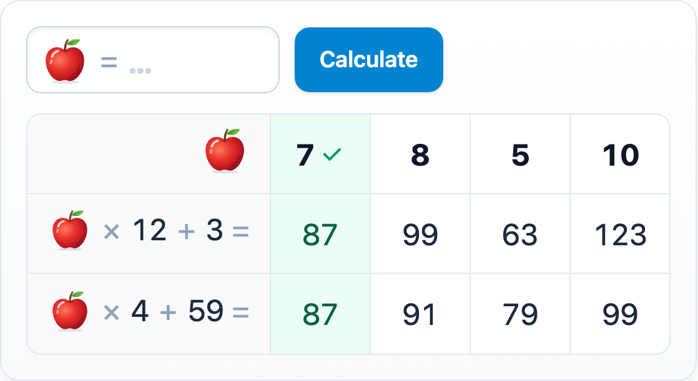
</p>

## tspci-table-graph

PCI in which the candidate adds numbers to a table and sees the results of two formulas in the table and in a graph,
to find where the formulas meet.

- The graph is plain SVG (no chart library): round ticks, colour-blind safe markers that also differ in shape, a guide
  line for the selected row
- Formulas, names, units, axes, start values and decimals can be configured; buttons and messages in English or Dutch
- A tool (`"scoring": ["none"]`): reports the numbers in the table as an `ordered` `float` response

<p align="center">
  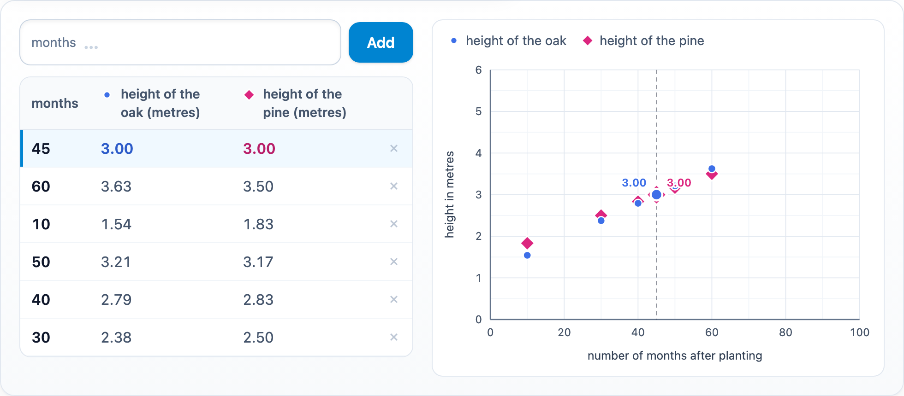
</p>

Both are improved versions of PCIs made for the Dutch national assessment of mathematics (Peiling rekenen-wiskunde
2022), where every step of the candidate is kept in the state's log.

## tspci-table-select

PCI in which the candidate selects a row or a cell of a table. Experimental (alpha), just for inspiration: see
[Alpha examples](#alpha-examples).

- Authoring mode: the item author builds the table in the PCI itself, via "Configure…": headers, cells, row headers,
  adding, removing and moving rows and columns, or pasting cells from a spreadsheet
- `data-selection-mode`: the candidate selects a row or a cell (row headers cannot be selected)
- Every choice is a radio button behind the row or cell: arrow keys, and a screen reader hears the headers
- Item-author can provide the correct answer by selecting it (TAO, qti-construction)
- Reports the id of the row (`r2`) or cell (`r2-c3`) as an `identifier`: editing the text of the table keeps the
  correct response

<p align="center">
  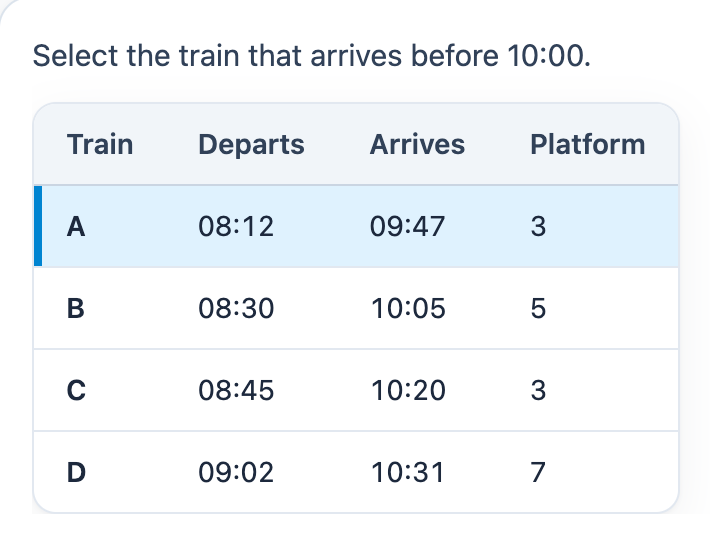
</p>

## tspci-spreadsheet

PCI with a small spreadsheet: the candidate puts the answer in a cell, or uses the sheet as a tool (`data-mode`).
Experimental (alpha), just for inspiration: see [Alpha examples](#alpha-examples).

- Cells, a formula bar, formulas with references, ranges, `$`, operators and 23 functions, Excel's errors; a small
  parser and evaluator instead of `eval`, with tests (`npm test`)
- Like Excel: type to replace, F2 to edit, a click inserts a cell's name in a formula, the fill handle and Ctrl+C/V move
  relative references along, undo and redo
- In Dutch (`data-language="nl"`): `1,5` and `=SOM(A1;B1)`; the response is the same in every language
- Authoring mode: the item author sets up the sheet in the PCI itself, via "Configure…": size, values and formulas,
  locked and bold cells, the answer cell, column widths
- Answer mode reports the value of the answer cell (`15.1`), so every way to get there gives the same response; tool
  mode reports the cells the candidate changed

<p align="center">
  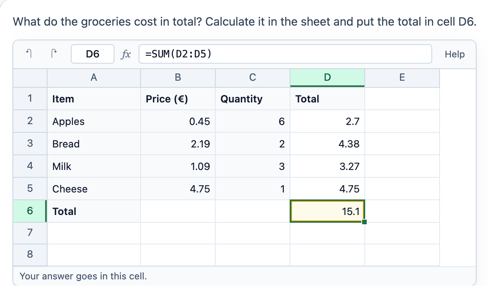
</p>

## Interactions from the Dutch vmbo exams

The six examples below take the idea of custom interactions in the Dutch digital vmbo exams of 2025, with their own
design, example content and scoring. Each one keeps its pure logic in an import-free file with node tests (`npm test`
in the folder), has stories in the shared Storybook, and supports several interactions of its type on one page.

> [!WARNING]
> **Experimental (beta).** These six are `1.0.0-beta.1`: they are offered as is, without any warranty, and have never
> been used in an assessment. Try them out with candidates and check their content and scoring before you use them in
> one.

## tspci-table-entry

PCI in which the candidate fills in the empty cells of a table ("fill in the table, then draw the graph").

- Authoring mode: the item author builds the table and marks every cell as given or as an input with its expected value
  and an optional margin; cells can be pasted from a spreadsheet
- Only numbers (decimal comma in Dutch), a maximum length and number of decimals, or free text
- Enter, Tab and the arrow keys move between the inputs
- Reports one normalized value per input (`1,50` is `1.5`): `match_correct`, or response processing for "1 point off per
  wrong value" (README); with `data-scoring="pci"` the PCI scores itself, with the margins

<p align="center">
  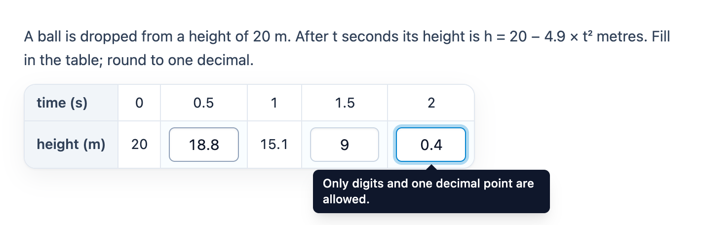
</p>

## tspci-force-vector

PCI in which the candidate draws a force arrow from point P on a picture, with a force scale (1 cm ≙ 10 N) and a ruler.

- Drag from P to draw, drag the head to change it; arrow keys turn and lengthen it; a live label in newton and cm
- The picture, scale, angle and length snapping, a grid, several arrows and a free start can be configured
- Authoring mode: the item author draws the correct arrow and sets the margins for start, direction and length; the
  picture shades what counts as correct
- Reports start, direction and length per arrow as `float`s; the authoring mode generates the response processing for
  "point and direction: 1 point, length: 1 point"

<p align="center">
  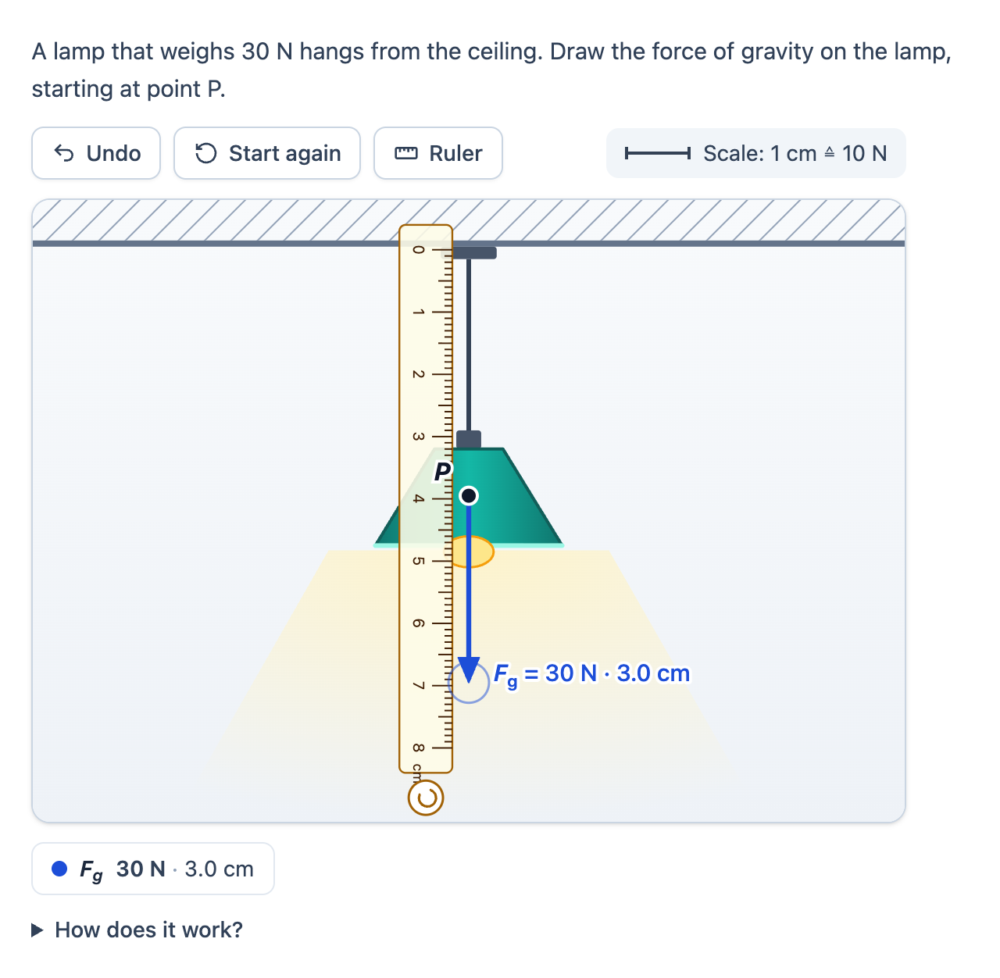
</p>

## tspci-circuit-builder

PCI in which the candidate completes a circuit diagram with symbols and wires on a grid.

- 24 circuit symbols in SVG; drag, click or keyboard to place, rotate, move and remove; open ends are marked
- Authoring mode: the board with locked parts, the palette (with counts), a solution and the checks
- The PCI scores itself with the author's checks: the right parts, a closed circuit, in series, parallel, the LED the
  right way round, the same circuit as the solution; each check is a rubric line with its points
- Reports a `record` with the score, a field per check, the circuit as a topology that does not depend on the layout,
  and the board for a rater

<p align="center">
  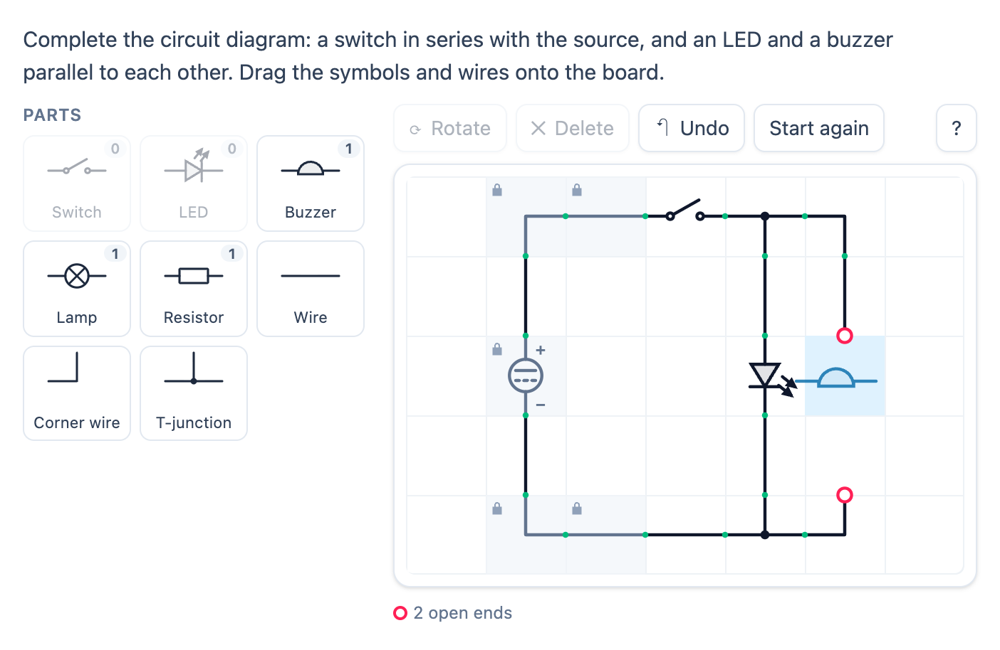
</p>

## tspci-oscilloscope

PCI with an oscilloscope screen: the candidate sets the frequency and amplitude of a signal next to a reference signal.

- Sine, square or triangle; grid, time base and volts per division; the values on the knobs can be hidden
- A running trace (off with reduced motion); the knobs are range inputs with − and + buttons
- Authoring mode: the reference, the start and the correct setting
- Reports frequency and amplitude as `float`s, for response processing like "three times the amplitude" or "a higher
  tone" (README)

<p align="center">
  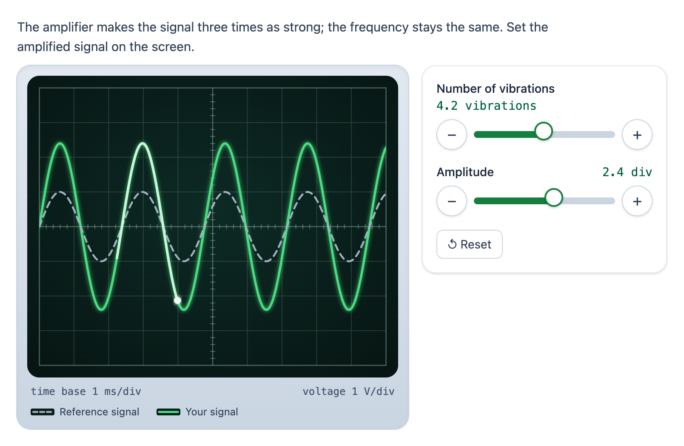
</p>

## tspci-sound-level

PCI with a sound simulation: the power of a source and the distance to a listener give the sound level in dB.

- A three.js scene with spreading waves, with a 2D fallback without WebGL; a meter and everyday sounds to compare
- Power choices or a slider, distance range and units, the source (speaker, walrus, whale, …) and the reference
  intensity can be configured
- A tool that reports what the candidate tried, or answer mode: the distance or power the candidate set as a `float`
  ("at what distance is it 70 dB?")

<p align="center">
  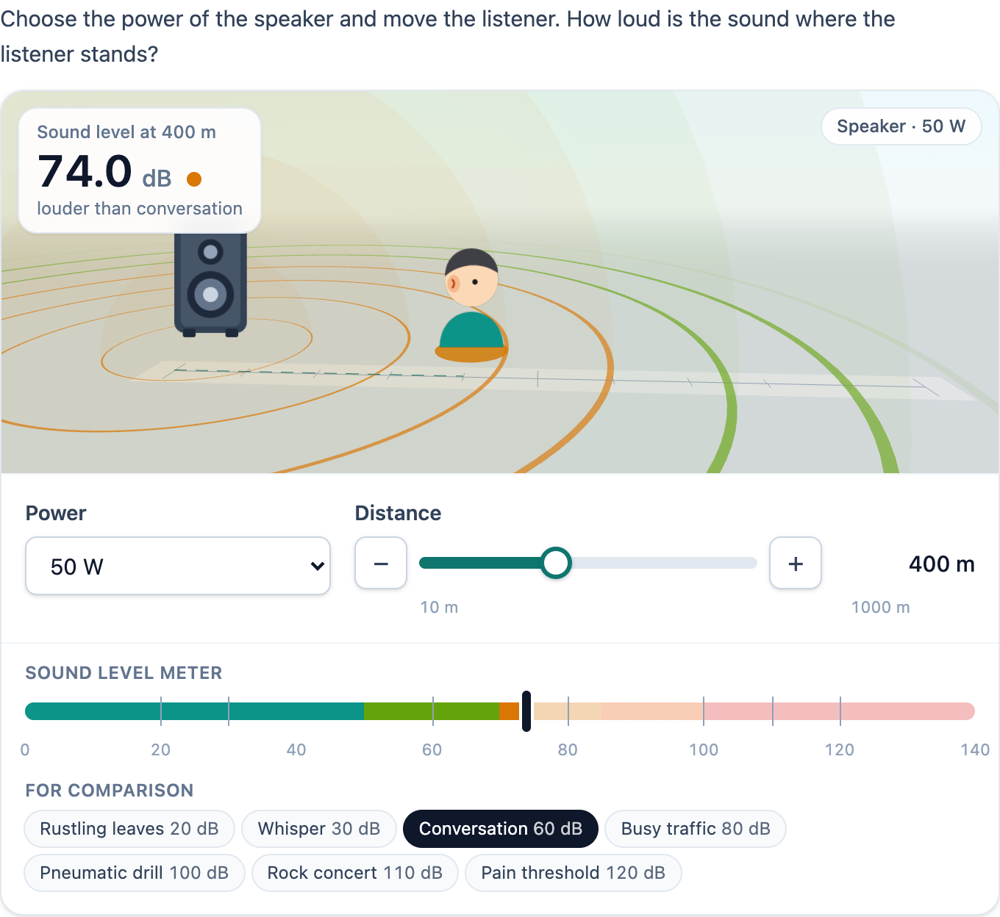
</p>

## tspci-data-chart

PCI with a bar, line or pie chart that shows its numbers on hover, focus or tap.

- Stacked, grouped or 100% bars, horizontal or vertical; hand-made SVG with colour-blind safe colours
- Authoring mode: the data in a table (pasted from a spreadsheet), the series colours, and the correct parts
- A tool that reports which parts the candidate looked at, or select mode: the candidate chooses one or more parts,
  scored with `match_correct`

<p align="center">
  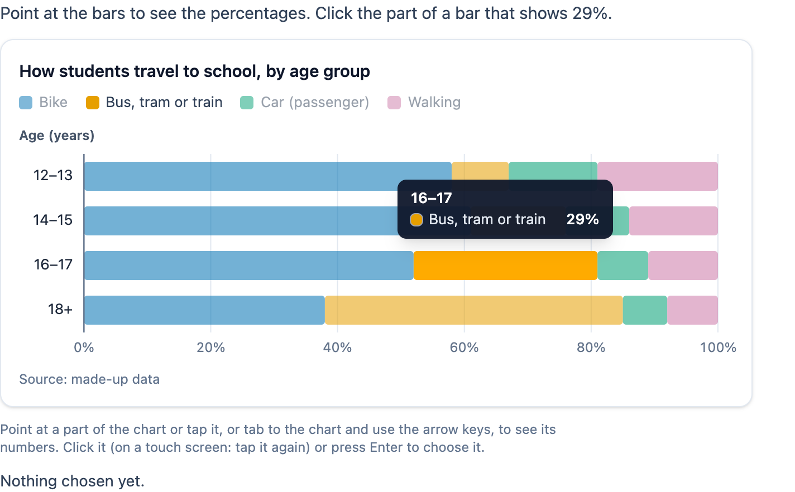
</p>

## Alpha examples

The 22 examples below are new ideas for assessment (`1.0.0-alpha.1`, like tspci-table-select and tspci-spreadsheet);
the six above, based on interactions in the Dutch exams, are `1.0.0-beta.1`.

> [!WARNING]
> **Experimental (alpha). Just for inspiration.** The alpha examples are a technical showcase, made by software
> developers without much knowledge of the subjects they could be used for. Their content, terms and scoring have not
> been checked by subject experts or assessment specialists, and they have never been used in an assessment. They are
> offered as is, without any warranty.

Like the six above, each one has its pure logic in an import-free file with node tests, stories
in the shared Storybook, English and Dutch, several interactions of its type on one page, and, where the author sets up
content or a correct answer, an authoring mode. The 3D ones use three.js 0.180 and work without WebGL through their
lists and 2D views.

### 3D

| example | what the candidate does | scoring |
| --- | --- | --- |
| [tspci-net-folding](./tspci-net-folding) | builds a net that folds into a cube or box, finds opposite or adjacent faces, completes a net, picks the nets that fold; the net folds in 3D | the right faces or nets; a net that closes |
| [tspci-cross-section](./tspci-cross-section) | cuts a cube, prism, pyramid, cylinder, cone or sphere with a plane and sees the section in its true shape | shape, side lengths and area within a margin |
| [tspci-measure-3d](./tspci-measure-3d) | measures lengths, angles and areas in a scene with a tape, a protractor and an area tool, exact or ruler-style | the answer within a margin, optionally the right measurement made |
| [tspci-light-shadow](./tspci-light-shadow) | moves lamps and an object in front of a screen; umbra and penumbra computed exactly, with a 2D view of the rays | shadow sizes or magnification within a margin |
| [tspci-molecule-builder](./tspci-molecule-builder) | builds a molecule from atoms and bonds, in 3D (VSEPR angles) or as a structural formula | the molecule (canonical SMILES), or checks such as formula, valence, isomer |
| [tspci-model-hotspot](./tspci-model-hotspot) | clicks or labels the parts of an eye, flower, plant cell, bicycle or a glTF model, with pull-apart and cut-open views | the parts, or label pairs (per pair with `map_response`) |
| [tspci-technical-drawing](./tspci-technical-drawing) | reads a workshop drawing of a 3D workpiece: fills in dimensions, completes a view, names a view, picks the workpiece | values, identifiers, or the drawn lines checked |
| [tspci-assembly](./tspci-assembly) | assembles or takes apart a cabinet, hub or plug in 3D, in an order the prerequisites allow | a valid order, the right first part, penalties for violations |
| [tspci-load-planner](./tspci-load-planner) | loads a van, container or pallet: stacking, this side up, fragile, weight, centre of gravity, unloading order | the author's checks |
| [tspci-contour-map](./tspci-contour-map) | reads a contour map with a linked 3D relief: draws a cross-section, finds the highest point, reads heights, draws a river | per task, within margins |
| [tspci-sun-earth](./tspci-sun-earth) | sets the date, time and place on a tilted Earth around the Sun and sees the sun's path in the sky | day, time or place within a margin |

### 2D

| example | what the candidate does | scoring |
| --- | --- | --- |
| [tspci-number-line](./tspci-number-line) | places points, marks an interval, draws jumps, or reads off values on a number line | values within a margin, the interval |
| [tspci-fraction-model](./tspci-fraction-model) | divides and shades bars, circles, grids and sets, or names the shaded fraction or percentage | the fraction in lowest terms (equivalent shadings count) |
| [tspci-chance-tools](./tspci-chance-tools) | runs dice, spinner, bag and coin experiments, designs a spinner or bag, fills in a probability tree | exact probabilities, decimals within a margin |
| [tspci-text-marker](./tspci-text-marker) | marks words and sentences in a source text with named categories | per target: overlap, all words or exact, with a tolerance |
| [tspci-form-fill](./tspci-form-fill) | fills in a paper or online form (a waybill, a bank transfer) from given information | per field: value, format (IBAN, postcode), relations such as totals |
| [tspci-message-writing](./tspci-message-writing) | writes an email, chat replies or a post in a realistic environment | a human rater, plus checks: recipient, subject, attachment, words, phrases |
| [tspci-week-planner](./tspci-week-planner) | plans tasks in an agenda of days, times and people, rooms or vehicles | rules: order, days, hours, breaks, overlaps, opening hours |
| [tspci-flowchart](./tspci-flowchart) | orders cards, completes or builds a flowchart with decisions | the graph, whatever the layout, or rules such as X before Y |
| [tspci-timeline](./tspci-timeline) | places events at a date, in a period (the Dutch tijdvakken) or in order | a margin in years, the period, ordered pairs |
| [tspci-measuring-instrument](./tspci-measuring-instrument) | reads off or sets a thermometer, measuring cylinder, meter, scale, ruler, caliper, clock, stopwatch or gauge | the value within a margin |
| [tspci-nutrition-label](./tspci-nutrition-label) | composes a meal from products with nutrition labels against the reference intakes, or chooses a product | min/max per nutrient, products, food groups |

## Ports of open-source PCIs

The examples below are ports of existing open-source PCIs to IMS PCI v1.0 with tspci, with a new, accessible UI. They
keep the response format of the original, so items and scoring made for the original stay meaningful. They are
derivative works, so **each one keeps the licence of its original** (GPL-2.0-only or GPL-3.0-only), not the MIT licence
of this repository: see the `LICENSE` file and the "Source and licence" section of the README in each folder.

| example | original | licence |
| --- | --- | --- |
| tspci-likert | [TAO likertScoreInteraction](https://github.com/oat-sa/extension-tao-itemqti-pci/tree/develop/views/js/pciCreator/ims/likertScoreInteraction) (Open Assessment Technologies) | GPL-2.0-only |
| tspci-math-entry | [TAO mathEntryInteraction](https://github.com/oat-sa/extension-tao-itemqti-pci/tree/develop/views/js/pciCreator/ims/mathEntryInteraction) (Open Assessment Technologies) | GPL-2.0-only |
| tspci-html-template | [html-template-interaction-pci](https://github.com/oatymart/html-template-interaction-pci) (Martin Nicholson, Open Assessment Technologies) | GPL-2.0-only |
| tspci-gantt-chart | [openPCI ganttchart](https://github.com/openPCI/openPCIs/tree/master/ganttchart) | GPL-3.0-only |
| tspci-svg-map | [openPCI svgmap](https://github.com/openPCI/openPCIs/tree/master/svgmap) | GPL-3.0-only |
| tspci-text-gap-match | [openPCI textgapmatch](https://github.com/openPCI/openPCIs/tree/master/textgapmatch) | GPL-3.0-only |
| tspci-multiple-match | [openPCI multiplematch](https://github.com/openPCI/openPCIs/tree/master/multiplematch) | GPL-3.0-only |
| tspci-q-sort | [openPCI wordrank](https://github.com/openPCI/openPCIs/tree/master/wordrank) | GPL-3.0-only |
| tspci-brainstorm | [openPCI brainstorm](https://github.com/openPCI/openPCIs/tree/master/brainstorm) | GPL-3.0-only |
| tspci-paint | [openPCI paint](https://github.com/openPCI/openPCIs/tree/master/paint) | GPL-3.0-only |
| tspci-voxelcraft | [openPCI voxelcraft](https://github.com/openPCI/openPCIs/tree/master/voxelcraft) | GPL-3.0-only |
| tspci-the-room | [openPCI theroom](https://github.com/openPCI/openPCIs/tree/master/theroom) | GPL-3.0-only |

The openPCI PCIs are by Elias J.T. Hansen, Anna Rusmann and Jeppe Bundsgaard (Aarhus University and Aalborg
University). Where an original ran author-written JavaScript to score (svgmap, voxelcraft, theroom), the port scores
with settings or declarative rules instead: no PCI here evaluates author code.

## tspci-likert

A Likert scale: 2 to 10 levels between two labels, optionally with thumb icons and the level numbers. A port of the
PCI that is used to certify IMS PCI support.
Port of [TAO likertScoreInteraction](https://github.com/oat-sa/extension-tao-itemqti-pci/tree/develop/views/js/pciCreator/ims/likertScoreInteraction), licensed **GPL-2.0-only** like the original ([LICENSE](./tspci-likert/LICENSE)).

- Real radio buttons: arrow keys, large touch targets, a screen reader hears "3 of 7" and the labels at the ends
- Reports the chosen level as a `single` `integer`; a state saved by the TAO original is restored too

<p align="center">
  
</p>

## tspci-math-entry

The candidate types a formula, or fills in the gaps of an expression, with a toolbar of the symbols the author enabled
and an on-screen keyboard. MathQuill is replaced by [MathLive](https://mathlive.io) (MIT).
Port of [TAO mathEntryInteraction](https://github.com/oat-sa/extension-tao-itemqti-pci/tree/develop/views/js/pciCreator/ims/mathEntryInteraction), licensed **GPL-2.0-only** like the original ([LICENSE](./tspci-math-entry/LICENSE)).

- Authoring mode: the item author writes the expression with gaps in a math editor
- Reports LaTeX, or the gaps as a JSON array, as a `string`; the MathLive fonts are inlined, so the bundle is about
  1.2 MB (500 KB gzipped)

<p align="center">
  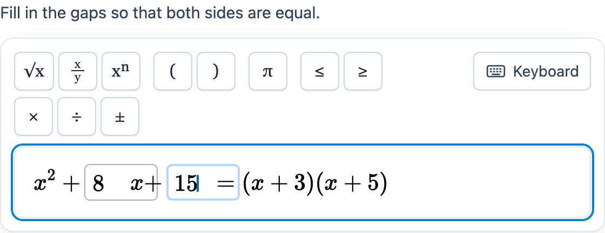
</p>

## tspci-html-template

An interaction made of the author's own HTML: every input, textarea or select with `data-response` and a `name` is part
of the response.
Port of [html-template-interaction-pci](https://github.com/oatymart/html-template-interaction-pci), licensed **GPL-2.0-only** (the original is MIT but its files carry a GPL-2.0 header, see its README) ([LICENSE](./tspci-html-template/LICENSE)).

- The HTML is sanitised (no scripts, event handlers or external loads); the inputs get an accessible look that the
  author's CSS can override
- Authoring mode: an HTML editor with a live preview, buttons to insert fields, and warnings
- Reports a `record` with one field per `name` (string, identifier or boolean)

<p align="center">
  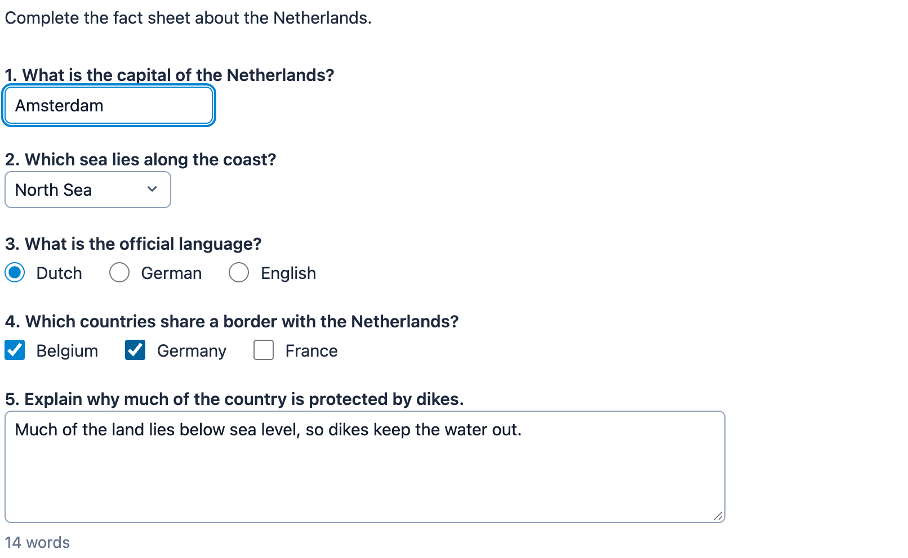
</p>

## tspci-gantt-chart

Plan tasks on a timeline: the candidate draws, moves and resizes bars in a Gantt chart, snapping to days, hours or
half hours, with weekends optionally blocked.
Port of [openPCI ganttchart](https://github.com/openPCI/openPCIs/tree/master/ganttchart), licensed **GPL-3.0-only** like the original ([LICENSE](./tspci-gantt-chart/LICENSE)).

- Pointer and keyboard (Shift+arrows resize, Alt+arrows move); a plain-text summary of the plan for screen readers
- Reports the original's response string; the same plan always gives the same string

<p align="center">
  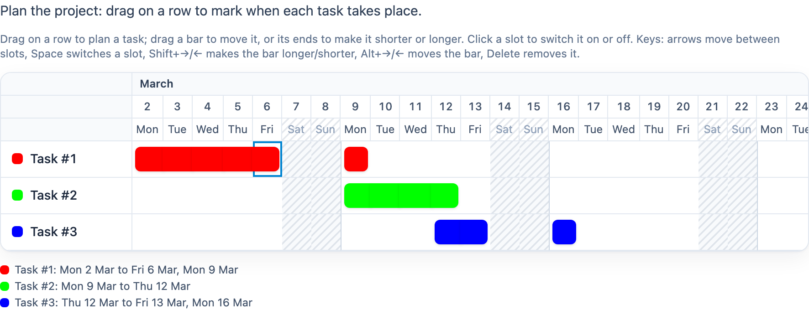
</p>

## tspci-svg-map

The candidate draws a route along the roads of an SVG map.
Port of [openPCI svgmap](https://github.com/openPCI/openPCIs/tree/master/svgmap), licensed **GPL-3.0-only** like the original ([LICENSE](./tspci-svg-map/LICENSE)).

- Click, tap or drag to draw, with a dashed preview, undo and start over; the arrow keys go from crossing to crossing
- Authoring mode: the item author uploads the map and clicks it to place the start and the points of interest
- Scoring settings instead of the original's JavaScript: points to pass, an end point, the shortest route
- Reports the original's JSON (`{"path": [...], "poi": [...], "score": ...}`) as a `string`

<p align="center">
  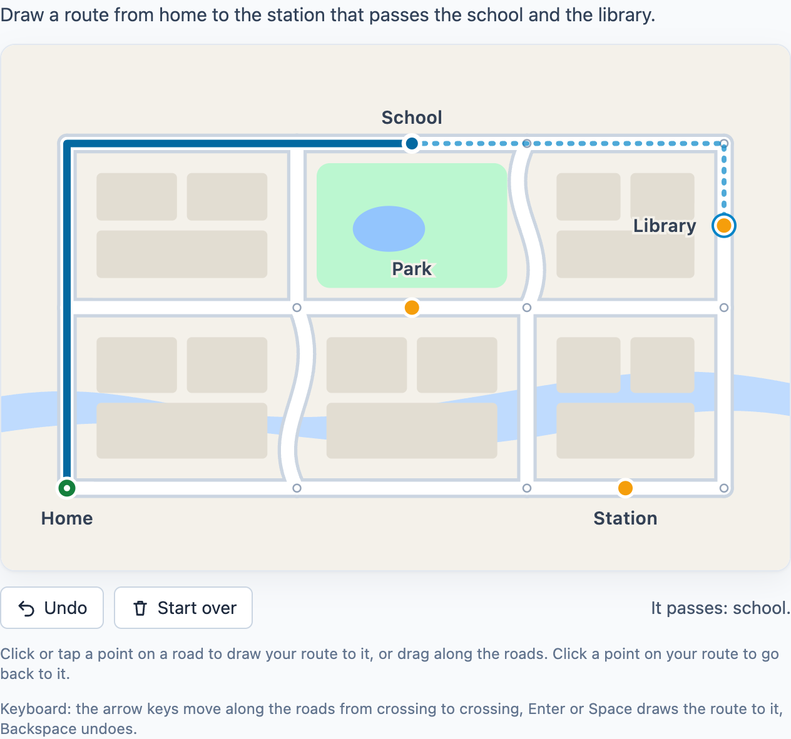
</p>

## tspci-text-gap-match

Drag text labels onto drop zones on an image ("label the parts of the plant").
Port of [openPCI textgapmatch](https://github.com/openPCI/openPCIs/tree/master/textgapmatch), licensed **GPL-3.0-only** like the original ([LICENSE](./tspci-text-gap-match/LICENSE)).

- Pointer and touch drag and drop, and a pick-then-place alternative for the keyboard
- Authoring mode: the item author uploads the image and draws the drop zones on it
- Reports the labels per drop zone as the original's JSON `string`

<p align="center">
  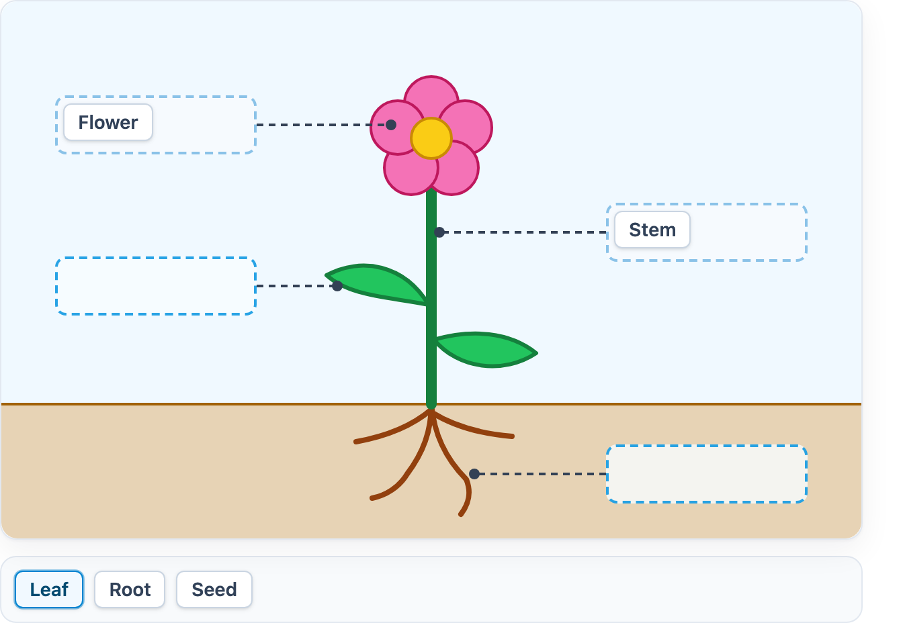
</p>

## tspci-multiple-match

A matrix of choices: items as rows, answered per topic on the same categories, for example a Likert scale for several
subjects at once.
Port of [openPCI multiplematch](https://github.com/openPCI/openPCIs/tree/master/multiplematch), licensed **GPL-3.0-only** like the original ([LICENSE](./tspci-multiple-match/LICENSE)).

- Radio buttons or checkboxes; a table on wide screens, cards on narrow ones
- Optional random order of topics, categories and items, and a subset of the topics
- Reports the original's JSON `string`, in the authored order, so `match_correct` works with random order too

<p align="center">
  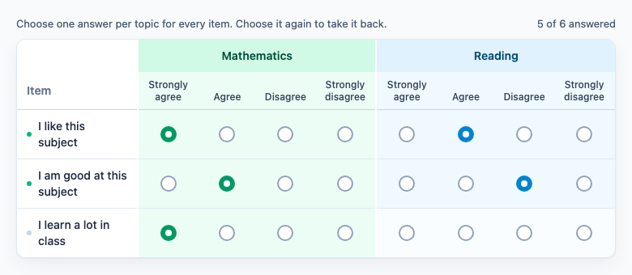
</p>

## tspci-q-sort

A Q-sort (Q methodology): place every statement in a forced, quasi-normal grid from "Most disagree" (−3) to "Most
agree" (+3), horizontal (left to right) or vertical (top to bottom), optionally after a pre-sort into three piles.
Based on [openPCI wordrank](https://github.com/openPCI/openPCIs/tree/master/wordrank), licensed **GPL-3.0-only** like the original ([LICENSE](./tspci-q-sort/LICENSE)).

- Drag and drop, click to move, and full keyboard use with screen reader announcements
- The cards are shuffled once per candidate; the order and the piles are kept in the state
- Reports the value of each statement, in the authored order, as a JSON `string`: a row of the Q-sort data matrix

<p align="center">
  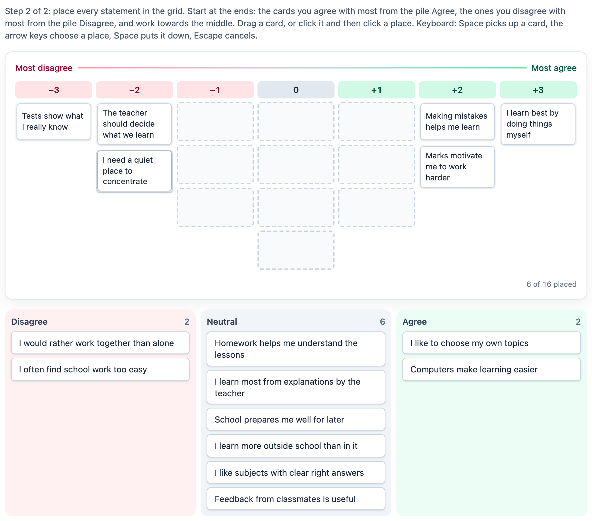
</p>

## tspci-brainstorm

A simulated brainstorm chat: scripted (not AI) participants post ideas at set times while the candidate joins in.
Port of [openPCI brainstorm](https://github.com/openPCI/openPCIs/tree/master/brainstorm), licensed **GPL-3.0-only** like the original ([LICENSE](./tspci-brainstorm/LICENSE)).

- The participants wait while the candidate types; message bubbles, a typing indicator, a time bar, a live region
- The script is a setting (`seconds;name;colour;message` per line)
- Reports the whole chat as the original's `string`, for a human rater

<p align="center">
  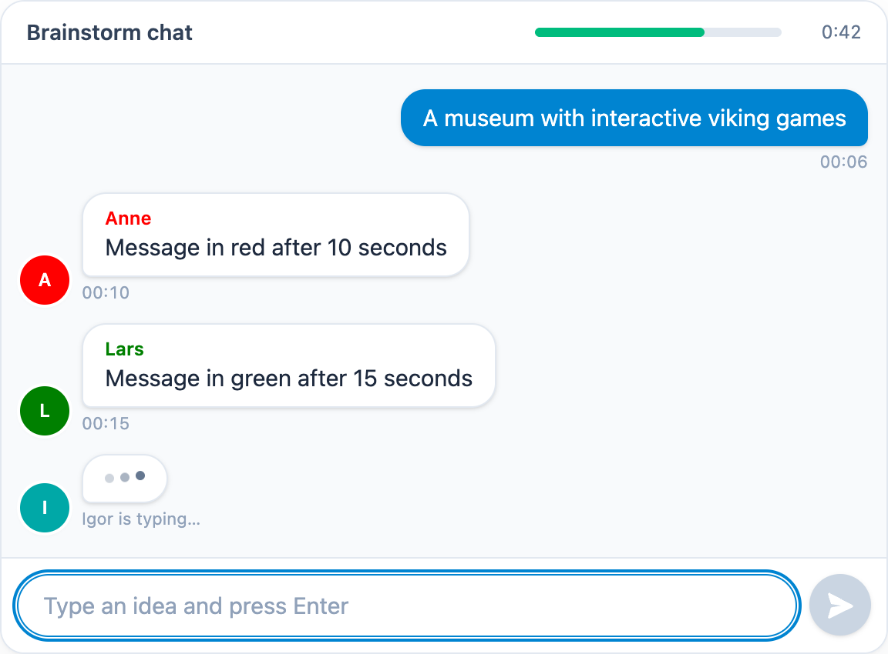
</p>

## tspci-paint

The candidate draws the answer on a canvas.
Port of [openPCI paint](https://github.com/openPCI/openPCIs/tree/master/paint), licensed **GPL-3.0-only** like the original ([LICENSE](./tspci-paint/LICENSE)).

- Colours, brush sizes, an eraser, undo, redo and clear; mouse, pen (with pressure), touch, and the keyboard
- Reports the drawing as a PNG data URL `string`, for a human rater; the strokes are kept in the state

<p align="center">
  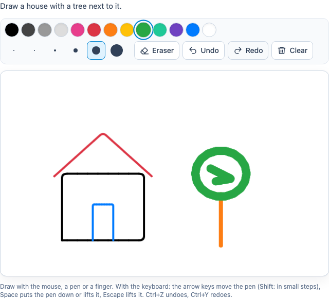
</p>

## tspci-voxelcraft

Build with cubes in 3D (three.js): place, remove and paint cubes, orbit, undo and start over, fully keyboard operable.
Port of [openPCI voxelcraft](https://github.com/openPCI/openPCIs/tree/master/voxelcraft), licensed **GPL-3.0-only** like the original ([LICENSE](./tspci-voxelcraft/LICENSE)).

- Authoring mode: the item author builds a starting figure and a target shape in 3D
- Reports the building as the original's JSON `string`, with a score of 1 when the target shape is in it

<p align="center">
  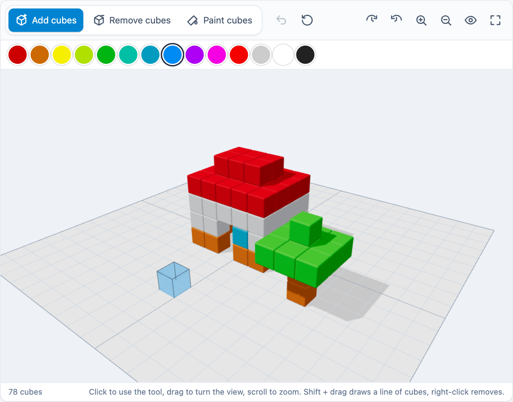
</p>

## tspci-the-room

Furnish a room in 3D (three.js): place, move and turn furniture, with snapping to walls, other furniture and a grid.
Port of [openPCI theroom](https://github.com/openPCI/openPCIs/tree/master/theroom), licensed **GPL-3.0-only** like the original ([LICENSE](./tspci-the-room/LICENSE)).

- A built-in restaurant exercise; the original's glTF exercises still load from a game URL
- Declarative scoring rules (counts, zones, against a wall, no overlap) instead of the original's JavaScript
- Reports the objects and the scores per rule as the original's JSON `string`, for `custom` scoring

<p align="center">
  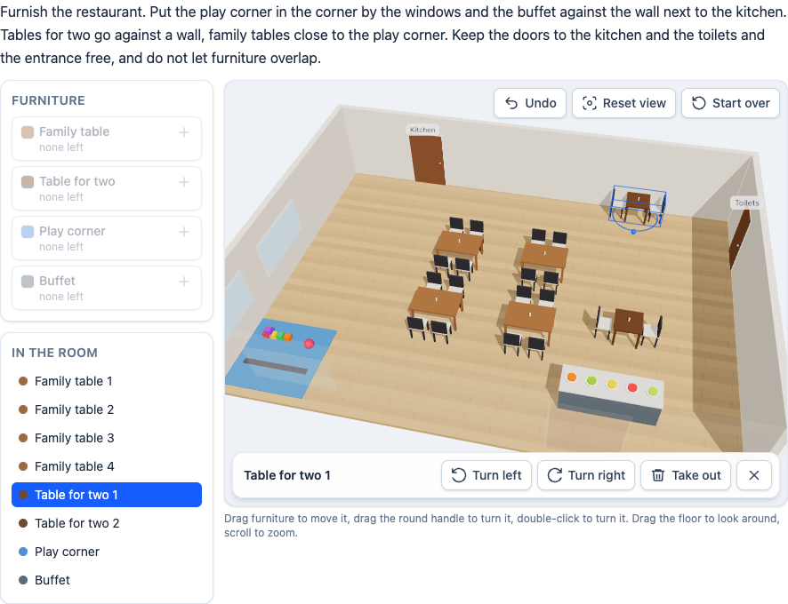
</p>

## tspci-geogebra-applet

PCI with a [GeoGebra](https://www.geogebra.org) applet in it: the candidate constructs, graphs or calculates, and the
applet can score the work itself. Not a port: written from scratch from GeoGebra's public
[Apps API](https://geogebra.github.io/docs/reference/en/GeoGebra_Apps_API/), licensed MIT.

- **Needs an internet connection**: the GeoGebra app is not in the package but loaded from geogebra.org when the item
  opens; offline or where geogebra.org is blocked, the candidate sees an error instead of the applet
- **GeoGebra has its own [licence](https://www.geogebra.org/license)**: free for non-commercial use, commercial use
  requires a licence from GeoGebra. GeoGebra is a trademark of GeoGebra GmbH; this PCI is not made or endorsed by
  GeoGebra
- Starts from the candidate's state, the author's applet, a geogebra.org material or an empty app (classic, graphing,
  geometry, 3d, …); authoring mode: the item author builds the applet in the PCI itself
- Objects named `correct`, `answer`, `score` and `maxscore` in the applet are reported as a `record`; the item's
  response processing copies them (`custom`)

<p align="center">
  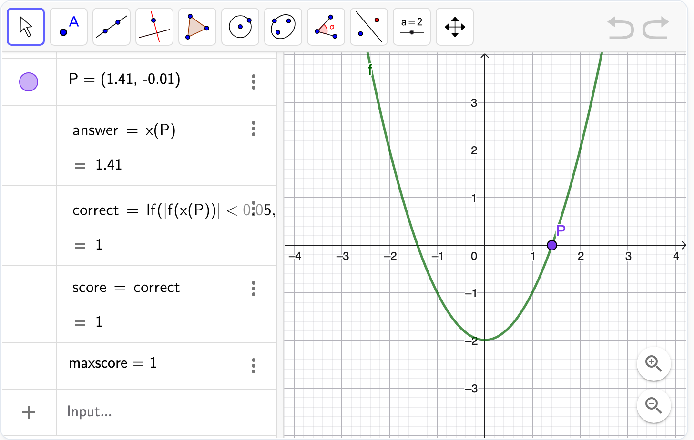
</p>
