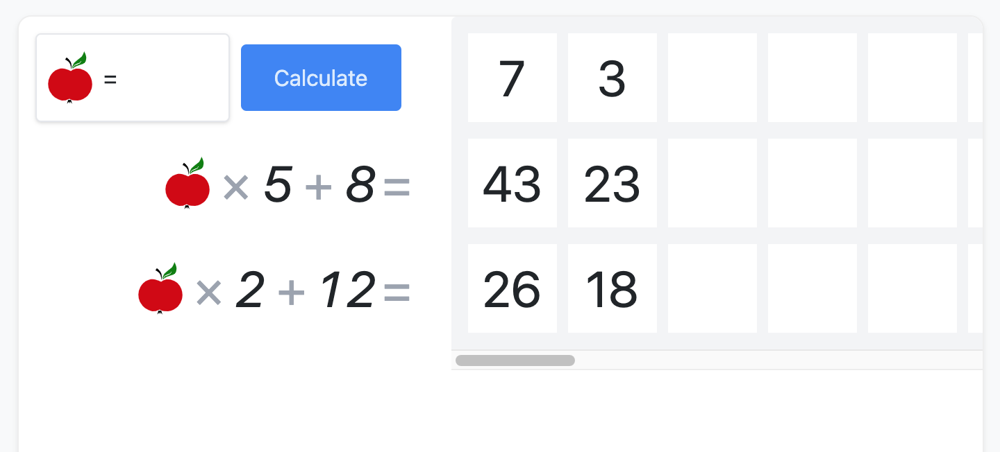

# @citolab tspci-examples

Example PCI's created with @citolab/tspci

[github](https://github.com/Citolab/tspci/lib/tspci) | 
[npm](https://www.npmjs.com/package/@citolab/tspci)

There are 4 examples in this repository that can give a head start while creating new Portable Custom Interactions.
To run these examples go the to folder of the specific example and run:

``` sh
npm i
npm run dev
```

## Testing PCIs

These PCIs can be tested in [qti.citolab.nl](https://qti.citolab.nl).

### Using QTI3 export (direct import)

The `package-qti3` script creates a zip file that can be directly imported into [qti.citolab.nl](https://qti.citolab.nl).

``` sh
npm run package-qti3
```

### Using TAO export

You can also import PCIs into TAO first:

1. Use the TAO export to import the PCI
2. In TAO, go to **Settings → Portable Custom Interactions → Add** to register the PCI
3. Create an item using the PCI
4. Export the item as QTI 2.2

When you import the QTI 2.2 package into [qti.citolab.nl](https://qti.citolab.nl), it will automatically upgrade the package and ensure the PCI works.

## Authoring systems

Every example describes its settings and its response for authoring systems. The settings in `src/config.json` carry
an editor and a label next to their default:

```json
"brickColorMode": {
  "default": "mixed",
  "editor": "enum",
  "options": [
    { "value": "mixed", "label": { "en": "Multiple colours", "nl": "Meerdere kleuren" } },
    { "value": "single", "label": { "en": "One colour", "nl": "Eén kleur" } }
  ]
}
```

and `package.json` `config.tspci.response` declares what `getResponse()` returns. The build writes `dist/authoring.json`
from both, and the qti3 package ships it next to the bundle; an authoring system such as qti-construction then shows
the author a dropdown, colour pickers and number fields instead of plain text. The dev page (`npm run dev`) shows the
same form. See [Authoring systems](https://github.com/Citolab/tspci/tree/main/lib/tspci#authoring-systems) in the
tspci readme; every project made with `tspci init` explains it in `AUTHORING.md`.

These examples need tspci 2.13.0 or later (the authoring descriptor): older versions pass the editor hints to the PCI
instead of the defaults.

## SBOM

Every production build writes a [CycloneDX](https://cyclonedx.org/) SBOM of the bundle to
`dist/sbom.cdx.json`. An export puts it in the package as well, next to the bundle it describes: for
`npm run package-qti3` that is `resources/pci/sbom.cdx.json`, listed as a file of the PCI resource in the
manifest. That way it survives the import into an authoring system, which is exactly the party that
needs it. A copy is also written next to the zip as `qti3-dist/qti3-pci-blocks_1.0.0.sbom.cdx.json`, for
your own technical documentation.

No flag is needed for any of this. Use `--no-include-sbom` to keep it out of the package, or `--no-sbom`
to skip generating one.

The SBOM is built from the bundler module graph, so it lists the packages whose code is actually in the
delivered file. For `tspci-3d-blocks` that is three components:

``` json
"components": [
  { "purl": "pkg:npm/%40citolab/preact-store@2.9.12", "licenses": [{ "license": { "id": "MIT" } }] },
  { "purl": "pkg:npm/preact@10.28.2",                 "licenses": [{ "license": { "id": "MIT" } }] },
  { "purl": "pkg:npm/three@0.136.0",                  "licenses": [{ "license": { "id": "MIT" } }] }
]
```

Two things this example shows nicely. The build time dependencies (`@types/three`, `archiver`,
`autoprefixer`, `tailwindcss`) are not in the SBOM, because they are not delivered. And
`three-orbitcontrols` is not in it either: `interaction.tsx` imports `OrbitControls` from
`three/examples/jsm/controls/OrbitControls`, so that code belongs to `three` itself and the separate
`three-orbitcontrols` dependency is never bundled. A dependency tree based SBOM would list both as
shipped components.

Transitive dependencies are included when their code is bundled. `tspci-color-proportions` lists six
components: next to `preact` and `preact-store` also `@react-hook/mouse-position` and the three
`@react-hook` packages it pulls in. The PCI itself is the top level entry of the `dependencies` graph in
the document, so a consumer can also read just the direct dependencies from it.

The SBOM also records a SHA-512 hash of the built bundle, so whoever integrates the PCI can verify that
the SBOM belongs to the file they received.

`tspci-3d-blocks` shows the optional `config.tspci.sbom` settings in its `package.json`, in this case a
supplier and an external reference. A real product would point those references at its vulnerability
disclosure policy and security contact. The other examples use the defaults, which need no
configuration at all. See the
[@citolab/tspci readme](https://github.com/Citolab/tspci/tree/main/lib/tspci#sbom) for all options.

## tspci-hello-world

There should alwas be a 'hello world' example. So here it is: the most basic example of an PCI.

- Displaying 'Hello world'

## tspci-vanilla-js

A PCI without a framework: what percentage of the circle is coloured?

- The pie is drawn from its settings (number of slices, coloured slices, colour, size), so one PCI makes many items;
  the correct answer follows from them (3 of 10 → 30)
- Reports the answer as a number (`{ base: { integer: 30 } }`), so an item scores it with `match_correct`
- Plain CSS in the shadow root, no Tailwind

<p align="center">
  
</p>

## tspci-color-proportions

PCI where the test-taker can color parts of a rectangle.

- Colours (a colour list), instruction, size and button text can be configured
- An eraser and a "start over" button
- Authoring mode: the item author draws the shape (a rectangle split by lines that snap to 1/4, 1/8 or 1/16) in the
  PCI itself, via "Configure…" in an authoring system that supports it (`getAuthoringInstance`, see tspci
  `docs/authoring-mode.md`). Without it, the PCI shows the shape it always had
- Uses tailwind for styling
- Item-author can provide the correct answer by answering the PCI (TAO, qti-construction)
- Scores automatically based on proportions: every colouring with the same proportions gives the same response

<p align="center">
  
</p>

## tspci-hauntedjs

Example PCI using [haunted](https://github.com/matthewp/haunted) instead of preact.

Simple PCI for finding the correct variable

<p align="center">
  
</p>

## tspci-3d-blocks

PCI where the test-taker builds with toy bricks on a baseplate.

- Grid size, brick size, the label at the front, the brick colours (multiple colours, or one) and the baseplate colour
  can be configured; an authoring system shows a dropdown and colour pickers for them
- Uses three.js (rounded bricks with studs, soft shadows, orbit controls), bundled in the PCI output file
- Item-author can provide the correct answer by building it (TAO, qti-construction)
- Scores automatically based on the front, side and top view: every build with the same views gives the same response

<p align="center">
  
</p>