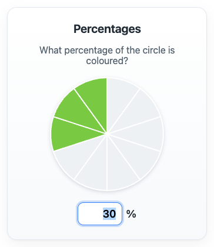
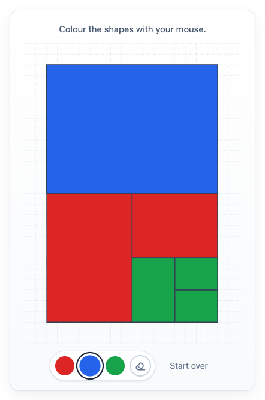
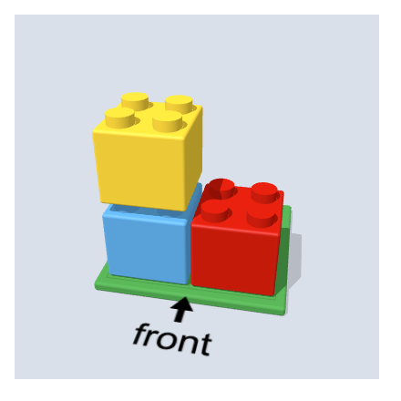

# @citolab tspci-examples

Example PCI's created with @citolab/tspci

[github](https://github.com/Citolab/tspci/lib/tspci) | 
[npm](https://www.npmjs.com/package/@citolab/tspci)

There are 3 examples in this repository that can give a head start while creating new Portable Custom Interactions.
To run these examples go the to folder of the specific example and run:

``` sh
npm i
npm run dev
```

## Testing PCIs

These PCIs can be tested in [qti.citolab.nl](https://qti.citolab.nl).

### Using QTI3 export (direct import)

The `package-qti3` script creates a zip file that can be directly imported into [qti.citolab.nl](https://qti.citolab.nl).

``` sh
npm run package-qti3
```

### Using TAO export

You can also import PCIs into TAO first:

1. Run `npm run package-tao`, which writes `dist/tao-pci-<typeIdentifier>_<version>.zip`
2. In TAO, go to **Settings → Portable Custom Interactions → Add Interaction** and upload the zip
3. Create an item using the PCI
4. Export the item as QTI 2.2

When you import the QTI 2.2 package into [qti.citolab.nl](https://qti.citolab.nl), it will automatically upgrade the package and ensure the PCI works.

## Authoring systems

An item author places a PCI in an item, sets it up (the settings) and decides what counts as a correct answer (the
scoring). Every example describes both in two files it already has:

- **`src/config.json`, the settings.** A value is a plain default, or an object with a `default` and hints for the
  author's form: an `editor`, a `label` (one string or one per language), `options`, `min`/`max`:

  ```json
  "brickColorMode": {
    "default": "mixed",
    "editor": "enum",
    "label": { "en": "Brick colours", "nl": "Kleuren van de blokken" },
    "options": [
      { "value": "mixed", "label": { "en": "Multiple colours", "nl": "Meerdere kleuren" } },
      { "value": "single", "label": { "en": "One colour", "nl": "Eén kleur" } }
    ]
  }
  ```

  The editors are `text`, `textarea`, `integer`, `number`, `boolean`, `enum`, `color`, `colorList`, `hidden` and
  `pci` (the PCI edits the setting itself, see below). The bundle only gets the defaults.
- **`package.json` `config.tspci`, the response and the scoring.** `response` declares what `getResponse()` returns
  (`{ "cardinality": "single", "baseType": "integer" }`), `score` the scoring the PCI is made for (`MATCH_CORRECT`,
  `CUSTOM`, `NONE`; the first is the default).

| example | settings (editors) | response | scoring |
| --- | --- | --- | --- |
| tspci-vanilla-js | `text`, `textarea`, `integer`, `color` | `single` `integer` | `MATCH_CORRECT`, `NONE` |
| tspci-color-proportions | `textarea`, `colorList`, `text`, `integer`, `pci` | `single` `string` | `MATCH_CORRECT`, `NONE` |
| tspci-3d-blocks | `integer`, `text`, `enum`, `colorList`, `color` | `single` `string` | `MATCH_CORRECT`, `NONE` |

How an authoring system uses this depends on the system.

### TAO: what TAO supports

TAO has no standard way for a PCI to describe its settings, so `npm run package-tao` builds the creator part of the
TAO package (`imsPciCreator`) from the two files. This is what an author gets in TAO:

- **A properties form per setting.** The label, the hint as a tooltip, and a control for the editor: a number field
  with `min`/`max`, a checkbox, a dropdown for an `enum`, a colour picker for a `color`, a list of colour pickers for a
  `colorList`. Every change goes to the PCI's `trigger`, so the interaction redraws straight away.

  <p align="center">
    
  </p>

- **A "Configure…" button for `pci` settings.** tspci-color-proportions lets the author draw the shape to colour in
  the PCI itself (`getAuthoringInstance`). TAO opens it in its own modal; **Done** writes the setting back.

  <p align="center">
    
  </p>

- **Scoring by answering the PCI.** With `MATCH_CORRECT` the author switches the interaction to **Response** and
  answers it: what `getResponse()` reports becomes the correct response, and TAO scores with a string comparison.
  `CUSTOM` leaves the response processing to the author, and `NONE` is for a PCI that is not scored (a tool). This
  is why every example reports the meaning of an answer and not the route to it: two builds with the same views give
  the same response.

  <p align="center">
    
  </p>

- **An icon** in the list of custom interactions, from `<typeIdentifier>.svg` next to `package.json`
  (`blocks.svg`, `colorProportions.svg`).

TAO's limits apply. The settings arrive in the PCI as text (`"200"`, `"true"`, `"#c91a09, #0055bf"`), and
`MATCH_CORRECT` can only compare one value: no margins, no partial scores. See
[@citolab/tspci-tao](https://github.com/Citolab/tspci/tree/main/lib/tspci-tao) for the details.

### Other authoring systems: a proposal for sharing settings and scoring

Other authoring systems have no PCI-specific package to read, so we propose a small descriptor that travels with the
PCI. Every build writes `dist/authoring.json` from the same two files, and `npm run package-qti3` adds it to the
package as `resources/pci/authoring.json`, listed in the manifest as a file of the PCI resource (like the SBOM). An
authoring system that knows the file can build a typed form; one that does not just ignores it. This is a proposal
(`"descriptorVersion": "0"`): qti-construction and the dev page (`npm run dev`) use it, and we'd like to hear from
other authoring systems.

```jsonc
// tspci-3d-blocks/dist/authoring.json (generated, shortened)
{
  "descriptorVersion": "0",
  "typeIdentifier": "blocks",
  "version": "1.1.0",
  "label": "3d blocks",
  "properties": {
    "brickColorMode": { "editor": "enum", "default": "mixed", "options": [{ "value": "mixed" }, { "value": "single" }] },
    "baseplateColor": { "editor": "color", "default": "#4b9f4a" }
  },
  "response": { "cardinality": "single", "baseType": "string" },
  "score": ["MATCH_CORRECT", "NONE"]
}
```

What we suggest an authoring system does with it:

- **Settings.** Show a control per `editor` with its `label` in the author's language, and write the values as
  `data-` attributes of the interaction, as text, just like TAO. A setting with `"editor": "pci"` gets a "Configure…"
  button that runs the PCI's `getAuthoringInstance` in a sandboxed iframe (tspci `docs/authoring-mode.md`). Delivery
  never calls it, so a PCI with an authoring mode still works everywhere.
- **Response.** Declare the item's response variable from `response`, so a PCI that reports a number is scored as a
  number (tspci-vanilla-js reports `{ "base": { "integer": 30 } }`). A PCI that reports several values uses
  `"cardinality": "record"` with typed `fields`.
- **Scoring.** Let the author answer the PCI in a preview: the reported response becomes the correct response, or one
  of several accepted answers. Margins, such as a time window or an area, belong in the item's response processing,
  which the authoring system writes, not in the PCI.

See [Authoring systems](https://github.com/Citolab/tspci/tree/main/lib/tspci#authoring-systems) in the tspci readme;
every project made with `tspci init` explains it in `AUTHORING.md`.

These examples need tspci 2.13.0 or later (the authoring descriptor): older versions pass the editor hints to the PCI
instead of the defaults.

## SBOM

Every production build writes a [CycloneDX](https://cyclonedx.org/) SBOM of the bundle to
`dist/sbom.cdx.json`. An export puts it in the package as well, next to the bundle it describes: for
`npm run package-qti3` that is `resources/pci/sbom.cdx.json`, listed as a file of the PCI resource in the
manifest. That way it survives the import into an authoring system, which is exactly the party that
needs it. A copy is also written next to the zip as `qti3-dist/qti3-pci-blocks_1.0.0.sbom.cdx.json`, for
your own technical documentation.

No flag is needed for any of this. Use `--no-include-sbom` to keep it out of the package, or `--no-sbom`
to skip generating one.

The SBOM is built from the bundler module graph, so it lists the packages whose code is actually in the
delivered file. For `tspci-3d-blocks` that is three components:

``` json
"components": [
  { "purl": "pkg:npm/%40citolab/preact-store@2.9.12", "licenses": [{ "license": { "id": "MIT" } }] },
  { "purl": "pkg:npm/preact@10.28.2",                 "licenses": [{ "license": { "id": "MIT" } }] },
  { "purl": "pkg:npm/three@0.136.0",                  "licenses": [{ "license": { "id": "MIT" } }] }
]
```

Two things this example shows nicely. The build time dependencies (`@types/three`, `archiver`,
`autoprefixer`, `tailwindcss`) are not in the SBOM, because they are not delivered. And
`three-orbitcontrols` is not in it either: `interaction.tsx` imports `OrbitControls` from
`three/examples/jsm/controls/OrbitControls`, so that code belongs to `three` itself and the separate
`three-orbitcontrols` dependency is never bundled. A dependency tree based SBOM would list both as
shipped components.

Transitive dependencies are included when their code is bundled. `tspci-color-proportions` lists six
components: next to `preact` and `preact-store` also `@react-hook/mouse-position` and the three
`@react-hook` packages it pulls in. The PCI itself is the top level entry of the `dependencies` graph in
the document, so a consumer can also read just the direct dependencies from it.

The SBOM also records a SHA-512 hash of the built bundle, so whoever integrates the PCI can verify that
the SBOM belongs to the file they received.

`tspci-3d-blocks` shows the optional `config.tspci.sbom` settings in its `package.json`, in this case a
supplier and an external reference. A real product would point those references at its vulnerability
disclosure policy and security contact. The other examples use the defaults, which need no
configuration at all. See the
[@citolab/tspci readme](https://github.com/Citolab/tspci/tree/main/lib/tspci#sbom) for all options.

## tspci-vanilla-js

A PCI without a framework: what percentage of the circle is coloured?

- The pie is drawn from its settings (number of slices, coloured slices, colour, size), so one PCI makes many items;
  the correct answer follows from them (3 of 10 → 30)
- Reports the answer as a number (`{ base: { integer: 30 } }`), so an item scores it with `match_correct`
- Plain CSS in the shadow root, no Tailwind

<p align="center">
  
</p>

## tspci-color-proportions

PCI where the test-taker can color parts of a rectangle.

- Colours (a colour list), instruction, size and button text can be configured
- An eraser and a "start over" button
- Authoring mode: the item author draws the shape (a rectangle split by lines that snap to 1/4, 1/8 or 1/16) in the
  PCI itself, via "Configure…" in an authoring system that supports it (`getAuthoringInstance`, see tspci
  `docs/authoring-mode.md`). Without it, the PCI shows the shape it always had
- Uses tailwind for styling
- Item-author can provide the correct answer by answering the PCI (TAO, qti-construction)
- Scores automatically based on proportions: every colouring with the same proportions gives the same response

<p align="center">
  
</p>

## tspci-3d-blocks

PCI where the test-taker builds with toy bricks on a baseplate.

- Grid size, brick size, the label at the front, the brick colours (multiple colours, or one) and the baseplate colour
  can be configured; an authoring system shows a dropdown and colour pickers for them
- Uses three.js (rounded bricks with studs, soft shadows, orbit controls), bundled in the PCI output file
- Item-author can provide the correct answer by building it (TAO, qti-construction)
- Scores automatically based on the front, side and top view: every build with the same views gives the same response

<p align="center">
  
</p>