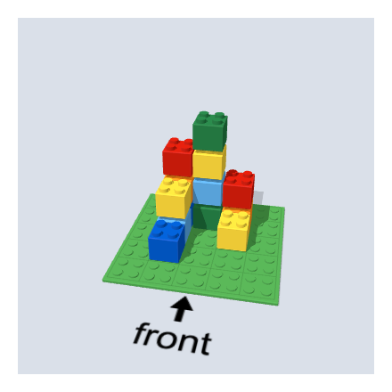

# @citolab/pci-3d-blocks

A QTI 3 Portable Custom Interaction (PCI) in which the candidate builds with toy bricks on a baseplate, for example to
recreate a building shown in the item from its front, side and top view. Made with
[tspci](https://github.com/Citolab/tspci).

<p align="center">
  
</p>

## What it does

- **Build**: click a cell of the baseplate to place a brick, click the top of a brick to stack one on it. A brick
  shows where it will land before you click.
- **Remove**: click the side of a brick to take it away (a brick in the top layer goes with any click); the brick that
  would go is shown in see-through red first.
- **Look around**: drag to turn the baseplate. The arrow and its label mark the front, so the candidate can tell
  front, side and top apart.
- **Limits**: bricks stay on the plate, and a stack is at most as high as the grid is wide (5 × 5 × 5 by default).
- **Colours**: a brick's colour follows from where it stands, so a build looks the same when the candidate comes back
  to it. Colours do not count for the answer.
- **Delivery**: the build is saved as the item's state and restored. In review (`status: "solution"`) the PCI shows the
  correct response when the delivery system passes it.

## What can be configured

Every setting is a `data-` attribute of the interaction, as text. `dist/authoring.json` describes them for authoring
systems; TAO shows them as a form, with a dropdown for the colour mode and colour pickers.

| setting              | attribute               | default                                                | what                                                      |
| -------------------- | ----------------------- | ------------------------------------------------------ | --------------------------------------------------------- |
| Grid size            | `data-grid-divisions`   | `5`                                                    | cells per side of the baseplate (1 to 6); also the maximum height |
| Brick size           | `data-cube-pixel-size`  | `60`                                                   | size of a brick (at least 10)                             |
| Label at the front   | `data-front-label`      | `front`                                                | the text under the arrow, for the item's language         |
| Brick colours        | `data-brick-color-mode` | `mixed`                                                | `mixed`: the bricks get the colours of the list; `single`: all bricks get the first colour |
| Colours              | `data-brick-colors`     | `#c91a09, #f2cd37, #0055bf, #237841, #fe8a18, #5aa5dc` | a list of CSS colours                                     |
| Baseplate colour     | `data-baseplate-color`  | `#4b9f4a`                                              | a CSS colour                                              |
| Width, height        | `data-width`, `data-height` | `400`, `400`                                       | size of the interaction in pixels (at least 200)          |

## Scoring

The PCI is made for `match_correct` (`authoring.json`: `"scoring": ["match_correct", "human"]`).

**The response** is a string (`cardinality="single" base-type="string"`): the three views of the build, as JSON. Per
view, every cell of the grid is `found: true` when a brick is seen there.

```json
{ "xPlane": [{ "y": 0, "z": 0, "found": true }, …], "yPlane": [{ "x": 0, "z": 0, "found": false }, …], "zPlane": [{ "x": 0, "y": 0, "found": true }, …] }
```

- **What counts**: only the views. Two builds that look the same from the front, the side and the top give the same
  response, even when bricks inside differ, so there is one correct response for all of them.
- **What does not count**: colours, the order of building, and how the candidate turned the plate.
- **Setting the correct response**: answer the PCI. In TAO switch the interaction to *Response* and build the answer;
  in qti-construction or the PCI showcase, build it and take it as the correct response. A string comparison then
  scores it: 1 when the views match, otherwise 0.
- The views depend on the grid size: change the grid size and set the correct response again.
- **No response**: until the candidate places a brick, `getResponse()` reports nothing.
- `human`: use the PCI without automatic scoring, for instance as a tool or for a human rater.

## Using it

```sh
npm install @citolab/pci-3d-blocks
```

| file                                 | what                                                                      |
| ------------------------------------ | ------------------------------------------------------------------------- |
| `dist/index.js`                      | the PCI (AMD module, everything bundled: the package has no dependencies) |
| `dist/authoring.json`                | settings, response and scoring, for authoring systems                     |
| `dist/sbom.cdx.json`                 | CycloneDX SBOM of the bundle                                              |
| `dist/tao-pci-blocks_<version>.zip`  | the PCI for TAO: Settings → Portable Custom Interactions → Add            |
| `blocks.svg`, `example.png`          | icon and screenshot                                                       |

In a QTI 3 item, with `index.js` at `resources/pci/index.js` of the package:

```xml
<qti-response-declaration identifier="RESPONSE" cardinality="single" base-type="string"/>
…
<qti-portable-custom-interaction response-identifier="RESPONSE" module="pci" custom-interaction-type-identifier="blocks"
  data-grid-divisions="4" data-brick-color-mode="single">
  <qti-interaction-modules>
    <qti-interaction-module id="pci" primary-path="../resources/pci/index"></qti-interaction-module>
  </qti-interaction-modules>
  <qti-interaction-markup></qti-interaction-markup>
</qti-portable-custom-interaction>
```

Source and the other examples: [Citolab/tspci-examples](https://github.com/Citolab/tspci-examples).
