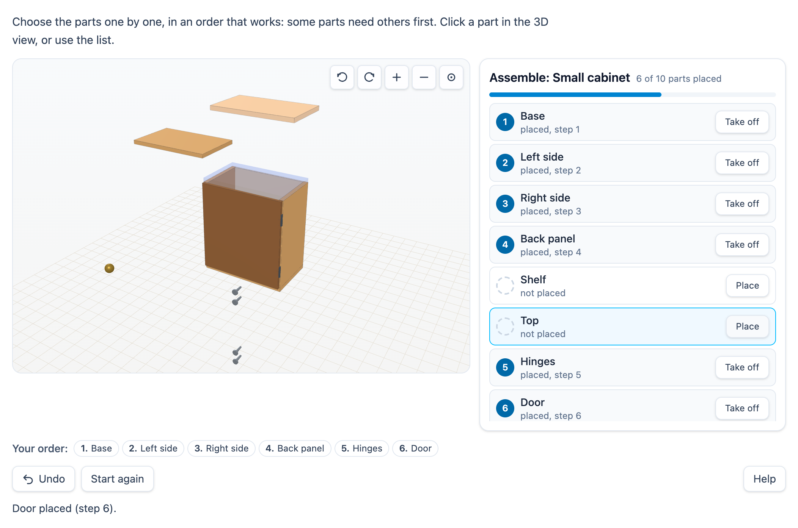

# @citolab/pci-assembly

> [!WARNING]
> **Experimental (alpha). Just for inspiration.** This PCI is a technical showcase, made by software developers without
> much knowledge of the subject it could be used for. Its content, terms and scoring have not been checked by subject
> experts or assessment specialists, and it has never been used in an assessment. It is offered as is, without any
> warranty.

A QTI 3 Portable Custom Interaction (PCI) in which the candidate assembles (or takes apart) a product in 3D, in the
right order: the "montagevolgorde" and "demontage" of vmbo technology, mobility, installation and furniture work. The
parts lie loose in an exploded view; the candidate picks the next part (a click in the 3D view, or the parts list) and
it moves into place. Some parts need others first ("the screws after the door"): the author sets these rules, decides
whether a wrong step is blocked, allowed and counted, or allowed without a word, and how the order is scored. Made with
[tspci](https://github.com/Citolab/tspci).

<p align="center">
  
</p>

## What it does

- **The product**: parts built from simple shapes (box, cylinder, tube, ring, hex nut, screw, cone, ball), each with
  an assembled position, a start position (the exploded view; automatic when the author gives none), a turn and copies
  (two hinges, four screws are one part). Three examples: a **small cabinet** (base, sides, back panel, shelf, top,
  hinges, door, hinge screws, knob), a **bicycle wheel hub** (shell, bearings, axle, cones, washers, lock nuts) and a
  **mains plug** (base with pins, cable, brown/blue/yellow-green wires, terminal screws, strain relief, clamp screws,
  cover, cover screw). Or the author's own glTF file: meshes named after a part id replace its shape.
- **The rules**: every part lists the parts it comes after, a directed acyclic graph. In a **disassembly** the rules
  turn round: a part comes off only when nothing that needs it is still on. The correct disassembly is the reverse of
  an assembly order.
- **Steps**: click a loose part in the 3D view (raycasting), or press its Place button in the list. It moves to its
  place in a short arc (at once with `prefers-reduced-motion`). Click a placed part, or its Take off button, to take a
  step back; Undo (or `Ctrl+Z`) takes back the last step; Start again. In a disassembly: Remove and Put back.
- **Feedback** (the author's choice): **block** a step that is not allowed yet and say what must come first ("Door
  cannot be placed yet: first Hinges."; also taking a part off while another stands on it); **record**: allow it, say it
  was not allowed yet and mark it in the list and in the order with a warning sign and the text "not allowed yet"; or
  **none**: allow it without a word. Either way the PCI counts what happened.
- **The 3D view**: turn by dragging (mouse, touch), zoom with a pinch or `Ctrl` + scroll, or the buttons in the
  corner. The view itself takes focus: the arrow keys turn it, `+` and `−` zoom, `0` resets. Hovering a part (in the
  view or the list) lights it up and shows a ghost where it goes. Without WebGL a note says so, and the list does it all.
  The renderer and its WebGL context are freed when the PCI is removed (also when the page drops it without telling).
- **Accessibility**: everything works from the parts list with the keyboard (buttons named "Place: Door", "Take off:
  Base"); every part says its state in text ("placed, step 3", "not placed"), with the step number in a badge, so
  nothing rests on colour; every step and refusal is read out by a live status line.
- **Logic** (`src/assembly.ts`, no imports, tested in node with `npm test`): the rules per task, violations (per step,
  every required part that came later or not at all), cycles, the first valid order, the number of valid orders
  (subset dynamic programming up to 20 parts, by trying above that), the checks and the score.
- **Authoring mode**: four tabs. **Product**: start from an example, a title, a glTF URL, and a card per part (id,
  English and Dutch name, shape, material, size, assembled and start position, turn, copies) with a 3D preview,
  assembled or exploded. **Order rules**: per part, toggle the parts it comes after; or in the graph, click a part and
  then the part that must come before it. **Task and scoring**: assemble or take apart, the feedback, the scoring, the
  points and the first part; it says how many valid orders there are and warns when an exact match would accept only one
  of several. **Try it**: run through the task as a candidate and make that order the correct one. `validate()` reports
  fewer than two parts, an id that is not a QTI identifier or is used twice, a part without a name, rules that go round
  in a circle, and checks worth no points.
- **Delivery**: the steps are saved as the item's state, with a log of every attempt (also the blocked ones); several
  interactions of this type on one page each get their own object.

## What can be configured

Every setting is a `data-` attribute of the interaction, as text. `dist/authoring.json` describes them for authoring
systems.

| setting                     | attribute         | default             | what                                                         |
| --------------------------- | ----------------- | ------------------- | ------------------------------------------------------------ |
| Instruction above the product | `data-prompt`   | a general one       |                                                              |
| Product, rules, task, scoring | `data-assembly` | empty: the example  | written by the authoring mode, as JSON (below)               |
| Example product             | `data-example`    | `cabinet`           | `cabinet`, `hub` or `plug`, when there is no `data-assembly` |
| Language                    | `data-language`   | `en`                | `en` or `nl`: the texts of the PCI; numbers in the authoring mode use a decimal comma in Dutch |

```json
{
  "title": { "en": "Small cabinet", "nl": "Kastje" },
  "task": "assemble", "feedback": "block", "scoring": "pci",
  "parts": [
    { "id": "base", "name": { "en": "Base", "nl": "Bodem" }, "shape": "box", "size": [6, 0.3, 3.6], "color": "wood",
      "at": [0, 0.15, 0], "start": [0, -1.6, 1.5], "after": [] },
    { "id": "hinges", "name": { "en": "Hinges", "nl": "Scharnieren" }, "shape": "cylinder", "size": [0.12, 0.8], "color": "darkSteel",
      "at": [2.9, 1.6, 1.88], "copies": [[0, 3.8, 0]], "after": ["sideRight"] },
    { "id": "screws", "name": { "en": "Hinge screws", "nl": "Scharnierschroeven" }, "shape": "screw", "size": [0.07, 0.5],
      "color": "steel", "at": [2.6, 1.3, 2.1], "turn": [90, 0, 0], "after": ["door"] }
  ],
  "order": ["base", "sideLeft", "sideRight", "back", "top", "shelf", "hinges", "door", "knob", "screws"],
  "first": "base",
  "points": { "valid": 2, "complete": 1, "first": 1, "penalty": 0 },
  "gltf": ""
}
```

- **`example`** instead of `parts`: that example's parts (`{ "example": "hub", "feedback": "record" }`).
- **Parts**: at most 24. `id` goes into the response, so it must be a QTI identifier (a letter or `_` first, then
  letters, digits, `_`, `.`, `-`). `size` per shape: box width, height, depth; cylinder, hex, screw, cone radius and
  length; tube radius, inner radius, length; ring radius and thickness; ball radius. The shapes stand along y; `turn`
  is in degrees around x, y and z. `color` is a material: `wood`, `lightWood`, `darkWood`, `steel`, `darkSteel`,
  `brass`, `white`, `grey`, `black`, `brown`, `blue`, `yellowGreen`, `red`, `orange`. `start` left out: pushed out from
  the middle of the product.
- **`after`**: the parts that must be in place first. Unknown ids are dropped; a cycle is reported by `validate()`.
- **`task`**: `assemble` or `disassemble`. **`feedback`**: `block`, `record` or `none`. **`scoring`**: `pci`, `list`
  or `string` (below).
- **`order`**: the correct assembly order (for a disassembly its reverse). Left out, or not valid: the first valid
  order (every time the first part in the list whose rules are met).
- **`gltf`**: a URL of a `.gltf`/`.glb` file. A mesh (or a node above it) named after a part id is that part; its
  place in the file is the assembled position and it moves out from the middle of the model. Parts the file does not
  have keep their shape; the rest of the file stays as a fixed context. If it does not load, the shapes stay and a note
  says so.

## Scoring

`authoring.json`: `"scoring": ["custom", "match_correct", "human"]`, `"correctResponse": "properties"`. The scoring in
`data-assembly` chooses the response:

| `scoring` | response                                                | for                         |
| --------- | ------------------------------------------------------- | --------------------------- |
| `pci`     | a record, scored by the PCI (default)                   | `custom`: several orders can be right |
| `list`    | `cardinality="ordered" base-type="identifier"`: the part ids in the order of the steps | `match_correct`: one order is right |
| `string`  | `cardinality="single" base-type="string"`: the ids comma separated (`base,sideLeft,…`) | `match_correct` as text, or a `qti-pattern-match` |

The response does not depend on the language. Until the first step `getResponse()` reports nothing.

**MATCH_CORRECT** compares with one correct order. `getCorrectResponse(properties)` gives it from the settings (the
author's order, or the first valid one; reversed for a disassembly). Use it only when the rules allow one order (the
authoring mode says how many there are), or list every accepted order as its own correct response.

```xml
<qti-response-declaration identifier="RESPONSE" cardinality="ordered" base-type="identifier">
  <qti-correct-response>
    <qti-value>shell</qti-value><qti-value>bearingLeft</qti-value><qti-value>bearingRight</qti-value><qti-value>axle</qti-value>
    …
  </qti-correct-response>
</qti-response-declaration>
<qti-response-processing template="https://purl.imsglobal.org/spec/qti/v3p0/rptemplates/match_correct.xml"/>
```

**CUSTOM**: the PCI checks the order against the rules and reports a record (`cardinality="record"`):

| field        | type      | what                                                                                      |
| ------------ | --------- | ----------------------------------------------------------------------------------------- |
| `score`      | `integer` | the points of the checks that pass, minus `penalty` per violation, never below 0          |
| `maxscore`   | `integer` | `valid` + `complete` (+ `first` when a first part is set)                                 |
| `correct`    | `integer` | 1 when the order is valid (and starts with the first part, when one is set)               |
| `valid`      | `integer` | 1 when every part is used and no step breaks a rule                                       |
| `complete`   | `integer` | 1 when every part is used                                                                 |
| `first`      | `integer` | 1 when the order starts with the author's first part; only when one is set               |
| `violations` | `integer` | per step, every part it needed that came later or not at all (0 with `feedback: block`)   |
| `blocked`    | `integer` | how many steps the PCI blocked (`feedback: block`)                                        |
| `steps`      | `integer` | the number of parts in the order                                                          |
| `order`      | `string`  | the part ids, comma separated                                                             |

```json
{ "record": [
  { "name": "score", "base": { "integer": 3 } }, { "name": "maxscore", "base": { "integer": 3 } },
  { "name": "correct", "base": { "integer": 1 } }, { "name": "valid", "base": { "integer": 1 } },
  { "name": "complete", "base": { "integer": 1 } }, { "name": "violations", "base": { "integer": 0 } },
  { "name": "blocked", "base": { "integer": 1 } }, { "name": "steps", "base": { "integer": 10 } },
  { "name": "order", "base": { "string": "base,sideLeft,sideRight,back,top,shelf,hinges,door,knob,screws" } }
] }
```

Copy `score` to `SCORE`, or test single fields (no points with more than one violation, a point off for every blocked
attempt):

```xml
<qti-response-declaration identifier="RESPONSE" cardinality="record"/>
<qti-outcome-declaration identifier="SCORE" cardinality="single" base-type="float">
  <qti-default-value><qti-value>0</qti-value></qti-default-value>
</qti-outcome-declaration>
<qti-response-processing>
  <qti-response-condition>
    <qti-response-if>
      <qti-not><qti-is-null>
        <qti-field-value field-identifier="score"><qti-variable identifier="RESPONSE"/></qti-field-value>
      </qti-is-null></qti-not>
      <qti-set-outcome-value identifier="SCORE">
        <qti-field-value field-identifier="score"><qti-variable identifier="RESPONSE"/></qti-field-value>
      </qti-set-outcome-value>
    </qti-response-if>
  </qti-response-condition>
</qti-response-processing>
```

`human`: for a human rater; the state's log shows every attempt, in order (`STEP`, `BLOCKED`, `TAKE_BACK`,
`TAKE_BACK_BLOCKED`, `CLEAR`).

**State and response.** `getState()` holds the steps, the number of blocked attempts and the log. `setResponse` (and
`boundTo` without a state) reads a list, a string or a record's `order` field (and `blocked`). In `status: "solution"`
the PCI shows the declared correct response (a list, a string, or a record value with the field `order`), or else the
author's order, read-only.

## Using it

```sh
npm install @citolab/pci-assembly
```

| file                                    | what                                                                      |
| --------------------------------------- | ------------------------------------------------------------------------- |
| `dist/index.js`                         | the PCI (AMD module, three.js and everything bundled: no dependencies)    |
| `dist/authoring.json`                   | settings, response, scoring and the authoring mode, for authoring systems |
| `dist/sbom.cdx.json`                    | CycloneDX SBOM of the bundle                                              |
| `dist/tao-pci-assembly_<version>.zip`   | the PCI for TAO: Settings → Portable Custom Interactions → Add            |
| `assembly.svg`, `example.png`           | icon and screenshot                                                       |

In a QTI 3 item, with `index.js` at `resources/pci/index.js` of the package:

```xml
<qti-response-declaration identifier="RESPONSE" cardinality="record"/>
…
<qti-portable-custom-interaction response-identifier="RESPONSE" module="pci" custom-interaction-type-identifier="assembly"
  data-language="nl" data-assembly="{&quot;example&quot;:&quot;hub&quot;,&quot;feedback&quot;:&quot;record&quot;}">
  <qti-interaction-modules>
    <qti-interaction-module id="pci" primary-path="../resources/pci/index"></qti-interaction-module>
  </qti-interaction-modules>
  <qti-interaction-markup></qti-interaction-markup>
</qti-portable-custom-interaction>
```

Source and the other examples: [Citolab/tspci-examples](https://github.com/Citolab/tspci-examples).
