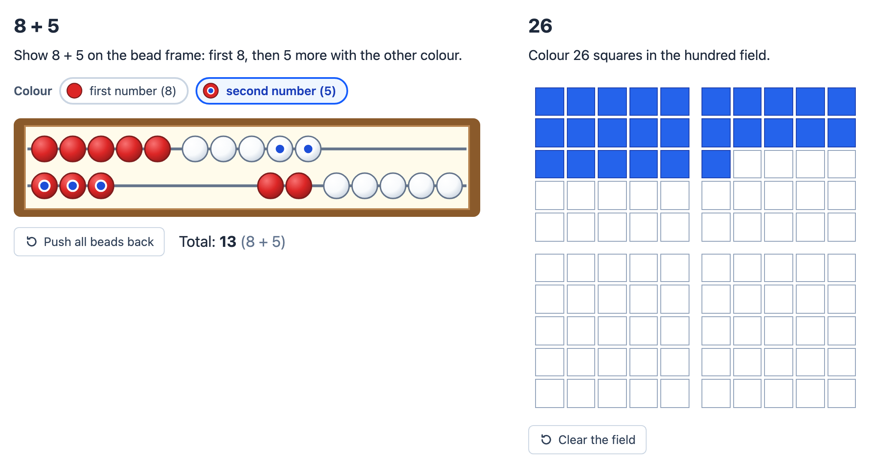

# @citolab/pci-bead-frame

> [!WARNING]
> **Experimental (alpha). Just for inspiration.** This PCI is a technical showcase, made by software developers without
> much knowledge of the subject it could be used for. Its content, terms and scoring have not been checked by subject
> experts or assessment specialists, and it has never been used in an assessment. It is offered as is, without any
> warranty.

A QTI 3 Portable Custom Interaction (PCI) with two models from Dutch early maths: the *rekenrek* (bead frame) and the
*honderdveld* (hundred field). On the rekenrek the candidate slides beads from right to left to show a number, as on the
real frame. In the hundred field they colour squares. A sum such as 8 + 5 is shown in two colours, so you can see
whether the candidate went via ten. The frame can also only show a number, like an image, while the item asks for it
elsewhere. Made with [tspci](https://github.com/Citolab/tspci).

<p align="center">
  
</p>

## What it does

- **The rekenrek** (`model: rekenrek`): 20 beads (2 rods) or 100 beads (10 rods), each rod with 5 red and 5 white
  beads. Pushed beads sit at the left of the rod and the rest at the right, with room between them.
  - **Click** a bead on the right: it moves left and takes along the beads to its left. Click a bead on the left: it
    goes back and takes along the beads to its right, as on a real rod.
  - **Drag** a bead half a bead's width to do the same.
  - **Keys**: each rod is a slider of the number of beads pushed. The beads move left, so **←** (and ↑) pushes one more
    bead and **→** (and ↓) takes one back. **Page Up** and **Page Down** move five, **Home** pushes all back and **End**
    pushes all ten.
- **The hundred field** (`model: hundred`): 10 × 10 squares or dots (`cells`). A click colours a square or takes its
  colour off, and a drag colours (or uncolours) every square it passes. The field is one tab stop: the arrow keys,
  Home and End move within it, and space or Enter colours a square.
- **The 5-structure**, also without colour: a gap after five beads on every rod, after five squares in a row and after
  five rows (on the 100-bead rekenrek and in the hundred field). Red and white beads also differ in lightness.
- **A sum in two colours** (`task: addition`): above the frame the candidate picks "first number (8)" or "second number
  (5)". Beads pushed with the second one get a blue dot. Squares coloured with it are amber and striped, so colour is
  never the only cue. On a rod, beads keep their colour while beads pushed back come off the right end.
- **Only showing a number** (`task: show`): the frame stands in for an image. It shows the number the way the frame is
  read, or whatever the author arranged in the authoring mode, such as 5 and 5 instead of 10, scattered squares to count,
  or a sum in two colours. Nothing can be changed, nothing is reported, and the item asks for the number with an
  interaction of its own (`config.tspci.toolWhen`).
- **The question** is the author's. `{number}`, `{add}` and `{sum}` in it are replaced by the settings. When the author
  leaves it empty, the PCI asks for the number itself ("Show 13 on the bead frame.", "Kleur 37 hokjes in het
  honderdveld."), so the candidate always sees what is asked. A frame that only shows a number has no question of its
  own.
- **A button to start over**, and optionally the total under the frame (`showTotal`, as a help: off by default, since
  counting is part of the task).
- **Screen readers**: a rod says its count, its colours and the total ("7 beads pushed (5 red, 2 white). Total 13.").
  A square says its row, its place and its colour, and a live region says how many squares are coloured. A frame that
  only shows a number is one image, described row by row ("row 1: 10, row 2: 3").
- English and Dutch (`language`). Several frames on one page each keep their own beads.

## Settings

| setting | editor | what it does |
| --- | --- | --- |
| `title`, `question` | `text`, `textarea` | above the frame; an empty question: the PCI's own, by the task and language |
| `model` | `enum` | `rekenrek` (default) or `hundred` |
| `size` | `enum` | the rekenrek: `20` (default) or `100` beads |
| `cells` | `enum` | the hundred field: `squares` (default) or `dots` |
| `task` | `enum` | `set` (default): show the number; `addition`: show number + add in two colours; `show`: only show the number, not scored |
| `number` | `integer` | the number to show (set, show), the first number of a sum (addition); at most 20 on a rekenrek of 20 |
| `add` | `integer` | the second number of a sum (addition only) |
| `layout` | `pci` | what a frame that only shows a number shows, arranged in the authoring mode ("Arrange the beads or squares…"); empty: the number, full rows first |
| `showTotal` | `boolean` | the total under the frame, a help |
| `language` | `enum` | `en` or `nl`: the PCI's own texts (question, buttons, screen reader texts) |

`layout` is text, so it can also be written by hand: a row per `/`, a digit per place, `0` empty, `1` first colour,
`2` second colour (`1111111111/1110000000` is 13). On a rekenrek the beads of a row slide to its left end.

## Response and scoring

The PCI does not score: it reports a `record`, and the item's scoring decides what counts. Nothing is reported while
no bead is pushed and no square coloured, and nothing at all for a frame that only shows a number.

| field | type | task | what it is |
| --- | --- | --- | --- |
| `value` | `integer` | `set`, `addition` | the beads pushed or squares coloured |
| `first`, `second` | `integer` | `addition` | how many of them have the first and the second colour |
| `structured` | `boolean` | `set`, `addition` | shown the way the frame is read: in reading order (rows from the top, each from the left) the first `value` places are filled. On a rekenrek: full rows first, so 13 is 10 and 3, not 5 and 8 |
| `viaTen` | `boolean` | `addition` | structured, both parts there, and the second part goes on where the first stops: 8 + 5 as 8, then 2 to fill the row to ten and 3 on the next row |
| `correct` | `boolean` | `set`, `addition` | the number is `number` (set), or the parts are `number` and `add` (addition); only when the settings give the number |

- **`getCorrectResponse`** gives the correct response from the settings: the number shown the way the frame is read
  (a sum via ten), so every check is true. With `match_correct` that means "the right number, shown structured" (and
  for a sum, via ten). To accept 13 as 5 and 8, score with `custom` on `correct` alone, or give part of the score per
  field, such as 1 point for `correct` and 1 for `structured` or `viaTen`.
- **`show`**: no response, no correct response; the item asks for the number elsewhere.

Where the beads and squares are is saved in the state (and restored), so a human rater (`human`) can look at it. A
response holds the numbers, not the places. So a response given back (`setResponse`, `boundTo`, the correct response in
status `solution`) is shown the way the frame is read, unless the frame already shows those numbers from its saved
state. Then the beads stay where the candidate left them. In status `solution` without a correct response in the item,
the PCI shows the one from its settings.

## Development

```bash
npm install
npm run dev           # the dev page, with the settings
npm test              # the logic (src/beadFrame.ts, src/texts.ts), in node
npm run test:stories  # the Storybook tests
```
