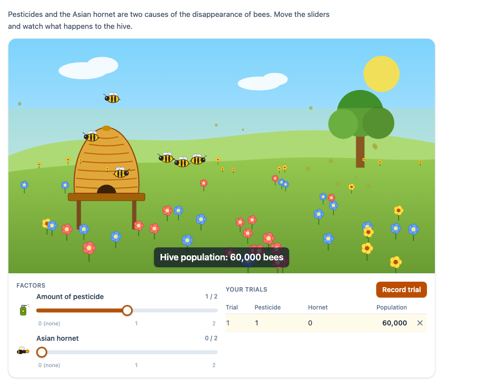

# @citolab/pci-bee-colony

**The disappearance of bees**: a meadow with a hive. The candidate sets the amount of pesticide and the Asian hornet
(and, if the author turns it on, the varroa mite) with sliders and sees what happens: bees disappear, flowers go, a
hornet flies across, and the population of the hive is shown. They can record their trials in a table and answer a
question that the PCI scores. A port of the DEPP PCI *Abeillepci* ("La disparition des abeilles").

<p align="center"></p>

## What it does

- **Sliders**: one per factor, from 0 (none) to the highest level (2 by default). They are native range inputs: drag
  them, or use the arrow keys, Home and End. A screen reader hears "level 1 of 2, Hive population: 60,000 bees".
- **The picture** (all SVG): a straw hive on a stand, a meadow with flowers in four groups, the sun and a tree. One bee
  is drawn per 10,000 bees (a setting); bees and flowers that go fade out. Pesticide is a haze with droplets over the
  meadow, the hornet level is the number of hornets hovering at the hive, and every time the candidate raises the
  hornet one flies across, as in the original. Varroa mites crawl on the hive. The picture has a text description for
  screen readers, and every change of the population is announced (`aria-live`).
- **Reduced motion**: with `prefers-reduced-motion: reduce` the bees and hornets stand still, nothing fades and no
  hornet flies across.
- **Results table** (on by default): **Record trial** adds the current levels and the population as a row; the same
  combination is not added twice; a row can be removed; the table holds 12 rows (a setting).
- **Question** (off by default): *which factor has the largest effect?* (a choice between the factors and "they all have
  the same effect"), or *how many bees live in the hive with …?* for a combination of levels the author picks (a
  number, typed as the candidate writes numbers: `20 000`, `20.000`, `20,000`).
- **Languages**: English, Dutch and French (`data-language`), with numbers as they are written in each: `80,000`,
  `80.000`, `80 000`. The French texts follow the original ("Population de la ruche : 0 abeille").
- **Delivery**: the levels, the table, every move and the answer are saved as the state (with a log of the candidate's
  actions) and restored; a response handed back with `boundTo` is restored as well. In `review`, `solution` and
  `closed` status everything is read-only; in `solution` status the key of the question is shown as the answer.

## What can be configured

Every setting is a `data-` attribute of the interaction, as text. `dist/authoring.json` describes them for authoring
systems.

| setting | attribute | default | what |
| --- | --- | --- | --- |
| Instruction | `data-prompt` | the instruction above | text above the simulation |
| Start population | `data-start-population` | `80000` | the population with every factor at 0 |
| Bees per bee drawn | `data-bees-per-icon` | `10000` | at most 40 bees are drawn |
| Pesticide | `data-pesticide` | `true` | the factor is on |
| Pesticide levels | `data-pesticide-levels` | `2` | 1 to 6 levels above 0 |
| Pesticide effect | `data-pesticide-effect` | `20000` | bees lost per level: one number, or one per level (`5000;10000`); the last repeats |
| Asian hornet | `data-hornet`, `data-hornet-levels`, `data-hornet-effect` | `true`, `2`, `20000` | as for pesticide |
| Varroa mite | `data-varroa`, `data-varroa-levels`, `data-varroa-effect` | `false`, `2`, `10000` | an optional third factor |
| Results table | `data-show-table` | `true` | the table and **Record trial** |
| Rows | `data-max-trials` | `12` | 1 to 50 |
| Question | `data-question` | `none` | `none`, `largestEffect` or `predict` |
| Question text | `data-question-text` | empty | empty: a standard text in the item's language |
| Combination | `data-predict-levels` | `1;1;0` | `predict`: the levels of pesticide; hornet; varroa |
| Key | `data-answer-key` | empty | empty: from the model; or `pesticide`, `hornet`, `varroa`, `equal`, or a number |
| Margin | `data-tolerance` | `0` | `predict`: a number within this many bees of the key is correct |
| Language | `data-language` | `en` | `en`, `nl` or `fr` |

**The model.** Population = start − the losses of every factor at its level, never below 0. A factor's loss at a level
is the sum of its effects per level up to it. With the defaults this is the original's rule,
80000 − 20000 · (pesticide + hornet): 80,000, 60,000, 40,000, 20,000 or 0 bees, and 8, 6, 4, 2 or 0 bees drawn.
The flowers follow the share of the colony that is left, as the original's rule did: all four groups at the start,
three at 75 % or more, one group above 0 and none at 0.

**The keys from the model.** `largestEffect`: the factor that costs the most bees over its whole slider (0 to its
highest level); when two or more share the largest effect, `equal`, so with the defaults (40,000 each) the key is
"they all have the same effect". `predict`: the population at the author's combination. An author's key replaces
these, for instance when the item text gives other information than the simulation shows.

## Response and scoring

`authoring.json`: `"scoring": ["custom", "human"]`. **The response** is a record
(`cardinality="record"`):

| field | base type | what |
| --- | --- | --- |
| `pesticide`, `hornet`, `varroa` | integer | the final level of each factor that is on |
| `population` | integer | the population at those levels |
| `trials` | string | the rows of the table, JSON: `[{"pesticide":2,"hornet":0,"population":40000}]` |
| `history` | string | the levels after every slider move, JSON (at most 500) |
| `answer` | string | with a question: the choice (`pesticide`, `hornet`, `varroa`, `equal`), or the typed number as a plain number (`20000`); text that is no number stays as typed |
| `correct` | integer | 1 when the answer matches the key (within the margin), else 0 |
| `score` | integer | 1 for a correct answer, else 0 |
| `maxscore` | integer | 1 with a question, 0 without |

Until the candidate moves a slider, records a trial or answers, `getResponse()` reports nothing.

- `custom`: map the PCI's `score` to the outcome, for instance
  `<qti-set-outcome-value identifier="SCORE"><qti-field-value field-identifier="score"><qti-variable identifier="RESPONSE"/></qti-field-value></qti-set-outcome-value>`.
  Response processing can also look at the trials, for instance to give a point for an investigation that changed
  one factor at a time.
- `human`: a rater reads the table and the answer.

**How it relates to the original.** The original logged every slider move as a JSON string of
`{"pesticide_curseur": …, "frelon_curseur": …}` objects; that is the `history` field now (with the factor ids as keys).
It had no table, no question and no score; it restored nothing.

## Using it

```sh
npm install @citolab/pci-bee-colony
```

| file | what |
| --- | --- |
| `dist/index.js` | the PCI (AMD module, everything bundled: the package has no dependencies) |
| `dist/authoring.json` | settings, response and scoring, for authoring systems |
| `dist/sbom.cdx.json` | CycloneDX SBOM of the bundle |
| `dist/tao-pci-beeColony_<version>.zip` | the PCI for TAO: Settings → Portable Custom Interactions → Add |
| `beeColony.svg`, `example.png` | icon and screenshot |

In a QTI 3 item, with `index.js` at `resources/pci/index.js` of the package:

```xml
<qti-response-declaration identifier="RESPONSE" cardinality="record"/>
<qti-outcome-declaration identifier="SCORE" cardinality="single" base-type="float"/>
…
<qti-portable-custom-interaction response-identifier="RESPONSE" module="pci" custom-interaction-type-identifier="beeColony"
  data-language="fr" data-varroa="true" data-question="largestEffect" data-hornet-effect="30000">
  <qti-interaction-modules>
    <qti-interaction-module id="pci" primary-path="../resources/pci/index"></qti-interaction-module>
  </qti-interaction-modules>
  <qti-interaction-markup></qti-interaction-markup>
</qti-portable-custom-interaction>
…
<qti-response-processing>
  <qti-response-condition>
    <qti-response-if>
      <qti-not><qti-is-null><qti-variable identifier="RESPONSE"/></qti-is-null></qti-not>
      <qti-set-outcome-value identifier="SCORE">
        <qti-field-value field-identifier="score"><qti-variable identifier="RESPONSE"/></qti-field-value>
      </qti-set-outcome-value>
    </qti-response-if>
  </qti-response-condition>
</qti-response-processing>
```

```sh
npm run storybook     # the stories of this PCI
npm test              # the model in node
npm run test:stories  # the stories' play functions, headless in Chromium
npm run prod          # both, then dist/index.js
```

## Source and licence

This PCI is a derivative work of
[`Abeillepci`](https://github.com/janfix/extension-wiquid-depp/tree/master/views/js/pciCreator/ims/Abeillepci) in
[janfix/extension-wiquid-depp](https://github.com/janfix/extension-wiquid-depp), © DEPP (Ministère de l'Éducation
nationale) / Jean-Philippe Rivière (Wiquid). That extension is licensed under the GNU General Public License version 2
only (`GPL-2.0-only`, as stated in its `composer.json` and in the headers of its files), so this PCI is too: see
[LICENSE](LICENSE). This differs from the MIT licence of most other examples in this repository.

What changed, by Stichting Cito Instituut voor Toetsontwikkeling (2026):

- Rewritten from jQuery UI and Raphaël to TypeScript, Preact and Tailwind in a shadow DOM, built with tspci; the model
  is a pure module with node tests.
- All pictures are new, drawn in inline SVG (hive, bees, hornet, flowers, mites); none of the original's images are used.
- The hardcoded rule became settings: the start population, the levels and the effect per level of each factor, the
  bees per bee drawn, and an optional third factor (varroa mite). The defaults are the original's rule.
- New: a results table where the candidate records trials, and an optional question (largest effect, or a prediction)
  that the PCI scores against the author's key or the model.
- Keyboard and screen-reader access (native sliders with value texts, a described picture, announcements), animations
  that respect `prefers-reduced-motion`, English, Dutch and French texts (the original was French only).
- A structured record response instead of a JSON string of slider positions; the state is saved and restored, with a
  log; review status is read-only; `qti-interaction-changed` events.

Source and the other examples: [Citolab/tspci-examples](https://github.com/Citolab/tspci-examples).
