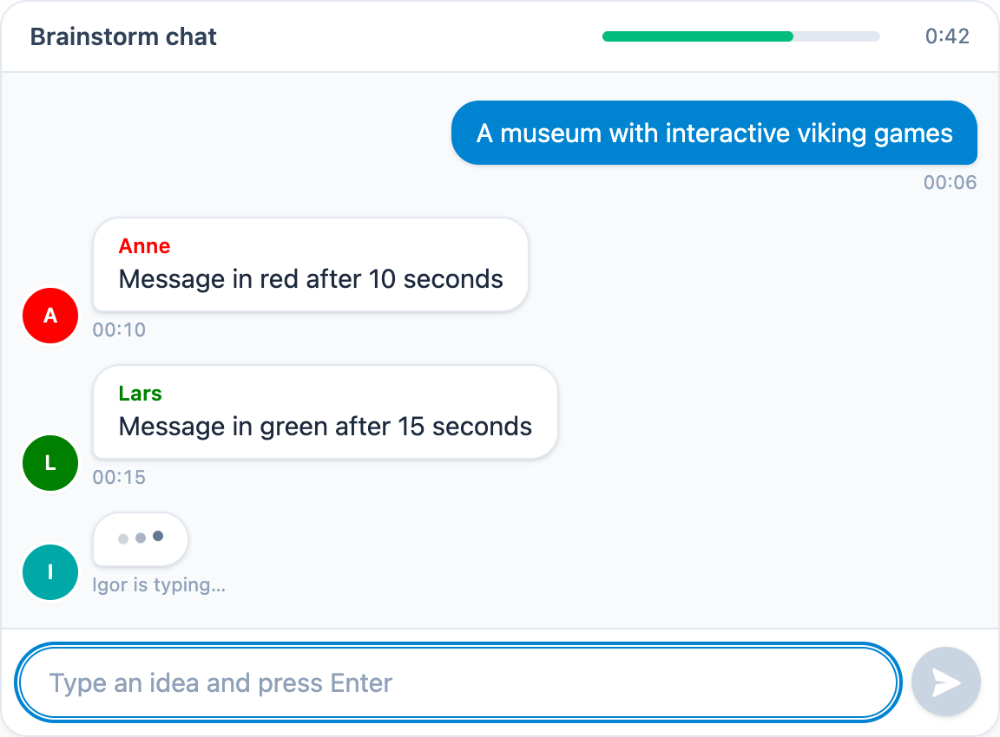

# @citolab/pci-brainstorm

A QTI 3 Portable Custom Interaction (PCI) with a simulated brainstorm: the candidate joins a group chat in which the
other participants are scripted "bots" that post ideas at set times. Everything said in the chat, by the bots and by
the candidate, is the response. Made with [tspci](https://github.com/Citolab/tspci).

<p align="center">
  
</p>

## Source and licence

This PCI is a port of [brainstorm](https://github.com/openPCI/openPCIs/tree/master/brainstorm) from the
[openPCI](https://github.com/openPCI/openPCIs) project of Aarhus University and Aalborg University, by Elias J.T.
Hansen, Anna Rusmann and Jeppe Bundsgaard. The original is licensed under the GNU General Public License version 3
(the repository's `LICENSE`; it states no "or any later version"), so this port is too: **GPL-3.0-only**, see
[LICENSE](LICENSE). This differs from the MIT licence of the other examples in this repository.

What changed (Stichting Cito Instituut voor Toetsontwikkeling, 2026):

- **IMS PCI v1.0 via tspci** instead of TAO's older PCI format (`define`, jQuery, `OAT/util/event`); it runs in any
  QTI 3 delivery system and still packages for TAO (`npm run package-tao`).
- **A modern chat**: message bubbles with avatars in the bot's colour, a typing indicator before a bot's message, a
  time bar with the seconds left, auto-scroll, a send button next to Enter. Preact and Tailwind, no jQuery.
- **Accessible**: the chat is a `role="log"` live region, so a screen reader reads each new message; the time left is
  a progress bar; the start message is a real button; the end message is an alert. Texts in English and Dutch.
- **State**: the chat, the clocks and which bots have spoken are saved and restored; a resumed attempt goes on where
  it was. The original saved no state.
- Kept: the bot script format, the settings and their defaults, the timing (bots wait while the candidate types) and
  the response format.

## What it does

- **Start**: with a start message the chat waits behind a button ("Click here when you are ready to brainstorm");
  without one it starts right away.
- **Bots**: every line of the script is a message, shown that many seconds into the brainstorm. As in the original,
  the bots' clock stops while the candidate types and goes on 3 seconds after the last key press, so the bots do not
  talk over the candidate. A bot "is typing" for 1.5 s before its message appears.
- **The candidate** types an idea and presses Enter (or the send button); empty messages are not sent.
- **Time limit**: when it is up, the end message appears and the message box is disabled; bots that have not spoken
  yet stay silent.
- **Review**: in `review`, `solution` or `closed` status, and when the delivery system hands over a response without a
  state, the PCI shows the chat read-only.

## What can be configured

Every setting is a `data-` attribute of the interaction, as text. `dist/authoring.json` describes them for authoring
systems.

| setting              | attribute         | default                                        | what                                                  |
| -------------------- | ----------------- | ---------------------------------------------- | ----------------------------------------------------- |
| Test-taker nickname  | `data-nickname`   | `You`                                          | the candidate's name in the chat and in the response  |
| 'Bot' input          | `data-messages`   | three example messages (Anne, Lars, Igor)      | one per line: `seconds;name;colour;message` (below)   |
| Time limit (seconds) | `data-time-limit` | `60`                                           | the length of the brainstorm                          |
| Start message        | `data-start-text` | `Click here when you are ready to brainstorm`  | empty: start right away                               |
| Time is out-message  | `data-end-text`   | `Time is up. Go to next task.`                 | shown when the time is up                             |
| Language             | `data-language`   | `en`                                           | `en` or `nl`: the chat's own texts                    |

The bot script, as in the original; the colour is any CSS colour:

```text
5;Anne;darkred;A big collection of axes
10;Kai;green;A film about how the vikings lived
14;Eske;#00a8a7;Build axes
```

Lines that do not fit are skipped. Unlike the original, a message may contain a semicolon.

## Scoring

The PCI is made for a human rater (`authoring.json`: `"scoring": ["human"]`): the response is for a human rater
or for analysis.

**The response** is a string (`cardinality="single" base-type="string"`), the original's format: every message in the
order it appeared, as `|mm:ss;name;message`:

```text
|00:06;You;A museum with interactive viking games|00:10;Anne;Message in red after 10 seconds|00:15;Lars;Message in green after 15 seconds
```

- The candidate's messages carry the time they were sent; a bot's message, as in the original, its scripted time.
- `;` and `|` in a message or a name become `,` and `/`, so the response can always be split.
- **No response**: until the first message, `getResponse()` reports nothing.

## Using it

```sh
npm install @citolab/pci-brainstorm
```

| file                                   | what                                                                      |
| -------------------------------------- | ------------------------------------------------------------------------- |
| `dist/index.js`                        | the PCI (AMD module, everything bundled: the package has no dependencies) |
| `dist/authoring.json`                  | settings, response and scoring, for authoring systems                     |
| `dist/sbom.cdx.json`                   | CycloneDX SBOM of the bundle                                              |
| `dist/tao-pci-brainstorm_<version>.zip`| the PCI for TAO: Settings → Portable Custom Interactions → Add            |
| `brainstorm.svg`, `example.png`        | icon and screenshot                                                       |

In a QTI 3 item, with `index.js` at `resources/pci/index.js` of the package:

```xml
<qti-response-declaration identifier="RESPONSE" cardinality="single" base-type="string"/>
…
<qti-portable-custom-interaction response-identifier="RESPONSE" module="pci" custom-interaction-type-identifier="brainstorm"
  data-nickname="You" data-time-limit="90"
  data-messages="5;Anne;darkred;A big collection of axes&#10;10;Kai;green;A film about how the vikings lived">
  <qti-interaction-modules>
    <qti-interaction-module id="pci" primary-path="../resources/pci/index"></qti-interaction-module>
  </qti-interaction-modules>
  <qti-interaction-markup></qti-interaction-markup>
</qti-portable-custom-interaction>
```

Source and the other examples: [Citolab/tspci-examples](https://github.com/Citolab/tspci-examples).
