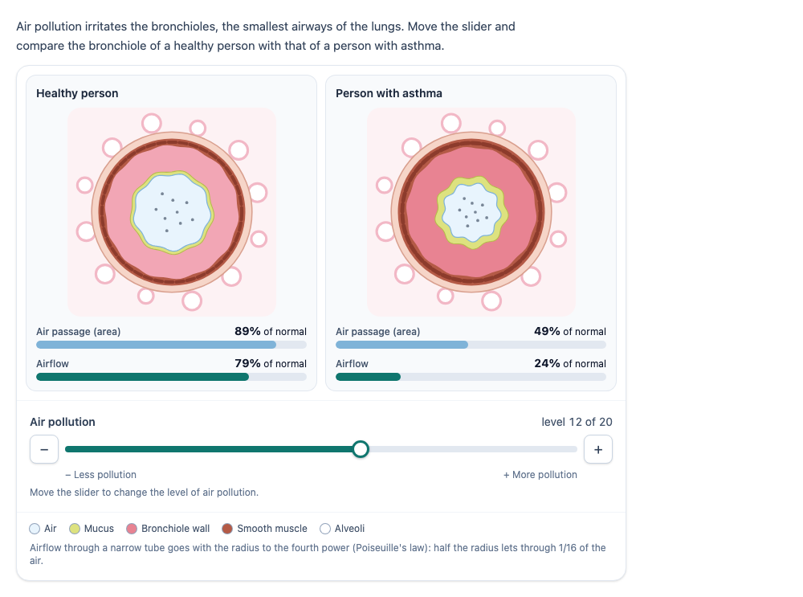

# Pollution and the bronchioles (`bronchiole`)

Cross-sections of a bronchiole of a healthy person and of a person with asthma, side by side. The candidate moves a
slider from less to more air pollution: the wall of the bronchiole swells (inflammation), it makes more mucus, and the
air passage gets narrower, much more so for the person with asthma. Under each picture the area of the air passage and
the airflow, as a percentage of normal, make the effect quantitative. Optionally a question below the simulation that
the PCI scores itself.

<p align="center">
  
</p>

> [!WARNING]
> **Experimental (alpha).** Offered as is, without any warranty, and never used in an assessment. Check its content and
> scoring before you use it in one.

## Source and licence

This PCI is a derivative work of
[`Broncopci`](https://github.com/janfix/extension-wiquid-depp/tree/master/views/js/pciCreator/ims/Broncopci)
("Les effets de la pollution sur les bronchioles") in
[janfix/extension-wiquid-depp](https://github.com/janfix/extension-wiquid-depp), © DEPP (Ministère de l'Éducation
nationale) / Jean-Philippe Rivière (Wiquid). That extension is licensed under the GNU General Public License version 2
only (`GPL-2.0-only`, as stated in its `composer.json` and in the headers of its files), so this PCI is too: see
[LICENSE](LICENSE). This differs from the MIT licence of most other examples in this repository.

What changed, by Stichting Cito Instituut voor Toetsontwikkeling (2026):

- A rewrite, not a translation: TypeScript, Preact and Tailwind in a shadow DOM instead of jQuery UI and a
  hand-drawn Inkscape SVG. The cross-sections are new inline SVG, drawn from a model (`src/airway.ts`): alveoli,
  connective tissue, smooth muscle, the wall (redder as it swells), mucus and the air passage with particles of
  pollution. No image of the original is used, and no text is in a picture.
- The original changed only the asthmatic airway (the radius of the air passage was `40 − level` on a scale of 1 to
  20) and kept the healthy one as it was. Here both respond, each with its own settings, and the defaults keep the
  original's asthmatic airway exactly (2.5 % to 50 % narrower).
- Area (∝ r²) and airflow (∝ r⁴, Poiseuille) as a percentage of normal, with bars and a short explanation.
- Settings: which persons are shown, the scale and its labels, the response of each airway, what is shown, an
  optional scored question; texts in English, Dutch and French (the original was French only and hardcoded).
- Keyboard and screen readers: a native slider with − and + buttons, a live region that reads the new values, a text
  alternative for each picture; review status disables the controls.
- A structured response (a record) instead of a JSON string of the slider history, and a state that is saved and
  restored (the original did not restore).

## What it does

- **The slider**: drag it, use the arrow keys, Home and End, or the − and + buttons; the whole levels from the lowest to
  the highest (default 1 to 20). While dragging the pictures follow; letting go puts the level in the response and the
  log.
- **The model**: the radius of the air passage `r` (1 = normal) narrows linearly with the level, from the narrowing
  at the lowest level to the narrowing at the highest, per airway. Part of the narrowing is drawn as extra mucus
  (`mucusShare`), the rest as a swollen wall that also thickens the smooth muscle layer.
- **Area**: `100 · r²` % of normal.
- **Airflow**: by Poiseuille's law for laminar flow through a tube, `Q = π ΔP r⁴ / (8 η L)`; with the same pressure
  difference, length and viscosity the airflow is `100 · r⁴` % of normal. Half the radius lets through 1/16 of the air.
  This is a model for a classroom: real airflow in the bronchial tree also depends on many airways in parallel and on
  turbulence higher up.
- **Question** (optional): below the simulation, with a text field (a decimal point or comma); the PCI scores it.

## What can be configured

Every setting is a `data-` attribute of the interaction, as text. `dist/authoring.json` describes them for authoring
systems.

| setting                    | attribute                | default     | what                                                                                       |
| -------------------------- | ------------------------ | ----------- | ------------------------------------------------------------------------------------------ |
| Instruction                | `data-prompt`            | (a text)    | above the simulation                                                                       |
| Bronchioles shown          | `data-persons`           | `both`      | `both`, `healthy` or `asthmatic` (a `ratio` question always shows both)                    |
| Scale                      | `data-pollution-min/max` | `1`, `20`   | whole levels                                                                               |
| Start                      | `data-pollution-start`   | `1`         |                                                                                            |
| Labels at the ends         | `data-label-less/more`   | empty       | empty: "Less pollution" / "More pollution" in the language; also the names of − and +      |
| Healthy response           | `data-healthy-at-min/max` | `0`, `10`  | narrowing of the radius in % at the lowest and the highest level (0–95)                   |
| Asthmatic response         | `data-asthmatic-at-min/max` | `2.5`, `50` | the same; the defaults are the original's `r = 40 − level`                            |
| Mucus share                | `data-mucus-share`       | `40`        | % of the narrowing drawn as mucus, the rest as a swollen wall (only the picture)           |
| Show area / airflow        | `data-show-area/flow`    | `true`      | the bars and percentages (the response has them anyway)                                    |
| Decimals                   | `data-decimals`          | `0`         | of the percentages on the screen, 0 to 2                                                   |
| Question                   | `data-question`          | `none`      | `none`, `threshold` or `ratio`, see Scoring                                                |
| Threshold: person          | `data-question-person`   | `asthmatic` |                                                                                            |
| Threshold: quantity        | `data-question-quantity` | `flow`      | `flow` or `area`                                                                           |
| Threshold: percentage      | `data-question-percent`  | `50`        | below this % of normal                                                                     |
| Ratio: level               | `data-question-level`    | empty       | empty: the highest level                                                                   |
| Tolerance                  | `data-tolerance`         | `0.5`       | correct within ± this                                                                      |
| Points                     | `data-points`            | `1`         |                                                                                            |
| Question text              | `data-question-text`     | empty       | empty: made from the settings in the language                                              |
| Language                   | `data-language`          | `en`        | `en`, `nl` or `fr`: every text and the numbers (decimal comma in nl and fr)                |

## Scoring

`authoring.json`: `"scoring": ["custom", "human", "none"]`. Without a question the simulation is a tool (score
`none`, or `human` with the log). With a question the PCI computes `correct` and `score` itself:

- **`threshold`**: "From which pollution level on is the airflow in the bronchiole of the person with asthma less than
  50 % of normal?" The correct answer is the lowest whole level on the scale where the quantity is below the
  percentage: with the defaults level 7 (airflow 46 %; level 6 still has 52 %); for the area, level 12. When that does
  not happen on the scale (the healthy airway, by default), nothing is correct: choose other settings.
- **`ratio`**: "At pollution level 20, how many times larger is the airflow in the healthy bronchiole than in that of
  the person with asthma?" The correct answer is the ratio of the airflows, rounded to two decimals: with the defaults
  `65.61 / 6.25 = 10.50`.
- The answer is correct when it is within `tolerance` of the correct answer (default ± 0.5: the exact level, or the
  ratio to the nearest half).

**The response** is a record (`cardinality="record"`):

| field            | type      | what                                                                                  |
| ---------------- | --------- | ------------------------------------------------------------------------------------- |
| `pollution`      | `integer` | the level the candidate left the slider at                                            |
| `healthyArea`    | `float`   | area of the healthy air passage at that level, % of normal (2 decimals); when shown   |
| `healthyFlow`    | `float`   | airflow of the healthy bronchiole, % of normal; when shown                            |
| `asthmaticArea`  | `float`   | the same for the asthmatic bronchiole; when shown                                     |
| `asthmaticFlow`  | `float`   |                                                                                       |
| `levels`         | `string`  | the levels the candidate stopped at, beginning with the start, `"1,5,12,20"` (at most 200) |
| `answer`         | `float`   | with a question: the answer, when it is a number                                      |
| `correct`        | `integer` | with a question: 1 when the answer is within the tolerance, else 0                    |
| `score`          | `integer` | with a question: `points` when correct, else 0                                        |
| `maxscore`       | `integer` | with a question: `points`                                                             |

```json
{ "record": [
  { "name": "pollution", "base": { "integer": 7 } },
  { "name": "healthyArea", "base": { "float": 93.78 } }, { "name": "healthyFlow", "base": { "float": 87.95 } },
  { "name": "asthmaticArea", "base": { "float": 68.06 } }, { "name": "asthmaticFlow", "base": { "float": 46.33 } },
  { "name": "levels", "base": { "string": "1,7" } },
  { "name": "answer", "base": { "float": 7 } },
  { "name": "correct", "base": { "integer": 1 } }, { "name": "score", "base": { "integer": 1 } },
  { "name": "maxscore", "base": { "integer": 1 } }
] }
```

- **No response**: until the candidate moves the slider or types an answer, `getResponse()` reports nothing.
- **Compared with the original**: the original reported `{"slider_value": "0,2,3,4,5,…"}` as a string: every value the
  slider passed while dragging, appended to a hidden field. `levels` is the same history, but only the levels the
  candidate stopped at (letting go, a key, a button), without repeats; `pollution` is its last value. The full log of
  actions is in the state (`getState()`), not the response.
- `match_correct` is not offered: QTI's `match` cannot compare records. Copy `score` to `SCORE`:

```xml
<qti-response-declaration identifier="RESPONSE" cardinality="record"/>
<qti-outcome-declaration identifier="SCORE" cardinality="single" base-type="float">
  <qti-default-value><qti-value>0</qti-value></qti-default-value>
</qti-outcome-declaration>
…
<qti-response-processing>
  <qti-response-condition>
    <qti-response-if>
      <qti-not><qti-is-null>
        <qti-field-value field-identifier="score"><qti-variable identifier="RESPONSE"/></qti-field-value>
      </qti-is-null></qti-not>
      <qti-set-outcome-value identifier="SCORE">
        <qti-field-value field-identifier="score"><qti-variable identifier="RESPONSE"/></qti-field-value>
      </qti-set-outcome-value>
    </qti-response-if>
  </qti-response-condition>
</qti-response-processing>
```

**State and review**: `getState()` saves the level, the levels, the typed answer and the log of actions; it is
restored when the candidate comes back. A record response handed back (`boundTo`, `setResponse`) restores the level,
the levels and the answer. In `review` status the controls are disabled; in `solution` status the PCI shows the correct
answer, with the slider at the level the question is about.

## Development

```sh
npm i
npm test               # the model, the settings and the number format in node (test/)
npm run test:stories   # the stories (src/bronchiole.stories.ts), headless in Chromium
npm run prod           # both, then dist/index.js
npm run package-qti3   # a QTI 3 package for qti.citolab.nl
npm run package-tao    # dist/tao-pci-bronchiole_<version>.zip for TAO
```

Source and the other examples: [Citolab/tspci-examples](https://github.com/Citolab/tspci-examples).
