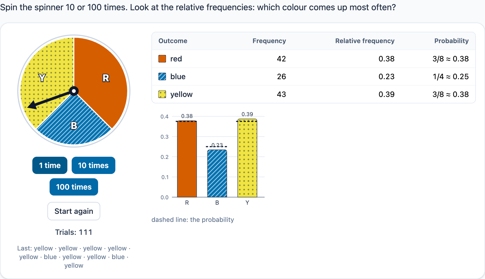

# @citolab/pci-chance-tools

> [!WARNING]
> **Experimental (alpha). Just for inspiration.** This PCI is a technical showcase, made by software developers without
> much knowledge of the subject it could be used for. Its content, terms and scoring have not been checked by subject
> experts or assessment specialists, and it has never been used in an assessment. It is offered as is, without any
> warranty.

A QTI 3 Portable Custom Interaction (PCI) for probability ("kans", "experimentele kans", "kansboom"). The candidate
does probability experiments with dice, a spinner, a bag of coloured balls or coins: 1, 10 or 100 trials at a time,
with a frequency table and a bar chart of the relative frequencies that grow as they go. The same tools carry two
scored tasks: **design** a spinner or bag with given probabilities ("make a spinner where the chance of red is 3/8"),
and **fill in the probability tree** of a two-step experiment. The item author sets up the tool, the task, the targets
and the margin in the PCI itself. Made with [tspci](https://github.com/Citolab/tspci).

<p align="center">
  
</p>

## What it does

- **The tools**, drawn as SVG:
  - **dice**: 1 to 3 dice with 2 to 20 faces of your own (`1 2 3 4 5 6`, `A B C D`, or `6 no no no no no`; faces
    with the same label count together); the outcome of a trial is the sum or the faces one by one;
  - **a spinner**: sectors with a size, a label, a letter and a colour; 1 to 3 spins per trial;
  - **a bag of balls**: colours with a count, a label and a letter; 1 to 3 balls per trial, put back or not;
  - **coins**: 1 to 3 coins; heads or tails per coin, or the number of heads.
- **Colour is never the only clue**: the eight colours are the colour-blind safe Okabe–Ito set, each with its own
  pattern (stripes, dots, hatching…), and every sector and ball carries its letter. Table rows and bars repeat the
  colour, pattern and label.
- **Doing the experiment**: the buttons "1 time", "10 times" and "100 times" (at most 10 000 trials). A run animates its
  last trial once (the pointer turns, the dice tumble, the coins flip, the balls pop out of the bag); the table and
  chart follow when it stops. With `prefers-reduced-motion` nothing moves and the table updates at once. "Start again"
  starts a new series. The live status line says what happened ("Done 10 times, 23 in total. Last outcome: red.").
- **The frequency table** lists every possible outcome (up to 36; beyond that the ones that came up) with its
  frequency and relative frequency; with `data-show-theory` also the probability ("3/8 ≈ 0.38"). The **bar chart**
  shows the relative frequencies, with the probabilities as dashed lines when they are shown. The last ten outcomes
  are listed under the tool.
- **Seeded randomness**: every session gets a seed, kept in the state with the runs. Trial *n* follows from the seed
  and *n* alone, so a restored state (or a tool-mode response handed back) shows exactly the same history.
  `data-seed` fixes the seed, for a screenshot or a test.
- **Design mode**: the candidate makes a spinner of equal sectors (choose a colour, click a sector, `−`/`+` for the
  number of sectors) or fills a bag (`−`/`+` or a number per colour). The colours are those of the author's spinner or
  bag (a colour with size or count 0 is in the palette only). The probabilities of the design are not shown. With
  "experiments" on, the candidate can try the design out; changing it starts a new experiment.
- **Tree mode**: the tool done twice (two dice, two coins, two spins, two balls) as a tree with a field on every
  branch, optionally a field per path ("probability of the path") and the probability of an event made of paths
  ("two balls of the same colour"). Without putting back, the second stage follows the first. The outcomes on the
  branches are given, or the candidate chooses them (their order does not matter). Fractions (`3/8`, also `6/16`),
  decimals (`0.375`, `0,375`) and percentages (`37,5%`) are accepted; anything but digits, `/`, `,`, `.` and `%` is
  refused as it is typed.
- **Keyboard**: every button, field and select is a native control. The design spinner's sectors are buttons in one
  tab stop: the arrow keys (and Home/End) move between them, Enter or Space colours one; a screen reader hears "Sector
  3 of 8: red".
- **Language**: `data-language` `en` or `nl` for the texts and numbers (decimal comma in Dutch). Responses are the same
  in every language (`0.375`, `H,T`).
- **Authoring mode**: "Set up the experiment…" in an authoring system that supports it (qti-construction, TAO with
  tspci-tao, the dev page), in two tabs. **Tool**: the tool and its set-up (dice count and faces with D4 … D20 buttons,
  the sectors or colours, spins or draws, putting back). **Task**: the mode; the targets (outcome, probability as a
  fraction, points) and an exact size for a design; the outcomes on the branches, the path fields, the event and the
  margin for a tree; whether the candidate may also run experiments. A preview shows the tool, the solution's score
  and the correct tree. `validate()` reports problems in the author's language.
- **Delivery**: the state (the experiment, the design, the tree) is saved and restored; in review (`status:
  "solution"`) the PCI shows the correct response from the declaration, or else the solution that follows from the
  settings (the smallest spinner or bag that meets the targets; the tree filled in), read-only. Several interactions
  of this type on one page each get their own object.

## What can be configured

Every setting is a `data-` attribute of the interaction, as text. `dist/authoring.json` describes them for authoring
systems.

| setting                     | attribute          | default              | what                                                                 |
| --------------------------- | ------------------ | -------------------- | -------------------------------------------------------------------- |
| Instruction                 | `data-prompt`      | the example question | shown above the experiment                                           |
| Task                        | `data-mode`        | `tool`               | `tool`, `design` or `tree`                                           |
| Experiment                  | `data-setup`       | empty: the example   | written by the authoring mode, as JSON (below)                       |
| Show the probabilities      | `data-show-theory` | `false`              | a probability column and dashed lines in the chart                   |
| Seed                        | `data-seed`        | empty: per session   | a fixed series of random numbers                                     |
| Language                    | `data-language`    | `en`                 | `en` or `nl`: the texts and numbers                                  |

```json
{
  "tool": "bag",
  "bag": { "balls": [{ "label": "red", "letter": "R", "color": 0, "count": 3 }, { "label": "blue", "letter": "B", "color": 1, "count": 2 }], "draws": 2, "replace": false },
  "tree": { "labels": "given", "paths": true, "event": { "text": "two balls of the same colour", "paths": ["red,red", "blue,blue"] } },
  "margin": 0.005,
  "experiments": true
}
```

- **The tools**: `dice: { count, faces: [...], combine: "sum" | "sequence" }`, `coins: { count, combine }` (`sum`:
  the number of heads), `spinner: { sectors: [{ label, letter, color, count }], spins }` (`count` is the size),
  `bag: { balls: [{ label, letter, color, count }], draws, replace }`. Colours 0–7: red, blue, yellow, green, orange,
  light blue, pink, grey. Labels have no commas: an outcome of several steps is `red,blue`.
- **Design**: `targets: [{ "outcome": "red", "probability": "3/8", "points": 1 }]` (at most 4) and optionally
  `size` (exactly this many sectors or balls). Only a spinner or a bag can be designed.
- **Tree**: `labels` `given` or `choose`, `paths` (a field per path), `event` (or `null`), and `margin`: how far a
  decimal or percentage may be from the exact probability (0.005: two decimals rounded, 1/3 → 0.33). A fraction must
  be exactly equivalent. At most 4 outcomes per stage.
- Empty or missing parts: the example of the mode (an 8-sector spinner to explore; a spinner for red 3/8 and blue 1/4;
  a bag of 3 red and 2 blue to draw two from).

## Scoring

**Tool mode** (`human`): the response is a single string, the experiment log as JSON, for a rater or a later
interaction. Declare it `cardinality="single" base-type="string"`.

```json
{ "tool": "spinner", "trials": 111, "outcomes": { "red": 42, "blue": 26, "yellow": 43 }, "runs": [100, 10, 1], "seed": 2026, "start": 0 }
```

**Design and tree mode** (`custom`): the PCI checks the answer against the author's settings and reports a record
(`cardinality="record"`):

| field                           | type      | what                                                                        |
| ------------------------------- | --------- | --------------------------------------------------------------------------- |
| `score`, `maxscore`             | `integer` | the points of the checks that pass, of all checks                           |
| `correct`                       | `integer` | 1 when every check passes                                                   |
| `target1` … `target4`           | `integer` | design: 1 when the design gives that target's outcome exactly its probability (6/16 is 3/8) |
| `probability1` … `probability4` | `string`  | design: the probability the design gives that outcome, in lowest terms     |
| `value1` … `value4`             | `float`   | design: the same as a number                                                |
| `size`, `sizeCheck`             | `integer` | design: the number of sectors or balls; 1 with exactly the size asked for (only with a size) |
| `branch1` … `branch20`          | `integer` | tree: 1 per right branch (outcome and probability), the first stage first, then top to bottom |
| `path1` … `path16`              | `integer` | tree: 1 per right path probability, top to bottom                          |
| `answer`, `answerValue`         | `string`, `float` | tree: the probability of the event as written (normalized: `2/5`, `0.4`) and as a number |
| `answerCheck`                   | `integer` | tree: 1 when it is right (within the margin for a decimal)                  |
| `trials`                        | `integer` | the trials the candidate ran                                                |
| `design`, `tree`                | `string`  | the design or the filled-in tree as JSON (for `setResponse` and a rater)   |

Each target, the size, each branch, each path and the event is worth its points (a target its `points`, the others 1).
A wrong outcome on a first-stage branch makes the branches under it wrong as well.

- **Copy the score**: `score` to `SCORE`, as below.
- **Your own response processing**: test single fields, such as `<qti-field-value field-identifier="branch3">`, or
  score the simple numbers yourself: `value1` (a design's probability) or `answerValue` (the event) with
  `<qti-equal tolerance-mode="absolute" tolerance="0.005">`, or `probability1` with `<qti-match>` against `3/8`.
- `match_correct` is not offered: QTI's `match` cannot compare records, and many designs and trees are right.
- **No response**: until the candidate runs a trial (tool), changes the design or fills in a field, `getResponse()`
  reports nothing.

```xml
<qti-response-declaration identifier="RESPONSE" cardinality="record"/>
<qti-outcome-declaration identifier="SCORE" cardinality="single" base-type="float">
  <qti-default-value><qti-value>0</qti-value></qti-default-value>
</qti-outcome-declaration>
<qti-response-processing>
  <qti-response-condition>
    <qti-response-if>
      <qti-not><qti-is-null>
        <qti-field-value field-identifier="score"><qti-variable identifier="RESPONSE"/></qti-field-value>
      </qti-is-null></qti-not>
      <qti-set-outcome-value identifier="SCORE">
        <qti-field-value field-identifier="score"><qti-variable identifier="RESPONSE"/></qti-field-value>
      </qti-set-outcome-value>
    </qti-response-if>
  </qti-response-condition>
</qti-response-processing>
```

**State and response.** `getState()` holds the experiment (seed, start, runs), the design and the tree, and the log.
`setResponse` (and `boundTo` without a state) reads the `design` or `tree` field, or a tool-mode log; the other
fields follow from it. In `status: "solution"` the `design` or `tree` field of the declared correct response is shown;
without one, the solution of the settings.

## Using it

```sh
npm install @citolab/pci-chance-tools
```

| file                                        | what                                                                      |
| ------------------------------------------- | ------------------------------------------------------------------------- |
| `dist/index.js`                             | the PCI (AMD module, everything bundled: the package has no dependencies) |
| `dist/authoring.json`                       | settings, response, scoring and the authoring mode, for authoring systems |
| `dist/sbom.cdx.json`                        | CycloneDX SBOM of the bundle                                              |
| `dist/tao-pci-chanceTools_<version>.zip`    | the PCI for TAO: Settings → Portable Custom Interactions → Add            |
| `chanceTools.svg`, `example.png`            | icon and screenshot                                                       |

In a QTI 3 item, with `index.js` at `resources/pci/index.js` of the package:

```xml
<qti-response-declaration identifier="RESPONSE" cardinality="record"/>
…
<qti-portable-custom-interaction response-identifier="RESPONSE" module="pci" custom-interaction-type-identifier="chanceTools"
  data-language="nl" data-mode="design" data-setup="{&quot;tool&quot;:&quot;spinner&quot;,…}">
  <qti-interaction-modules>
    <qti-interaction-module id="pci" primary-path="../resources/pci/index"></qti-interaction-module>
  </qti-interaction-modules>
  <qti-interaction-markup></qti-interaction-markup>
</qti-portable-custom-interaction>
```

Source and the other examples: [Citolab/tspci-examples](https://github.com/Citolab/tspci-examples).
