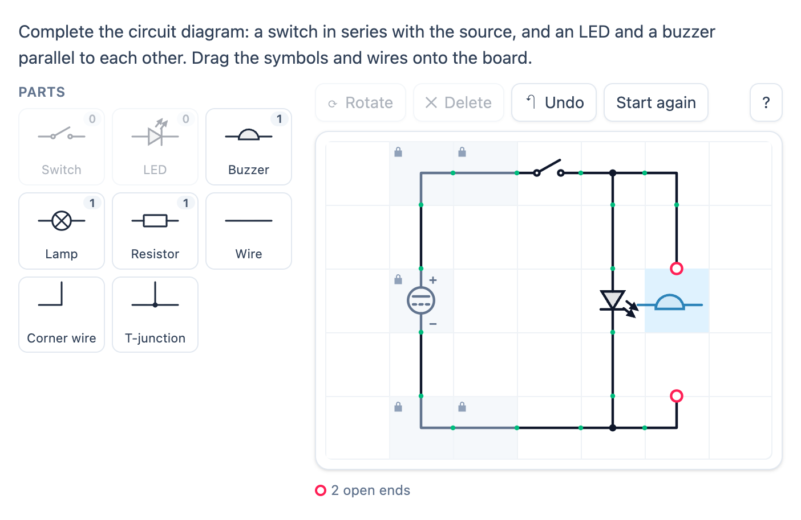

# @citolab/pci-circuit-builder

> [!WARNING]
> **Experimental (beta).** This PCI takes the idea of an interaction in an existing exam; it is not a copy of it. It is
> offered as is, without any warranty, and has never been used in an assessment. Try it out with candidates and check
> its content and scoring before you use it in one.

A QTI 3 Portable Custom Interaction (PCI) in which the candidate completes a circuit diagram on a grid: they drag
circuit symbols and straight, corner and T-wires onto the board, rotate them and connect them to the parts the author
put there (a source, wires, a transistor). The PCI turns the grid into a netlist and checks the circuit itself: closed,
in series, parallel, the right way round, which lamps are lit. The candidate can also test which materials conduct, and
break a lamp to see what the other lamps do (series or parallel). The item author builds the board, the palette, a solution and the checks in
the PCI itself. Made with [tspci](https://github.com/Citolab/tspci).

<p align="center">
  
</p>

## What it does

- **The symbols**, drawn as SVG in the European (IEC) style used in Dutch schools: resistor (rectangle), variable
  resistor, lamp (circle with a cross), LED, diode, switch, push button, buzzer, motor, LDR, NTC, fuse, voltmeter,
  ammeter, cell, battery, DC source, AC source, NPN transistor; and wires: straight, corner, T-junction, junction
  (a cross, joined) and crossing wires (not joined). Letters and `+`/`−` stay upright when a part turns.
- **Test materials**: a sample between two crocodile clips, each with its own shape and colour. Conductors: aluminium
  foil (`aluminiumFoil`), copper (`copper`), an iron nail (`ironNail`), pencil lead (`graphite`); insulators: cotton
  (`cotton`), wood (`wood`), plastic (`plastic`), glass (`glass`), rubber (`rubber`). The author puts the ones they want
  in the palette (an item without a palette does not get them). The analysis treats a conductor as a closed switch (a
  branch without resistance worth mentioning) and an insulator as open: no current goes through it, so a lamp in series
  with cotton stays off and the `closed` check fails. Series, parallel and the topology are about the drawing: the
  sample counts there like any component (`cotton(1-2) dcSource(3>1) lamp(2-3)`).
- **Breaking lamps** (`data-lamp-tool`, off by default): the candidate chooses a lamp (also a locked one) and presses
  "Break lamp" (or `B`); a broken lamp is drawn with a snapped filament and conducts no current, and the other lamps
  follow: in series they go out, in parallel they stay lit. "Repair lamp" (or `B` again) makes it whole. A screen reader
  hears "broken" and "lit" in the cell's name. Use it with `data-show-current`, or the candidate sees no lamp light.
  The broken lamps are in the state and in the response's `board` (`"broken": true`); a lamp that is moved takes its
  mark along, one that is removed loses it.
- **Placing**: drag a part from the palette onto a cell, or choose a part (it stays chosen) and click cells. Drag a
  part on the board to move it (onto another part: they swap), off the board to remove it. Rotate with the button, `R`
  or a double click. Delete, Undo and Start again. The palette shows how many of a part are left.
- **Keyboard**: the board is a grid with the selected cell as its active descendant. The arrow keys move over the
  board, `Enter` places the chosen part, `Shift` + arrow moves a part, `R` rotates, `Delete` removes, `Ctrl+Z` undoes,
  `Escape` drops the chosen part. A screen reader hears every cell ("Row 3, column 2: DC source, turned 90°, locked, 2
  open ends") and every step in a live status line.
- **Connections**: terminals lie on the middle of the cell edges, so a part connects to its neighbour when their
  terminals meet. Joints get a small green dot, open ends a red ring (`data-show-open-ends`).
- **Locked parts**: what the author locks is part of the question; the candidate cannot move, rotate or remove it.
  Unlocked preset parts are a start the candidate may change.
- **Analysis** (`src/circuit.ts`, no imports, tested in node with `npm test`): the wires make nodes; the components
  are branches between them. A component works when it lies in a loop with a source (biconnected blocks; switches count
  as closed); two components are in series when every loop through one goes through the other, parallel when they sit
  across the same two nodes; an LED, diode, battery or cell points the right way when there is a loop from the source's
  `+` into its anode (or `−`) and from its cathode (or `+`) back to the source's `−`. A source joined to itself by wires
  is a short circuit.
- **Topology**: the circuit without its layout, as a canonical netlist (`buzzer(1-2) dcSource(1>3) led(2>1)
  switch(2-3)`): every component with its nodes, numbered so the text is the smallest possible, polar parts as
  `in>out`. The same circuit gives the same text wherever the parts lie, however they are turned (when that does not
  matter) and however the wires run.
- **Show current** (`data-show-current`, off by default because it gives away whether the circuit is closed): a closed
  circuit glows, lamps and a forward LED light up. Parts that are open by themselves (an insulator, a broken lamp) do
  not keep the rest from glowing: a lamp parallel to a broken one stays lit.
- **Authoring mode**: the item author builds everything in the PCI itself (`getAuthoringInstance`), via "Configure…"
  ("Build the circuit…") in an authoring system that supports it (qti-construction, TAO with tspci-tao, the dev page),
  in four tabs: **Board** (the size, and the parts the candidate starts with; new parts are locked, untick Locked to
  let the candidate change one), **Solution** (complete the circuit as a candidate would), **Palette** (which parts,
  and how many of each) and **Checks** (below; each shows whether the solution passes it, with the solution's score and
  topology). `validate()` reports an empty palette, a solution that fails a check or needs parts the palette does not
  have, and a solution check without a solution.
- **Delivery**: the candidate's parts are saved as the item's state (every change in the log) and restored. In review
  (`status: "solution"`) the PCI shows the correct response from the response declaration, or else the author's
  solution, read-only. Several interactions of this type on one page each get their own object.
- **The original exam format**: a preset in the format of the Dutch exam interaction
  (`[{ "Preset": [{ "gridx": 1, "gridy": 0, "id": "draadH", "rotation": 180 }] }]`) is read as it is, all locked: the
  rotations follow the same convention (clockwise; a corner at 0 joins W and N, a T at 0 joins W, E and N, a
  transistor at 0 has its base W, collector N and emitter S) and the Dutch ids (`draad`, `draadH`, `draadT`,
  `gelijkspanningsbron`, `zekering`, `weerstand`, `zoemer`, …) map to the parts.

## What can be configured

Every setting is a `data-` attribute of the interaction, as text. `dist/authoring.json` describes them for authoring
systems.

| setting                     | attribute                | default                | what                                                            |
| --------------------------- | ------------------------ | ---------------------- | --------------------------------------------------------------- |
| Instruction above the board | `data-prompt`            | the example's question | also part of the board's accessible name                        |
| Circuit                     | `data-circuit`           | empty: the example     | written by the authoring mode, as JSON (below)                  |
| Mark open wire ends         | `data-show-open-ends`    | `true`                 | red rings on terminals with nothing on the other side           |
| Light up a closed circuit   | `data-show-current`      | `false`                | gives away whether the circuit is closed                        |
| Break and repair lamps      | `data-lamp-tool`         | `false`                | the "Break lamp" tool, to see series versus parallel            |
| Language                    | `data-language`          | `en`                   | `en` or `nl`: the texts of the PCI                              |

```json
{
  "columns": 7, "rows": 5,
  "preset": [{ "type": "dcSource", "x": 1, "y": 2, "rotation": 90, "locked": true }, { "type": "wire", "x": 2, "y": 0, "rotation": 0, "locked": true }],
  "palette": "switch:1 led:1 buzzer:1 wire corner tee",
  "solution": [{ "type": "switch", "x": 3, "y": 0, "rotation": 0 }, { "type": "led", "x": 4, "y": 2, "rotation": 90 }],
  "checks": [
    { "type": "parts", "count": { "switch": 1, "led": 1, "buzzer": 1 }, "exact": true, "points": 1 },
    { "type": "series", "parts": ["switch", "source"], "points": 1 },
    { "type": "parallel", "parts": ["led", "buzzer"], "points": 1 },
    { "type": "forward", "parts": ["led"], "points": 1 },
    { "type": "closed", "points": 1 }
  ]
}
```

- **Size**: 2 to 16 columns and rows. `x` and `y` count from 0, top left; one part per cell.
- **Palette**: part types with an optional count (`led:1`; without a count as many as the candidate likes). Without a
  palette: every part. The types: `wire`, `corner`, `tee`, `cross`, `crossover`, `resistor`, `variableResistor`,
  `lamp`, `led`, `diode`, `switch`, `pushButton`, `buzzer`, `motor`, `ldr`, `ntc`, `fuse`, `voltmeter`, `ammeter`,
  `cell`, `battery`, `dcSource`, `acSource`, `transistor`, and the test materials `aluminiumFoil`, `copper`, `ironNail`,
  `graphite`, `cotton`, `wood`, `plastic`, `glass`, `rubber` (also by their Dutch names: `aluminiumfolie`, `koper`,
  `spijker`, `potloodstift`, `katoen`, `hout`, `glas`).
- **Solution**: the parts besides the locked ones, as the candidate would leave the board.

### The checks

At most 8, each worth `points` (default 1). A part in a check is a type, or `source` for any source. Counts go over the
whole board, locked parts included.

| check      | passes when                                                                                                            | rubric line                                   |
| ---------- | ---------------------------------------------------------------------------------------------------------------------- | --------------------------------------------- |
| `parts`    | the board has at least `count` of each; with `exact`, exactly that many and no other components than these and the locked ones | "the right symbols"                  |
| `closed`   | a source that is not short-circuited, every component in a loop with a source and none short-circuited, no open wire ends (unless `allowOpenEnds`) | "a closed, working circuit" |
| `series`   | there are different components of these types, each pair in series                                                    | "the switch in series with the source"        |
| `parallel` | there are different components of these types, each pair across the same two nodes                                    | "the LED and the buzzer parallel"             |
| `forward`  | every LED / diode / battery / cell of these types points with the current of the source (a DC source first, then a battery or cell) | "the LED the right way round"    |
| `solution` | the topology is the same as the solution's                                                                             | "the same circuit as the answer model"        |
| `lit`      | every part of these types that is not broken has current (a lamp is lit, an LED lights the right way round); with `material`, that test material is on the board in series with each; with `off`, none of them has current; with `broken`, only when the candidate broke a lamp | "the lamp lights with aluminium foil", "the lamp stays off with cotton", "the other lamp stays lit when one is broken" |

```json
{ "type": "lit", "parts": ["lamp"], "material": "aluminiumFoil" }
{ "type": "lit", "parts": ["lamp"], "material": "cotton", "off": true }
{ "type": "lit", "parts": ["lamp"], "broken": true }
```

Broken lamps only count for `lit`: the other checks look at the circuit as the candidate built it, so a lamp the
candidate broke to try something out does not cost the `closed` point. An insulating test material does make a circuit
open. The authoring mode does not try a `lit` check with `broken` on the solution (it has no broken lamps).

`parallel` means connected across the same two points: an LED with its own series resistor is not parallel to a
buzzer, its branch is. Use `solution` (topology) for "the same circuit as this one".

## Scoring

The PCI is made for `custom` scoring (`authoring.json`: `"scoring": ["custom", "human"]`): it evaluates the author's
checks, the item's response processing turns them into points. The response is a record (`cardinality="record"`):

| field                | type      | what                                                                       |
| -------------------- | --------- | -------------------------------------------------------------------------- |
| `score`              | `integer` | the points of the checks that pass                                         |
| `maxscore`           | `integer` | the points of all checks                                                   |
| `correct`            | `integer` | 1 when every check passes (and there is at least one), else 0              |
| `check1` … `check8`  | `integer` | 1 or 0 per check, in the order of the checks; only the checks there are    |
| `topology`           | `string`  | the canonical netlist (above), the same for every layout of a circuit      |
| `board`              | `string`  | every part on the grid, the locked and broken ones marked, as JSON, for a rater |

```json
{ "record": [
  { "name": "score", "base": { "integer": 4 } }, { "name": "maxscore", "base": { "integer": 5 } },
  { "name": "correct", "base": { "integer": 0 } },
  { "name": "check1", "base": { "integer": 1 } }, { "name": "check2", "base": { "integer": 1 } },
  { "name": "check3", "base": { "integer": 1 } }, { "name": "check4", "base": { "integer": 0 } },
  { "name": "check5", "base": { "integer": 1 } },
  { "name": "topology", "base": { "string": "buzzer(1-2) dcSource(1>3) led(1>2) switch(2-3)" } },
  { "name": "board", "base": { "string": "{\"columns\":7,\"rows\":5,\"parts\":[…]}" } }
] }
```

- **One point per rubric line**: make a check per line and copy `score` and `maxscore` to the outcomes, as below. A
  rubric line that needs two checks ("the switch in series and the others parallel") is two checks of which only one
  has points, and a condition on both fields in the response processing; or give each half a point.
- **Your own response processing**: test single fields, `<qti-field-value field-identifier="check3">` equal to 1, and
  give points as you like (for example: no points for parallel unless the circuit is closed).
- **Topology**: compare `topology` with a `<qti-match>` against the solution's topology (shown in the authoring mode's
  Checks tab), or use the `solution` check. Either way the layout does not count.
- `match_correct` is not offered: QTI's `match` cannot compare records, and the same circuit can be drawn in many ways.
- `human`: use the PCI without automatic scoring, for a human rater (`board` has the whole board).
- **No response**: until the candidate changes the board (or breaks a lamp), `getResponse()` reports nothing.

```xml
<qti-response-declaration identifier="RESPONSE" cardinality="record"/>
<qti-outcome-declaration identifier="SCORE" cardinality="single" base-type="float">
  <qti-default-value><qti-value>0</qti-value></qti-default-value>
</qti-outcome-declaration>
<qti-outcome-declaration identifier="MAXSCORE" cardinality="single" base-type="float">
  <qti-default-value><qti-value>5</qti-value></qti-default-value>
</qti-outcome-declaration>
…
<qti-response-processing>
  <qti-response-condition>
    <qti-response-if>
      <qti-not><qti-is-null>
        <qti-field-value field-identifier="score"><qti-variable identifier="RESPONSE"/></qti-field-value>
      </qti-is-null></qti-not>
      <qti-set-outcome-value identifier="SCORE">
        <qti-field-value field-identifier="score"><qti-variable identifier="RESPONSE"/></qti-field-value>
      </qti-set-outcome-value>
    </qti-response-if>
  </qti-response-condition>
</qti-response-processing>
```

**State and response.** `getState()` holds the candidate's parts, the broken lamps (`broken`, cells as `"x,y"`) and the
log, so the board can be restored; a state saved by an earlier version (without `broken`) still loads. `setResponse`
(and `boundTo` without a state) reads the `board` field, or a board as a string, broken lamps included; the other
fields follow from it. In `status: "solution"` the board of the declared correct response is shown (a string, or a record value with
the field `board`); without one, the author's solution.

## Using it

```sh
npm install @citolab/pci-circuit-builder
```

| file                                         | what                                                                      |
| -------------------------------------------- | ------------------------------------------------------------------------- |
| `dist/index.js`                              | the PCI (AMD module, everything bundled: the package has no dependencies) |
| `dist/authoring.json`                        | settings, response, scoring and the authoring mode, for authoring systems |
| `dist/sbom.cdx.json`                         | CycloneDX SBOM of the bundle                                              |
| `dist/tao-pci-circuitBuilder_<version>.zip`  | the PCI for TAO: Settings → Portable Custom Interactions → Add            |
| `circuitBuilder.svg`, `example.png`          | icon and screenshot                                                       |

In a QTI 3 item, with `index.js` at `resources/pci/index.js` of the package:

```xml
<qti-response-declaration identifier="RESPONSE" cardinality="record"/>
…
<qti-portable-custom-interaction response-identifier="RESPONSE" module="pci" custom-interaction-type-identifier="circuitBuilder"
  data-language="nl" data-circuit="{&quot;columns&quot;:7,&quot;rows&quot;:5,…}">
  <qti-interaction-modules>
    <qti-interaction-module id="pci" primary-path="../resources/pci/index"></qti-interaction-module>
  </qti-interaction-modules>
  <qti-interaction-markup></qti-interaction-markup>
</qti-portable-custom-interaction>
```

## Inspired by the DEPP Circuit and LampeDouble PCIs

The test materials and the lamp tool (version 1.0.0-beta.2) take two ideas from PCIs of the French DEPP (Ministère de
l'Éducation nationale, by Jean-Philippe Rivière / Wiquid), [janfix/extension-wiquid-depp](https://github.com/janfix/extension-wiquid-depp)
(`views/js/pciCreator/ims/Circuitpci` and `LampeDoublepci`): a circuit in which the pupil tests whether aluminium foil
or cotton conducts, and two lamps in which the pupil blows one to see what happens to the other. They are re-implemented
here from scratch in the circuit builder's own analysis (no code or images of the originals), so this package stays
MIT. What is new compared with them: any material from a list, in any circuit the author builds; breaking any lamp,
in series, parallel or mixed circuits; checks that score it; keyboard and screen reader access; Dutch and English.

Source and the other examples: [Citolab/tspci-examples](https://github.com/Citolab/tspci-examples).
