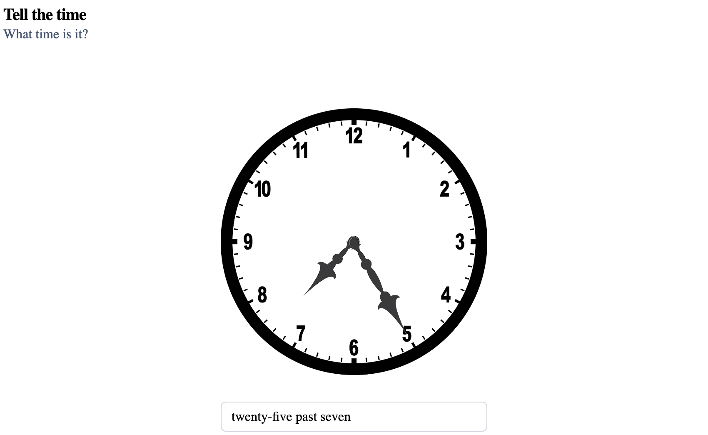

# @citolab/pci-clocks

> [!WARNING]
> **Experimental (alpha). Just for inspiration.** This PCI is a technical showcase, made by software developers without
> much knowledge of the subject it could be used for. Its content, terms and scoring have not been checked by subject
> experts or assessment specialists, and it has never been used in an assessment. It is offered as is, without any
> warranty.

A QTI 3 Portable Custom Interaction (PCI) for telling the time (Dutch: *klok kijken*). The candidate reads an analog or
digital clock and types the time, in digits or in words, or sets the clock to a time. The response is the time as
`HH:MM`. Made with [tspci](https://github.com/Citolab/tspci).

<p align="center">
  
</p>

## What it does

- **Read the clock** (`typeOfQuestion: askTime`): the clock shows the time of the `initialtime` setting and the
  candidate types it. Digits and words both work, in English and Dutch: `7:25`, `19:25`, `twenty-five past seven`,
  `vijf voor half acht`. They all give the same response.
- **Set the clock** (`typeOfQuestion: setClock`): the candidate turns the hands of the analog clock, or sets the hours
  and minutes of the digital one with its arrows, in jumps of 1, 5 or 15 minutes (`minutePerJumps`).
- **Analog or digital**, each with skins: classic, learning clock or Roman numerals (analog); classic, alarm clock or
  LCD screen (digital). The author picks the clock and its skin in the PCI's own authoring mode ("Choose the clock…").
- A digital clock can be a 24-hour or a 12-hour clock (`twentyFourHour`).

## Settings

| setting | editor | what it does |
| --- | --- | --- |
| `title`, `question` | `text`, `textarea` | above the clock |
| `typeOfQuestion` | `enum` | `askTime` (read the clock) or `setClock` (set it) |
| `typeOfClock`, `skin` | `pci` | the clock and its look, chosen in the authoring mode |
| `twentyFourHour` | `boolean` | 24-hour clock (digital only) |
| `minutePerJumps` | `enum` | `1`, `5` or `15` minutes per jump when setting the clock |
| `initialtime` | `time` | the time the clock shows at the start (`HH:MM`) |
| `language` | `enum` | `en` or `nl`: the clock's own texts, and the language of times in words |

## Response and scoring

`single` `string`: the time as `HH:MM`. A time read off an analog clock or typed in words has no morning or afternoon,
so it is reported on a 12-hour clock (`04:10` for "ten past four", for `4:10` and for `16:10`). A 24-hour digital clock
that the candidate sets reports the 24-hour time. The author gives the correct response in the item
(`match_correct`), or a human rater scores it (`human`).

## Fonts and images

The digital clock uses the DigitTech font ([fontspace](https://www.fontspace.com/digit-tech-font-f106535), public
domain), bundled in the PCI. The clock face and hands are Cito's own images.

## Development

```bash
npm install
npm run dev           # the dev page, with the settings and the authoring mode
npm test              # the tests of reading times (node)
npm run test:stories  # the Storybook tests
```
