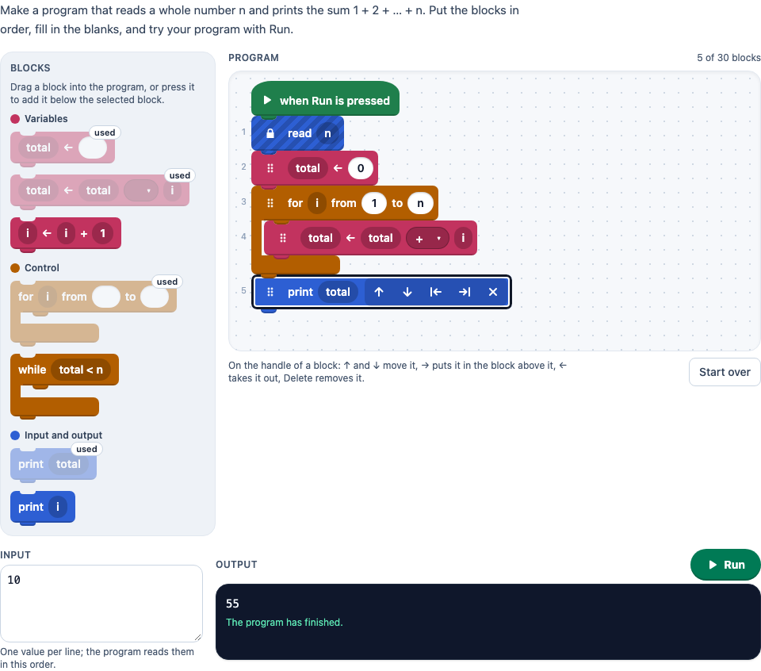

# Code blocks

> [!WARNING]
> **Experimental (beta).** This PCI is a new implementation of an open-source PCI (see "Source and licence"). It is
> offered as is, without any warranty, and has never been used in an assessment. Try it out with candidates and check
> its content and scoring before you use it in one.

A PCI in which the candidate **builds a program from code blocks**: they drag blocks (set a variable, read input,
print, if, if/else, while, repeat, for) from a palette into a program, nest them, fill in the blanks in the blocks
(text boxes and dropdowns), type the input and press **Run** to see what the program prints, or an error in plain
language with its line. The labels of the blocks are the author's pseudocode, in any language.

It is a port of the [Code Block Programming Interaction](https://github.com/rdncuee/CBP) for TAO, with one big
difference: the original attached JavaScript to every block and ran it; this PCI has a small block language and an
interpreter of its own and never runs code that an author or a candidate wrote (see below).

The default item asks for the sum 1 + 2 + … + n, with a locked `read n` line, seven blocks (two of them distractors),
blanks to fill in, the solution and three test cases.

<p align="center"></p>

## What the candidate does

- **Build the program.** Drag a block from the palette into the program (above or below a line, into the empty branch
  of a block, onto the lower half of a loop or condition to put it inside), or press it to add it below the selected
  block. Drag a block by its handle to move it, or onto the palette to remove it. Blocks that hold blocks are C-shapes
  that wrap their inside; an if/else has two mouths with an else bar between them. Removing a block
  that holds blocks leaves them in its place (as in the original).
- **Keyboard.** Every block has a handle (a button): `↑` / `↓` move the block one line through the listing (into a
  loop and out of it again, past other blocks), `→` puts it into the block above it, `←` takes it out of its block,
  `Delete` removes it. The selected block also has buttons for this (move up, move down, out of the block, into the
  block above, remove), for touch and mouse. The focus stays on the block that moved.
- **Fill in the blanks**: a text box (for a value, an expression or a name) or a dropdown with the author's choices.
- **Input and Run.** The input is a value per line (when the author allows, the candidate changes it). Run shows the
  printed lines, or the error that stopped the program: "Error on line 3: the variable total has no value yet." The
  line with the error is marked in the editor. A change to the program or the input clears the output.
- **Screen readers**: the program is a list; a handle is read as "Line 4: total ← total + i", the blanks as "Blank 1
  on line 4", locked blocks as locked; every add, move, remove and run is announced in a live status line.
- **Look**: block-based programming style. Blocks are puzzle pieces with white bold text, a notch on top and a tab below,
  so a stack looks snapped together. The program hangs from a "when Run is pressed" hat block on a dotted canvas. The
  hat is only drawn: it is not part of the program, the `code` or the `codeblock`. If, if/else, while, repeat and for
  are C-shapes: a top piece with an inner tab, an arm down the inside, and a closing bottom bar with its own tab (for
  if/else also an else bar and a second mouth). The C is one continuous fill with no seams, a thin gap separates a C
  inside a C, and an empty C shows a slot to drop a block into. In the palette the containers are small complete
  C-shapes. Text boxes are white
  pills, dropdowns are pills in a darker shade of the block with a ▾, and fixed parts are rounded reporter pills.
- **Colours**, with a legend in the palette, which groups the blocks by category. White text on each meets WCAG AA:
  variables (`set`) raspberry `#C2335F`, 5.34:1; control (if, if/else, while, repeat, for) orange `#B25E00`,
  4.67:1; input and output blue `#2D5FD3`, 5.69:1; the hat green `#1F7F4C`, 5.00:1. The dark shades of the dropdowns
  are 6.9–8.1:1.
- **States**: the selected block has a white ring inside a dark one, drawn inside the piece, so it never covers the
  blocks or bars around it. It is visible on every block colour and on the canvas, and the toolbar sits inside the
  piece. The error line has a red ring. Locked blocks are striped on the whole shape (for a C
  also the arm and the bars; the stripes only darken) and show a lock. Used blocks fade in the palette, with a "used" badge. While dragging, the block is lifted with a
  shadow, and a piece-shaped gap shows where it will snap. Line numbers are kept, small and grey, for the error
  messages.
- Large touch targets, one column in a narrow item (container queries, down to 360 px). The tilt of a dragged block
  and the transitions are off with `prefers-reduced-motion`.
- Limits as in the original: at most 30 blocks in the program (`maxBlocks`), at most 5 levels of blocks inside blocks
  (`maxDepth`), and a used block is used up unless `reuse` is on. The interpreter stops a program after 10 000 steps
  (`maxSteps`, against loops that never end) or 500 printed lines.

## The block language

The author writes the blocks, a line per block: `kind: label`. The **kind** says what the block does, the **label** is
what the candidate sees, with parts in braces:

| in the label | is                                                         |
| ------------ | ---------------------------------------------------------- |
| `{}`         | a text box the candidate fills in                           |
| `{a\|b\|c}`  | a dropdown with these choices (at most 10)                  |
| `{total}`    | fixed text: part of the code, not editable                 |

| kind     | parts in braces, in order                  | example label                         |
| -------- | ------------------------------------------ | ------------------------------------- |
| `set`    | a variable, a value                        | `set: {total} ← {}`                   |
| `input`  | a variable: gets the next input value      | `input: read {n}`                     |
| `print`  | a value (or values separated by commas)    | `print: print {total}`                |
| `if`     | a condition                                | `if: if {n} {<\|>} {0} then`          |
| `ifelse` | a condition; after `\|` the else line      | `ifelse: if {n mod 2 = 0} \| otherwise` |
| `while`  | a condition                                | `while: while {total < n}`            |
| `repeat` | a number of times                          | `repeat: repeat {} times`             |
| `for`    | a variable, from, to (steps of 1)          | `for: for {i} from {1} to {}`         |

Each part takes one pair of braces; the **last part takes the rest of the braces, with the text between them**: in
`set: {total} ← {total} {+|-|*} {i}` the variable is `total` and the value is `total + i` when the candidate chooses
`+`. Text before the first and after the last brace of a part is only label (`for`, `from`, `then`, `times`).
`if/else`, `if-else`, `assign`, `read`, `output` and `write` are accepted as kinds too.

**Values** are numbers (`3`, `2.5`), text in quotes (`"even"`), `true`/`false` and variables. The operators are
`+ - * /`, `div` or `//` (whole division), `mod` or `%` (remainder, with the sign of the divisor), `^` (power),
`= <> != < <= > >=` (and `≠ ≤ ≥`), `and or not`, and brackets. `+` with text joins text. Functions: `abs`, `round`,
`floor`, `ceil`, `sqrt`, `min`, `max`, `length` (also `len`, `lengte`, `longueur`). With `data-language="nl"` the
words `en of niet waar onwaar` work too, with `fr` `et ou non vrai faux`; true and false are printed in that language.
An input value is a number when it reads as one (`5`, `2,5`), otherwise text. A `for` from 1 to 0 does not run.
A condition must be true or false (`if 3` is an error, not "truthy").

A **program** (the starting program, the solution) is a block per line, indented inside a block, with the else of an
if/else as a line of its own at the level of its `if`:

```
* input: read {n}
total ← 0
for i from 1 to n
    total ← total + i
print total
```

A line is plain code that one of the blocks matches (`total ← 0` fills the blank of `set: {total} ← {}`), or
`kind: label` for a block that is not in the palette (such as the locked `read {n}`). `*` in front locks a block: the
candidate cannot move or remove it (but fills its blanks). `#` starts a comment.

## Settings

Every setting is a `data-` attribute of the interaction, as text. `dist/authoring.json` describes them for authoring
systems.

| setting                | attribute           | default        | what                                                                     |
| ---------------------- | ------------------- | -------------- | ------------------------------------------------------------------------ |
| Instruction            | `data-prompt`       | the example's  | above the blocks                                                         |
| Blocks ¹               | `data-blocks`       | empty: the example | the palette, a block per line (above); blocks not in the solution are distractors |
| Starting program ¹     | `data-program`      | empty          | the program at the start, with locked blocks                            |
| Solution ¹             | `data-solution`     | empty          | the correct program: shown in solution status, and the correct response with `code` scoring |
| Input ¹                | `data-inputs`       | empty          | the input at the start, a value per line                                 |
| Test cases ¹           | `data-tests`        | empty          | `5; 3 => 8` per line: input values `=>` the printed lines, at most 8     |
| Change the input       | `data-edit-inputs`  | `true`         | the candidate can change the input                                       |
| Reuse                  | `data-reuse`        | `false`        | a block can be used more than once (the original's repeat flag)          |
| Response and scoring   | `data-scoring`      | `original`     | `original`, `code` or `pci` (below)                                      |
| Most blocks            | `data-max-blocks`   | `30`           | 1 to 60                                                                  |
| Most levels            | `data-max-depth`    | `5`            | blocks inside blocks, 1 to 10                                            |
| Most steps             | `data-max-steps`    | `10000`        | per run                                                                  |
| Language               | `data-language`     | `en`           | `en`, `nl` or `fr`: the texts of the PCI, the example, and the words of the language |

¹ `"editor": "pci"`: written by the authoring mode (below), and still plain text an author can write by hand.

Without blocks the PCI shows the example in the language of the texts (with its prompt, starting program, solution,
input and tests where those are empty). What the PCI could not read of the settings goes to the console.

## Authoring mode

The original had a creator in TAO's item editor; this PCI has an authoring mode (`getAuthoringInstance`). An authoring
system that supports `pci` settings shows a button, **Make the blocks, the solution and the tests…** (in TAO above
the Blocks field, in TAO's own dialog), that opens it. It has four tabs and a list of checks above them:

- **Blocks**: a card per block with its kind, its label, and a row per part in braces (text box, dropdown with its
  choices, or fixed text, named after what the part is: variable, value, condition, …), move up/down, remove, add a
  part, and whether the candidate can add it (a block that is not in the palette is only in the starting program or
  the solution). Each block shows whether it is *in the solution* or a *distractor*.
- **Solution**: the correct program, built in the candidate's own editor (drag and drop, keyboard, blanks), with the
  output of the solution for the input at the start.
- **Starting program**: the same editor, with a *Locked* switch on every block, and *Start from the solution*.
- **Input and tests**: the input at the start and up to 8 test cases (input values → expected lines, one per line), a
  pass/fail per test against the solution, and *Fill in the expected output from the solution*.
- **Checks**, live and in plain language: a kind of block without enough parts in braces, an unclosed brace, a
  dropdown with fewer than two choices, a variable part that is not a name, more blocks or levels than `maxBlocks` /
  `maxDepth`, empty blanks in the solution, tests the solution fails, values with `;`, no tests with
  `data-scoring="pci"`, no solution with `data-scoring="code"`. These keep the author from finishing (`validate()`).
  Notes that do not: no solution yet, a block the solution uses more often than the candidate can add it, a solution
  that stops with an error for the input at the start.

The authoring mode writes the same text settings as above (`blocks`, `program`, `solution`, `inputs`, `tests`, the
settings with `"editor": "pci"`): plain code where reading it back gives the same block, `kind: label` lines where not.
Delivery, the response and the scoring do not change, and an authoring system without the authoring mode shows the
text. When the author changes nothing, the item keeps its own text (an item with the example stays the example). A
filled blank of a block that is not in the palette becomes fixed text when it is written. The texts of the authoring
mode follow the authoring system's language (`en`, `nl`, `fr`). The model is in `src/author.ts` (tested in node), the
view in `src/authoring.tsx`.

In TAO the five settings keep their fields in the properties form, but as one-line text fields (TAO's control for a
`pci` setting): edit multi-line text with the button.

## Response and scoring

**`data-scoring="original"`** (default): `cardinality="single" base-type="string"`, a JSON string with the keys of the
original, so that existing response processing and reports keep working:

```json
{
  "result": ["15"],
  "code": "read n\ntotal ← 0\nfor i from 1 to n\n    total ← total + i\nprint total",
  "codeblock": [
    { "id": "p1", "type": "input", "locked": true },
    { "id": "b1", "type": "set" },
    { "id": "b2", "type": "for", "nests": [[{ "id": "b3", "type": "set" }]] },
    { "id": "b4", "type": "print" }
  ],
  "textbox": [{ "b1.2": "0" }, { "b2.2": "1" }, { "b2.3": "n" }],
  "dropdown": [{ "b3.3": "+" }]
}
```

| key         | in the original                                            | here                                                                                   |
| ----------- | ---------------------------------------------------------- | -------------------------------------------------------------------------------------- |
| `result`    | the printed lines of the last run (`[]` after a change)     | the same; the lines printed before an error, `[]` when the program has not run since the last change |
| `code`      | the generated JavaScript                                    | the program as pseudocode: the labels with the blanks filled in (`___` when empty), four spaces per level |
| `codeblock` | the blocks: `id`, `type`, `nests` (a list per branch)       | the same shape; `id` is `b1`, `b2` … in the order of `data-blocks` (`p1` … for blocks only in the starting program), `type` is `set`, `input`, `print`, `if`, `ifElse`, `while`, `repeat` or `for`, and a locked block has `"locked": true` |
| `textbox`   | `{ id: value }` per text box, in the order of the program  | the same, one per text box, with the id `block.part` (`b2.3`: the third part in braces of `b2`) |
| `dropdown`  | `{ id: value }` per dropdown                                | the same                                                                               |

Score it with custom response processing or by a rater (`human`).

**`data-scoring="code"`**: the `code` above as the response, for `match_correct`: the correct response is the
solution as code (`getCorrectResponse(properties)` gives it to an authoring system). Made for tasks where only one
program is right, such as putting given blocks in order (a Parsons problem).

**`data-scoring="pci"`**: the PCI runs the author's test cases on every change (not only when the candidate presses
Run) and reports a record, `cardinality="record"`, scored `custom`:

| field             | type      | what                                                                      |
| ----------------- | --------- | ------------------------------------------------------------------------- |
| `score`           | `integer` | the number of test cases the program passes                              |
| `maxscore`        | `integer` | the number of test cases                                                  |
| `correct`         | `integer` | 1 when it passes every test case, else 0                                  |
| `test1` … `test8` | `integer` | 1 or 0 per test case, only the tests there are                            |
| `code`            | `string`  | the program as pseudocode                                                 |
| `program`         | `string`  | the original's JSON (above)                                               |

A test case passes when the program, run with its input values, prints exactly its lines (spaces around a line do not
count) and stops without an error.

In every mode `getResponse()` reports nothing until the candidate changed the program or the input, or ran it. A
response handed back (`boundTo`, or a correct response in the response declaration) can be any of the three: the
JSON, a record with `program`, or the code. In solution status the PCI shows the correct response of the declaration,
or else the author's solution, with its output for the author's input; in review and solution status it is read-only.
The whole state (program, input, last run) and a log of every action are saved and restored.

## Using it

```xml
<qti-response-declaration identifier="RESPONSE" cardinality="record"/>
…
<qti-portable-custom-interaction response-identifier="RESPONSE" module="pci" custom-interaction-type-identifier="codeBlocks"
  data-scoring="pci" data-language="nl">
  <qti-interaction-modules>
    <qti-interaction-module id="pci" primary-path="../resources/pci/index"></qti-interaction-module>
  </qti-interaction-modules>
  <qti-interaction-markup></qti-interaction-markup>
</qti-portable-custom-interaction>
```

```sh
npm test               # the interpreter, the model and the authoring model (src/interpreter.ts, blocks.ts, author.ts) in node
npm run test:stories   # the stories' play functions, headless
npm run prod           # dist/index.js
npm run package-qti3   # or package-tao
```

## Source and licence

This PCI is a port of the [Code Block Programming Interaction](https://github.com/rdncuee/CBP) (`rdncuee/CBP`), a
TAO PCI by The National Center for University Entrance Examinations (Japan), © 2022. It is licensed under the MIT
licence (its `LICENSE` file and its README), and so is this PCI: see [LICENSE](LICENSE), which keeps the original's
copyright notice.

What changed, by Stichting Cito Instituut voor Toetsontwikkeling (2026):

- **No JavaScript per block.** In the original an author attached JavaScript to every block and the PCI ran the whole
  program with `new Function` in a Web Worker (with a time limit). This PCI never evaluates code that an author or a
  candidate wrote: it has a small declarative block language (set, input, print, if, if/else, while, repeat, for) and
  an expression parser and interpreter of its own (`src/interpreter.ts`), with a step limit instead of a time limit.
  The kinds of block follow the original's (process, print, if, if/else, while, for); set, input and repeat are new,
  and process blocks with free code are gone.
- Rewritten in TypeScript with Preact and Tailwind in a shadow DOM (the original is jQuery with SortableJS and
  js-beautify); no code or images of the original are used.
- The author writes the blocks as text (`kind: label` with `{}` blanks and `{a|b}` dropdowns) instead of the TAO
  editor's `¥textField_…` and `¥selectBox_…[…]` codes; the starting program, locked blocks and the solution are text
  too. The original's limits are kept as settings (30 blocks, 5 levels, reuse of blocks).
- Japanese texts became English, Dutch and French; the labels of the blocks are the author's.
- The original's creator (TAO authoring panels) became an authoring mode that writes the text settings: blocks, the
  solution and the starting program in the candidate's editor, locks, input and test cases, with live checks.
- A puzzle-piece look in the style of block-based programming (an original design, see above) instead of the
  original's coloured strips with icons.
- Keyboard and screen reader access (the original had drag and drop only), touch, plain-language errors with the line
  instead of `alert` and `confirm` dialogs, the error line marked in the editor, and a start-over button with an inline
  confirmation.
- **The response** keeps the original's JSON keys (with the mapping above); `code` is pseudocode instead of
  JavaScript. New: the `code` response for `match_correct`, PCI scoring with the author's test cases, and the state
  with a log of every action, saved and restored (the original restored the drawn HTML).
