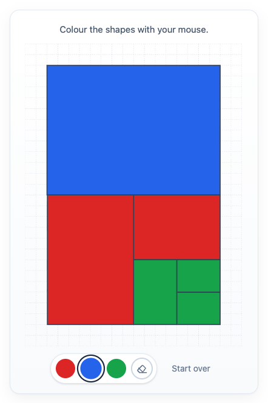

# @citolab/pci-verhoudingen

A QTI 3 Portable Custom Interaction (PCI) in which the candidate colours the parts of a shape, to show proportions:
"colour half of the shape red and a quarter blue". Made with [tspci](https://github.com/Citolab/tspci).

<p align="center">
  
</p>

## What it does

- **Colour**: pick a colour and click a part of the shape to fill it (or focus it and press Enter or Space). Clicking
  it with another colour changes it.
- **Erase and start over**: the eraser empties one part, the "start over" button empties them all.
- **The shape**: a rectangle split into parts by straight lines. Without a shape of its own, the PCI shows its standard
  shape: parts of 1/2, 1/4, 1/8, 1/16, 1/32 and 1/32.
- **Authoring mode**: the item author draws the shape in the PCI itself (`getAuthoringInstance`), via "Configure…"
  in an authoring system that supports it (qti-construction, TAO with tspci-tao, the PCI showcase). Set the size of the
  rectangle and drag lines across it; lines snap to 1/4, 1/8 or 1/16 of the sides, and can be selected, removed or
  undone. A shape needs at least two parts.
- **Delivery**: the colouring is saved as the item's state and restored. In review (`status: "solution"`) the PCI shows
  the correct response when the delivery system passes it.

## What can be configured

Every setting is a `data-` attribute of the interaction, as text. `dist/authoring.json` describes them for authoring
systems.

| setting                  | attribute          | default                              | what                                                   |
| ------------------------ | ------------------ | ------------------------------------ | ------------------------------------------------------ |
| Instruction              | `data-instruction` | `Colour the shapes with your mouse.` | the text above the shape                               |
| Colours to choose from   | `data-colors`      | `#dc2626, #2563eb, #16a34a`          | a list of CSS colours: one button per colour           |
| Text of the reset button | `data-reset-label` | `Start over`                         | for the item's language                                |
| Width, height            | `data-width`, `data-height` | `360`, `500`                | size of the interaction in pixels (at least 200)       |
| Shape to colour          | `data-partition`   | empty: the standard shape            | written by the authoring mode, as JSON: the rectangle and its lines (`{"width":512,"height":768,"snap":8,"lines":[[0,8,16,8]]}`) |

## Scoring

The PCI is made for `match_correct` (`authoring.json`: `"score": ["MATCH_CORRECT", "NONE"]`).

**The response** is a string (`cardinality="single" base-type="string"`): per colour used, the share of the whole shape
it covers, in percent, as JSON. Colours are written in lower case and the list is sorted by colour.

```json
[{ "color": "#2563eb", "percentage": 25 }, { "color": "#dc2626", "percentage": 50 }]
```

- **What counts**: the proportions per colour. In the standard shape, colouring the 1/2 part red, or the 1/4, 1/8,
  1/16 and both 1/32 parts red, both give red 50%, so one correct response covers every colouring with the right
  proportions.
- **What does not count**: which parts were coloured, the order, and uncoloured parts (they are not in the response).
- **Setting the correct response**: answer the PCI. In TAO switch the interaction to *Response* and colour the answer;
  in qti-construction or the PCI showcase, colour it and take it as the correct response. A string comparison then
  scores it: 1 when every colour has the right share and no other colour is used, otherwise 0.
- The response contains the colours themselves: change `data-colors` or the shape and set the correct response again.
- **No response**: until the candidate colours a part, `getResponse()` reports nothing.
- `NONE`: use the PCI without scoring, for instance as a tool or for a human rater.

## Using it

```sh
npm install @citolab/pci-verhoudingen
```

| file                                           | what                                                                      |
| ---------------------------------------------- | ------------------------------------------------------------------------- |
| `dist/index.js`                                | the PCI (AMD module, everything bundled: the package has no dependencies) |
| `dist/authoring.json`                          | settings, response, scoring and the authoring mode, for authoring systems |
| `dist/sbom.cdx.json`                           | CycloneDX SBOM of the bundle                                              |
| `dist/tao-pci-colorProportions_<version>.zip`  | the PCI for TAO: Settings → Portable Custom Interactions → Add            |
| `colorProportions.svg`, `example.png`          | icon and screenshot                                                       |

In a QTI 3 item, with `index.js` at `resources/pci/index.js` of the package:

```xml
<qti-response-declaration identifier="RESPONSE" cardinality="single" base-type="string"/>
…
<qti-portable-custom-interaction response-identifier="RESPONSE" module="pci" custom-interaction-type-identifier="colorProportions"
  data-colors="#dc2626, #2563eb">
  <qti-interaction-modules>
    <qti-interaction-module id="pci" primary-path="../resources/pci/index"></qti-interaction-module>
  </qti-interaction-modules>
  <qti-interaction-markup></qti-interaction-markup>
</qti-portable-custom-interaction>
```

Source and the other examples: [Citolab/tspci-examples](https://github.com/Citolab/tspci-examples).
