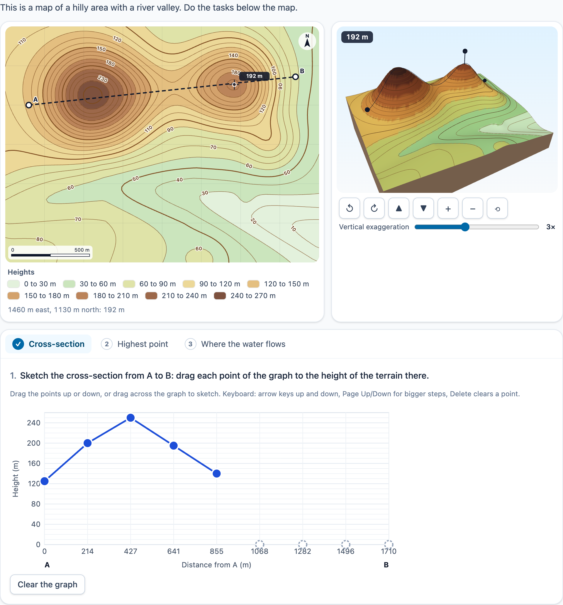

# @citolab/pci-contour-map

> [!WARNING]
> **Experimental (alpha). Just for inspiration.** This PCI is a technical showcase, made by software developers without
> much knowledge of the subject it could be used for. Its content, terms and scoring have not been checked by subject
> experts or assessment specialists, and it has never been used in an assessment. It is offered as is, without any
> warranty.

A QTI 3 Portable Custom Interaction (PCI) about contour lines and relief ("hoogtelijnen", "dwarsdoorsnede"). It shows a
terrain twice: as a contour map with labelled contour lines and hypsometric tints, and as a 3D relief model (three.js)
with the same contour lines draped on it. The two views are linked. The candidate does tasks on the map: sketch a
cross-section, click the highest point or the steepest slope, read heights, or draw where a stream flows from a
spring. The PCI scores each task itself, within the margins the author set. The item author shapes the terrain and
makes the tasks in the PCI itself. Made with [tspci](https://github.com/Citolab/tspci).

<p align="center">
  
</p>

## What it does

- **The terrain** (`src/terrain.ts`, no imports, tested in node with `npm test`) is a heightfield: a base height, a
  tilt (metres per km to the east and to the north), Gaussian hills and hollows, ridges and valleys along polylines,
  and small bumps from a seed (the same seed always gives the same bumps). Coordinates are metres, x to the east and
  y to the north.
- **The contour map** (SVG): the terrain is sampled on a grid (101 columns) and the contour lines come from marching
  squares on that grid, every `data-interval` metres. Every fifth line is thicker. The lines are labelled with their
  height, upright along the line. The tints (optional) are bands of whole contour intervals, at most ten of them, from
  light green to dark brown (lightness falls the whole way, so the order also reads without colour vision), with a
  legend that gives each band's heights in words. The map also has a scale bar and a north arrow.
- **The 3D relief model** (three.js 0.180, only what is needed is imported): the same grid as a block of land with the
  same tints, the contour lines draped on it, and the active task's points and lines. A slider sets the vertical
  exaggeration (1× to 6×). Drag to turn, scroll or pinch to zoom. On the keyboard the arrow keys turn it, `+`/`−` zoom
  and `0` resets; there are buttons for all of these as well. The model draws only when something changes (no
  animation loop), so `prefers-reduced-motion` has nothing to stop. Without WebGL there is a message instead, and the
  map still does everything. The WebGL context is freed when the interaction is unmounted, ends (`oncompleted`) or is
  taken out of the page.
- **Linked views**: the pointer on the map shows as a pin on the model, and the pointer on the model (found by
  raycasting) shows as a cross on the map. With `data-show-height` the height under the pointer shows in both. It is
  off by default because it gives the answers away. A click on the model counts as a click on the map.
- **Keyboard**: the map is an application with a cursor. The arrow keys move it a fiftieth of the map (with `Shift`, a
  tenth), and `Enter` or `Space` places a point. The live status line reads out where the cursor is ("Pointer at 560 m
  east, 930 m north"), and every step the candidate takes. Each task is a tab (left and right arrows move between them).
- **The tasks** (at most 6, in tabs):
  - **Cross-section** (`profile`): a line A–B (the author's, or one the candidate draws by clicking A and then B) and an
    empty graph with a point at each fixed distance. Each point is a slider: drag it, or drag across the graph to sketch
    the whole line in one go. With the keyboard, the arrows move a point by half a contour interval, `Page Up`/`Page Down`
    by two intervals, `Home`/`End` go to the bottom and the top, and `Delete` clears the point.
  - **Point on the map** (`point`): click the highest point, the lowest point or the steepest slope (on the whole map,
    or within a region), a point in a named region, or where the water from S ends up.
  - **Read the height** (`height`): marked points with a field each, in metres (a decimal comma in Dutch).
  - **Where the water flows** (`river`): from the spring S, click points or drag along the course of the stream. The
    PCI works out the true stream as the path of steepest descent, until it reaches the edge of the map or a hollow.
- **Review**: in `status: "solution"` the correct answers are filled in and shown read-only, with the true profile,
  the target and the true stream drawn dashed in teal.
- **Authoring mode** (`getAuthoringInstance`, "Make the terrain and the tasks…") has three tabs:
  - **Terrain**: click the map to add a hill, drag it to move it, and drag its ring to resize it. There are fields for
    x, y, the height (negative: a hollow) and the radius. Ridges and valleys have draggable points, a height and a
    width, and you can add bends. The tab also has the size of the map, the base height, the tilt, the seed and the
    number of bumps.
  - **Map**: the contour interval, the tints, the labels, and the height under the pointer.
  - **Tasks**: add, change and remove tasks. Their points (A, B, the region, S, the marked points) are placed by
    clicking the map. The map and a line of text show the correct answer as the PCI works it out.

  `validate()` reports, in the author's language: no tasks, a margin of 0, a line A–B that is too short, points
  outside the map, a region task without a region, a height task without points, a spring on flat ground, and the
  height under the pointer switched on together with a cross-section or a height task.
- **Several interactions** of this type on one page each get their own object, store and response.

## What can be configured

Every setting is a `data-` attribute of the interaction, as text. `dist/authoring.json` describes them for authoring
systems.

| setting                       | attribute             | default            | what                                                      |
| ----------------------------- | --------------------- | ------------------ | --------------------------------------------------------- |
| Instruction above the map     | `data-prompt`         | the example's      | empty with the example terrain: the example's, translated |
| Terrain                       | `data-terrain`        | empty: the example | JSON, written by the authoring mode (below)               |
| Tasks                         | `data-tasks`          | empty: the example | JSON list, written by the authoring mode (below)          |
| Contour interval (m)          | `data-interval`       | `10`               |                                                           |
| Colours for the heights       | `data-tints`          | `true`             | hypsometric tints with a legend                           |
| Heights on the contour lines  | `data-contour-labels` | `true`             |                                                           |
| 3D relief model               | `data-show3d`         | `true`             | `false`: only the map                                     |
| Vertical exaggeration         | `data-exaggeration`   | `3`                | of the 3D model at the start, 1 to 6                      |
| Height under the pointer      | `data-show-height`    | `false`            | gives the heights away: for practice, not for a test      |
| Language                      | `data-language`       | `en`               | `en` or `nl`; numbers follow it, the response does not    |

```json
{
  "width": 2000, "depth": 1500, "base": 90, "tiltX": -30, "tiltY": 12, "seed": 7, "bumps": 6,
  "hills": [{ "x": 560, "y": 1060, "h": 135, "r": 460 }, { "x": 1460, "y": 1130, "h": 95, "r": 400 }],
  "ridges": [{ "points": [[0, 330], [620, 520], [1180, 440], [2000, 190]], "h": -28, "w": 260 }]
}
```

- A hill is `h` metres high at its top and about 13% of that at distance `r`. A ridge (`h` > 0) or valley (`h` < 0)
  follows its polyline and is `w` wide.
- A field that is missing is flat (no tilt, no bumps, no hills). An empty `data-terrain` gives the example.

```json
[
  { "type": "profile", "a": { "x": 150, "y": 1000 }, "b": { "x": 1850, "y": 1180 }, "samples": 9, "margin": 15, "points": 1 },
  { "type": "point", "target": "highest", "margin": 60, "points": 1 },
  { "type": "point", "target": "region", "region": { "x": 1460, "y": 1130, "r": 250 }, "regionLabel": "Oak Hill", "points": 1 },
  { "type": "height", "marks": [{ "x": 553, "y": 1063, "label": "P" }], "margin": 3, "points": 1 },
  { "type": "river", "source": { "x": 1330, "y": 900 }, "margin": 50, "points": 1 }
]
```

| task      | fields                                                                                         | right when                                                             |
| --------- | ---------------------------------------------------------------------------------------------- | ---------------------------------------------------------------------- |
| `profile` | `a`, `b` (none: the candidate draws the line, at least a quarter of the map's shorter side), `samples` (3–21), `margin` (m up or down), `minCorrect` | at least `minCorrect` (default all) points lie within `margin` of the true height along the line |
| `point`   | `target`: `highest`, `lowest`, `steepest` (optionally within `region`), `region` (with `region` and `regionLabel`), `flowEnd` (with `source`); `margin` (m on the map) | the point lies within `margin` of the target, or inside the region |
| `height`  | `marks` (up to 8, with a `label`), `margin` (m), `minCorrect`                                  | at least `minCorrect` (default all) heights lie within `margin`        |
| `river`   | `source`, `margin` (m on the map)                                                              | the mean distance between the candidate's stream and the true one (taken both ways, the larger) is at most `margin` |

Every task has `points` (default 1), and optionally `text`, which replaces the standard instruction.

## Scoring

The PCI is made for `custom` scoring (`authoring.json`: `"scoring": ["custom", "human"]`). It works out the correct
answers from the terrain and scores each task, and the item's response processing copies the score or tests single
fields. The response is a record (`cardinality="record"`):

| field                          | type      | what                                                                                    |
| ------------------------------ | --------- | --------------------------------------------------------------------------------------- |
| `score`                        | `integer` | the points of the tasks that are right                                                  |
| `maxscore`                     | `integer` | the points of all tasks                                                                 |
| `correct`                      | `integer` | 1 when every task is right, else 0                                                      |
| `task1` … `task6`              | `integer` | the task's points when it is right, else 0                                              |
| `task1number` … `task6number`  | `float`   | profile: the number of points within the margin; point: metres to the target (region: to its middle); height: the first height given; river: metres between the streams. Missing when the task has no answer. |
| `task1value` … `task6value`    | `string`  | the answer as text in no language: `"124 198 - 197"` (`-` not set), `"560 930"`, `"A 200 750 B 1800 750: …"`, `"1330 900, 1310 820, …"` |
| `answers`                      | `string`  | everything the candidate did, per task, as JSON (for `setResponse` and a rater)          |

- **Copy the score**: the response processing below sets `SCORE` from `score`, as in the other examples.
- **Simple tasks in your own response processing**: the number fields can be tested without the PCI's verdict.
  - A height: `<qti-equal tolerance-mode="absolute" tolerance="3 3">` with `task1number` and the true height (the
    authoring mode shows it).
  - A point: `<qti-lte>` with `task2number` and your own margin in metres.
  - A cross-section: `<qti-gte>` with `task1number` and the number of points needed.
  - A stream: `<qti-lte>` with `task3number` and your margin.
- `match_correct` is not offered: QTI's `match` cannot compare records, and a point or a stream is right within a
  margin, not when it is exactly equal. `getCorrectResponse(properties)` (`config.tspci.correctResponse: "settings"`)
  returns the record of the correct answers for an authoring system.
- `human`: use the map as a tool without scoring; `answers` holds everything.
- **No response**: until the candidate does something, `getResponse()` reports nothing.

```xml
<qti-response-declaration identifier="RESPONSE" cardinality="record"/>
<qti-outcome-declaration identifier="SCORE" cardinality="single" base-type="float">
  <qti-default-value><qti-value>0</qti-value></qti-default-value>
</qti-outcome-declaration>
<qti-outcome-declaration identifier="MAXSCORE" cardinality="single" base-type="float">
  <qti-default-value><qti-value>3</qti-value></qti-default-value>
</qti-outcome-declaration>
…
<qti-response-processing>
  <qti-response-condition>
    <qti-response-if>
      <qti-not><qti-is-null>
        <qti-field-value field-identifier="score"><qti-variable identifier="RESPONSE"/></qti-field-value>
      </qti-is-null></qti-not>
      <qti-set-outcome-value identifier="SCORE">
        <qti-field-value field-identifier="score"><qti-variable identifier="RESPONSE"/></qti-field-value>
      </qti-set-outcome-value>
    </qti-response-if>
  </qti-response-condition>
</qti-response-processing>
```

A height read at P, scored by the item itself (true height 255.9 m, margin 3 m):

```xml
<qti-response-condition>
  <qti-response-if>
    <qti-equal tolerance-mode="absolute" tolerance="3 3">
      <qti-field-value field-identifier="task1number"><qti-variable identifier="RESPONSE"/></qti-field-value>
      <qti-base-value base-type="float">255.9</qti-base-value>
    </qti-equal>
    <qti-set-outcome-value identifier="SCORE"><qti-base-value base-type="float">1</qti-base-value></qti-set-outcome-value>
  </qti-response-if>
</qti-response-condition>
```

**State and response.** `getState()` holds the answers per task (and the log), so everything can be restored.
`setResponse` (and `boundTo` without a state) reads the `answers` field, or the answers as a JSON string; the other
fields follow from it. In `status: "solution"` the answers of the declared correct response are shown (a record value
with the field `answers`, or the JSON). Without one, the correct answers come from the settings.

## Using it

```sh
npm install @citolab/pci-contour-map
```

| file                                       | what                                                                      |
| ------------------------------------------ | ------------------------------------------------------------------------- |
| `dist/index.js`                            | the PCI (AMD module, everything bundled: the package has no dependencies) |
| `dist/authoring.json`                      | settings, response, scoring and the authoring mode, for authoring systems |
| `dist/sbom.cdx.json`                       | CycloneDX SBOM of the bundle                                              |
| `dist/tao-pci-contourMap_<version>.zip`    | the PCI for TAO: Settings → Portable Custom Interactions → Add            |
| `contourMap.svg`, `example.png`            | icon and screenshot                                                       |

In a QTI 3 item, with `index.js` at `resources/pci/index.js` of the package:

```xml
<qti-response-declaration identifier="RESPONSE" cardinality="record"/>
…
<qti-portable-custom-interaction response-identifier="RESPONSE" module="pci" custom-interaction-type-identifier="contourMap"
  data-language="nl" data-interval="10" data-tasks="[{&quot;type&quot;:&quot;point&quot;,&quot;target&quot;:&quot;highest&quot;,&quot;margin&quot;:60}]">
  <qti-interaction-modules>
    <qti-interaction-module id="pci" primary-path="../resources/pci/index"></qti-interaction-module>
  </qti-interaction-modules>
  <qti-interaction-markup></qti-interaction-markup>
</qti-portable-custom-interaction>
```

Source and the other examples: [Citolab/tspci-examples](https://github.com/Citolab/tspci-examples).
