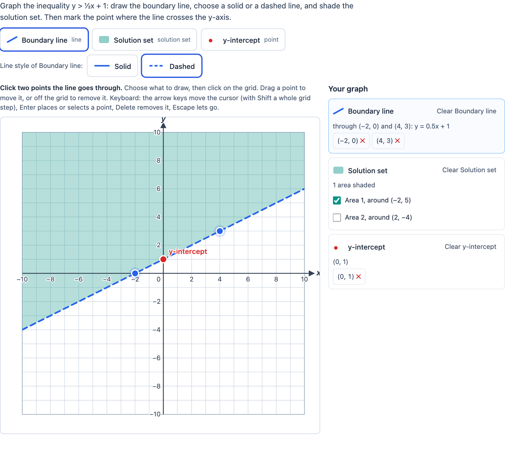

# Coordinate graph

> [!WARNING]
> **Experimental (beta).** This PCI is a new implementation of an open-source PCI (see "Source and licence"). It is
> offered as is, without any warranty, and has never been used in an assessment. Try it out with candidates and check
> its content and scoring before you use it in one.

A PCI in which the candidate **draws on a coordinate grid**: points, sets of points, lines, line segments, rays and
the **solution sets of inequalities** (a line, solid or dashed, and the area on one side of it shaded). The author
defines the elements the candidate can draw (each with a label, a colour and how many points) and draws the correct
answer of each; the PCI scores itself with them.

The default item: *graph the inequality y > ½x + 1, choose a solid or a dashed line, shade the solution set, and mark
the point where the line crosses the y-axis.*

<p align="center"></p>

Unlike `tspci-graph-builder` (a graph from measured data: table, axes, scale, points) and `tspci-number-line` (one
dimension), here the candidate draws geometric objects on a fixed x-y grid, as in algebra: lines through two points,
systems of inequalities, the graph of a function through plotted points.

## What the candidate does

- **Chooses what to draw**: a button per element (as the original's buttons), with its colour, label, type and, for a
  set of points, how many are placed ("3 of 5"). The solution set's button waits until a line is drawn.
- **Places points**: a **click** (or tap) on the grid places a point for the chosen element, snapped to the grid (or
  half or a tenth of a grid step). A point needs one click, a line, segment or ray two (a ray: the start point, then a
  point it goes through); when an element has all its points, the next click moves its last point, as in the original.
  **Drag** a point to move it (a point of another element selects that element), drag it off the grid to remove it.
- **Line style**: for a line, segment or ray with `styleToggle`, the candidate chooses **Solid** or **Dashed**
  (`<` and `>` are dashed, `≤` and `≥` solid).
- **Shades areas**: the lines divide the grid into areas; with the solution set chosen, a click on an area shades it,
  another click unshades it. Moving a line starts the shading over (other areas), as in the original.
- **Keyboard and screen reader**: the grid is one tab stop (`role="application"`); the arrow keys move a cursor (a snap
  step, with Shift a whole grid step), Enter places a point, or selects the point under the cursor, which the arrow
  keys then move; Delete removes it, Escape lets go; with the solution set chosen, Enter shades the area under the
  cursor. Every action is announced (`role="status"`), with the equation of a line ("Boundary line: y = 0.5x + 1").
  Beside the grid, "Your graph" lists every element in words, a delete button per point, a clear button per element
  and a **checkbox per area** ("Area 1, around (−2, 5)"). Buttons are at least 44 px high; the grid scales to the width.

## Settings

Every setting is a `data-` attribute (text).

| setting | editor | default | what |
| --- | --- | --- | --- |
| `prompt` | `textarea` | the example's | the instruction above the item |
| `elements` | `pci` | the example | the elements and their correct answers, as JSON, made in the authoring mode (below) |
| `xMin`, `xMax`, `yMin`, `yMax` | `number` | −10, 10, −10, 10 | the range of the axes |
| `xStep`, `yStep` | `number` | 1 | the distance between grid lines (and numbers) |
| `snap` | `enum` | `grid` | points snap to the grid lines, `half` a step or a `tenth` of a step |
| `xLabel`, `yLabel` | `text` | x, y | the names of the axes |
| `allowEdge` | `boolean` | `true` | points may be placed on the edge of the grid (Point Graph's `allowOuter`) |
| `given` | `textarea` | – | points the author gives (Point Graph's static points): a line per point, `label;x;y` |
| `connectGiven` | `boolean` | `false` | connect the given points from left to right |
| `tolerance` | `number` | 0 | how far a point may be from the correct one, in units of the axes |
| `language` | `enum` | `en` | `en`, `nl` or `fr`; numbers with a decimal comma in nl and fr |

**`elements`** is a JSON list (at most 12) of:

```json
{ "id": "lines_1", "type": "line", "label": "Boundary line", "color": "#2563eb",
  "styleToggle": true, "dashed": false, "score": 1,
  "correct": { "points": [{ "x": 0, "y": 1 }, { "x": 2, "y": 2 }], "dashed": true } }
```

- `type`: `point`, `points` (a set of points), `line`, `segment`, `ray` or `solutionSet`.
- `id`: the name of its field in the response; as in the original, `points_1`, `setPoints_2`, `lines_3`,
  `segments_4`, `rays_5`, `solutionSet_6`. The original's `uid` is taken over.
- `max` (a set of points, 1–20), `connect` (a set of points: connect them from left to right, Point Graph's line graph),
  `dashed` (the style at the start) and `styleToggle` (the candidate chooses), `score` (points, default 1; 0: not scored).
- `correct`: `points` (a line, segment or ray: two points), `dashed` (counts with `styleToggle`), and for a solution set
  `regions`: a point inside each area that is shaded, with the areas of the correct lines.
- `equation` and `minPoints` (a set of points, from Point Graph's equation wizard): right when there are at least
  `minPoints` points and every one is on y = `equation` (`2x + 1`, `x^2 - 2`, `sqrt(x)`, `0,5x − 1`, within `tolerance`).

**Authoring mode** (`getAuthoringInstance`, for an authoring system; the original's creator): the author adds,
removes and orders the elements, sets type, label, colour, points, line style, the number of points or an equation,
selects an element and draws its correct answer on the grid of the item's settings (the same board the candidate gets,
with mouse and keyboard). `validate()` reports what is missing (a solution set without a line, a line with one correct
point, an equation that cannot be read …); `getProperties()` gives `data-elements`.

## Scoring

`scoring: custom`: the PCI checks each element that has a correct answer (or an equation) and reports the result in a
record. Response processing can copy `score` to `SCORE` (and `maxscore` to `MAXSCORE`), or use the `check` fields.

| element | right when |
| --- | --- |
| point | within `tolerance` of the correct point (in x and in y) |
| set of points | as many points as the correct ones, each matching its own correct point; or, with an `equation`, at least `minPoints` points, all on the curve |
| line | the same line where the grid shows it: the ends of each on the grid lie within `tolerance` of the other (any two points on it will do), and with `styleToggle` the same style |
| segment | the same two end points, in any order (and the style) |
| ray | the same start point and the same direction (where it leaves the grid), and the style |
| solution set | the shaded areas cover the correct ones: they differ on at most 1 % of the grid (sampled), whatever lines the candidate used to make them |

**The response** (`cardinality="record"`):

| field | type | what |
| --- | --- | --- |
| `score` | integer | the points of the elements that are right |
| `maxscore` | integer | the points of all scored elements |
| `correct` | integer | 1 when every scored element is right |
| `check1` … `check12` | integer | per element, in the order of `elements`: 1 right, 0 not; left out when the element is not scored |
| `points_1`, `lines_3`, … (the `id` of each element) | list of point | `[x, y]` per point; a line, segment or ray: its two points (as clicked); empty when nothing is drawn |
| `solutionSet_6`, … | list of string | a polygon per shaded area, its corners rounded to 2 decimals, counterclockwise from the leftmost: `"-10 -4, 10 6, 10 10, -10 10"` |
| `graph` | string | JSON: `{ values: { <id>: { points: [{x, y}], dashed, regions: [{x, y}] } } }`, what is drawn, with the line styles |

Until the candidate draws something, `getResponse()` reports nothing. A response handed back (`boundTo`), and a correct
response in the response declaration, is read from `graph`, or else from the element fields. The state (`getState`)
has the drawing and a log of every action (points added, moved and removed, styles, areas); it is restored when the
candidate comes back.

**Review**: in `status="review"` (and `closed`) everything is read only. In `status="solution"` the PCI shows the
correct response from the response declaration, or else the author's correct elements.

### Compared with the original's response

- **Graphing Line And Point** (`graphLineAndPointInteraction`) reports a record with an entry per element, named by its
  `uid`, written as `{ "name": "lines_9", "base": { "list": { "point": [[x, y], …] } } }`; a solution set as one entry
  per shaded area, all with the same name, with the corners of the area. This PCI keeps the names and the `[x, y]`
  points, but writes them the standard way, `{ "name": "lines_9", "list": { "point": [[x, y], …] } }`, and a solution
  set as one field with a string per area (a record cannot have one name twice). `setResponse` reads both forms, so a
  response of the original comes back when `elements` use the original's `uid`s (`elements` is not read from the
  original's `graphs` property; an author rebuilds the list in the authoring mode). The original
  never had the line style in its response (only in its state); here it is in `graph` and in the scoring. The original
  scored nothing itself; the `score`, `maxscore`, `correct`, `check` and `graph` fields are new.
- **Point Graph** (`graphPointLineGraphInteraction`, `multiple` `string`: `["x y", …]`) is a set of points here
  (`max`, `connect` for its line graph, `given` and `connectGiven` for its static points, `allowEdge` for its
  `allowOuter`, `snap` for its sub steps, `equation` for its equation wizard). Its points are in the set's field as
  `[x, y]`; `setResponse` also takes its `{ "list": { "string": ["x y", …] } }` for the first set of points.

QTI's `point` base type has integer coordinates; with `snap` `half` or `tenth` (or steps below 1) the coordinates of
the element fields can be decimals.

## Using it

```xml
<qti-response-declaration identifier="RESPONSE" cardinality="record"/>
…
<qti-portable-custom-interaction response-identifier="RESPONSE" module="pci" custom-interaction-type-identifier="coordinateGraph"
  data-x-min="-5" data-x-max="5" data-y-min="-5" data-y-max="5" data-language="nl"
  data-elements='[{"id":"lines_1","type":"line","label":"l","styleToggle":true,"correct":{"points":[{"x":0,"y":1},{"x":1,"y":3}],"dashed":false}},{"id":"solutionSet_2","type":"solutionSet","label":"Oplossingen","correct":{"regions":[{"x":-3,"y":3}]}}]'>
  <qti-interaction-modules>
    <qti-interaction-module id="pci" primary-path="../resources/pci/index"></qti-interaction-module>
  </qti-interaction-modules>
  <qti-interaction-markup></qti-interaction-markup>
</qti-portable-custom-interaction>
```

```sh
npm test               # the model (src/model.ts) in node
npm run test:stories   # the stories' play functions, headless
npm run prod           # dist/index.js
npm run package-qti3   # or package-tao
```

## Source and licence

This PCI is a derivative work of two PCIs of the PARCC TEI extension for TAO,
[parcc/extension-parcc-tei](https://github.com/parcc/extension-parcc-tei), © 2014-2017 Parcc, Inc., made by Open
Assessment Technologies for Parcc, Inc.:

- [`graphLineAndPointInteraction`](https://github.com/parcc/extension-parcc-tei/tree/master/views/js/pciCreator/dev/graphLineAndPointInteraction)
  ("Graphing Line And Point"), by Thibault Milan and Sam Sipasseuth: its interaction (elements with a label, colour and
  number of points; points, sets of points, lines, segments, solution sets of areas between the lines; the line style
  toggle), its creator and its response format;
- [`graphPointLineGraphInteraction`](https://github.com/parcc/extension-parcc-tei/tree/master/views/js/pciCreator/dev/graphPointLineGraphInteraction)
  ("Point Graph"), by Sam Sipasseuth and Christophe Noël: points connected into a line graph, static points, points
  not on the edge, sub steps, and the equation wizard of its creator.

The extension is licensed under the GNU General Public License version 2, not later versions: its
[`LICENSE`](https://github.com/parcc/extension-parcc-tei/blob/master/LICENSE) is the GPL-2.0, its `manifest.php` says
`'license' => 'GPL-2.0'`, and the headers of its files say "under version 2 of the License (non-upgradable)". Its
`composer.json` says `"license": ["PARCC"]`, which is not a known licence; we follow the `GPL-2.0-only` of the
`LICENSE`, `manifest.php` and the file headers. So this PCI is `GPL-2.0-only` too: see [LICENSE](LICENSE). This
differs from the MIT licence of most examples in this repository.

What changed, by Stichting Cito Instituut voor Toetsontwikkeling (2026):

- Rewritten from scratch in TypeScript with Preact, Tailwind and SVG in a shadow DOM (the original is jQuery, Raphael
  and TAO's libraries); no code or images of the original are used. The geometry (canonical lines, clipping, the areas
  between the lines, matching with a tolerance) is a pure model with node tests.
- The two PCIs are merged: Point Graph is a set of points with `connect`, `given`, `allowEdge`, `snap` and `equation`.
- New: rays; snapping to half or a tenth of a step; steps other than 1; axis names; the line's equation in words.
- The original's areas came from walking around the intersections of the lines; here the grid is split by each line
  in turn, which also handles parallel and vertical lines. A dragged point no longer has to be clicked; points can be
  removed by dragging them off the grid, with a delete button, or with the keyboard.
- Keyboard and screen reader access: real buttons, a radio group for the line style, a keyboard cursor on the grid,
  announcements, a description of every element and a checkbox per area; large touch targets; it fits narrow screens.
- **Scoring**: the original scored nothing itself (its creator left that to custom response processing); this PCI
  scores each element against the author's correct answer, and reports `score`, `maxscore`, `correct` and a `check`
  per element. Point Graph's equation wizard (which wrote QTI response processing) became the `equation` of a set.
- **The response**: see "Compared with the original's response" above. The state and a log of every action are saved
  and restored (the original's state was its response).
- An authoring mode (`getAuthoringInstance`) instead of TAO's creator; texts in English, Dutch and French.
