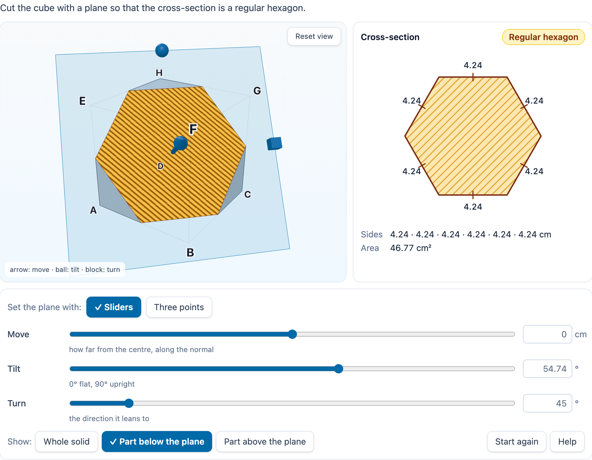

# @citolab/pci-cross-section

> [!WARNING]
> **Experimental (alpha). Just for inspiration.** This PCI is a technical showcase, made by software developers without
> much knowledge of the subject it could be used for. Its content, terms and scoring have not been checked by subject
> experts or assessment specialists, and it has never been used in an assessment. It is offered as is, without any
> warranty.

A QTI 3 Portable Custom Interaction (PCI) in which the candidate cuts a solid with a plane and sees the cross-section
(Dutch: *doorsnede*): a cube, box, prism, pyramid, cylinder, cone or sphere in 3D, the plane through it, and the
cross-section flat in its true shape with its side lengths and area. The PCI computes the section exactly, names it
(an equilateral triangle, a rectangle, a regular hexagon, an ellipse, …) and checks it against the author's target, so
"make a cut whose cross-section is a rectangle of 4 by 6" is scored by the PCI. Made with
[tspci](https://github.com/Citolab/tspci).

<p align="center">
  
</p>

## What it does

- **The solids**, built in code (no models to download), in cm: cube (edge), box (length, width, height), prism and
  pyramid with a regular base of 3 to 8 sides (side, height), cylinder and cone (radius, height), sphere (radius).
  Corners are lettered as in Dutch textbooks: ABCD below, EFGH above (E over A), the top of a pyramid T.
- **The plane** is three numbers: **move** (how far from the centre of the solid, along the normal, in cm), **tilt**
  (0° flat to 90° upright) and **turn** (the direction it leans to, 0° to 360°). The candidate sets them:
  - with **sliders and number fields** (a decimal point or a comma; the field takes it on Enter or when it loses focus);
  - with **handles in the 3D view**: drag the arrow to move the plane, the ball to tilt it, the block to turn it;
  - with **three points on edges** (polyhedra only): click an edge in the 3D view (the point snaps to the ends, the
    midpoint or 0.1 cm), or choose the edge and the distance from its first corner for P, Q and R, with a *Midpoint*
    button. Three points on one line are refused with a message.
- **What is shown**: the solid in two parts, clipped by the plane. *Whole solid* shows the part above the plane
  see-through; *Part below / above the plane* hides the other part (its edges stay faint). The section is hatched
  orange in 3D and drawn flat next to it: side lengths, tick marks on equal sides, squares in right angles, the diameter
  of a circle and the axes of an ellipse, the name and the area.
- **The geometry** (`src/geometry.ts`, no imports, tested in node with `npm test`):
  - polyhedra: the plane cut with every edge, the points sorted around in the plane (a convex hull), so the polygon is
    exact up to floating point;
  - cylinder, cone and sphere: a sphere's section is a circle of radius √(r² − d²); for a cylinder and a cone the PCI
    finds the boundary analytically along 720 rays (the solids are convex), adds the corners where the curve meets the
    base or top exactly, and computes circles and ellipses (centre, axes, πab) from the quadratic. A cylinder cut
    upright is a rectangle and a cone cut through its top a triangle, both as exact polygons. A cone gives an
    ellipse, a parabolic or hyperbolic segment depending on the tilt against the slope of its side;
  - **naming**: triangles (equilateral, isosceles, right, right isosceles), quadrilaterals (square, rectangle, rhombus,
    parallelogram, isosceles trapezium, kite, trapezium), pentagon to octagon (regular or not), circle, ellipse, part
    of an ellipse, parabolic and hyperbolic segment. "Equal" is within the naming tolerance (`data-tolerance`, default
    2 % of the longest side and 2° for right and parallel), so a plane set to the nearest half degree still gives the
    regular hexagon; three midpoints give it exactly. Every name that fits is kept (a square is also a rectangle, a
    rhombus, a kite, …);
  - **what a solid can give**: a few thousand planes (random and special ones) find the shapes a solid can be cut into,
    for the authoring mode's check.
- **Keyboard**: everything works without a mouse. The 3D view is focusable (`role="application"`): the arrow keys turn
  it, `+` and `−` zoom, `Home` resets the view. The sliders, number fields, selects and the radio groups (*Set the plane
  with*, *Show*, which point a click places) are ordinary form controls. **Touch**: one finger turns the view, two pinch.
- **Screen readers**: the 3D view's name says the solid and the plane, the flat section is an image with the whole
  description ("square, sides 6 cm, 6 cm, 6 cm, 6 cm, area 36 cm²"), and every change is said in a live status line.
- **Colour**: Okabe-Ito blue for the plane and orange for the section, and never colour alone: the section is hatched,
  the handles differ in shape (arrow, ball, block), chosen options carry a check mark.
- **Reduced motion**: there is no animation; the view only redraws on a change.
- **WebGL**: without it the PCI says so and the controls and the flat section keep working. The renderer and its
  context are freed when the interaction ends (`oncompleted`), unmounts or is taken out of the page.
- **Authoring mode**: in three tabs, **Solid** (type, dimensions, sides of the base, instruction, mode, letters),
  **Controls** (which controls, show the name and the measures, the start plane) and **Target** (shape, exact or not,
  lengths, area, margins, naming tolerance), with a live preview of the interaction. *Use this cross-section as the
  target* takes the shape, the lengths and the plane (as the solution) from the preview. `validate()` reports, in the
  author's language: no target in answer mode, lengths without a shape, a shape the solid cannot give, a solution plane
  that misses the target, no solution plane, a start plane that already scores, and no control to move the plane.
- **Delivery**: the plane, the part shown, the input mode and the three points are the item's state (every change in
  the log). Several interactions of this type on one page each get their own object.

## What can be configured

Every setting is a `data-` attribute of the interaction, as text. `dist/authoring.json` describes them for authoring
systems.

| setting            | attribute             | default                                    | what                                                                           |
| ------------------ | --------------------- | ------------------------------------------ | ------------------------------------------------------------------------------ |
| Instruction        | `data-prompt`         | the example's question                     | above the solid                                                                |
| Solid              | `data-solid`          | `cube`                                     | `cube`, `box`, `prism`, `pyramid`, `cylinder`, `cone`, `sphere`                |
| Dimensions         | `data-dimensions`     | `6`                                        | cm, separated by spaces: see "The solids" above                               |
| Sides of the base  | `data-base-sides`     | `4`                                        | 3 to 8, for a prism or pyramid                                                 |
| Mode               | `data-mode`           | `answer`                                   | `answer` (record, scored) or `tool` (JSON, not scored)                         |
| Controls           | `data-controls`       | `move tilt turn handles points hide`       | which the candidate gets; empty: the plane is fixed, the candidate only looks  |
| Start plane        | `data-plane`          | `0 0 0`                                    | offset (cm), tilt (°), turn (°)                                                |
| Solution plane     | `data-solution-plane` | `0 54.7356 45`                             | a plane that answers the question: shown in solution status                    |
| Target shape       | `data-target-shape`   | `regularHexagon`                           | a shape code (below), or empty                                                 |
| Only this shape    | `data-exact-shape`    | `false`                                    | `true`: a square is then no rectangle                                          |
| Target lengths     | `data-target-lengths` | empty                                      | cm: `4 6` (also `4 x 6`, `4 by 6`, `4 bij 6`); a circle: its diameter; an ellipse: its axes |
| Target area        | `data-target-area`    | empty                                      | cm²                                                                            |
| Length margin      | `data-margin`         | `0.2`                                      | cm                                                                             |
| Area margin        | `data-area-margin`    | `0.5`                                      | cm²                                                                            |
| Naming tolerance   | `data-tolerance`      | `2`                                        | % of the longest side for equal sides, ° for right and parallel                |
| Show the name      | `data-show-name`      | `true`                                     | off for "which shape is this?"                                                 |
| Show the measures  | `data-show-measures`  | `true`                                     | side lengths and area                                                          |
| Corner letters     | `data-show-labels`    | `true`                                     | ABCD EFGH                                                                      |
| Language           | `data-language`       | `en`                                       | `en` or `nl`: the texts and the decimal comma                                  |

Shape codes: `triangle`, `equilateralTriangle`, `isoscelesTriangle`, `rightTriangle`, `quadrilateral`, `trapezium`,
`isoscelesTrapezium`, `kite`, `parallelogram`, `rhombus`, `rectangle`, `square`, `pentagon`, `regularPentagon`,
`hexagon`, `regularHexagon`, `heptagon`, `octagon`, `circle`, `ellipse`, `ellipseSegment`, `parabolaSegment`,
`hyperbolaSegment`, `curved` (anything with a curved side). The response can also hold `rightIsoscelesTriangle`,
`regularHeptagon`, `regularOctagon`, `polygon` and `none`.

Example questions:

- *"Cut the cube so that the cross-section is a regular hexagon"*: the defaults.
- *"Make a cut whose cross-section is a rectangle of 4 by 6"*: `data-solid="box" data-dimensions="8 4 6"
  data-target-shape="rectangle" data-target-lengths="4 6"`.
- *"Which shape is this cross-section?"*: `data-mode="tool" data-controls="hide" data-plane="0 45 45"
  data-show-name="false"`, next to a choice interaction that asks the question.

## Scoring

The PCI is made for `custom` scoring (`authoring.json`: `"scoring": ["custom", "human"]`): it checks the section against
the author's target; the item's response processing turns that into points. In answer mode the response is a record
(`cardinality="record"`):

| field       | type         | what                                                                                  |
| ----------- | ------------ | ------------------------------------------------------------------------------------- |
| `score`     | `integer`    | the checks that pass                                                                  |
| `maxscore`  | `integer`    | the checks there are: shape, lengths and area, each when the author set it            |
| `correct`   | `integer`    | 1 when every check passes (and there is at least one)                                 |
| `shapeOk`   | `integer`    | 1 when the shape fits the target (any name that fits, or exactly with `exact-shape`)  |
| `lengthsOk` | `integer`    | 1 when every length is within the margin of a target length and every target length of a length |
| `areaOk`    | `integer`    | 1 when the area is within the area margin                                             |
| `shape`     | `identifier` | the most specific name: `rectangle`, `regularHexagon`, `ellipse`, … or `none`         |
| `kinds`     | `string`     | every name that fits, separated by spaces: `square rectangle rhombus …`               |
| `sides`     | `integer`    | the number of straight sides (0 for a circle or ellipse)                              |
| `area`      | `float`      | cm², 2 decimals                                                                        |
| `lengths`   | `string`     | the side lengths in cm in order around, 2 decimals, separated by spaces; a circle: the diameter; an ellipse: its long and short axis; a curved shape: its straight sides |
| `plane`     | `string`     | `{"offset":0,"tilt":54.74,"turn":45}`                                                 |

```json
{ "record": [
  { "name": "score", "base": { "integer": 2 } }, { "name": "maxscore", "base": { "integer": 2 } },
  { "name": "correct", "base": { "integer": 1 } },
  { "name": "shapeOk", "base": { "integer": 1 } }, { "name": "lengthsOk", "base": { "integer": 1 } },
  { "name": "shape", "base": { "identifier": "rectangle" } },
  { "name": "kinds", "base": { "string": "rectangle parallelogram isoscelesTrapezium trapezium quadrilateral polygon" } },
  { "name": "sides", "base": { "integer": 4 } }, { "name": "area", "base": { "float": 24 } },
  { "name": "lengths", "base": { "string": "4 6 4 6" } },
  { "name": "plane", "base": { "string": "{\"offset\":0,\"tilt\":90,\"turn\":0}" } }
] }
```

- **One point per check**: copy `score` to `SCORE`, as below.
- **Your own response processing**: test single fields, for example `<qti-field-value field-identifier="shape">`
  against `<qti-base-value base-type="identifier">regularHexagon</qti-base-value>` with `qti-match`, or the `area`
  with `<qti-equal tolerance-mode="absolute" tolerance="0.5">` (`authoring.json` marks it `"tolerance": "range"`).
- `match_correct` is not offered: QTI's `match` cannot compare records, and many planes give the same section.
- `human` / tool mode (`data-mode="tool"`): declare the response `single`/`string`; it is JSON with the last section
  and the shapes the candidate made: `{"shape":"rectangle","sides":4,"area":48,"lengths":[6,8,6,8],"plane":{…},"found":["ellipse","rectangle"]}`.
- **No response**: until the candidate moves the plane, `getResponse()` reports nothing; *Start again* goes back to that.

```xml
<qti-response-declaration identifier="RESPONSE" cardinality="record"/>
<qti-outcome-declaration identifier="SCORE" cardinality="single" base-type="float">
  <qti-default-value><qti-value>0</qti-value></qti-default-value>
</qti-outcome-declaration>
<qti-response-processing>
  <qti-response-condition>
    <qti-response-if>
      <qti-not><qti-is-null>
        <qti-field-value field-identifier="score"><qti-variable identifier="RESPONSE"/></qti-field-value>
      </qti-is-null></qti-not>
      <qti-set-outcome-value identifier="SCORE">
        <qti-field-value field-identifier="score"><qti-variable identifier="RESPONSE"/></qti-field-value>
      </qti-set-outcome-value>
    </qti-response-if>
  </qti-response-condition>
</qti-response-processing>
```

**State and response.** `getState()` holds the plane, the part shown, the input mode, the three points and the shapes
made (and the log). `setResponse` (and `boundTo` without a state) reads the `plane` field, a tool's JSON, or a plane
as text (`"0 45 0"`); the other fields follow from it. In `status: "solution"` the plane of the declared correct
response is shown (a record value with the field `plane`), or else `data-solution-plane`, read-only.
`getCorrectResponse(properties)` gives the record of the solution plane, for authoring systems
(`config.tspci.correctResponse: "settings"`).

## Using it

```sh
npm install @citolab/pci-cross-section
```

| file                                         | what                                                                      |
| -------------------------------------------- | ------------------------------------------------------------------------- |
| `dist/index.js`                              | the PCI (AMD module, everything bundled, three.js included)               |
| `dist/authoring.json`                        | settings, response, scoring and the authoring mode, for authoring systems |
| `dist/sbom.cdx.json`                         | CycloneDX SBOM of the bundle                                              |
| `dist/tao-pci-crossSection_<version>.zip`    | the PCI for TAO: Settings → Portable Custom Interactions → Add            |
| `crossSection.svg`, `example.png`            | icon and screenshot                                                       |

In a QTI 3 item, with `index.js` at `resources/pci/index.js` of the package:

```xml
<qti-response-declaration identifier="RESPONSE" cardinality="record"/>
…
<qti-portable-custom-interaction response-identifier="RESPONSE" module="pci" custom-interaction-type-identifier="crossSection"
  data-language="nl" data-solid="box" data-dimensions="8 4 6" data-target-shape="rectangle" data-target-lengths="4 6"
  data-solution-plane="0 90 0" data-prompt="Snijd de balk zo door dat de doorsnede een rechthoek van 4 bij 6 cm is.">
  <qti-interaction-modules>
    <qti-interaction-module id="pci" primary-path="../resources/pci/index"></qti-interaction-module>
  </qti-interaction-modules>
  <qti-interaction-markup></qti-interaction-markup>
</qti-portable-custom-interaction>
```

**Development**: `npm test` runs the geometry and scoring tests in node; the stories in `src/crossSection.stories.ts`
run in the repository's Storybook. `tsconfig.json` has `skipLibCheck`, because `@types/three` 0.180.0 refers to WebGPU
types that the `dom` library of this TypeScript does not have.

Source and the other examples: [Citolab/tspci-examples](https://github.com/Citolab/tspci-examples).
