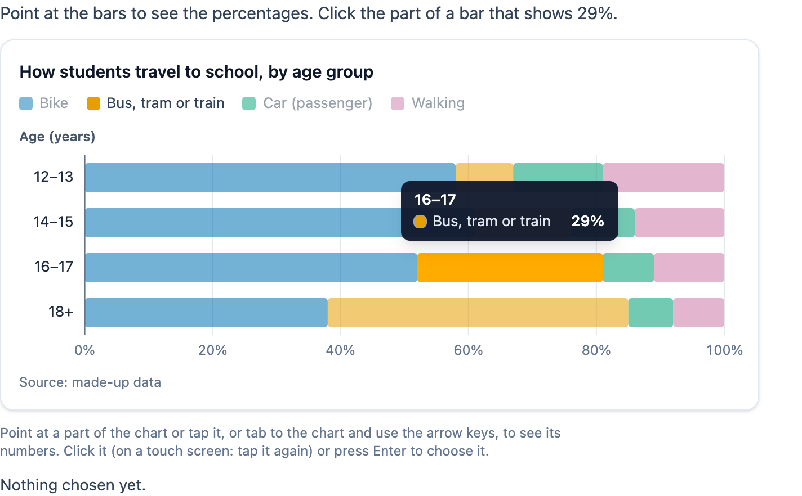

# @citolab/pci-data-chart

> [!WARNING]
> **Experimental (beta).** This PCI takes the idea of an interaction in an existing exam; it is not a copy of it. It is
> offered as is, without any warranty, and has never been used in an assessment. Try it out with candidates and check
> its content and scoring before you use it in one.

A QTI 3 Portable Custom Interaction (PCI) with an interactive chart: bars (side by side, stacked or stacked to 100%),
lines or pies, whose numbers show when the candidate points at a part, taps it or reaches it with the keyboard. The
candidate uses the chart as a tool for another interaction ("which statements are true?"), or clicks the answer in it
("click the age group where 29% take the bus"). The item author enters the data in the PCI itself. Made with
[tspci](https://github.com/Citolab/tspci).

<p align="center">
  
</p>

## What it does

- **The details on demand**: by default the chart shows the bars, not the numbers. Pointing at a part shows a tooltip
  with the category, the series and the value (and, stacked to 100%, the share of the total); the other parts fade a
  little. The numbers can also be shown in the chart all the time, or never (the tooltip then names the part only).
- **Charts**: horizontal or vertical bars, with the series side by side, stacked, or stacked to 100%; a line chart (a
  line per series); a donut per category (pie). Hand-made SVG with preact, no chart library. The value axis gets nice
  ticks (1, 2, 2.5 or 5 × a power of ten), or the author's minimum and maximum. Bars grow in when the chart appears and
  lines draw themselves, unless the candidate's system asks for reduced motion.
- **Keyboard**: the chart is one tab stop (Tab lands on the chosen part, or the first). In stacked bars the arrow keys
  along a bar go to the next or previous part of it, across the bars to the nearest part of the neighbouring bar; bars
  side by side and pies go in reading order; a line chart goes left and right along a line. Home and End go to the
  first and last part, Escape hides the tooltip, Enter or Space chooses. Every part has an accessible name: "16–17,
  Bus, tram or train, 29%".
- **Touch**: a tap shows the tooltip; in select mode a second tap on the same part chooses it, a tap elsewhere hides it.
- **Select mode**: the candidate clicks (or presses Enter or Space on) the part that is the answer; one choice
  (radio buttons for a screen reader) or more (checkboxes), up to a maximum. A chosen part gets a dark outline and a
  check mark, and the text under the chart says what was chosen.
- **Tool mode**: nothing to choose; the PCI records which parts the candidate looked at (numbers shown for at least
  400 ms, by mouse, tap or keyboard) and how often, for research.
- **Colours**: Okabe & Ito's colour blind safe palette; labels in a part get black or white text, whichever contrasts
  more.
- **Dutch** (`data-language="nl"`): `1,5`, `12.345,6`, `€ 12,50`, and the texts in Dutch. The response does not depend
  on the language.
- **Small screens**: the chart is laid out again for the width there is, so the texts keep their size.
- **Authoring mode**: the item author enters the data in the PCI itself (`getAuthoringInstance`), via "Configure…"
  ("Edit the chart data…") in an authoring system that supports it (qti-construction, TAO with tspci-tao, the dev
  page): a table of categories × series, rows and series added, removed and moved, the series' names and colours (the
  palette, or any colour), cells pasted from a spreadsheet (a whole table with its headers in the top left field, a
  block of numbers anywhere else), with a live preview of the chart with the item's settings. In select mode the author
  clicks the correct part(s) in the preview. Without data of its own, the PCI shows the example.
- **Delivery**: what the candidate chose and looked at is saved as the item's state (every look and choice in the log)
  and restored. In review (`status: "solution"`) the PCI marks the correct parts when the delivery system passes the
  correct response. Several data charts on one page each keep their own state.

## What can be configured

Every setting is a `data-` attribute of the interaction, as text. `dist/authoring.json` describes them for authoring
systems.

| setting                      | attribute                   | default                   | what                                                         |
| ---------------------------- | --------------------------- | ------------------------- | ------------------------------------------------------------ |
| Instruction above the chart  | `data-prompt`               | the example's question    |                                                              |
| Title of the chart           | `data-title`                | the example's title       | also the chart's accessible name                             |
| Use of the chart             | `data-mode`                 | `select`                  | `select`: the candidate clicks the answer; `tool`: only looks |
| Parts the candidate may choose | `data-max-choices`        | `1`                       | `0`: no limit                                                |
| Data                         | `data-data`                 | empty: the example        | written by the authoring mode, as JSON (below)               |
| Chart                        | `data-chart-type`           | `bar`                     | `bar`, `line` or `pie` (a donut per category)                |
| Bars                         | `data-orientation`          | `horizontal`              | `horizontal` or `vertical`                                   |
| Series in a bar chart        | `data-layout`               | `stacked`                 | `grouped` (side by side), `stacked` or `percent` (to 100%)   |
| Show the numbers             | `data-show-values`          | `focus`                   | `focus` (pointed at or focused), `always`, `never`           |
| Unit                         | `data-unit`                 | `%`                       | `%`, `€`, `kWh`, …: `29%`, `€ 12.50`, `1.4 kWh`             |
| Label of the value axis      | `data-value-axis-label`     |                           |                                                              |
| Label of the category axis   | `data-category-axis-label`  | `Age (years)`             |                                                              |
| Lowest / highest value       | `data-min`, `data-max`      | empty: automatic          | bars always include 0; ignored for 100% and pies             |
| Gridlines                    | `data-gridlines`            | `true`                    |                                                              |
| Legend                       | `data-legend`               | `top`                     | `top`, `right`, `bottom` or `none`                           |
| Source                       | `data-source`               | `made-up data`            | under the chart, after "Source:" (unless it starts with it)  |
| Width of the chart           | `data-width`                | `640`                     | in px; narrower when there is less room                      |
| Language                     | `data-language`             | `en`                      | `en` or `nl`: numbers and texts                              |

```json
{
  "series": [{ "id": "s1", "name": "Bike", "color": "#0072B2" }, { "id": "s2", "name": "Bus, tram or train", "color": "#E69F00" }],
  "categories": [{ "id": "c1", "label": "12–13", "values": [58, 9] }, { "id": "c3", "label": "16–17", "values": [52, 29] }],
  "correct": ["c3-s2"]
}
```

`values` has a number (or `null`: no value) per series. Ids stay when categories or series are added or removed, so
the correct response stays valid.

## Scoring

The PCI is made for `match_correct` in select mode, and for `human` as a tool (`authoring.json`:
`"scoring": ["match_correct", "human"]`). A part of the chart is `<category id>-<series id>`: `c3-s2` is the second
series in the third category (as first entered: ids do not change when rows move).

**Select mode**: the chosen part, `identifier`.

- One choice (`data-max-choices="1"`): `cardinality="single" base-type="identifier"`, e.g. `c3-s2`.
- More (`data-max-choices` 2 or more, or 0): `cardinality="multiple" base-type="identifier"`, e.g. `c1-s1 c2-s1`; a
  list also when the item declares the response `multiple` with one choice.
- **Setting the correct response**: the author clicks the correct parts in the preview of the authoring mode; they are
  in `data-data` (`correct`), and `getCorrectResponse(properties)` gives them to the authoring system
  (`authoring.json`: `"correctResponse": "properties"`). In TAO, answer the PCI as the candidate would in the *Response*
  state.
- **No response**: until something is chosen, `getResponse()` reports nothing.

**Tool mode** (`human`): `cardinality="single" base-type="string"`: the parts the candidate looked at, in the order of
the first look, with how often, as JSON. The state's log has every look with its time.

```json
{ "c3-s2": 2, "c1-s1": 1 }
```

## Using it

```sh
npm install @citolab/pci-data-chart
```

| file                                    | what                                                                      |
| --------------------------------------- | ------------------------------------------------------------------------- |
| `dist/index.js`                         | the PCI (AMD module, everything bundled: the package has no dependencies) |
| `dist/authoring.json`                   | settings, response, scoring and the authoring mode, for authoring systems |
| `dist/sbom.cdx.json`                    | CycloneDX SBOM of the bundle                                              |
| `dist/tao-pci-dataChart_<version>.zip`  | the PCI for TAO: Settings → Portable Custom Interactions → Add            |
| `dataChart.svg`, `example.png`          | icon and screenshot                                                       |

In a QTI 3 item, with `index.js` at `resources/pci/index.js` of the package:

```xml
<qti-response-declaration identifier="RESPONSE" cardinality="single" base-type="identifier">
  <qti-correct-response><qti-value>c3-s2</qti-value></qti-correct-response>
</qti-response-declaration>
…
<qti-portable-custom-interaction response-identifier="RESPONSE" module="pci" custom-interaction-type-identifier="dataChart"
  data-mode="select" data-layout="stacked" data-unit="%" data-language="nl">
  <qti-interaction-modules>
    <qti-interaction-module id="pci" primary-path="../resources/pci/index"></qti-interaction-module>
  </qti-interaction-modules>
  <qti-interaction-markup></qti-interaction-markup>
</qti-portable-custom-interaction>
```

As a tool next to, say, a match interaction with statements:

```xml
<qti-response-declaration identifier="CHART" cardinality="single" base-type="string"/>
…
<qti-portable-custom-interaction response-identifier="CHART" module="pci" custom-interaction-type-identifier="dataChart"
  data-mode="tool" data-show-values="focus">…</qti-portable-custom-interaction>
```

## Developing

`npm run prod` builds `dist/index.js`, `npm run package-tao` and `npm run package-qti3` the packages, `npm test` runs
the tests of the data model and the arithmetic (`src/chart.ts`, `src/scale.ts`: no imports, so node runs them as they
are). The stories in `src/dataChart.stories.ts` run in the repository's Storybook (`npx vitest run --project=storybook
tspci-data-chart` from the root).

Source and the other examples: [Citolab/tspci-examples](https://github.com/Citolab/tspci-examples).
