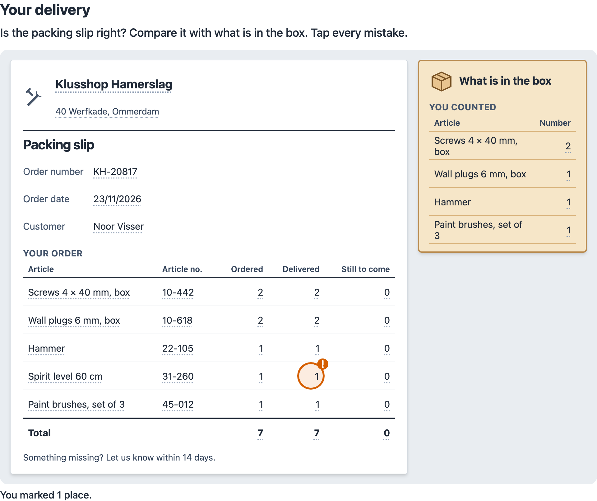

# @citolab/pci-document-reading

> [!WARNING]
> **Experimental (alpha). Just for inspiration.** This PCI is a technical showcase, made by software developers without
> much knowledge of the subject it could be used for. Its content, terms and scoring have not been checked by subject
> experts or assessment specialists, and it has never been used in an assessment. It is offered as is, without any
> warranty.

A QTI 3 Portable Custom Interaction (PCI) for reading everyday documents and doing the sums on them (Dutch: *documenten
lezen*), as in SLO's example for praktijkonderwijs "Ik kan een loonstrookje lezen en begrijpen". The pupil gets a
realistic but made-up document, drawn from data as HTML (not an image): a payslip, a till receipt, a packing slip next
to the delivery, a staff rota, a bus timetable, an energy bill or the dosage table of a medicine leaflet. They tap the
field the question asks for (*Tap your net wage*), tap every mistake in the document (a wrong total, a wrong number
of hours, an item that is not in the box), or type a number they read or work out from it (*How many minutes until
the next bus?*). The item author makes their own documents in the PCI itself. Made with
[tspci](https://github.com/Citolab/tspci).

<p align="center">
  
</p>

## What it does

- **Seven documents** (`template`), each with an example in English and Dutch:
  - `payslip` (*loonstrook*): hours × hourly wage, holiday allowance (8%), total gross, wage tax and pension, net wage;
  - `receipt` (*kassabon*): items with number, price and amount, number of items, discount, total, paid in cash,
    change, VAT included; thermal paper with a typewriter font and a torn edge;
  - `packingSlip` (*pakbon*) next to the delivery: ordered, delivered and still to come per article, and beside it
    what the pupil counted in the box (an article that did not come is not in the box);
  - `rota` (*dienstrooster*): the shifts of three people over six days and their hours this week;
  - `timetable` (*dienstregeling*): a bus line, five stops and five buses, departure times;
  - `energyBill` (*jaarafrekening*): meter readings, usage, costs, VAT, paid in advance, to pay or to get back;
  - `dosage` (*bijsluiter*): age, weight, tablets each time, times a day, tablets and milligrams a day at most.
- **Three tasks** (`task`):
  - `find`: the pupil taps the field the question asks for. One field is chosen at a time; a second tap takes it back.
  - `check`: the document has mistakes. The pupil taps every mistake (a tap marks, a second tap takes the mark away),
    and the line under the document says how many places they marked. Scored like hazard spotting: the mistakes
    found, the taps on fields without a mistake, and per mistake whether it was found.
  - `answer`: a question with a number box ("How much do you earn per hour?"); the document is the source. The pupil
    may also tap where they found it (`markSource`).
- **Every value is a field.** A field is an input (the hours, the price of the milk) or computed from the fields
  before it (the wage = hours × hourly wage, the total, the change, the hours of a shift). A mistake is a computed
  field the author made wrong on purpose. **A mistake carries on**: the fields after it are computed from what the
  document shows, as on a real document, so every mistake can be found by checking a field against the fields it
  comes from, and only that field is the mistake (a wrong wage, then a holiday allowance and a gross that are right
  for that wage).
- **Amounts and numbers by the language**: `€ 1.360,28` and `17,5` in Dutch, `€1,360.28` and `17.5` in English; meter
  readings `23.512 kWh`; times `08:15`; a day off `vrij` or `off`. The currency sign is a setting (`€` by default). The
  pupil may type `14,25`, `14.25`, `€ 14,25` or `17,5 uur`.
- **Made-up content only**: made-up companies, people, addresses, logos (simple shapes) and a medicine that says it is
  not one. No real brands, logos or personal data.
- **Touch**: every field is a button of at least 44 × 44 px; a tap (a click from the browser, which does not come
  when the finger scrolls the page) chooses or marks it. Nothing needs a hover; the hover background is only a hint,
  and only on a device that has a hover.
- **Keyboard**: every field is in the tab order, in reading order. The arrow keys move through the fields: Left and
  Right to the previous and next field, Up and Down to the field above or below in the same column of a table, Home
  and End to the first and last. Enter or Space chooses or marks. In `answer`, the number box comes before the
  document.
- **Screen readers**: the document is a named region with real tables: a caption, column headers and row headers.
  Each field is a toggle button named with its place and its value ("Net wage: €900.61", "Noor, Fri 27 Nov:
  13:00–18:00") and `aria-pressed`; in review a mark is read as text ("marked as a mistake"). A live region says what a
  tap did ("Marked as a mistake: Total deductions. You marked 2 places.").
- **Colour is never the only cue**: a chosen field has a blue frame and a tick, a mistake an orange ring and an
  exclamation mark, where the answer was found a dashed green frame and a magnifier (Okabe-Ito colours). A number box
  with something that is not a number has a red border, a warning icon and a message.
- **Authoring mode** (`"editor": "pci"`): the author picks the document, the task and the language, and sees the
  document as the pupil will. A tap in it picks the right field (find; more than one when any of them is right), where
  the answer is (answer), or makes a computed field wrong with a value a little off (check; a second tap makes it
  right). Below it every value is in a form, grouped as on the document; a computed field shows what it computes to
  and can be given another value. Lines can be added and removed on the receipt and the packing slip. The task panel
  lists the right field, the mistakes ("Noor, hours this week: 21 (should be 23)") or the answer, its unit and margin.
  `validate()` reports what is missing or cannot be read, in the author's language.
- **Delivery**: the taps and the typed text are saved as the item's state (every change in the log) and restored, for
  the same document only. `boundTo` and `setResponse` show a response; status `solution` shows the item's correct
  response, or else the one that follows from the settings, read-only. Several interactions on one page each have
  their own state.

## Settings

| setting | editor | what it does |
| --- | --- | --- |
| `title`, `question` | `text`, `textarea` | above the document; an empty question is the example's for its own field, `Tap: Total gross.` for another one, and for check `This payslip has 2 mistakes. Tap every mistake.` |
| `language` | `enum` | `en` or `nl`: the document's texts and number formats, and the PCI's own texts |
| `template` | `enum` | `payslip` (default), `receipt`, `packingSlip`, `rota`, `timetable`, `energyBill`, `dosage` |
| `task` | `enum` | `find` (default), `check`, `answer` |
| `document` | `pci` | the values and the mistakes, as JSON (below); empty: the example (with the example's mistakes for `check`) |
| `targets` | `pci` | field ids, separated by commas: the right fields (`find`, any of them) or where the answer is (`answer`); empty: the example's |
| `answer` | `text` | the correct number (`answer`); empty: the example's, or the value of the first target |
| `tolerance` | `number` | the margin of the answer (default `0`) |
| `unit` | `text` | next to the number box; empty: the example's (`minutes`), the currency sign for an amount, or the field's unit (`kWh`) |
| `markSource` | `boolean` | `answer`: the pupil may tap where they found it (default `true`) |
| `currency` | `text` | the currency sign (default `€`) |

```json
{
  "values": { "hours": "64", "rate": "14.25", "holidayPct": "8", "tax": "61.20", "pension": "23.15", "employer": "…" },
  "mistakes": { "wage": "921.00", "deductions": "74.35" }
}
```

Values are language neutral: amounts and numbers with a decimal point (`14.25`), times `08:15`, a shift
`09:00-13:00` (empty for a day off), text as it is shown. A value that is missing or cannot be read is the example's.
`mistakes` gives computed fields another value; a mistake that equals the computed value is no mistake. The field ids
are in the authoring mode next to each chosen field, and in `src/documents.ts` (`net`, `item2Amount`, `line4Delivered`,
`day5Person2`, `bus4Stop2`, `usage`, `perDay2`, …).

## Response and scoring

The PCI does not score: it reports a `record`, and the item's scoring decides what counts. Nothing is reported until
the pupil tapped a field or typed in the number box.

| field | type | task | what it is |
| --- | --- | --- | --- |
| `correct` | `boolean` | all | find: the tapped field is a target; check: every mistake found and no other field tapped; answer: the number is the answer, within the margin |
| `field` | `identifier` | `find` | the field the pupil tapped |
| `found` | `integer` | `check` | mistakes found |
| `total` | `integer` | `check` | mistakes in the document |
| `wrong` | `integer` | `check` | taps on fields without a mistake |
| `mistake1` … `mistake8` | `boolean` | `check` | per mistake, in the order of the document: found |
| `answer` | `float` | `answer` | the number the pupil typed (`14,25` is reported as `14.25`); left out when it is not a number |
| `source` | `identifier` | `answer` | the field the pupil marked (only with `markSource`, when they marked one) |
| `sourceCorrect` | `boolean` | `answer` | the marked field is a target |

- **`getCorrectResponse`** follows from the settings: the first target (`find`), every mistake found (`check`), or the
  answer and, with `markSource`, the first target as the source (`answer`). So `match_correct` means "the right
  field", "every mistake and nothing else" or "the right number, found in the right place".
- **`custom`**: hazard-spotting scoring for `check` (a point per `mistakeN`, minus a point per `wrong`, at least 0);
  for `answer`, `correct` alone when marking the source is optional, or a point for `correct` and one for
  `sourceCorrect`.
- **`human`**: the response says which fields were tapped (and for `check` which mistakes; taps on fields without a
  mistake are counted, the state keeps which ones).

## Development

```bash
npm install
npm test              # the logic (src/documents.ts) in node
npm run dev           # the dev page, with the settings
npm run test:stories  # the Storybook tests
```

`src/documents.ts` has no imports: the templates and their examples, the computed fields and the mistakes, the formats,
the response and the correct response, tested with `node --test`. `src/documentView.tsx` draws a document, also in the
authoring mode (`src/authoring.tsx`).
