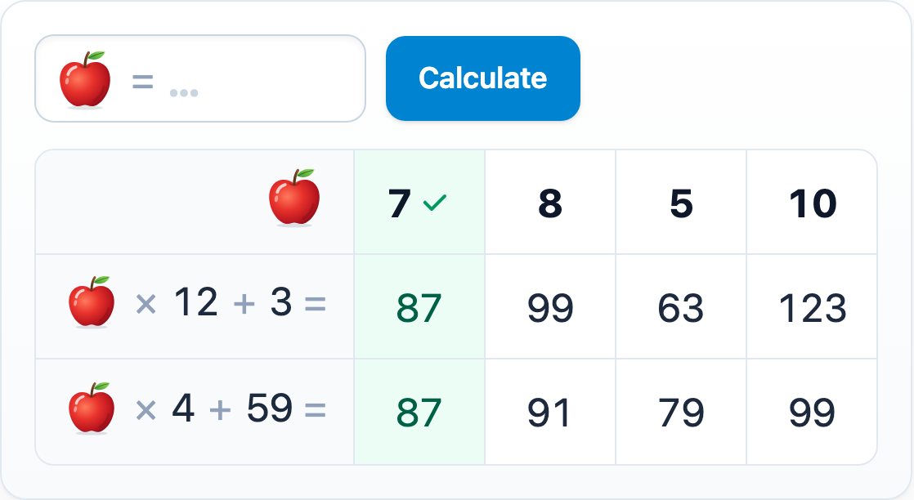

# @citolab/pci-equal-expressions

A QTI 3 Portable Custom Interaction (PCI) for trial and improvement: two expressions with a picture in place of the
unknown number (an apple, a pear, an ice cream or an image of your own). The candidate tries numbers, and a table keeps
the results of both expressions, until they find the number at which both give the same result. Made with
[tspci](https://github.com/Citolab/tspci).

<p align="center">
  
</p>

An improved version of the "getallen" PCI of the Dutch national assessment of mathematics (Peiling rekenen-wiskunde
2022), made to study the steps candidates take.

## What it does

- **Try a number**: type it next to the picture and press *Calculate* (or Enter). A decimal point or comma both work.
- **The table**: one column per number tried, the newest first, with the result of both expressions. A number tried
  again moves to the front. Optionally, a try at which both expressions give the same result is marked green.
- **The picture**: an apple, a pear or an ice cream, or the author's own image (see below).
- **Language**: the buttons and messages in English or Dutch (`data-language`); numbers follow it (`6,25` in Dutch).
- **Delivery**: the tries are saved as the item's state, with every step in the log, and restored. In review the
  input is disabled.

The PCI is a tool: the candidate gives the answer elsewhere in the item, for instance in a text entry interaction.

## The image

The PCI shows the first of these:

1. **An `` in the interaction markup.** An authoring system with a media bank puts the author's image there
   (`config.tspci.markup` in `authoring.json` declares the slot; qti-construction shows a media picker for it). The
   delivery system treats its `src` like any other image in the package. Its `alt` is the name a screen reader reads.
2. **An uploaded image** (`data-custom-image`). The authoring mode ("Upload own image…" in TAO with tspci-tao,
   qti-construction and the PCI showcase) lets the author drop or choose a file. A picture is shrunk to at most
   160 pixels and stored as PNG or WebP, a small SVG as it is, as a `data:` URL: the item needs no separate file.
   *Remove image* goes back to the chosen one.
3. **The chosen image** (`data-image`): `apple` (default), `pear` or `iceCream`.

## What can be configured

Every setting is a `data-` attribute of the interaction, as text. `dist/authoring.json` describes them for authoring
systems.

| setting | attribute | default | what |
| --- | --- | --- | --- |
| First expression | `data-expression1` | `? × 12 + 3` | `?` is the unknown; numbers, `+ - × ÷ ^`, brackets (`*`, `x`, `:` and `/` work too) |
| Second expression | `data-expression2` | `? × 4 + 59` | the same; the defaults meet at 7 |
| Image | `data-image` | `apple` | `apple`, `pear` or `iceCream`; an own image goes first |
| Own image | `data-custom-image` | empty | written by the authoring mode: a `data:` URL (an image URL works too) |
| Name of the image | `data-image-name` | empty | for screen readers; empty: apple, pear, ice cream or "unknown number" |
| Empty columns | `data-columns` | `4` | columns the table shows before the first try (1 to 10) |
| Mark equal results | `data-highlight-equal` | `false` | `true`: a try at which both expressions give the same result is marked green |
| Language | `data-language` | `en` | `en` or `nl` |

## Response and scoring

The PCI is not scored (`"role": "tool"`, `"score": ["NONE"]`).

**The response** is the list of numbers tried, oldest first (`cardinality="ordered" base-type="float"`):
`[10, 5, 8, 7]`. A number tried twice is in it once; the state's log has every try with its time. Until the first try,
`getResponse()` reports nothing. Response processing can still use it, for instance to see whether the candidate tried
the right number.

## Using it

```sh
npm install @citolab/pci-equal-expressions
```

| file | what |
| --- | --- |
| `dist/index.js` | the PCI (AMD module, everything bundled: the package has no dependencies) |
| `dist/authoring.json` | settings, the image slot, response and the authoring mode, for authoring systems |
| `dist/sbom.cdx.json` | CycloneDX SBOM of the bundle |
| `dist/tao-pci-equalExpressions_<version>.zip` | the PCI for TAO: Settings → Portable Custom Interactions → Add |
| `equalExpressions.svg`, `example.png` | icon and screenshot |

In a QTI 3 item, with `index.js` at `resources/pci/index.js` of the package:

```xml
<qti-response-declaration identifier="TRIES" cardinality="ordered" base-type="float"/>
<qti-response-declaration identifier="RESPONSE" cardinality="single" base-type="float"/>
…
<qti-portable-custom-interaction response-identifier="TRIES" module="pci" custom-interaction-type-identifier="equalExpressions"
  data-expression1="? × 12 + 3" data-expression2="? × 4 + 59" data-image="pear" data-language="nl">
  <qti-interaction-modules>
    <qti-interaction-module id="pci" primary-path="../resources/pci/index"></qti-interaction-module>
  </qti-interaction-modules>
  <qti-interaction-markup></qti-interaction-markup>
</qti-portable-custom-interaction>
<p>The number is <qti-text-entry-interaction response-identifier="RESPONSE"/></p>
```

With an image of your own from the package: `<qti-interaction-markup></qti-interaction-markup>`.

Source and the other examples: [Citolab/tspci-examples](https://github.com/Citolab/tspci-examples).
