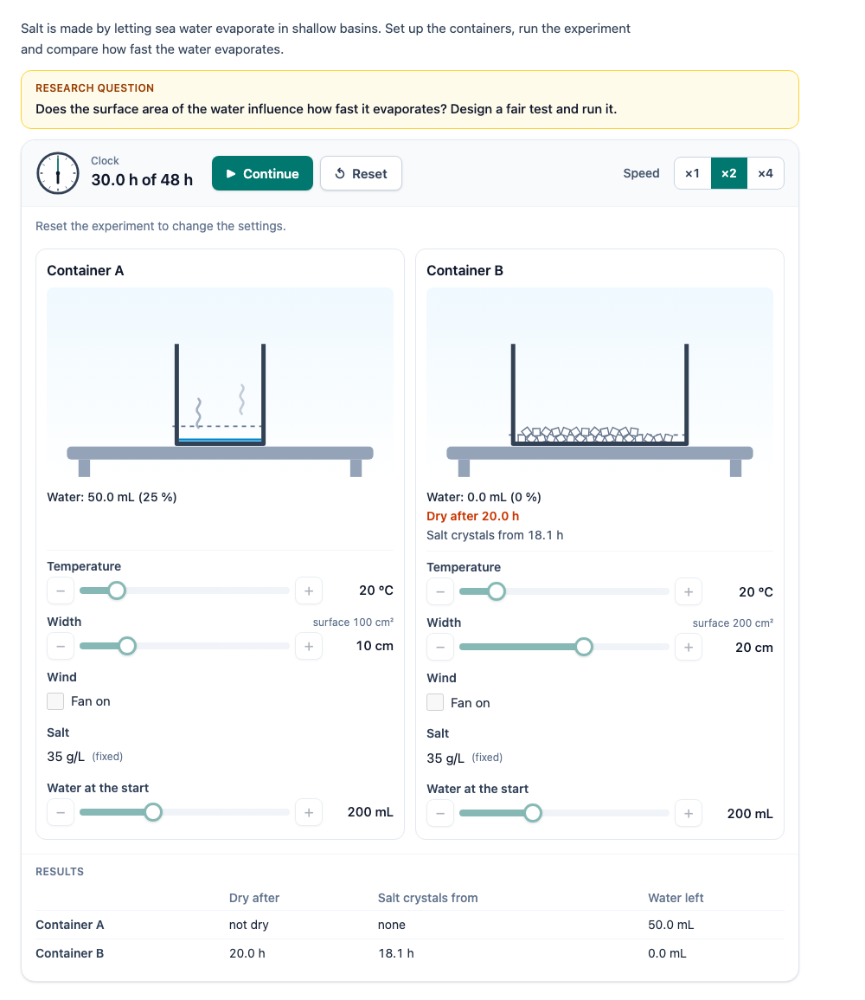

# @citolab/pci-evaporation

> [!WARNING]
> **Experimental (alpha).** This PCI is a rewrite of a PCI of the French DEPP; it has never been used in an assessment.
> Try it out with candidates and check its content, model and scoring before you use it in one.

A QTI 3 Portable Custom Interaction (PCI) with an evaporation experiment the candidate designs. Two or three trays of
salt water stand side by side; for each the candidate sets the temperature, the width (so the surface area), a fan for
wind, the salt concentration and the volume of water, as far as the item allows. A simulated clock runs the experiment
(faster, paused, reset): the water levels drop, vapour rises, and salt crystals appear once the water left is
saturated. With a research question ("does the surface area influence how fast water evaporates?") the PCI checks
whether the candidate ran a fair test: only that variable differs between the containers. Made with
[tspci](https://github.com/Citolab/tspci).

<p align="center">
  
</p>

## What it does

- **Design**: a card per container with its settings. A number is a native range input with − and + buttons (arrow
  keys one step, Page Up/Down, Home/End); wind is a checkbox. A variable the candidate may not change is shown as
  fixed. The settings are locked while the experiment runs and after it ended: Reset unlocks them.
- **Run**: Start, Pause, Continue and Reset, and a speed of ×1, ×2 or ×4 (radio buttons). A clock face and
  "12.5 h of 48 h" show the time. The run ends at the length of the experiment, or earlier when every container is dry.
- **The picture** (SVG, per container): the tray to scale (the same scale for every container), the water with a
  dashed line at the start level, vapour rising while it evaporates, salt crystals on the bottom as the salt comes out,
  the plate under it coloured from blue (cold) through grey (20 °C) to red (hot), and a fan blowing over it with wind.
  Under it the water left, when it was dry and when the first crystals appeared.
- **Results**: a table with per container the time until dry, the time of the first salt crystals and the water left,
  and a list of earlier runs with their settings and outcome.
- **Accessibility**: real buttons, sliders, checkboxes and radio buttons; every picture has a text alternative
  ("Container A: a tray 10 cm wide at 20 °C, with 150.0 mL of water."); a live region tells a screen reader when the
  experiment starts, pauses and ends, when a container is dry and when crystals appear.
- **Languages**: English, Dutch and French (`data-language`), with a decimal comma in Dutch and French.
- **Delivery**: the state (containers, clock, runs) and a log of every action are saved and restored; a run that was
  going when the candidate left comes back paused at the same time. In review (`status` `review`, `solution` or
  `closed`) everything is shown but nothing can be changed.

### The model

`src/model.ts`, tested in node with `npm test`. A container is a tray `width` cm wide and 10 cm deep, so its water
surface is *A* = width × 10 cm². Water evaporates at a constant rate

> rate (mL/h) = 0.05 × *A* × *f*(*T*) × (wind ? 2 : 1)

where *f*(*T*) is the saturation vapour pressure of water at *T* (Magnus formula) relative to that at 20 °C
(*f*(10 °C) ≈ 0.53, *f*(40 °C) ≈ 3.2, *f*(60 °C) ≈ 8.6). So at 20 °C without wind a tray loses 0.5 mm of water an
hour; the default tray (10 cm, 200 mL) is dry after 40 h, one twice as wide after 20 h. The rate does not depend on the
volume or the salt (a simplification). The salt (concentration × volume) stays behind and crystallizes when the water
left can no longer hold it: at 360 g/L (NaCl). Sea water (35 g/L) gives crystals when about 10 % of the water is
left.

The model is meant for comparing containers, not for predicting real evaporation: humidity, the cooling of the water
and the slowing by salt are left out.

## What can be configured

Every setting is a `data-` attribute of the interaction, as text. `dist/authoring.json` describes them for authoring
systems.

| setting                       | attribute                                     | default                       | what |
| ----------------------------- | --------------------------------------------- | ----------------------------- | ---- |
| Instruction                   | `data-prompt`                                 | an example                    | above the experiment |
| Research question             | `data-question`                               | about the surface area        | shown above the experiment; empty: none |
| Target variable               | `data-target`                                 | `area`                        | `temperature`, `area`, `wind`, `salt`, `volume`, or `none` (any fair test counts) |
| Number of containers          | `data-count`                                  | `2`                           | `2` or `3` |
| What the candidate may change | `data-change-temperature`, `-area`, `-wind`, `-salt`, `-volume` | `true`, `true`, `true`, `false`, `true` | the others stay at their value |
| Temperature                   | `data-temperature`, `-min`, `-max`, `-step`   | `20`, `10`, `80`, `5`         | °C; the value at the start (and when it is fixed) and the slider |
| Width                         | `data-width`, `-min`, `-max`, `-step`         | `10`, `5`, `30`, `5`          | cm; the surface is width × 10 cm |
| Wind                          | `data-wind`                                   | `false`                       | at the start (and when it is fixed); shown when the candidate may change it or it is on |
| Salt                          | `data-salt`, `-min`, `-max`, `-step`          | `35`, `0`, `250`, `5`         | g/L; shown when the candidate may change it or it is more than 0 |
| Volume                        | `data-volume`, `-min`, `-max`, `-step`        | `200`, `50`, `500`, `50`      | mL |
| Start values per container    | `data-start`                                  | empty                         | `temperature=60 \| temperature=20`: `key=value` separated by `;`, containers by `\|`; keys `temperature`, `width` (or `area`), `wind`, `salt`, `volume`. Also for a fixed variable |
| Length of the experiment      | `data-duration`                               | `48`                          | hours on the clock |
| Real time                     | `data-run-seconds`                            | `20`                          | seconds the whole experiment takes at ×1 (at most 600) |
| Language                      | `data-language`                               | `en`                          | `en`, `nl` or `fr` |

Values that make no sense are corrected: a maximum under the minimum, a step that is too large, a value off the
slider's steps (to the nearest step).

**The original's demonstration** (the same salt water heated and at room temperature; nothing to change):
`data-change-temperature="false" data-change-area="false" data-change-wind="false" data-change-volume="false"
data-start="temperature=60 | temperature=20" data-target="none" data-question=""`. The wide and the narrow container:
`data-start="width=30 | width=5"` with `data-change-area="false"`.

## Scoring

`authoring.json`: `"scoring": ["custom", "human"]`. The response is a record (`cardinality="record"`):

| field        | base type | what |
| ------------ | --------- | ---- |
| `score`      | integer   | 1 when a run to the end was a fair test of the target variable; else 0 |
| `fairTest`   | integer   | 1 when in the counted run (below) exactly one variable differs between the containers, and it is the target |
| `ran`        | integer   | 1 when a run to the end was counted; 0 when the candidate never ran the experiment to the end (the design then is the current one) |
| `varied`     | string    | the variables that differ between the containers, separated by `;` (`area`, `temperature;area`) |
| `runCount`   | integer   | number of runs to the end |
| `containers` | string    | JSON: the settings of the counted run's containers: `[{"temperature":20,"width":10,"wind":false,"salt":35,"volume":200}, …]` |
| `results`    | string    | JSON: per container `dryAfter` (h, or null: not dry), `crystalsFrom` (h, or null), `volumeLeft` (mL at the end), `crystals` (g) |
| `runs`       | string    | JSON: every run, also those reset halfway (`completed: false`), with containers, hours and results |

**The counted run** is the last run to the end that was a fair test, or else the last run to the end. A fair test once
run is not undone by later runs. A run counts as "to the end" when the clock reached the length of the experiment or
every container was dry.

- **Fair test**: exactly one variable differs (the area is the width), and with a target that one is the target.
  Nothing different is not a test; two things different is not fair. Variables the candidate may not change are equal
  anyway, unless the author made them differ with `data-start`.
- **Custom response processing**: `score` is the point (`<qti-set-outcome-value identifier="SCORE">` with
  `<qti-field-value field-identifier="score">`). Use `fairTest` and `ran` for partial credit (a fair design that was not
  run), or `varied` for feedback.
- **Without a target** (`data-target="none"`) `score` is 1 for any fair test; score it by hand, or use `varied`.
- **No response**: until the candidate changes a setting or starts the experiment, `getResponse()` reports nothing.
- `setResponse` with such a record restores the runs and the containers of the last run (in the design phase).

### Compared with the original

The original logged only whether the animation had been started: the string `{"animation" : true}` (or `false`). The
candidate could not change anything: two fixed experiments ran on one button. Here the response has the design, the
results and every run, and a score for a fair test; `runCount` > 0 is the original's `animation: true`.

## Using it

```sh
npm install @citolab/pci-evaporation
```

| file                                      | what |
| ----------------------------------------- | ---- |
| `dist/index.js`                           | the PCI (AMD module, everything bundled: the package has no dependencies) |
| `dist/authoring.json`                     | settings, response and scoring, for authoring systems |
| `dist/sbom.cdx.json`                      | CycloneDX SBOM of the bundle |
| `dist/tao-pci-evaporation_<version>.zip`  | the PCI for TAO: Settings → Portable Custom Interactions → Add |
| `evaporation.svg`, `example.png`          | icon and screenshot |

In a QTI 3 item, with `index.js` at `resources/pci/index.js` of the package:

```xml
<qti-response-declaration identifier="RESPONSE" cardinality="record"/>
<qti-outcome-declaration identifier="SCORE" cardinality="single" base-type="integer"/>
…
<qti-portable-custom-interaction response-identifier="RESPONSE" module="pci" custom-interaction-type-identifier="evaporation"
  data-question="Does warm water evaporate faster? Design a fair test and run it." data-target="temperature"
  data-count="3" data-change-salt="false" data-language="en">
  <qti-interaction-modules>
    <qti-interaction-module id="pci" primary-path="../resources/pci/index"></qti-interaction-module>
  </qti-interaction-modules>
  <qti-interaction-markup></qti-interaction-markup>
</qti-portable-custom-interaction>
…
<qti-response-processing>
  <qti-set-outcome-value identifier="SCORE">
    <qti-field-value field-identifier="score"><qti-variable identifier="RESPONSE"/></qti-field-value>
  </qti-set-outcome-value>
</qti-response-processing>
```

## Source and licence

This PCI is a derivative work of
[`MaraisSalantpci`](https://github.com/janfix/extension-wiquid-depp/tree/master/views/js/pciCreator/ims/MaraisSalantpci)
("Évaporation", a salt marsh) in [janfix/extension-wiquid-depp](https://github.com/janfix/extension-wiquid-depp),
© DEPP (Ministère de l'Éducation nationale) / Jean-Philippe Rivière (Wiquid). That extension is licensed under the GNU
General Public License version 2 only (`GPL-2.0-only`, as stated in its `composer.json` and in the headers of its
files), so this PCI is too: see [LICENSE](LICENSE). This differs from the MIT licence of most other examples in this
repository.

What changed, by Stichting Cito Instituut voor Toetsontwikkeling (2026):

- Rewritten from jQuery and a fixed SVG/image background to TypeScript, Preact and Tailwind in a shadow DOM (tspci);
  every picture is drawn anew in inline SVG, no image of the original is used.
- From a fixed demonstration (heated vs room temperature, wide vs narrow, fixed animation times) to an experiment the
  candidate designs, with a documented model instead of hardcoded durations; 2 or 3 containers; temperature, surface,
  wind, salt and volume per container; speed, pause and reset.
- Settings for the author (what may change, ranges, fixed and start values, the research question and target, the
  length of the experiment), described in `src/config.json` for authoring systems.
- A structured, scored response (a fair-test check) instead of `{"animation" : true}`; state and log saved and restored.
- Keyboard and screen-reader access, English, Dutch and French (the original was French only).

Source and the other examples: [Citolab/tspci-examples](https://github.com/Citolab/tspci-examples).
