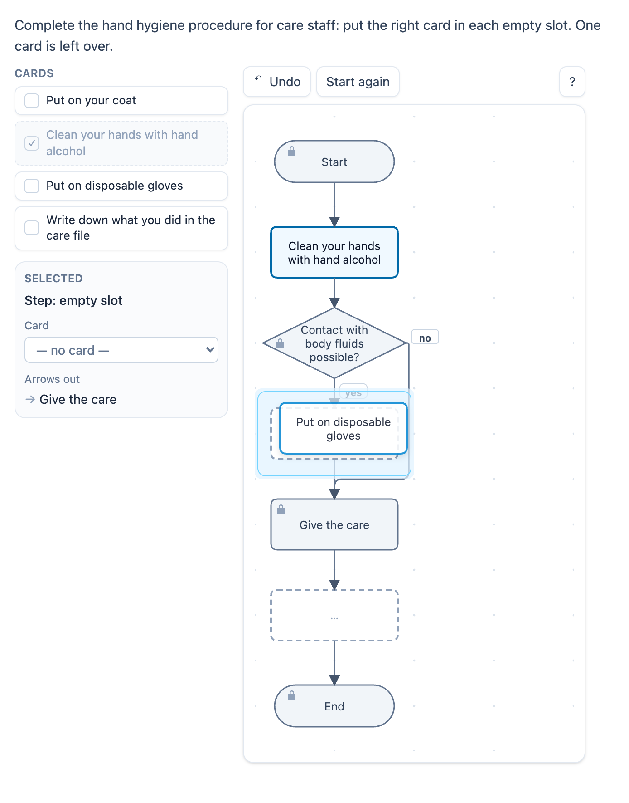

# @citolab/pci-flowchart

> [!WARNING]
> **Experimental (alpha). Just for inspiration.** This PCI is a technical showcase, made by software developers without
> much knowledge of the subject it could be used for. Its content, terms and scoring have not been checked by subject
> experts or assessment specialists, and it has never been used in an assessment. It is offered as is, without any
> warranty.

A QTI 3 Portable Custom Interaction (PCI) in which the candidate builds or completes a flowchart: they put cards with the
steps of a process in order, fill the empty slots of a partial chart (a production process, a hygiene procedure, a
decision tree), or build a whole chart with start/end blocks, steps, decisions and input/output blocks joined by
arrows. The response is the graph without its layout, as a canonical string, so the item can score it with
`match_correct`. The PCI can also score it itself against the author's checks (one card before another on every path,
the yes exit of a decision, no dead ends, …). The item author sets up the cards, the chart, the solution and the checks
in the PCI itself. Made with [tspci](https://github.com/Citolab/tspci).

<p align="center">
  
</p>

## What it does

- **Shapes** (ISO 5807 style): start/end (rounded), step (rectangle), decision (diamond, with yes/no exits),
  input/output (parallelogram), and arrows. The shape always carries the meaning, colour only adds to it. Locked blocks
  have a lock, empty slots a dashed outline, and the exits carry the words yes/no (ja/nee).
- **Three tasks** (`mode`):
  1. **order**: put the cards in order in a linear process. The PCI draws start, a slot per card and end, one under the
     other (a new column after `rows` blocks). Distractor cards are left over.
  2. **complete**: a partial chart with locked blocks, locked arrows and empty slots that the candidate fills with
     cards (or typed text). Optionally (`arrows`) the candidate also draws and removes arrows.
  3. **free**: the candidate builds the chart: blocks from the palette, text from the cards and/or typed, arrows, a
     *Tidy up* button (automatic layout). Score it with checks, or leave it to a human rater.
- **Mouse and touch**: drag a card onto a slot (or, in free mode, onto an empty cell), or choose a card and click a
  cell. Drag a card from slot to slot (they swap), or off the chart (it goes back). Drag a block to move it. Drag from
  the dot under the selected block to another block to draw an arrow. Click an arrow to select it.
- **Keyboard**: the chart is a grid with the selected cell as its active descendant. Arrow keys move over the chart,
  `Enter` places the chosen card or block, `Shift` + arrow moves a block (in a slot: swaps its card with the next or
  previous slot, also across columns), `C` jumps to *Connect to…*, `Delete` removes (a block, an arrow, or the card
  from a slot), `Ctrl+Z` undoes, `Escape` drops the chosen card. The panel next to the chart has everything for the
  selected block as native controls: its card or text, its shape, its arrows with their yes/no labels and a remove
  button, *Connect to…* with the exit, delete.
- **Screen readers**: every cell is read with its block and its arrows ("Row 3, column 1: Decision: Contact with body
  fluids possible?; part of the question; arrows to Put on disposable gloves (yes), Give the care (no)"), every step goes
  to a live status line, and *The flow as text* under the chart reads the whole chart as an outline: "1. Start, 2. Step:
  Clean your hands, 3. Decision: Contact…? yes 4. Step: Put on gloves, 5. Step: Give the care … no → continues at 5".
- **Arrows** are routed orthogonally: straight when the cells in between are free, with one bend for a decision's
  side exit, otherwise along the gaps between the cells (where no block is). A yes exit leaves at the bottom, a no exit
  at the side.
- **Logic** in `src/flowchart.ts` (model, canonical graph, checks, outline) and `src/layout.ts` (routing, automatic
  layout, text wrapping), without imports, tested in node with `npm test`.
- **Delivery**: the whole chart is saved as the item's state (every change in the log) and restored. In review
  (`status: "solution"`) the PCI shows the correct response from the response declaration, or else the author's
  solution, read-only. Several interactions of this type on one page each get their own object.
- `prefers-reduced-motion`: there is no animation to turn off.

## What can be configured

Every setting is a `data-` attribute of the interaction, as text. `dist/authoring.json` describes them for authoring
systems.

| setting                      | attribute           | default                | what                                                          |
| ---------------------------- | ------------------- | ---------------------- | ------------------------------------------------------------- |
| Instruction above the chart  | `data-prompt`       | the example's question | also part of the chart's accessible name                      |
| Flowchart                    | `data-flowchart`    | empty: the example     | written by the authoring mode, as JSON (below)                |
| Scoring                      | `data-scoring`      | `match`                | `match`: a canonical string; `pci`: a record with the checks  |
| Show the flow as text        | `data-show-outline` | `true`                 | the outline under the chart (collapsed)                       |
| Language                     | `data-language`     | `en`                   | `en` or `nl`: the texts of the PCI                            |

```json
{
  "mode": "complete", "text": "cards", "columns": 2, "rows": 7,
  "cards": [
    { "id": "c1", "text": "Clean your hands with hand alcohol" },
    { "id": "c2", "text": "Put on disposable gloves" },
    { "id": "c4", "text": "Put on your coat", "distractor": true }
  ],
  "chart": {
    "nodes": [
      { "id": "start", "shape": "start", "x": 0, "y": 0, "locked": true, "text": "Start" },
      { "id": "s1", "shape": "step", "x": 0, "y": 1, "locked": true, "slot": true },
      { "id": "contact", "shape": "decision", "x": 0, "y": 2, "locked": true, "text": "Contact with body fluids possible?" }
    ],
    "edges": [{ "from": "start", "to": "s1", "locked": true }, { "from": "contact", "to": "s2", "label": "yes", "locked": true }]
  },
  "solution": { "nodes": [{ "id": "s1", "card": "c1" }, { "id": "s2", "card": "c2" }], "edges": [] },
  "checks": [{ "type": "before", "a": "c1", "b": "care", "points": 1 }]
}
```

- **mode**: `order`, `complete` or `free`. **text**: `cards`, `typed` or `both`. **arrows** (complete mode): the
  candidate draws arrows too. **shuffle** (default true): the cards in a mixed order, the same for everyone.
- **cards**: `id`, `text`, optional `shape` (the block a card makes in free mode) and `distractor`. In order mode the
  order of the cards is the right order; a list of strings is enough (`["Measure", "Saw", "Sand"]`).
- **chart**: blocks on a grid (`x` column, `y` row, from 0, one block per cell) with an `id`, a `shape` and a `text`;
  `slot: true` makes it a place for the candidate. Arrows `from`/`to` an id, with `label` `yes`/`no`.
- **solution**: the chart as the candidate would leave it (only the fills of the slots and the candidate's own blocks
  and arrows count). Not needed in order mode.

### The checks (data-scoring="pci")

At most 8, each worth `points` (default 1). A check names a card by its id and a locked block by its id. Without checks
the PCI compares the graph with the solution.

| check       | passes when                                                                                       |
| ----------- | ------------------------------------------------------------------------------------------------- |
| `same`      | the canonical graph equals the solution's (the layout does not count)                             |
| `before`    | `b` can be reached from the start, and every way there passes `a` ("wash before gloves")          |
| `branch`    | the `label` exit (yes/no) of `decision` leads to `target`; with `direct: false` anywhere along it |
| `cards`     | every card of the answer (or `cards`) is used; with `exact`, no other card                        |
| `startEnd`  | exactly one start and one end block; nothing goes into the start, nothing leaves the end          |
| `deadEnds`  | every block is reached from the start, every block but the end has an exit, an end is reachable   |
| `decisions` | every decision has exactly two exits, one yes and one no                                          |

## Scoring

**The graph.** Blocks are named by their card id, a locked block by its id, typed text by its text in quotes
(`"wash hands"`, lower case), an empty start/end block as `start`/`end`, an empty slot as `?`. A shape that differs
from the card's own shape is added (`c3/decision`). The string is the sorted names, `|`, then the sorted arrows
`from>to` with `:yes`/`:no`:

```
c1,c2,c3,care,contact,end,start|c1>contact;c2>care;c3>end;care>c3;contact>c2:yes;contact>care:no;start>c1
```

The same chart gives the same string wherever the blocks are and whatever ids the candidate's blocks got.

- **`match_correct`** (`data-scoring="match"`, the default): `cardinality="single" base-type="string"`, the correct
  response is the graph of the author's solution (the authoring mode shows it; `getCorrectResponse(properties)` gives it
  to an authoring system, `config.tspci.correctResponse: "settings"`). Made for order and complete mode. Typed text
  must then match exactly (after lower case and spaces).
- **`custom`** (`data-scoring="pci"`): a record, `cardinality="record"`:

| field               | type      | what                                                                  |
| ------------------- | --------- | --------------------------------------------------------------------- |
| `score`             | `integer` | the points of the checks that pass                                    |
| `maxscore`          | `integer` | the points of all checks                                              |
| `correct`           | `integer` | 1 when every check passes, else 0                                     |
| `check1` … `check8` | `integer` | 1 or 0 per check, only the checks there are                           |
| `graph`             | `string`  | the canonical graph (above)                                           |
| `chart`             | `string`  | every block and arrow with its place, as JSON, for a rater            |

- **`human`**: free build for a human rater; `chart` (with `pci`) or the state has the whole chart.
- **No response**: until the candidate changes the chart, `getResponse()` reports nothing.

```xml
<!-- MATCH_CORRECT -->
<qti-response-declaration identifier="RESPONSE" cardinality="single" base-type="string">
  <qti-correct-response>
    <qti-value>c1,c2,c3,care,contact,end,start|c1&gt;contact;c2&gt;care;c3&gt;end;care&gt;c3;contact&gt;c2:yes;contact&gt;care:no;start&gt;c1</qti-value>
  </qti-correct-response>
</qti-response-declaration>
<qti-response-processing template="https://purl.imsglobal.org/spec/qti/v3p0/rptemplates/match_correct.xml"/>

<!-- CUSTOM: copy the PCI's score -->
<qti-response-declaration identifier="RESPONSE" cardinality="record"/>
<qti-response-processing>
  <qti-response-condition>
    <qti-response-if>
      <qti-not><qti-is-null><qti-variable identifier="RESPONSE"/></qti-is-null></qti-not>
      <qti-set-outcome-value identifier="SCORE">
        <qti-field-value field-identifier="score"><qti-variable identifier="RESPONSE"/></qti-field-value>
      </qti-set-outcome-value>
    </qti-response-if>
  </qti-response-condition>
</qti-response-processing>
```

**State and response.** `getState()` holds the whole chart (and the log). `setResponse` and `boundTo` (without a
state) read the `chart` field of a record, a chart as JSON, or a graph string: the slots are filled with the cards whose
arrows fit them best, and in free mode new blocks are placed by the automatic layout. In `status: "solution"` the
declared correct response (a graph, or a record value with `chart` or `graph`) is shown; without one, the author's
solution.

## Using it

```sh
npm install @citolab/pci-flowchart
```

| file                                      | what                                                                      |
| ----------------------------------------- | ------------------------------------------------------------------------- |
| `dist/index.js`                           | the PCI (AMD module, everything bundled: the package has no dependencies) |
| `dist/authoring.json`                     | settings, response, scoring and the authoring mode, for authoring systems |
| `dist/sbom.cdx.json`                      | CycloneDX SBOM of the bundle                                              |
| `dist/tao-pci-flowchart_<version>.zip`    | the PCI for TAO: Settings → Portable Custom Interactions → Add            |
| `flowchart.svg`, `example.png`            | icon and screenshot                                                       |

The **authoring mode** (`getAuthoringInstance`, "Make the flowchart…" in an authoring system that supports it) has five
tabs: **Setup** (task, text source, arrows, mixed order, grid size), **Cards** (text, shape, distractor, order),
**Chart** (complete and free mode: blocks with fixed text or as slots, fixed arrows), **Solution** (complete the chart
as a candidate would; order mode: the card order) and **Checks** (each with a tick when the solution passes). The graph
of the solution and its score are shown below. `validate()` reports, in the author's language: no cards, no slots in
complete mode, no solution where one is needed, checks about unknown cards or blocks, and checks the solution fails.

In a QTI 3 item, with `index.js` at `resources/pci/index.js` of the package:

```xml
<qti-portable-custom-interaction response-identifier="RESPONSE" module="pci" custom-interaction-type-identifier="flowchart"
  data-language="nl" data-flowchart="{&quot;mode&quot;:&quot;order&quot;,&quot;cards&quot;:[&quot;Meten&quot;,&quot;Zagen&quot;,&quot;Schuren&quot;]}">
  <qti-interaction-modules>
    <qti-interaction-module id="pci" primary-path="../resources/pci/index"></qti-interaction-module>
  </qti-interaction-modules>
  <qti-interaction-markup></qti-interaction-markup>
</qti-portable-custom-interaction>
```

Source and the other examples: [Citolab/tspci-examples](https://github.com/Citolab/tspci-examples).
