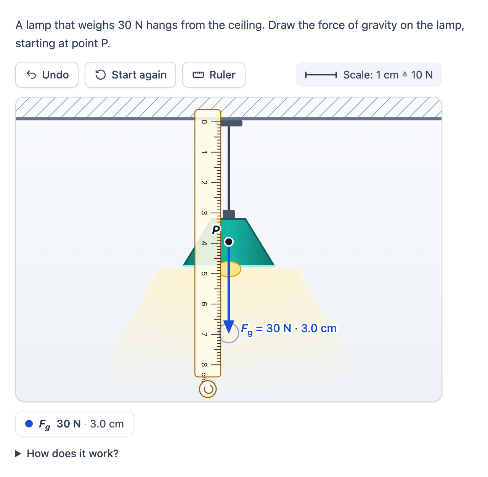

# @citolab/pci-force-vector

> [!WARNING]
> **Experimental (beta).** This PCI takes the idea of an interaction in an existing exam; it is not a copy of it. It is
> offered as is, without any warranty, and has never been used in an assessment. Try it out with candidates and check
> its content and scoring before you use it in one.

A QTI 3 Portable Custom Interaction (PCI) in which the candidate draws a force arrow on a picture: "draw the force of
gravity on the lamp, starting at point P", with a force scale such as 1 cm ≙ 10 N, a ruler to measure with and a live
label with the size of the arrow. The response is scored like the hand-scoring rubric of a physics exam: 1 point for
the right point of application and direction, 1 point for the right length. The item author places P and draws the
correct arrow in the PCI itself. Made with [tspci](https://github.com/Citolab/tspci).

<p align="center">
  
</p>

## What it does

- **Draw from P**: press on the point and drag; the arrow follows the pointer. Drag the head to change the arrow. While
  an arrow is not drawn yet, a drag anywhere on the picture draws it from P towards the pointer; once it is there, a
  stray click elsewhere leaves it alone.
- **The size, live**: next to the head and below the drawing, in newton and/or cm (`data-show-label`), with the force
  scale (`data-newton-per-cm`). Or not at all, when the candidate has to measure.
- **Snapping**: the direction snaps to whole degrees, 5°, 15° or 45° (or not), the length to 1 mm, 0.5 cm or 1 cm
  (or not). The arrow always stays on the picture.
- **A ruler** (meetlat) in cm and mm on the same scale as the drawing: drag it, turn it with the round handle around
  its 0, or put it away. It lies under the arrows, so the arrow and its label stay in sight.
- **Several arrows**: "draw the gravity and the normal force", each with its name (`F_z` is F with subscript z), its
  colour and its own given point, or a **free start** where the candidate chooses the point of application (and can
  drag the arrow by its line to move it).
- **Keyboard**: Tab to an arrow; ← and → turn it (counter-clockwise, clockwise), ↑ and ↓ make it longer and shorter,
  Shift for 15° and 1 cm. The first arrow key on an arrow that is not drawn yet draws 1 cm in that direction. Alt with
  the arrow keys moves an arrow with a free start; Delete removes it. The ruler: the arrow keys move it, Page Up and
  Page Down turn it.
- **Accessible**: every arrow is a slider ("force arrow") whose value a screen reader reads as "Fz: 30 N (3.0 cm),
  direction 270°, point P"; changes are announced. Buttons have names, the focus is always visible.
- **Undo and start again** ("Opnieuw"), also over a restored state.
- **Your own picture**: a URL or inline SVG markup (`data-background`), at any size. An inline SVG is shown as an
  image, so scripts in it never run. Without one, the PCI shows its example, a lamp hanging from the ceiling.
- **Dutch** (`data-language="nl"`): the texts and `2,5 cm`. The response is the same in every language.
- **Authoring mode**: the item author draws the correct arrows on the picture (`getAuthoringInstance`), via
  "Configure…" ("Draw the correct arrows…") in an authoring system that supports it (qti-construction, TAO with
  tspci-tao, the dev page). Drawing the arrow also places its point P; a check box makes the start free. The author
  names the arrows and sets the tolerances; the drawing shades what will be scored as correct (a circle around the
  start, a band of directions and lengths for the head), and the authoring mode shows the response processing for
  the item, ready to copy.
- **Delivery**: the arrows are saved as the item's state (every step in the log) and restored, with their undo
  history. In review (`status: "solution"`) the PCI draws the correct arrows dashed next to the candidate's.
- **Several on a page**: each interaction gets its own instance, store and settings.

## What can be configured

Every setting is a `data-` attribute of the interaction, as text. `dist/authoring.json` describes them for authoring
systems.

| setting                    | attribute              | default                 | what                                                            |
| -------------------------- | ---------------------- | ----------------------- | --------------------------------------------------------------- |
| Instruction                | `data-prompt`          | the example's question  | also the drawing's accessible name; the example's is translated |
| Picture                    | `data-background`      | empty: the lamp         | a URL (`https:`, `data:` or relative to the item) or `<svg …>`  |
| Width, height              | `data-width`, `data-height` | `560`, `400`       | the drawing in pixels; it shrinks to fit a narrow screen        |
| Pixels per cm              | `data-pixels-per-cm`   | `40`                    | what "1 cm" is on the drawing (and on the ruler)                |
| Force scale                | `data-newton-per-cm`   | `10`                    | 1 cm ≙ 10 N                                                     |
| Show the scale             | `data-show-scale`      | `true`                  | "Scale: 1 cm ≙ 10 N" above the drawing                          |
| Size shown                 | `data-show-label`      | `both`                  | `both`, `newton`, `cm` or `none` (the candidate measures)       |
| Decimals of the force      | `data-decimals`        | `0`                     | 0 to 3; cm always with 1                                        |
| Snap the direction         | `data-angle-snap`      | `1`                     | degrees: `0` (off), `1`, `5`, `15`, `45`                        |
| Snap the length            | `data-length-step`     | `0.1`                   | cm: `0` (off), `0.1`, `0.5`, `1`                                |
| Ruler                      | `data-ruler`           | `true`                  |                                                                 |
| cm grid                    | `data-grid`            | `false`                 |                                                                 |
| Arrows to draw             | `data-arrows`          | empty: Fg (Fz) from P   | written by the authoring mode, as JSON (below)                  |
| Correct arrows, tolerances | `data-answer`          | empty: the example's    | written by the authoring mode, as JSON (below)                  |
| Language                   | `data-language`        | `en`                    | `en` or `nl`                                                    |

All lengths are cm on the drawing, from its top left corner with y downwards, as on paper. Directions are degrees
counter-clockwise from the right, as in physics: 0 is to the right, 90 up, 180 to the left, 270 down.

```json
[{ "label": "F_z", "start": [7, 4.75], "point": "P" }, { "label": "F_n", "start": null }]
```

`data-arrows`: per arrow its name, its given point of application `[x, y]` (or `null`: the candidate chooses) and the
name shown at the point.

```json
{ "vectors": [[7, 4.75, 270, 3], [5, 6, 90, 3]], "tolerance": { "start": 0.3, "angle": 5, "length": 0.2 } }
```

`data-answer`: per arrow the correct `[x, y, angle, length]`, and how far off still counts as correct: the start within
0.3 cm, the direction within 5°, the length within 0.2 cm (so 2.8 cm ≤ length ≤ 3.2 cm). Delivery does not need it: the
PCI uses it for `getCorrectResponse` and the authoring mode for the response processing. It is in the item's markup,
where a curious candidate could read it; leave it out of the delivered item if that matters.

## Scoring

The PCI is made for `custom` scoring, with response processing in the item (`authoring.json`:
`"scoring": ["custom", "human"]`), and can tell its correct response from its settings (`"correctResponse": "properties"`).

**The response** is `cardinality="ordered" base-type="float"`: four numbers per arrow, in the order of `data-arrows`:

| index (per arrow) | what                                                              |
| ----------------- | ----------------------------------------------------------------- |
| 1                 | x of the start, cm from the left (0.01 cm)                        |
| 2                 | y of the start, cm from the top (0.01 cm)                         |
| 3                 | the direction, degrees counter-clockwise from the right, [0, 360) (0.1°) |
| 4                 | the length, cm (0.01 cm); the force is length × `data-newton-per-cm` |

`[7, 4.75, 270, 3]` is an arrow from (7, 4.75) straight down, 3 cm: 30 N at 1 cm ≙ 10 N. An arrow the candidate did not
draw is `[x, y, 0, 0]` at its given point (or `0, 0`); nothing drawn at all is no response. The response is in cm on the
drawing, not in pixels, so it does not change with the screen.

**Why not a match**: two candidates never draw exactly the same arrow, so the response is compared with margins, as
the rubric does. The tolerances do not live in the PCI but in the item's response processing (`AUTHORING.md`:
"Margins live in the item"). For each arrow it gives:

- **1 point for the point of application and the direction**: an arrow is drawn (length > 0), its start is within
  `start` cm of the correct start (the distance, (x − x₀)² + (y − y₀)² ≤ start²) and its direction is within `angle`
  degrees (also across 0°: 358° is 4° from 2°).
- **1 point for the length**: within `length` cm of the correct length, whatever the direction (as the rubric scores it).

The authoring mode writes this for the author's arrows and tolerances (open "Response processing for the item"). For
the example, an arrow from P straight down of 3 cm, with 0.3 cm, 5° and 0.2 cm:

```xml
<qti-outcome-declaration identifier="SCORE" cardinality="single" base-type="float">
  <qti-default-value><qti-value>0</qti-value></qti-default-value>
</qti-outcome-declaration>
<qti-outcome-declaration identifier="MAXSCORE" cardinality="single" base-type="float">
  <qti-default-value><qti-value>2</qti-value></qti-default-value>
</qti-outcome-declaration>
…
<qti-response-processing>
  <!-- arrow 1: the point of application (within 0.3 cm) and the direction (within 5°) -->
  <qti-response-condition>
    <qti-response-if>
      <qti-and>
        <qti-gt><qti-index n="4"><qti-variable identifier="RESPONSE"/></qti-index><qti-base-value base-type="float">0</qti-base-value></qti-gt>
        <qti-lte>
          <qti-sum>
            <qti-power><qti-subtract><qti-index n="1"><qti-variable identifier="RESPONSE"/></qti-index><qti-base-value base-type="float">7</qti-base-value></qti-subtract><qti-base-value base-type="integer">2</qti-base-value></qti-power>
            <qti-power><qti-subtract><qti-index n="2"><qti-variable identifier="RESPONSE"/></qti-index><qti-base-value base-type="float">4.75</qti-base-value></qti-subtract><qti-base-value base-type="integer">2</qti-base-value></qti-power>
          </qti-sum>
          <qti-base-value base-type="float">0.09</qti-base-value>
        </qti-lte>
        <qti-or>
          <qti-equal tolerance-mode="absolute" tolerance="5"><qti-index n="3"><qti-variable identifier="RESPONSE"/></qti-index><qti-base-value base-type="float">270</qti-base-value></qti-equal>
          <qti-equal tolerance-mode="absolute" tolerance="5"><qti-index n="3"><qti-variable identifier="RESPONSE"/></qti-index><qti-base-value base-type="float">-90</qti-base-value></qti-equal>
          <qti-equal tolerance-mode="absolute" tolerance="5"><qti-index n="3"><qti-variable identifier="RESPONSE"/></qti-index><qti-base-value base-type="float">630</qti-base-value></qti-equal>
        </qti-or>
      </qti-and>
      <qti-set-outcome-value identifier="SCORE">
        <qti-sum><qti-variable identifier="SCORE"/><qti-base-value base-type="float">1</qti-base-value></qti-sum>
      </qti-set-outcome-value>
    </qti-response-if>
  </qti-response-condition>
  <!-- arrow 1: the length (2.8 cm to 3.2 cm) -->
  <qti-response-condition>
    <qti-response-if>
      <qti-equal tolerance-mode="absolute" tolerance="0.2"><qti-index n="4"><qti-variable identifier="RESPONSE"/></qti-index><qti-base-value base-type="float">3</qti-base-value></qti-equal>
      <qti-set-outcome-value identifier="SCORE">
        <qti-sum><qti-variable identifier="SCORE"/><qti-base-value base-type="float">1</qti-base-value></qti-sum>
      </qti-set-outcome-value>
    </qti-response-if>
  </qti-response-condition>
</qti-response-processing>
```

A second arrow uses `qti-index` 5 to 8, and so on. Without a response, `qti-index` is NULL and no condition holds: 0
points. The same rules are in `src/vector.ts` (`scoreVector`, `responseProcessingXml`), where `npm test` checks them.

- **Setting the correct response**: an authoring system that supports `"correctResponse": "properties"` fills it from
  `data-arrows` and `data-answer`; otherwise answer the PCI (the dev page, TAO's *Response*). It is what `getResponse()`
  reports for the correct arrows: `<qti-value>7</qti-value><qti-value>4.75</qti-value><qti-value>270</qti-value><qti-value>3</qti-value>`.
- **Simpler**: with a given point, a 15° snap and 0.5 cm steps, the candidate can only draw a handful of arrows, and a
  `match_correct` on the four values works as well; the PCI still reports the same response.

## Using it

```sh
npm install @citolab/pci-force-vector
```

| file                                      | what                                                                      |
| ----------------------------------------- | ------------------------------------------------------------------------- |
| `dist/index.js`                           | the PCI (AMD module, everything bundled: the package has no dependencies) |
| `dist/authoring.json`                     | settings, response, scoring and the authoring mode, for authoring systems |
| `dist/sbom.cdx.json`                      | CycloneDX SBOM of the bundle                                              |
| `dist/tao-pci-forceVector_<version>.zip`  | the PCI for TAO: Settings → Portable Custom Interactions → Add            |
| `forceVector.svg`, `example.png`          | icon and screenshot                                                       |

In a QTI 3 item, with `index.js` at `resources/pci/index.js` of the package:

```xml
<qti-response-declaration identifier="RESPONSE" cardinality="ordered" base-type="float">
  <qti-correct-response>
    <qti-value>7</qti-value><qti-value>4.75</qti-value><qti-value>270</qti-value><qti-value>3</qti-value>
  </qti-correct-response>
</qti-response-declaration>
…
<qti-portable-custom-interaction response-identifier="RESPONSE" module="pci" custom-interaction-type-identifier="forceVector"
  data-newton-per-cm="10" data-angle-snap="5" data-language="nl">
  <qti-interaction-modules>
    <qti-interaction-module id="pci" primary-path="../resources/pci/index"></qti-interaction-module>
  </qti-interaction-modules>
  <qti-interaction-markup></qti-interaction-markup>
</qti-portable-custom-interaction>
```

Source and the other examples: [Citolab/tspci-examples](https://github.com/Citolab/tspci-examples).
