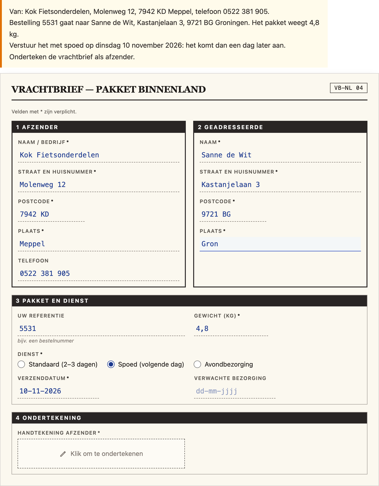

# @citolab/pci-form-fill

> [!WARNING]
> **Experimental (alpha). Just for inspiration.** This PCI is a technical showcase, made by software developers without
> much knowledge of the subject it could be used for. Its content, terms and scoring have not been checked by subject
> experts or assessment specialists, and it has never been used in an assessment. It is offered as is, without any
> warranty.

A QTI 3 Portable Custom Interaction (PCI) in which the candidate fills in a realistic form with the information from a
situation or a letter: a parcel waybill, a bank transfer, an order form, a patient intake, a damage report, a job
application. The form looks like a paper form or an online form. The PCI checks every field against the author's
checks (an exact value, one of several, a number within a margin, a format such as a valid IBAN, filled in, or
consistent with another field: a total that is the sum of the lines, a delivery date after the order date) and reports
the points. The item author builds the form, the checks and the solution in the PCI itself. Made with
[tspci](https://github.com/Citolab/tspci).

<p align="center">
  
</p>

## What it does

- **Field types**: text, text over several lines, number, amount (with €), date, drop-down list, radio buttons, a
  checkbox (or a group of checkboxes), a signature box (click to sign), postcode, IBAN, phone number and e-mail. A
  field can be required (marked `*`) and take the whole width in two columns; an amount can be the total line.
- **Sections**: a grid of fields, an address block (on paper a boxed block; half width puts two next to each other, as
  sender and recipient on a waybill) or amounts (lines with a € box on the right and a total line under a double rule;
  the candidate calculates the total).
- **Look** (`data-theme`): `paper` (an off-white form with numbered black section bars, dashed writing lines, the
  candidate's text in blue ink, a dashed signature box) or `web` (an online form with cards, rounded inputs and a
  "Check the form" button). Layout in 1 or 2 columns (`data-columns`); the form switches to one column when it is
  narrow (container query).
- **Validation feedback** (`web` only; `data-validation`, on by default): when a field loses focus, a required empty
  field or a value that is not of its type (a wrong IBAN checksum, a postcode that is not 1234 AB, a date that does
  not exist, an amount that is not a number) gets a message with a warning icon, a thicker red border and
  `aria-invalid`. "Check the form" shows all of them and says how many fields need attention. Validation is about the
  format only, never about the answer.
- **The situation**: the form's own situation text (en/nl) shows as a note above the form; leave it empty when the
  item gives the information itself. `data-prompt` adds an instruction above it.
- **Language** (`data-language`): `en` or `nl`, for the PCI's texts and the form's labels (every label can have an
  English and a Dutch text). Numbers follow it: `12,50` and `1.234,50` in Dutch, `12.50` in English (either decimal
  sign is accepted), dates as `dd-mm-jjjj` or `dd/mm/yyyy`. The response does not depend on the language.
- **Normalising** (`src/form.ts`, no imports, tested in node with `npm test`): what the candidate typed is kept as
  typed (the state), and turned into a value per field type for the checks and the response: text trimmed with single
  spaces, a postcode `9721 BG`, an IBAN `NL91ABNA0417164300`, a phone number `0522381905` (`00` becomes `+`), an e-mail
  address in lower case, a number `4.8`, an amount `89.45`, a date `2026-11-10`, a checkbox `true`, a signature
  `signed`.
- **Accessibility**: every field is a native control with a label, `aria-required`, its hint, the date format and
  its error message as description; sections are named regions; radio groups and checkbox groups are fieldsets with
  a legend; the signature box is a toggle button (`aria-pressed`, Enter or Space). A live status line says when a
  field was signed, ticked, or got a validation message. Errors have an icon and text, never only a colour; the
  check results in the authoring preview have a ✓ or ✗ icon and the words "passes"/"fails".
- **Authoring mode**: the item author builds everything in the PCI itself (`getAuthoringInstance`), via
  "Configure…" ("Build the form…"), in three tabs: **Form** (start from an example, the title, form code and
  situation in English and Dutch, the look, the layout, validation), **Fields and checks** (sections with their kind
  and width; fields with id, type, labels, hint, options, required, width, total; the checks per field with their
  points, each showing whether the solution passes it) and **Preview and solution** (the form as the candidate sees
  it: fill in the solution, and every check shows under its field, with the score and the response fields).
  `validate()` reports problems in the author's language.
- **Delivery**: the candidate's input is saved as the item's state (every change in the log) and restored. In review
  (`status: "solution"`) the PCI shows the correct response from the response declaration, or else the author's
  solution, read-only. Several interactions of this type on one page each get their own object.
- **Examples** (own content): `waybill` (a paper waybill for a parcel from a bike parts shop; 14 checks, 13 points)
  and `transfer` (an online bank transfer paying two invoices, with the total; 11 checks, 8 points).

## What can be configured

Every setting is a `data-` attribute of the interaction, as text. `dist/authoring.json` describes them for authoring
systems.

| setting                     | attribute          | default    | what                                                                   |
| --------------------------- | ------------------ | ---------- | ---------------------------------------------------------------------- |
| Instruction above the form  | `data-prompt`      | empty      | optional                                                               |
| Form                        | `data-form`        | empty      | written by the authoring mode, as JSON (below); empty: the example     |
| Example form                | `data-example`     | `waybill`  | `waybill` or `transfer`, when there is no `data-form`                  |
| Look                        | `data-theme`       | `paper`    | `paper` or `web`                                                       |
| Layout                      | `data-columns`     | `2`        | `1` or `2`                                                             |
| Validation messages         | `data-validation`  | `true`     | only with `web`                                                        |
| Language                    | `data-language`    | `en`       | `en` or `nl`                                                           |

```json
{
  "title": { "en": "Make a transfer", "nl": "Geld overmaken" },
  "code": "Online banking",
  "situation": { "en": "Bike repair shop Jansen sent you two invoices: …", "nl": "Fietsherstel Jansen stuurde je …" },
  "sections": [
    { "id": "to", "title": { "en": "To", "nl": "Naar" }, "fields": [
      { "id": "iban", "type": "iban", "label": { "en": "IBAN of the payee", "nl": "IBAN ontvanger" }, "required": true,
        "checks": [{ "type": "format", "format": "iban", "points": 0 }, { "type": "exact", "value": "NL91ABNA0417164300" }] }
    ] },
    { "id": "amounts", "title": "Amount", "kind": "amounts", "fields": [
      { "id": "line1", "type": "amount", "label": "Invoice 2026-118", "checks": [{ "type": "number", "value": 64.5 }] },
      { "id": "line2", "type": "amount", "label": "Invoice 2026-121", "checks": [{ "type": "number", "value": 24.95 }] },
      { "id": "total", "type": "amount", "label": "Total", "total": true,
        "checks": [{ "type": "relation", "relation": "sum", "fields": ["line1", "line2"] }] }
    ] }
  ],
  "solution": { "iban": "NL91ABNA0417164300", "line1": "64.50", "line2": "24.95", "total": "89.45" }
}
```

- **Texts** (`title`, `code`, `situation`, `label`, `hint`, option labels): a string, or `{ "en": …, "nl": … }`.
- **Sections**: `kind` is `fields` (default), `address` or `amounts`; `"span": 1` is half the width in two columns.
- **Fields**: `id` (a letter, then letters, digits, `-`, `_`; not a name of the response such as `score`), `type`
  (`text`, `textarea`, `number`, `amount`, `date`, `select`, `radio`, `checkbox`, `signature`, `postcode`, `iban`,
  `phone`, `email`), `label`, `hint`, `options` (`[{ "value": "express", "label": … }]`; for `select`, `radio` and a
  checkbox group), `required`, `"span": 2` (whole width), `total` (an amount's total line), `checks`.
- **Solution**: normalised values by field id (as in the response's `values`). At most 24 checks and 24 fields fit
  the declared record fields; `values` always has every field.

### The checks

Each check is worth `points` (default 1; 0 for a check you only want to see in the response). All checks look at
the normalised value; an empty field fails every check.

| check      | settings                                    | passes when                                                                      |
| ---------- | ------------------------------------------- | -------------------------------------------------------------------------------- |
| `exact`    | `value`, `caseSensitive`                    | the value equals `value`, both normalised (case does not count unless set)        |
| `oneOf`    | `values`                                    | the value equals one of `values`                                                  |
| `number`   | `value`, `margin`                           | the number is within `value ± margin`                                             |
| `format`   | `format`: `iban`, `postcode`, `email`, `phone`, `date`, `number`, `regex` (`pattern`) | a valid IBAN (length per country and mod-97 checksum), a Dutch postcode (1234 AB, not SA/SD/SS), an e-mail address, a Dutch or international phone number, an existing date, a number; `regex`: the whole value matches `pattern` |
| `required` |                                             | the field is filled in (a checkbox ticked, a signature signed)                    |
| `relation` | `relation`, `fields`, `margin`              | `sum`/`product`: the number equals the sum/product of the other fields (within `margin`, default 0.005; an empty line counts 0 in a sum); `after`/`before`: a date after/before each of them; `same`: the same value as each of them |

## Scoring

The PCI is made for `custom` scoring (`authoring.json`: `"scoring": ["custom", "human"]`): it evaluates the author's
checks, the item's response processing turns them into points. The response is a record (`cardinality="record"`):

| field                | type      | what                                                                           |
| -------------------- | --------- | ------------------------------------------------------------------------------ |
| `score`              | `integer` | the points of the checks that pass                                             |
| `maxscore`           | `integer` | the points of all checks                                                       |
| `correct`            | `integer` | 1 when every check passes (and there is at least one), else 0                  |
| `check1` … `check24` | `integer` | 1 or 0 per check, in form order (section, field, check); only those there are   |
| `value1` … `value24` | `string`  | the normalised value of each field in form order (empty when not filled in)     |
| `values`             | `string`  | the filled-in fields by id, normalised, as JSON                                |

```json
{ "record": [
  { "name": "score", "base": { "integer": 5 } }, { "name": "maxscore", "base": { "integer": 8 } },
  { "name": "correct", "base": { "integer": 0 } },
  { "name": "check1", "base": { "integer": 1 } }, …, { "name": "check11", "base": { "integer": 0 } },
  { "name": "value1", "base": { "string": "Fietsherstel Jansen" } }, …,
  { "name": "values", "base": { "string": "{\"payee\":\"Fietsherstel Jansen\",\"line1\":\"64.50\",…}" } }
] }
```

- **The PCI's points**: copy `score` (and `maxscore`) to the outcomes, as below.
- **Your own response processing**: test single checks (`<qti-field-value field-identifier="check6">` equal to 1) or
  the values themselves: `value5` is a string, so `<qti-string-match>`, `<qti-match>` against a list of accepted
  values, or `<qti-pattern-match>` work on it. The authoring mode's "Fields in the response" lists which check and
  which field each name is.
- `match_correct` is not offered: the same form can be filled in correctly in more than one way (case, spaces,
  "Order 5531" or "5531").
- `human`: use the PCI without automatic scoring, for a human rater (`values` has everything).
- **No response**: until the candidate fills in a field, `getResponse()` reports nothing.
- `getCorrectResponse(properties)` (`"correctResponse": "properties"`) gives the record of the author's solution.

```xml
<qti-response-declaration identifier="RESPONSE" cardinality="record"/>
<qti-outcome-declaration identifier="SCORE" cardinality="single" base-type="float">
  <qti-default-value><qti-value>0</qti-value></qti-default-value>
</qti-outcome-declaration>
<qti-outcome-declaration identifier="MAXSCORE" cardinality="single" base-type="float">
  <qti-default-value><qti-value>13</qti-value></qti-default-value>
</qti-outcome-declaration>
…
<qti-response-processing>
  <qti-response-condition>
    <qti-response-if>
      <qti-not><qti-is-null>
        <qti-field-value field-identifier="score"><qti-variable identifier="RESPONSE"/></qti-field-value>
      </qti-is-null></qti-not>
      <qti-set-outcome-value identifier="SCORE">
        <qti-field-value field-identifier="score"><qti-variable identifier="RESPONSE"/></qti-field-value>
      </qti-set-outcome-value>
    </qti-response-if>
  </qti-response-condition>
</qti-response-processing>
```

**State and response.** `getState()` holds what the candidate typed (and the log), so the form comes back as they
left it. `setResponse` (and `boundTo` without a state) reads the `values` field, or values as a JSON string, and shows
them in the candidate's notation (`89,45`, `16-11-2026` in Dutch); the other fields follow from them. In
`status: "solution"` the values of the declared correct response are shown (a record value with the field `values`),
or else the author's solution.

**Tests.** `npm test` (node, `test/form.test.ts`): numbers, dates, formats, normalising, every check, the examples,
the record, parsing and the authoring problems. Storybook (`src/formFill.stories.ts`): typing, choosing, signing,
validation, Dutch, state, bound response, solution, two instances and the authoring mode. Tab order and the arrow keys
in a radio group are checked with Playwright against the built bundle, as user-event cannot do those in a shadow root.

## Using it

```sh
npm install @citolab/pci-form-fill
```

| file                                    | what                                                                      |
| --------------------------------------- | ------------------------------------------------------------------------- |
| `dist/index.js`                         | the PCI (AMD module, everything bundled: the package has no dependencies) |
| `dist/authoring.json`                   | settings, response, scoring and the authoring mode, for authoring systems |
| `dist/sbom.cdx.json`                    | CycloneDX SBOM of the bundle                                              |
| `dist/tao-pci-formFill_<version>.zip`   | the PCI for TAO: Settings → Portable Custom Interactions → Add            |
| `formFill.svg`, `example.png`           | icon and screenshot                                                       |

In a QTI 3 item, with `index.js` at `resources/pci/index.js` of the package:

```xml
<qti-response-declaration identifier="RESPONSE" cardinality="record"/>
…
<qti-portable-custom-interaction response-identifier="RESPONSE" module="pci" custom-interaction-type-identifier="formFill"
  data-language="nl" data-theme="web" data-example="transfer">
  <qti-interaction-modules>
    <qti-interaction-module id="pci" primary-path="../resources/pci/index"></qti-interaction-module>
  </qti-interaction-modules>
  <qti-interaction-markup></qti-interaction-markup>
</qti-portable-custom-interaction>
```

Source and the other examples: [Citolab/tspci-examples](https://github.com/Citolab/tspci-examples).
