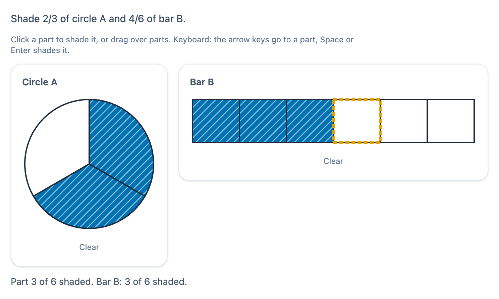

# @citolab/pci-fraction-model

> [!WARNING]
> **Experimental (alpha). Just for inspiration.** This PCI is a technical showcase, made by software developers without
> much knowledge of the subject it could be used for. Its content, terms and scoring have not been checked by subject
> experts or assessment specialists, and it has never been used in an assessment. It is offered as is, without any
> warranty.

A QTI 3 Portable Custom Interaction (PCI) for fractions and percentages with models ("breuken, procenten, strook,
cirkel"). The models are a bar (strip, with an optional percentage scale), a circle (pie), a grid (10 × 10 for
percentages) and a set of objects. The candidate shades parts, divides a bar or circle into equal parts, or writes the
fraction or percentage that is shaded. Several models can sit side by side to compare ("shade 2/3 of A and 4/6 of B").
The item author sets up the models in the PCI itself. Made with [tspci](https://github.com/Citolab/tspci).

<p align="center">
  
</p>

## What it does

- **The models**, drawn as SVG:
  - a **bar** of equal parts, optionally with a percentage scale underneath (a tick every 5 %, a label every 10 %);
  - a **circle** of equal sectors, clockwise from the top;
  - a **grid** of rows × columns (up to 12 × 12; 10 × 10 is the hundred square for percentages);
  - a **set** of separate objects (circles), in rows of at most 8.
- **Shading**: click a part to shade or unshade it, or drag over parts. A drag that starts on an unshaded part shades
  everything it passes; one that starts on a shaded part unshades. Each model has a Clear button.
- **Not colour alone**: shaded parts are blue (Okabe-Ito `#0072b2`) **and** hatched with white lines. The keyboard
  focus is a thick dashed orange outline.
- **Dividing** (bar and circle, when the author allows it): `−` and `+` buttons and a number field set the number of
  equal parts, between the author's minimum and maximum. When the parts split or merge evenly the shading stays (2/3
  becomes 4/6, 4/6 becomes 2/3). Otherwise it is cleared, and the status line says so.
- **Naming the fraction**: in a name task the shading is given. The candidate types the fraction as numerator over
  denominator (digits only), or as a percentage (one decimal comma in Dutch, a point in English).
- **Keyboard**: each model is one Tab stop. The parts are checkboxes with a roving tabindex. The arrow keys go along
  the parts (in a grid, Up and Down go a row; a circle goes clockwise), `Home` and `End` go to the first and last part,
  and `Space` or `Enter` shades or unshades.
- **Screen readers**: every part has a name ("Part 3 of 8", "Row 2, column 5", "Object 4 of 12") and `aria-checked`.
  Each model is a group with a summary ("Bar B: 6 equal parts, 3 shaded"). A model with given shading is an image
  with that summary. Every change is announced in a polite live region.
- **Readout** (`data-show-readout`, off by default because it gives away the count): "3/8 shaded · 37.5%" under each
  model. Solution status always shows it.
- **Reduced motion**: with `prefers-reduced-motion` there are no fill transitions.
- **Language**: `data-language` `en` or `nl` sets the texts and the decimal separator. The response does not depend on
  the language.
- **Logic** (`src/fraction.ts` and `src/geometry.ts`, no imports, tested in node with `npm test`): fractions,
  equivalence, lowest terms, resizing, scoring, the correct response, and the geometry of the parts and keys.
- **Authoring mode** (`getAuthoringInstance`, "Set up the models…"): add up to 4 models, then choose each model's type,
  label, parts (or rows and columns), task, whether the candidate divides it (from … to …), the percentage scale and
  the answer. Shade the given parts in the live preview. The panel shows the correct response. `validate()` reports, in
  the author's language:
  - an answer that is not a fraction or percentage;
  - an answer that cannot be shaded with the model's parts;
  - `=k` that points at no other model with an answer;
  - a name task without an answer, or with an answer that is not the shaded fraction;
  - a required number of parts that is out of range or does not fit the answer.
- **Delivery**: the models are saved as the item's state (every change in the log) and restored. Several interactions
  of this type on one page each get their own object and store. In solution status the PCI shows the correct response
  from the response declaration, or else the answers of the settings, read-only.

## What can be configured

Every setting is a `data-` attribute of the interaction, as text. `dist/authoring.json` describes them for authoring
systems.

| setting                     | attribute            | default                         | what                                                         |
| --------------------------- | -------------------- | ------------------------------- | ------------------------------------------------------------ |
| Instruction above the models| `data-prompt`        | "Shade 2/3 of circle A and 4/6 of bar B." | also part of the models' accessible name           |
| Models                      | `data-models`        | empty: the example              | written by the authoring mode, as JSON (below)               |
| Scoring                     | `data-scoring`       | `match`                         | `match`: ordered list for `match_correct`; `pci`: a record scored by the PCI |
| Show readout                | `data-show-readout`  | `false`                         | the shaded fraction and percentage under each model         |
| Language                    | `data-language`      | `en`                            | `en` or `nl`: texts and decimal separator                    |

```json
{ "models": [
  { "type": "grid", "rows": 10, "columns": 10, "target": "35%" },
  { "type": "bar", "parts": 4, "divide": true, "min": 1, "max": 24, "scale": true, "target": "5/12", "requireParts": 12 },
  { "type": "set", "parts": 12, "shaded": [0, 1, 2, 3], "task": "name", "target": "1/3", "simplest": true },
  { "type": "circle", "parts": 8, "shaded": [0, 1, 2], "task": "name", "entry": "percent", "target": "37.5%" }
] }
```

| field          | default        | what                                                                                       |
| -------------- | -------------- | ------------------------------------------------------------------------------------------ |
| `type`         | `bar`          | `bar`, `circle`, `grid` or `set`                                                           |
| `parts`        | 4 (set: 10)    | bar, circle, set: 1 to 36 parts; with `divide`, the parts at the start                     |
| `rows`, `columns` | 10, 10      | grid only: 1 to 12 each                                                                    |
| `divide`       | `false`        | bar and circle in a shade task: the candidate chooses the number of parts                  |
| `min`, `max`   | 1, 24          | with `divide`: the range of the number of parts                                            |
| `task`         | `shade`        | `shade`: the candidate shades; `name`: the shading is given, the candidate writes the fraction |
| `entry`        | `fraction`     | name task: `fraction` (numerator / denominator) or `percent`                               |
| `shaded`       | `[]`           | parts shaded at the start (shade) or the given shading (name), 0-based, a grid in reading order |
| `scale`        | `false`        | bar: a percentage scale underneath                                                         |
| `target`       | `""`           | the answer: `3/8`, `35%`, `37.5%`, `1`, or `=1` (the same fraction as model 1); empty: not scored |
| `requireParts` | 0              | PCI scoring: the model must have exactly this many parts                                   |
| `simplest`     | `false`        | PCI scoring, name task with a fraction: it must be in lowest terms                         |
| `label`        | `""`           | the model's name ("A"); without one, several models are called A, B, C, D                  |

The tasks of the brief, as settings:

| task                                   | model                                                                                 |
| -------------------------------------- | ------------------------------------------------------------------------------------- |
| shade 3/8                              | `{ "type": "bar", "parts": 8, "target": "3/8" }`                                      |
| shade 35 % on a 10 × 10 grid           | `{ "type": "grid", "rows": 10, "columns": 10, "target": "35%" }`                      |
| what fraction is shaded?               | `{ "type": "circle", "parts": 8, "shaded": [0,1,2,3,4,5], "task": "name", "target": "3/4" }` |
| divide the bar so you can shade 5/12   | `{ "type": "bar", "parts": 1, "divide": true, "max": 24, "target": "5/12" }`          |
| shade 2/3 and 4/6, compare             | two models, `"target": "2/3"` and `"target": "4/6"` (or `"=1"` with PCI scoring)      |

## Scoring

`authoring.json` offers `"scoring": ["match_correct", "custom", "human"]`.

### MATCH_CORRECT (`data-scoring="match"`, the default)

The response is an ordered list of strings (`cardinality="ordered" base-type="string"`), with one value per model in
model order. Each value is the shaded fraction (or the typed one) **in lowest terms**: 6/16 shaded gives `"3/8"`,
35 of 100 cells gives `"7/20"`, 37,5 % typed gives `"3/8"`. Nothing shaded gives `"0/1"`, everything gives `"1/1"`,
and an empty or unfinished entry gives `""`. Because both sides are in lowest terms, `match` accepts every equivalent
shading or fraction: shading 3 of 8 parts, any 3, or typing 6/16 when 3/8 is shaded.

The PCI gives the correct response from the settings (`getCorrectResponse(properties)`, with
`config.tspci.correctResponse: "settings"`): each model's answer in lowest terms, so the authoring system can write
the declaration. There is none when a model has no answer.

```xml
<qti-response-declaration identifier="RESPONSE" cardinality="ordered" base-type="string">
  <qti-correct-response><qti-value>2/3</qti-value><qti-value>2/3</qti-value></qti-correct-response>
</qti-response-declaration>
<qti-response-processing template="https://purl.imsglobal.org/spec/qti/v3p0/rptemplates/match_correct"/>
```

What `match` cannot check: the number of parts (only the proportion counts), lowest terms in a name task, or "the
same as model 1". Use PCI scoring for those. To score models one by one, compare `<qti-index n="2">` of the response
with a `<qti-base-value>` per model.

### CUSTOM (`data-scoring="pci"`)

The PCI evaluates every model with an answer and gives a record (`cardinality="record"`). A model passes when:

- its fraction is **equivalent** to the answer (2/3 = 4/6 = 8/12; 35 % = 7/20);
- it has `requireParts` parts, when set;
- the typed fraction is in lowest terms, when `simplest` is set.

`=k` compares with what the candidate did in model k, so "shade the same amount in B as in A" passes even when A is
wrong. Each model with an answer is worth one point.

| field                     | type      | what                                                                         |
| ------------------------- | --------- | ---------------------------------------------------------------------------- |
| `score`                   | `integer` | the models that pass                                                         |
| `maxscore`                | `integer` | the models with an answer                                                    |
| `correct`                 | `integer` | 1 when every model with an answer passes (and there is one), else 0          |
| `fraction1` … `fraction4` | `string`  | the shaded or typed fraction as it is, **not** simplified ("6/16"); "" for an empty entry |
| `value1` … `value4`       | `float`   | the fraction as a number (0.375); missing for an empty entry                 |
| `parts1` … `parts4`       | `integer` | the number of parts of the model                                             |
| `check1` … `check4`       | `integer` | 1 or 0, only for models with an answer                                       |
| `shading`                 | `string`  | JSON: per model the parts and shaded parts (or the typed text), for a rater and setResponse |

```xml
<qti-response-declaration identifier="RESPONSE" cardinality="record"/>
<qti-outcome-declaration identifier="SCORE" cardinality="single" base-type="float">
  <qti-default-value><qti-value>0</qti-value></qti-default-value>
</qti-outcome-declaration>
<qti-response-processing>
  <qti-response-condition>
    <qti-response-if>
      <qti-not><qti-is-null>
        <qti-field-value field-identifier="score"><qti-variable identifier="RESPONSE"/></qti-field-value>
      </qti-is-null></qti-not>
      <qti-set-outcome-value identifier="SCORE">
        <qti-field-value field-identifier="score"><qti-variable identifier="RESPONSE"/></qti-field-value>
      </qti-set-outcome-value>
    </qti-response-if>
  </qti-response-condition>
</qti-response-processing>
```

- **Your own rules**: test `check2` for 1, or compare `value1` with
  `<qti-equal tolerance-mode="absolute" tolerance="0.005">` against 0.35. The `fraction` fields show whether a
  candidate simplified their answer.
- **NONE**: use either response for a human rater or as a tool. `shading` shows exactly what was shaded.
- **No response**: until the candidate changes something, `getResponse()` reports nothing.

**State and response.** `getState()` holds every model (parts, shaded parts, typed text) and the log. `setResponse`
(and `boundTo` without a state) reads the record's `shading` field exactly. Otherwise it reads a fraction per model
(the list, or the `fraction` fields) and shades the first parts. A model the candidate may divide gets as many parts
as it needs. In solution status the declaration's correct response is shown (an ordered list of fractions); without
one, the answers of the settings.

## Using it

```sh
npm install @citolab/pci-fraction-model
```

| file                                         | what                                                                      |
| -------------------------------------------- | ------------------------------------------------------------------------- |
| `dist/index.js`                              | the PCI (AMD module, everything bundled: the package has no dependencies) |
| `dist/authoring.json`                        | settings, response, scoring and the authoring mode, for authoring systems |
| `dist/sbom.cdx.json`                         | CycloneDX SBOM of the bundle                                              |
| `dist/tao-pci-fractionModel_<version>.zip`   | the PCI for TAO: Settings → Portable Custom Interactions → Add            |
| `fractionModel.svg`, `example.png`           | icon and screenshot                                                       |

In a QTI 3 item, with `index.js` at `resources/pci/index.js` of the package:

```xml
<qti-response-declaration identifier="RESPONSE" cardinality="ordered" base-type="string">
  <qti-correct-response><qti-value>7/20</qti-value></qti-correct-response>
</qti-response-declaration>
…
<qti-portable-custom-interaction response-identifier="RESPONSE" module="pci" custom-interaction-type-identifier="fractionModel"
  data-language="nl" data-prompt="Kleur 35% van het honderdveld."
  data-models="{&quot;models&quot;:[{&quot;type&quot;:&quot;grid&quot;,&quot;rows&quot;:10,&quot;columns&quot;:10,&quot;target&quot;:&quot;35%&quot;}]}">
  <qti-interaction-modules>
    <qti-interaction-module id="pci" primary-path="../resources/pci/index"></qti-interaction-module>
  </qti-interaction-modules>
  <qti-interaction-markup></qti-interaction-markup>
</qti-portable-custom-interaction>
```

Source and the other examples: [Citolab/tspci-examples](https://github.com/Citolab/tspci-examples).
