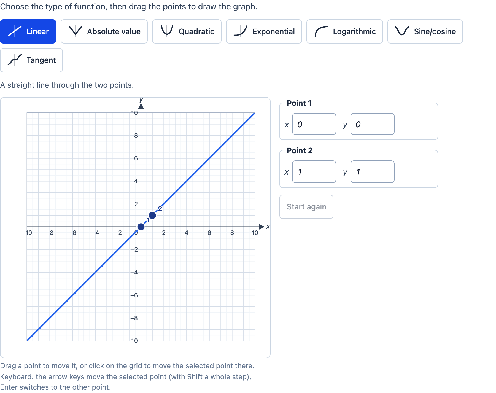

# Function graph

> [!WARNING]
> **Experimental (beta).** This PCI is a new implementation of an open-source PCI (see "Source and licence"). It is
> offered as is, without any warranty, and has never been used in an assessment. Try it out with candidates and check
> its content and scoring before you use it in one.

A PCI in which the candidate **graphs a function**: they choose the type of function (linear, absolute value,
quadratic, exponential, logarithmic, sine/cosine or tangent) and place its two points on a grid; the PCI draws the
curve through them, with its asymptotes. A port of the PARCC "Graphing Function" PCI (`graphFunctionInteraction`).

<p align="center"></p>

Unlike `tspci-table-graph` (the PCI computes the author's formulas for the numbers the candidate adds) and
`tspci-graph-builder` (the candidate plots measured data), here the candidate constructs the function: its type and
the points that determine it.

## What the candidate does

- **Chooses the type of function** with a row of buttons (each with a small picture of the curve). The author decides
  which types are offered; with one type there are no buttons. The points stay where they are when the candidate
  switches, so they can compare types through the same points. A line under the buttons says what the points are.
- **Places the two points** that determine the function, as in the original:

  | type | point 1 | point 2 | function |
  | --- | --- | --- | --- |
  | linear | a point | a point | y = ax + b |
  | absolute value | the vertex | a point | y = a\|x − h\| + k |
  | quadratic | the vertex | a point | y = a(x − h)² + k |
  | exponential | a point | a point, on the same side of the x axis | y = a·gˣ, asymptote y = 0 |
  | logarithmic | a point | a point, on the same side of the y axis, another y | y = a·ln(bx), asymptote x = 0 |
  | sine/cosine | on the midline | a highest or lowest point | y = a·cos(b(x − h)) + d |
  | tangent | the centre (on the midline) | a quarter period further | y = a·tan(b(x − h)) + d, vertical asymptotes |

  - **drag** a point (mouse, pen or finger; points snap to the grid: the step divided by the sub step);
  - **click** on the grid: while points are to be placed it places one, after that it moves the selected point there
    (the second point when none is selected, as in the original);
  - **type** the coordinates in the fields next to the graph (Enter or leaving the field takes them; a value off the
    axis is marked invalid and not taken);
  - **keyboard**: the graph is one tab stop; the arrow keys move the selected point by one snap (with Shift a whole
    step), Enter switches to the other point. While points are to be placed the arrow keys move a cursor and Enter
    places a point there.
- **Sees the curve live**, also while dragging, with asymptotes as dashed lines (author setting), and optionally the
  equation (author setting), in the names of the axes when they are short (`h = −5(t − 2)² + 20`).
- When the points do not determine a function of the type (the same x; an exponential function through or across the
  x axis; a logarithm through or across the y axis) no curve is drawn and the candidate reads why.
- **Start again** puts the points back where they started. Every action is announced (`role="status"`); the graph's
  accessible name gives the type and both points.

## Settings

Every setting is a `data-` attribute (text). The names of the original's properties are kept where they exist.

| setting | default | what |
| --- | --- | --- |
| `prompt` | a short instruction | the instruction above the item |
| `graphs` | all seven | the types offered, separated by commas: `linear`, `absolute`, `quadratic`, `exponential`, `logarithmic`, `cosine`, `tangent` (the first is chosen at the start) |
| `startPoints` | `default` | `default`: two points to drag at the origin and a step further (one and two steps for exponential and logarithmic), as the original; `empty`: the candidate places both |
| `showEquation` | `false` | show the equation of the graph |
| `showAsymptotes` | `true` | show asymptotes as dashed lines |
| `graphTitle` | | a title above the graph |
| `xStart`, `xEnd`, `yStart`, `yEnd` | −10, 10 | the axes (the axes cross at 0, or at the start when 0 is not on the axis) |
| `xStep`, `yStep` | 1 | a grid line and a number every step |
| `xSubStep`, `ySubStep` | 2 | points snap to the step divided by this |
| `xLabel`, `yLabel` | `x`, `y` | the label at the tip of each axis (also used in the equation and the coordinate fields) |
| `xTitle`, `yTitle` | | the title along each axis |
| `xAllowOuter`, `yAllowOuter` | `true` | points may lie on the border of the grid |
| `width`, `height` | 450 | the size of the grid in pixels (smaller on a narrow screen) |
| `plotColor`, `plotThickness` | `#2563eb`, 3 | the curve |
| `pointColor`, `pointRadius` | `#1e3a8a`, 8 | the points (each has a larger invisible touch target) |
| `correctType`, `correctPoints` | | the correct function: a type and its two points as `x1 y1,x2 y2` (in the roles of the table above) |
| `tolerance` | 0 | how far (in units of y) the candidate's function may be from the correct one |
| `language` | `en` | `en`, `nl` or `fr`; numbers with a decimal comma in nl and fr (typing accepts both) |

## The response and scoring

`cardinality="record"`, with the fields of the original first:

| field | type | what |
| --- | --- | --- |
| `functionGraphType` | string | the type: `linear`, `absolute`, `quadratic`, `exponential`, `logarithmic`, `cosine` or `tangent` |
| `points` | string | the two points as `x1 y1,x2 y2` (at most 2 decimals), point 1 first |
| `equation` | string | the equation, e.g. `y = -0.5*(x + 1)^2 + 2`, `y = 3*2^x`, `y = 2*abs(x - 1) - 2`; empty when the points determine no function |
| `score` | integer | 1 when the function is the correct one, 0 not (only when the PCI knows the correct function) |
| `maxscore` | integer | 1 (idem) |
| `correct` | integer | 1 when the function is the correct one, 0 not (idem) |

`functionGraphType` and `points` are exactly the original's record (its `getResponse`), so responses and response
processing made for the original stay meaningful, and a response of the original handed back (`boundTo`) restores the
graph. `equation`, `score`, `maxscore` and `correct` are new.

**Scoring** (`scoring: custom, human`): the PCI knows the correct function from the response declaration's correct
response (a record with `functionGraphType` and `points`, or `samplePoints` as the original's creator stores it) or else
from `correctType` and `correctPoints`. The candidate's function is correct when it has the same type and is the same
function: at 121 places spread over the x axis the values differ at most `tolerance` and both are defined at the same
places (values near an asymptote are skipped). So any two points of the right line count, a cosine through another top
counts, a tangent a period further counts, and a parabola counts only with the right vertex, as in the original's
response condition (vertex, type, distinct points and both points satisfying the equation). Response processing can copy
`score` to `SCORE`. The original's own response processing compares the points with an equation through TAO custom
operators (`CsvToOrdered`, `CountPointsThatSatisfyEquation`); this PCI does not read the `equation` of a correct response.

Until the candidate changes something (and while fewer than two points are placed) `getResponse()` reports nothing. The
state (`getState`) has the type, the points and a log of every action (types chosen, points placed and moved, start
again); it is restored when the candidate comes back.

**Review**: in `status="review"` (and `closed`) everything is read only. In `status="solution"` the PCI shows the correct
function.

## Using it

```xml
<qti-response-declaration identifier="RESPONSE" cardinality="record"/>
…
<qti-portable-custom-interaction response-identifier="RESPONSE" module="pci" custom-interaction-type-identifier="functionGraph"
  data-graphs="linear,quadratic,exponential" data-x-start="0" data-x-end="5" data-y-start="-5" data-y-end="25" data-y-step="5"
  data-correct-type="quadratic" data-correct-points="2 20,4 0">
  <qti-interaction-modules>
    <qti-interaction-module id="pci" primary-path="../resources/pci/index"></qti-interaction-module>
  </qti-interaction-modules>
  <qti-interaction-markup></qti-interaction-markup>
</qti-portable-custom-interaction>
```

```sh
npm test               # the model (src/functions.ts) in node
npm run test:stories   # the stories' play functions, headless
npm run prod           # dist/index.js
npm run package-qti3   # or package-tao
```

## Source and licence

This PCI is a derivative work of
[`graphFunctionInteraction`](https://github.com/parcc/extension-parcc-tei/tree/master/views/js/pciCreator/dev/graphFunctionInteraction)
("Graphing Function") in [parcc/extension-parcc-tei](https://github.com/parcc/extension-parcc-tei), by Sam Sipasseuth
(Open Assessment Technologies), © 2014-2017 Parcc, Inc., with its shared library `PARCC/graphFunction` (how two points
determine each function). That extension is licensed under the GNU General Public License version 2 only
(`GPL-2.0-only`): its `LICENSE` is the GPL-2.0, its `manifest.php` says `GPL-2.0`, and the headers of its files say
"version 2 of the License (non-upgradable)". Its `composer.json` says `"license": ["PARCC"]`, which is not a known
licence; we follow the GPL-2.0-only of the `LICENSE`, `manifest.php` and file headers. So this PCI is GPL-2.0-only too:
see [LICENSE](LICENSE). This differs from the MIT licence of most examples in this repository.

What changed, by Stichting Cito Instituut voor Toetsontwikkeling (2026):

- Rewritten in TypeScript with Preact and Tailwind in a shadow DOM (the original is jQuery and Raphael with TAO
  libraries); no code or images of the original are used. The formulas for each type (two points → the function) are
  the original's, with b > 0 for sine/cosine and tangent so the equation reads as it is taught.
- Kept: the seven types and their names, two points per function in the original's roles, the original's response
  record (`functionGraphType`, `points`), the grid settings (range, step, sub step for snapping, label, title, points on
  the border), the colours, the thickness and the point radius, and the starting points.
- Added: asymptotes, the equation (optional, in the candidate's language and with the names of the axes), a message
  when the points determine no function (the original then drew nothing without saying why), coordinate fields, the
  keyboard, announcements for screen readers, large touch targets, a layout that works at narrow widths, an empty start
  (`startPoints`), "Start again", and texts in English, Dutch and French.
- Changed: switching types keeps the points (the original put them back at the start); the points are numbered and
  their role is named; `width`/`height` are the size of the grid, which scales down on a narrow screen. The original's
  grid `weight`, `pointGlow` and `graphTitleRequired` are left out (a title shows when it is set).
- **The response**: the original's record plus `equation` and, when the PCI knows the correct function, `score`,
  `maxscore` and `correct`: the PCI scores the function itself (the original needed TAO custom operators). The
  original's state was its response; here the state also has a log of every action. Until the candidate does something
  the response is empty (the original reported its starting points at once).
