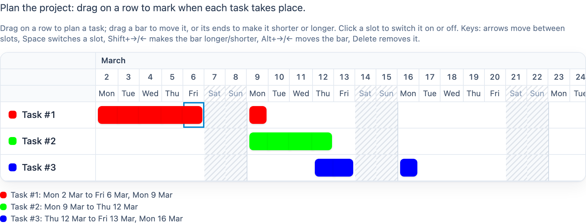

# @citolab/pci-gantt-chart

A QTI 3 Portable Custom Interaction (PCI) in which the candidate plans tasks on a timeline: a Gantt chart with a row
per task and a column per day (or hour, or half hour). The candidate draws, moves and resizes the bars. Made with
[tspci](https://github.com/Citolab/tspci).

<p align="center">
  
</p>

## Source and licence

This PCI is a port of the **Gantt chart** of [openPCI](https://github.com/openPCI/openPCIs/tree/master/ganttchart),
made by the OpenPCI project of Aarhus University and Aalborg University (Elias J.T. Hansen, Anna Rusmann and Jeppe
Bundsgaard). The original is licensed under the GNU General Public License version 3; the repository ships the GPL v3
text without an "or any later version" notice, so this port is licensed **GPL-3.0-only** as well (see
[LICENSE](LICENSE)), unlike the other examples in this repository, which are MIT.

What changed, by Stichting Cito Instituut voor Toetsontwikkeling (2026):

- **Ported** from TAO's older (pre-IMS) PCI format (jQuery, `define`, TAO's `pciCreator`) to the IMS PCI v1.0 API
  with tspci, Preact and Tailwind: it runs in any QTI 3 delivery system, and in TAO via `npm run package-tao`.
- **Modernised UI**: bars instead of coloured table cells, which can be moved and resized; a sticky task column and a
  clear time axis; weekends are hatched.
- **Keyboard and screen reader**: the chart is an ARIA grid with a roving cursor; every change is announced, and a
  plain-text summary under the chart says what is planned. English and Dutch texts.
- **Saving and restoring**: the original did not save state and ignored `setResponse`; this port does both.
- **Kept**: the settings, the time slots they give, and the response string (format and meaning), so items and their
  scoring stay meaningful.

## What it does

- **Plan**: drag across empty slots of a row to draw a bar. Drag a bar to move it, or drag one of its ends to make it
  shorter or longer. Click a slot to switch it on or off, as in the original. Everything snaps to the slots. A drag
  stays in its row, and the chart scrolls along at its edges.
- **Weekends** (`data-disable-weekends`): weekend slots cannot be planned. A bar that is moved keeps its number of
  working slots and skips the weekend; a bar that is drawn across a weekend becomes two bars, as in the original.
- **Keyboard**: the arrow keys move a cursor between slots and tasks (Home/End: first/last slot), Space or Enter
  switches a slot, Shift+→ makes the bar under the cursor longer and Shift+← shorter, Alt+→/← moves it,
  Delete/Backspace removes it.
- **Delivery**: the plan is saved as the item's state and restored; the response can be handed back with
  `setResponse` (also a response of the original). In review (`status: "solution"`) the PCI shows the correct
  response when the delivery system passes it.

## What can be configured

Every setting is a `data-` attribute of the interaction, as text. `dist/authoring.json` describes them for authoring
systems. All but the first and last are the settings of the original.

| setting                   | attribute                | default                                       | what                                                     |
| ------------------------- | ------------------------ | --------------------------------------------- | -------------------------------------------------------- |
| Instruction               | `data-prompt`            | `Plan the project: drag on a row …`           | above the chart; also its accessible name               |
| Tasks                     | `data-tasks`             | `Task #1;#F00` `Task #2;#0F0` `Task #3;#00f`  | one per line, `Task name;colour`                         |
| Number of days            | `data-period`            | `30`                                          | 1–366                                                    |
| Start date                | `data-start-date`        | `03/02/2026`                                  | `mm/dd/yyyy`; empty or anything else: today (as the original) |
| Show week days            | `data-week-days`         | `true`                                        | a row with Mon, Tue, …                                   |
| Show months               | `data-months`            | `true`                                        | a row with the months                                    |
| Don't use weekends        | `data-disable-weekends`  | `true`                                        | weekend slots cannot be planned; in hours mode a weekend day is one column |
| Show hours                | `data-use-hours`         | `false`                                       | a slot per hour from the start to the end time           |
| Show half hours           | `data-use-half-hours`    | `false`                                       | a slot per half hour (implies hours)                    |
| Show start and end time   | `data-show-time-range`   | `false`                                       | `08:00-09:00` instead of `08:00` above a slot           |
| Start time (hours)        | `data-day-start`         | `8`                                           | 0–23                                                     |
| End time (hours)          | `data-day-end`           | `16`                                          | 0–23; the last slot of a day starts then                 |
| Label days as weeks       | `data-week-num-hack`     | `false`                                       | the original's "week number hack": `Week 2` above a day |
| Language                  | `data-language`          | `en`                                          | `en` or `nl`: the texts of the PCI and the date names    |

The original took today as default start date when an item was created; this port has a fixed default, so the example
item is the same every day. Set the start date: with an empty one the dates (and so the response) change every day.

## Scoring

The PCI is made for `match_correct` (`authoring.json`: `"scoring": ["match_correct", "human"]`).

**The response** is a string (`cardinality="single" base-type="string"`), the original's format: JSON with single
quotes instead of double ones.

```text
{'response':'2/3 - 6/3, 9/3;9/3 - 12/3;12/3 - 13/3, 16/3','state':[[1,2,3,4,5,8],[8,9,10,11],[11,12,15]]}
```

- `response`: per task the planned periods, `day/month` (with hours `day/month HH:MM`); a period of more than one
  slot is `first - last`, where `last` is the start of the last slot. Periods are joined by `, `, tasks by `;`, in the
  order of the tasks setting.
- `state`: per task the planned slots, counted as the original counted its table cells (the task name is 0, so the
  first slot is 1).
- **What counts**: which slots of which task, in a string comparison of the whole response. Both parts follow from the
  plan, so the same plan always gives the same string. Changing the start date, the period, the hours or the order of
  the tasks changes the response: set the correct response again. Renaming a task or changing its colour does not.
- **Setting the correct response**: answer the PCI. In TAO switch the interaction to *Response* and plan the tasks; in
  qti-construction or the dev page, plan them and take that as the correct response.
- **No response**: until the candidate plans a slot, `getResponse()` reports nothing (the original reported an empty
  plan as a string).
- `human`: use the PCI without automatic scoring, for instance for a human rater, or score it in your own response processing
  from the `response` part.

## Using it

```sh
npm install @citolab/pci-gantt-chart
```

| file                                      | what                                                                      |
| ----------------------------------------- | ------------------------------------------------------------------------- |
| `dist/index.js`                           | the PCI (AMD module, everything bundled: the package has no dependencies) |
| `dist/authoring.json`                     | settings, response and scoring, for authoring systems                     |
| `dist/sbom.cdx.json`                      | CycloneDX SBOM of the bundle                                              |
| `dist/tao-pci-ganttChart_<version>.zip`   | the PCI for TAO: Settings → Portable Custom Interactions → Add            |
| `ganttChart.svg`, `example.png`           | icon and screenshot                                                       |
| `LICENSE`                                 | GNU GPL v3                                                                |

In a QTI 3 item, with `index.js` at `resources/pci/index.js` of the package:

```xml
<qti-response-declaration identifier="RESPONSE" cardinality="single" base-type="string">
  <qti-correct-response>
    <qti-value>{'response':'2/3 - 6/3;9/3 - 12/3;','state':[[1,2,3,4,5],[8,9,10,11],[]]}</qti-value>
  </qti-correct-response>
</qti-response-declaration>
…
<qti-portable-custom-interaction response-identifier="RESPONSE" module="pci" custom-interaction-type-identifier="ganttChart"
  data-period="30" data-start-date="03/02/2026" data-tasks="Design;#0ea5e9&#10;Build;#f59e0b&#10;Test;#10b981">
  <qti-interaction-modules>
    <qti-interaction-module id="pci" primary-path="../resources/pci/index"></qti-interaction-module>
  </qti-interaction-modules>
  <qti-interaction-markup></qti-interaction-markup>
</qti-portable-custom-interaction>
```

Source and the other examples: [Citolab/tspci-examples](https://github.com/Citolab/tspci-examples).
