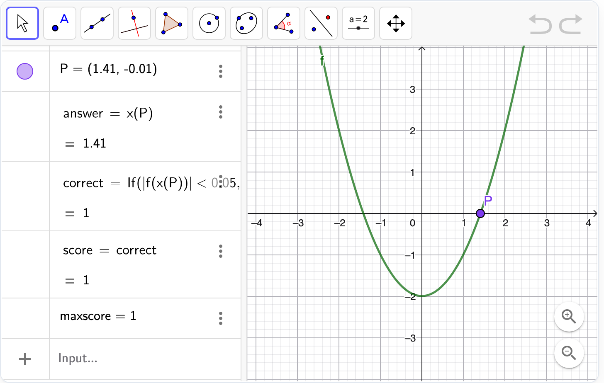

# @citolab/pci-geogebra-applet

A QTI 3 Portable Custom Interaction (PCI) with a [GeoGebra](https://www.geogebra.org) applet in it: the candidate
constructs, graphs or calculates, and the applet can score the work itself. The item author builds the applet in the PCI
itself, or uses a material from geogebra.org. Made with [tspci](https://github.com/Citolab/tspci).

> **Before you use it**
>
> - **It needs an internet connection.** The GeoGebra app is not in this package: the PCI loads it from geogebra.org
>   every time the item opens. Offline, or where geogebra.org is blocked, the candidate sees an error instead of the
>   applet. Locked-down browsers and networks must allow geogebra.org, and the candidate's browser connects to
>   GeoGebra's servers (consider this in a privacy review).
> - **Non-commercial use only.** This PCI is a port of the GeoGebra PCI by Jean-Philippe Rivière and keeps its
>   licence, the [GeoGebra Non-Commercial License Agreement](https://www.geogebra.org/license); the GeoGebra app it
>   loads falls under the same licence. **Commercial use requires a licence from GeoGebra.** This differs from the MIT
>   licence of most other examples in this repository. See [Source and licence](#source-and-licence).
> - GeoGebra is a trademark of GeoGebra GmbH. This PCI is not made or endorsed by GeoGebra.

<p align="center">
  
</p>

## What it does

- **GeoGebra from geogebra.org**: the PCI loads `https://www.geogebra.org/apps/deployggb.js` when it starts, and that
  loads the app. Nothing of GeoGebra is in the bundle, so the candidate's device needs to reach geogebra.org. While it
  loads the PCI says so (`role="status"`); when it fails it says so (`role="alert"`) with a **Try again** button.
- **Where the applet starts**, in this order: the candidate's own applet from the saved state; the author's applet
  (`data-ggb-base64`); a material from geogebra.org (`data-material-id`); an empty app (`data-app-name`).
- **In a frame of its own**: GeoGebra looks up its elements in the document and puts its styles in the document's
  head, which does not work in the shadow roots a QTI player puts a PCI in. The PCI therefore runs the applet in a
  `srcdoc` iframe; that frame has the page's origin, so the PCI talks to the applet's API directly.
- **Responsive**: the applet keeps its width and height as long as there is room, and scales down on a smaller screen
  (GeoGebra's `scaleContainerClass`); the frame follows the applet's height.
- **Authoring mode**: the item author builds the applet in the PCI itself (`getAuthoringInstance`), via "Configure…"
  ("Build the applet…") in an authoring system that supports it (qti-construction, TAO with tspci-tao, the dev page).
  Load a material id or link, or start empty, and build with every tool, the menu and the style bar. **Done** saves the
  applet as it is in `data-ggb-base64`. The authoring mode lists the objects the response will read.
- **Delivery**: after every change in the applet (debounced) the PCI tells the delivery system
  (`qti-interaction-changed`). The candidate's applet is the item's state (`getBase64` / `setBase64`) and comes back
  when the candidate returns.
- **Accessible wrapper**: the applet is a labelled region and a titled frame; the texts around it are in English or
  Dutch (`data-language`). GeoGebra's own texts follow `data-app-language`.

## What can be configured

Every setting is a `data-` attribute of the interaction, as text. `dist/authoring.json` describes them for authoring
systems.

| setting                       | attribute                     | default   | what                                                                                       |
| ----------------------------- | ----------------------------- | --------- | ------------------------------------------------------------------------------------------ |
| GeoGebra material id          | `data-material-id`            | empty     | an id (`abcd1234`) or link (`https://www.geogebra.org/m/abcd1234`); used without an authored applet |
| Applet                        | `data-ggb-base64`             | empty     | written by the authoring mode: the applet as a base64 `.ggb` file                          |
| GeoGebra app                  | `data-app-name`               | `classic` | `classic`, `graphing`, `geometry`, `3d`, `suite`, `scientific`, `evaluator`, `notes`       |
| Width, height (px)            | `data-width`, `data-height`   | `800`, `600` | the applet's size; on a smaller screen it scales down                                   |
| Language of GeoGebra          | `data-app-language`           | empty     | ISO 639-1 (`en`, `nl`, `de`, …); empty: `data-language`                                    |
| Toolbar                       | `data-show-tool-bar`          | `true`    |                                                                                            |
| Menu                          | `data-show-menu-bar`          | `false`   |                                                                                            |
| Input bar                     | `data-show-algebra-input`     | `true`    |                                                                                            |
| Style bar                     | `data-allow-style-bar`        | `false`   |                                                                                            |
| Right-click menu and properties | `data-enable-right-click`   | `true`    |                                                                                            |
| Undo and redo                 | `data-enable-undo-redo`       | `true`    |                                                                                            |
| Zoom buttons                  | `data-show-zoom-buttons`      | `true`    |                                                                                            |
| Move and zoom the view        | `data-enable-shift-drag-zoom` | `true`    | drag the view, zoom with the wheel                                                         |
| Fullscreen button             | `data-show-fullscreen-button` | `false`   |                                                                                            |
| Include the applet in the response | `data-save-applet`       | `false`   | adds the field `applet` to the response (below)                                            |
| Language                      | `data-language`               | `en`      | `en` or `nl`: the texts around the applet                                                  |

These settings are GeoGebra's [app parameters](https://geogebra.github.io/docs/reference/en/GeoGebra_App_Parameters/)
of the same name. The PCI always turns off GeoGebra's file features (saving, signing in) and the reset icon.

## Scoring

The PCI is made for `custom` scoring (`authoring.json`: `"scoring": ["custom", "human"]`): the applet decides, the item's
response processing copies its verdict.

**The convention for authors.** Give objects in the applet these names, and the PCI reads them with GeoGebra's
[Apps API](https://geogebra.github.io/docs/reference/en/GeoGebra_Apps_API/):

| object in the applet | read with                       | field in the response | type                                  |
| -------------------- | ------------------------------- | --------------------- | ------------------------------------- |
| `correct`            | `getValue("correct")`, rounded  | `correct`             | `integer`: 1 right, 0 wrong (a boolean gives 1 or 0) |
| `answer`             | `getValueString("answer", false)` | `candidateResponse` | `string`: a text as it is; a number or a point without `answer =` in front (`1.41`, `(1, 2)`) |
| `score`              | `getValue("score")`, rounded    | `score`               | `integer`                             |
| `maxscore`           | `getValue("maxscore")`, rounded | `maxscore`            | `integer`                             |
| (the applet itself)  | `getBase64()`                   | `applet`              | `string`: base64 `.ggb`; only with `data-save-applet="true"` |

A field whose object does not exist is empty (`"base": null`). For example, in the input bar:

```
f(x) = x^2 - 2
P = (1, 1)
answer = x(P)
correct = If(abs(f(x(P))) < 0.05, 1, 0)
score = correct
maxscore = 1
```

Hide the objects that give the answer away (`SetVisibleInView`, or the object's properties), and fix them so the
candidate cannot change them (`SetFixed`).

**The response** is a record (`cardinality="record"`):

```json
{ "record": [
  { "name": "correct", "base": { "integer": 1 } },
  { "name": "candidateResponse", "base": { "string": "1.41" } },
  { "name": "score", "base": { "integer": 1 } },
  { "name": "maxscore", "base": { "integer": 1 } }
] }
```

- **CUSTOM**: copy the fields to the outcomes in the item's response processing (QTI 3):
  ```xml
  <qti-response-declaration identifier="RESPONSE" cardinality="record"/>
  <qti-outcome-declaration identifier="SCORE" cardinality="single" base-type="float">
    <qti-default-value><qti-value>0</qti-value></qti-default-value>
  </qti-outcome-declaration>
  <qti-outcome-declaration identifier="MAXSCORE" cardinality="single" base-type="float">
    <qti-default-value><qti-value>1</qti-value></qti-default-value>
  </qti-outcome-declaration>
  …
  <qti-response-processing>
    <qti-response-condition>
      <qti-response-if>
        <qti-not><qti-is-null>
          <qti-field-value field-identifier="score"><qti-variable identifier="RESPONSE"/></qti-field-value>
        </qti-is-null></qti-not>
        <qti-set-outcome-value identifier="SCORE">
          <qti-field-value field-identifier="score"><qti-variable identifier="RESPONSE"/></qti-field-value>
        </qti-set-outcome-value>
      </qti-response-if>
    </qti-response-condition>
    <qti-response-condition>
      <qti-response-if>
        <qti-not><qti-is-null>
          <qti-field-value field-identifier="maxscore"><qti-variable identifier="RESPONSE"/></qti-field-value>
        </qti-is-null></qti-not>
        <qti-set-outcome-value identifier="MAXSCORE">
          <qti-field-value field-identifier="maxscore"><qti-variable identifier="RESPONSE"/></qti-field-value>
        </qti-set-outcome-value>
      </qti-response-if>
    </qti-response-condition>
  </qti-response-processing>
  ```
  With only `correct`, score with `<qti-match>` on `<qti-field-value field-identifier="correct">` and
  `<qti-base-value base-type="integer">1</qti-base-value>`.
- `match_correct` is not offered: QTI's `match` cannot compare records, and the applet is better at deciding what
  counts than a comparison of strings.
- `human`: use the PCI without automatic scoring, for instance as a tool or for a human rater (with `data-save-applet`, the rater
  gets the candidate's applet in the response).

**State and response.** `getState()` always holds the candidate's applet, so it can be restored; `data-save-applet`
only decides whether the response carries it too. A response handed back with an `applet` field (`setResponse`, or
`boundTo` without a state) restores that applet. `resetResponse()` starts the item's applet again.

## Using it

```sh
npm install @citolab/pci-geogebra-applet
```

| file                                    | what                                                                      |
| --------------------------------------- | ------------------------------------------------------------------------- |
| `dist/index.js`                         | the PCI (AMD module; GeoGebra is not in it, see above)                    |
| `dist/authoring.json`                   | settings, response, scoring and the authoring mode, for authoring systems |
| `dist/sbom.cdx.json`                    | CycloneDX SBOM of the bundle; lists GeoGebra as a component loaded at runtime |
| `dist/tao-pci-geogebraApplet_<version>.zip`   | the PCI for TAO: Settings → Portable Custom Interactions → Add            |
| `geogebraApplet.svg`, `example.png`           | icon and screenshot                                                       |

In a QTI 3 item, with `index.js` at `resources/pci/index.js` of the package:

```xml
<qti-portable-custom-interaction response-identifier="RESPONSE" module="pci" custom-interaction-type-identifier="geogebraApplet"
  data-material-id="abcd1234" data-app-name="classic" data-width="800" data-height="600" data-show-menu-bar="false">
  <qti-interaction-modules>
    <qti-interaction-module id="pci" primary-path="../resources/pci/index"></qti-interaction-module>
  </qti-interaction-modules>
  <qti-interaction-markup></qti-interaction-markup>
</qti-portable-custom-interaction>
```

A delivery system with a Content Security Policy has to allow `https://www.geogebra.org` (scripts, styles, fonts,
images and connections: the app loads more from there) and `srcdoc` frames.

## Source and licence

This PCI is a derivative work of the GeoGebra PCI
[`geogebrapci`](https://github.com/janfix/extension-geogebra/tree/master/views/js/pciCreator/ims/geogebrapci) (type
`GGBPCI`) in [janfix/extension-geogebra](https://github.com/janfix/extension-geogebra), by Jean-Philippe Rivière
(Wiquid). It keeps that PCI's response format: a `record` with `correct`, `candidateResponse`, `score`, `maxscore` and
optionally `applet`, read from objects in the applet, so items and scoring made for the original stay meaningful.

- **Licence.** The PCI code of that extension is "subject to the GeoGebra Non-Commercial License Agreement" (as stated
  in the headers of its files and in its README, which points to [geogebra.org/license](https://www.geogebra.org/license)),
  so this PCI is too: see [LICENSE](LICENSE), and `"license": "LicenseRef-GeoGebra"` in `package.json`. Its TAO
  installer (PHP) is GPL-2.0-only according to its `composer.json`; that part is not used here, and where the two
  disagree we follow the stricter one. **Use is free for non-commercial purposes only; for commercial use, contact
  GeoGebra at [office@geogebra.org](mailto:office@geogebra.org).** This differs from the MIT licence of most other
  examples in this repository.
- **GeoGebra** itself is not part of this package. It is loaded from geogebra.org at runtime and falls under the same
  licence. **If you use this PCI, check what that means for your own use** (and for the materials you load from
  geogebra.org, which have their own terms). Using GeoGebra also means the candidate's browser connects to
  geogebra.org.

What changed, by Stichting Cito Instituut voor Toetsontwikkeling (2026):

- Rewritten in TypeScript and Preact, built with tspci, as an IMS PCI v1.0 for QTI 3 and TAO; written from GeoGebra's
  public documentation ([Apps API](https://geogebra.github.io/docs/reference/en/GeoGebra_Apps_API/),
  [App Parameters](https://geogebra.github.io/docs/reference/en/GeoGebra_App_Parameters/)) and the
  [IMS PCI specification](https://www.imsglobal.org/sites/default/files/assessment/pciv1p0/pciv1p0.html). No code of
  the original is used, and GeoGebra's `deployggb.js` is loaded from geogebra.org instead of bundled.
- The applet runs in a `srcdoc` frame, so it works in the shadow roots QTI players put a PCI in, and scales down on a
  smaller screen.
- An authoring mode (`getAuthoringInstance`) in which the author builds the applet in the PCI itself, or loads a
  geogebra.org material; the settings are `data-` attributes described in `dist/authoring.json`.
- The candidate's applet is saved as the state and restored; `qti-interaction-changed` events after every change.
- An accessible wrapper (labelled region, titled frame, loading and error messages with a **Try again** button) in
  English and Dutch.

Source and the other examples: [Citolab/tspci-examples](https://github.com/Citolab/tspci-examples).
