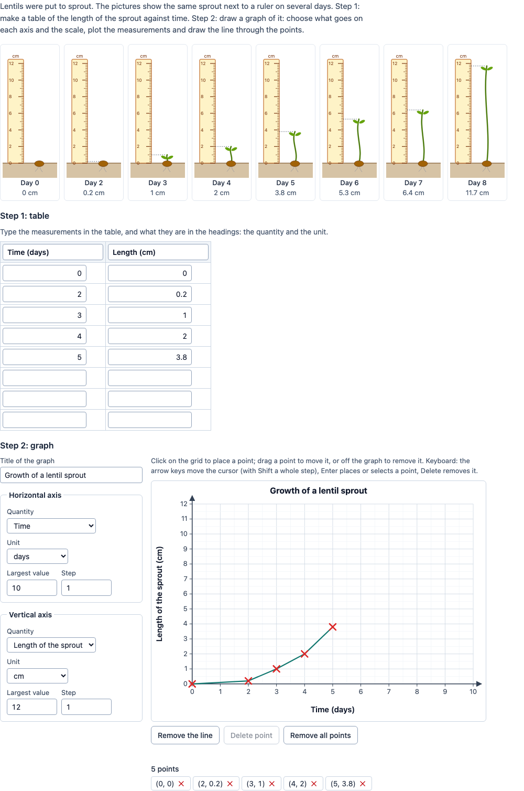

# Graph builder

A PCI in which the candidate **builds a graph from measured data**: first a table of the measurements, then a graph
on a grid: what goes on each axis (quantity and unit), the scale, the points and the line through them. The PCI
scores the work with the author's checks.

The default item is the lentil experiment of the original: a lentil sprout next to a ruler on eight days (day 0 → 0 cm,
2 → 0.2, 3 → 1, 4 → 2, 5 → 3.8, 6 → 5.3, 7 → 6.4, 8 → 11.7 cm).

<p align="center"></p>

Unlike `tspci-table-graph` (the PCI computes a formula and plots it) and `tspci-data-chart` (the PCI shows a chart),
here the candidate constructs the graph.

## What the candidate does

- **Reads the measurements**: a picture per measurement (a sprout next to a ruler, drawn in SVG, with the caption
  "Day 3" and optionally the value), and/or a table of the values. A screen reader hears "Day 3: 1 cm" per picture.
- **Step 1, the table** (optional): types the measurements in two columns, in any order, and a heading per column.
- **Step 2, the graph**:
  - chooses the quantity and the unit of each axis from lists (the right ones and the author's distractors);
  - sets the scale of each axis: the largest value and the step (the grid has a line per step; a scale with 0 or more
    than 50 steps is not taken and the field says why);
  - types a title (optional, not scored);
  - plots points: **click** on the grid (a point snaps to a tenth of a step), **drag** a point to move it, drag it off
    the graph to remove it; or with the **keyboard**: the graph is one tab stop, the arrow keys move a cursor (a tenth
    of a step, with Shift a whole step), Enter places a point or selects the point under the cursor, the arrow keys
    then move it, Delete removes it, Escape lets go. Every action is announced (`role="status"`), and the list under
    the graph has every point with a delete button;
  - **Draw the line** connects the points sorted by x; **Remove the line**; **Remove all points**.

## Settings

Every setting is a `data-` attribute (text). Empty texts mean the lentil example in the candidate's language.

| setting | default | what |
| --- | --- | --- |
| `prompt` | lentil instruction | the instruction above the item |
| `data` | the lentils | a line per measurement: `x;y`, `x<tab>y` (pasted from a spreadsheet) or `x y`; lines may also be separated by `\|`; with `;` or a tab a comma is a decimal comma; at most 30 |
| `xQuantity`, `xUnit`, `yQuantity`, `yUnit` | Time, days, Length of the sprout, cm | the right quantity and unit of each axis |
| `quantityOptions`, `unitOptions` | Number of lentils; Temperature; Mass — h; mm; °C; g | distractors in the lists, separated by `;` |
| `dataSource` | `illustration` | `illustration` (pictures), `table` (the values in a table) or `both` |
| `caption` | `Day {x}` | the caption of a picture, `{x}` is the x value |
| `showValues` | `true` | print the value under each picture (otherwise the candidate reads the ruler) |
| `tableStep` | `true` | step 1: the candidate fills in a table |
| `tableRows` | one per measurement | rows of that table |
| `askTitle` | `true` | a field for the title of the graph |
| `xScale`, `yScale` | `10;1` | the scale at the start: largest value;step |
| `tolerance` | `2` | how far a point may be from a measurement, in % of the candidate's axis (x and y) |
| `scaleUse` | `50` | for a suitable scale the measurements fill at least this % of each axis |
| `pointsTable`, `pointsAxes`, `pointsScale`, `pointsPoints`, `pointsLine` | 1, 1, 1, 2, 1 | points per check; 0: the check does not count |
| `tableScoring` | `all` | `all`: the table points when every cell is right; `cell`: the table points for every right cell |
| `language` | `en` | `en`, `nl` or `fr`; numbers with a decimal comma in nl and fr (typing accepts both) |

The pictures are made for measurements of a length (a sprout and a ruler); for other data use `dataSource="table"`.

## Scoring

`scoring: custom`: the PCI evaluates the checks and reports the result in a record. Response processing can copy
`score` to `SCORE` (and `maxscore` to `MAXSCORE`), or use the check fields for its own rules.

| check | passes when |
| --- | --- |
| `checkTable` | every measurement is in the table (x and y, rows in any order) and there are no other filled rows |
| `checkAxes` | both axes have the right quantity and unit (not case sensitive) |
| `checkScale` | on both axes every measurement fits (axes start at 0), the measurements fill at least `scaleUse` % and there are 2 to 25 steps |
| `checkPoints` | every measurement has a point of its own within `tolerance` % of the axis, and there are no other points |
| `checkLine` | the line is drawn through at least 2 points |

**The response** (`cardinality="record"`):

| field | type | what |
| --- | --- | --- |
| `score` | integer | the points of the passed checks (with `tableScoring="cell"`: `pointsTable` × right cells for the table) |
| `maxscore` | integer | the points of all checks that count |
| `correct` | integer | 1 when every check that counts passes |
| `checkTable`, `checkAxes`, `checkScale`, `checkPoints`, `checkLine` | integer | 1 passed, 0 not (also for checks with 0 points) |
| `tableCells` | integer | right cells of the table (of 2 × the measurements) |
| `pointsMatched` | integer | measurements with a point within the tolerance |
| `graph` | string | JSON: `{ title, x: { quantity, unit, max, step }, y: {…}, points: [{ x, y }], line }` |
| `table` | string | JSON: `{ headers: [x, y], rows: [[x, y], …] }`, the filled rows as typed |

Until the candidate changes something, `getResponse()` reports nothing. A response handed back (`boundTo`) restores the
graph and the table. The state (`getState`) has the whole work and a log of every action (cells typed, axes chosen,
points added, moved and removed, the line); it is restored when the candidate comes back.

**Review**: in `status="review"` (and `closed`) everything is read only. In `status="solution"` the PCI shows the
correct response from the response declaration (a record with a `graph` field), or else the finished graph of the data:
the table, the right axes, a scale of 1, 2, 2.5 or 5 × 10ⁿ per step, every measurement and the line.

## Using it

```xml
<qti-response-declaration identifier="RESPONSE" cardinality="record"/>
…
<qti-portable-custom-interaction response-identifier="RESPONSE" module="pci" custom-interaction-type-identifier="graphBuilder"
  data-language="nl" data-points-points="2" data-table-scoring="cell">
  <qti-interaction-modules>
    <qti-interaction-module id="pci" primary-path="../resources/pci/index"></qti-interaction-module>
  </qti-interaction-modules>
  <qti-interaction-markup></qti-interaction-markup>
</qti-portable-custom-interaction>
```

```sh
npm test               # the model (src/graph.ts) in node
npm run test:stories   # the stories' play functions, headless
npm run prod           # dist/index.js
npm run package-qti3   # or package-tao
```

## Source and licence

This PCI is a derivative work of
[`Lentillespci`](https://github.com/janfix/extension-wiquid-depp/tree/master/views/js/pciCreator/ims/Lentillespci)
("Observation de la pousse des lentilles") in [janfix/extension-wiquid-depp](https://github.com/janfix/extension-wiquid-depp),
© DEPP (Ministère de l'Éducation nationale) / Jean-Philippe Rivière (Wiquid). That extension is licensed under the GNU
General Public License version 2 only (`GPL-2.0-only`, its `composer.json` and the headers of its files), so this PCI
is too: see [LICENSE](LICENSE). This differs from the MIT licence of most examples in this repository.

What changed, by Stichting Cito Instituut voor Toetsontwikkeling (2026):

- Rewritten in TypeScript with Preact and Tailwind in a shadow DOM (the original is jQuery and Raphael); no code, images
  or photographs of the original are used. The photographs are replaced by SVG pictures of a sprout next to a ruler.
- The item is no longer hard-coded French: the data, the quantities and units, the distractors, the pictures or a
  table, the table step, the start scale and the scoring are settings; the texts are in English, Dutch and French.
- The original's 11 × 11 table of free cells became a two-column table with headings and a row per measurement.
- The original's graph had tick labels the candidate typed one by one and red crosses dragged from a stack onto the
  grid; here the candidate chooses quantity and unit per axis, sets the scale with a largest value and a step, places
  points by clicking (snapped to a tenth of a step), drags them, and removes them by dragging them off the graph
  (instead of into a red zone), with a delete button, or with the keyboard.
- "Tracer la courbe" / "Effacer la courbe" are kept: the line connects the points sorted by x.
- Keyboard and screen reader access: real inputs, selects and buttons, a keyboard cursor on the graph, announcements.
- **The response**: the original stored an unstructured dump of the Raphael drawing as a JSON string and had no
  scoring (and its state was not restored reliably). This PCI reports a record with the score and a field per check,
  and the graph and the table as structured JSON (axes, scales, points, line; headings and rows) instead of the drawing.
  The state and a log of every action are saved and restored.
