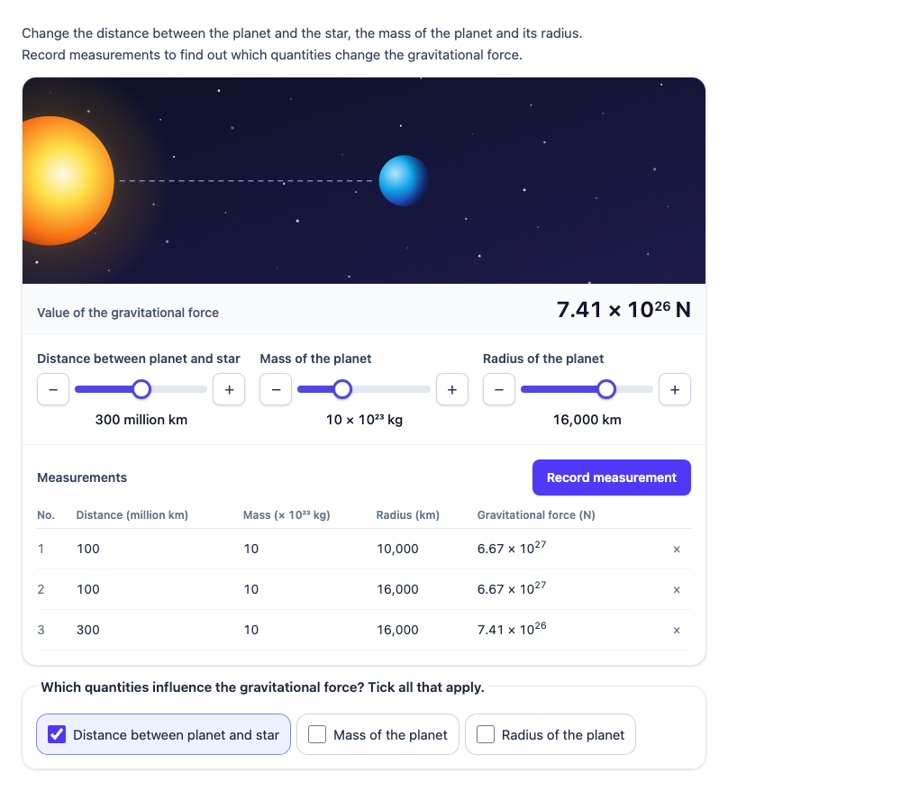

# @citolab/pci-gravitation

> [!WARNING]
> **Experimental (alpha).** A port of a PCI of the French DEPP. It is offered as is, without any warranty, and has not
> been used in an assessment in this form. Try it out with candidates and check its content and scoring before you
> use it in one.

A QTI 3 Portable Custom Interaction (PCI) with a gravitation simulation: a star and a planet. The candidate changes
the distance between them, the mass of the planet and its radius, and reads the gravitational force. The radius is a
distractor: it changes the picture, not the force. The candidate records measurements in a table to investigate
which quantities matter (control of variables) and, optionally, ticks the quantities that influence the force; the
PCI scores that against the author's key. Made with [tspci](https://github.com/Citolab/tspci).

<p align="center">
  
</p>

## Source and licence

This PCI is a derivative work of
[`NouvelleTerrepci`](https://github.com/janfix/extension-wiquid-depp/tree/master/views/js/pciCreator/ims/NouvelleTerrepci)
("Calcul de la force de gravitation") in [janfix/extension-wiquid-depp](https://github.com/janfix/extension-wiquid-depp),
© DEPP (Ministère de l'Éducation nationale) / Jean-Philippe Rivière (Wiquid). That extension is licensed under the GNU
General Public License version 2 only (`GPL-2.0-only`, as stated in its `composer.json` and in the headers of its
files), so this PCI is too: see [LICENSE](LICENSE). This differs from the MIT licence of most other examples in this
repository.

What changed, by Stichting Cito Instituut voor Toetsontwikkeling (2026):

- Rewritten from jQuery UI and a pasted SVG to TypeScript, Preact and Tailwind in a shadow DOM, built with tspci. The
  star and the planet are new inline SVG with gradients; nothing of the original's markup or images is used.
- The model: the original looked the force up in a table of 77 strings (11 distances × 7 masses). This PCI computes it
  with Newton's law, F = G·M·m/d², so every slider value has a force; with the default star it gives the original's
  numbers exactly (see below).
- Settings for the mass of the star, the range and step of each slider, the start values, which sliders are shown,
  the significant digits, a table of recorded measurements and a question with a key. The original was hardcoded.
- English, Dutch and French texts, with numbers per language (6.67 × 10²⁶ N, 6,67 × 10²⁶ N; 10,000 / 10.000 /
  10 000 km). The original was French only.
- Keyboard and screen reader access: native sliders with − and + buttons and spoken values ("100 million
  kilometres"), the force read as "6.67 times 10 to the power 26 newtons", a live region for every change, a real
  table and real checkboxes.
- A structured `record` response with the values, the force, the measurements and the score (the original returned a
  JSON string of three booleans), the whole state and a log saved and restored, review and solution status, and
  `qti-interaction-changed` events.

## What it does

- **The model** (`src/physics.ts`, tested in node with `npm test`): F = G·M·m/d² with G = 6,67·10⁻¹¹ N·m²/kg² (the
  school value; the original's table was made with it), the star's mass M in kg, the planet's mass m in 10²³ kg and the
  distance d in millions of km. The default star of 10³⁶ kg reproduces the original's table: 1·10²³ kg at 100 million
  km gives 6.67·10²⁶ N, 30·10²³ kg at 550 million km 6.61·10²⁶ N. (That star is about 500 000 times the Sun; with
  `data-star-mass="1.989e30"` it is the Sun, and an Earth-like planet at 150 million km gets 3.5·10²² N.)
- **The radius** of the planet changes its size in the picture and is shown in km, but is not in the formula: a
  distractor, as in the original. It can be hidden.
- **Sliders**: one per shown quantity, a native range input (arrow keys one step, Page Up/Down, Home/End) with − and +
  buttons. While the candidate drags, the picture and the force follow; letting go (or a key or a button) puts the
  value in, and a screen reader hears the new force.
- **Measurements** (`data-record`): "Record measurement" adds the current values and the force to a table; a row can
  be removed. The table keeps the last `data-max-records` rows.
- **Question** (`data-question="influence"`): "Which quantities influence the gravitational force?" with a checkbox
  per shown quantity. The PCI scores it against `data-key`.
- **Delivery**: every change goes in the state (with a log of actions) and is restored; a response handed back
  (`boundTo`) is restored too. In review (`status: "review"`) and solution status everything is shown but disabled;
  in solution status the key is ticked.

## What can be configured

Every setting is a `data-` attribute of the interaction, as text. `dist/authoring.json` describes them for authoring
systems.

| setting | attribute | default | what |
| --- | --- | --- | --- |
| Instruction | `data-prompt` | an example | above the simulation |
| Mass of the star | `data-star-mass` | `1e36` | kg; `1e36` gives the original's numbers, `1.989e30` is the Sun. Also `1,989e30` or `1.989 × 10^30` |
| Show the distance | `data-show-distance` | `true` | `false`: no slider, the distance stays at its start value |
| Distance slider | `data-distance-min`, `-max`, `-step` | `50`, `550`, `50` | millions of km, the minimum more than 0 |
| Distance at the start | `data-distance` | `100` | also the distance when it is not shown |
| Show the mass | `data-show-mass` | `true` | |
| Mass slider | `data-mass-min`, `-max`, `-step` | `1`, `30`, `1` | × 10²³ kg |
| Mass at the start | `data-mass` | `10` | |
| Show the radius | `data-show-radius` | `true` | the distractor |
| Radius slider | `data-radius-min`, `-max`, `-step` | `2500`, `22500`, `500` | km (the original's range) |
| Radius at the start | `data-radius` | `10000` | |
| Significant digits | `data-digits` | `3` | of the force, 1 to 5 |
| Record measurements | `data-record` | `true` | the button and the table |
| Rows in the table | `data-max-records` | `20` | 1 to 100; the last ones are kept |
| Question | `data-question` | `influence` | `influence`: checkboxes, scored; `none`: a tool (the question goes elsewhere) |
| Text of the question | `data-question-text` | empty | empty: the standard text in the candidate's language |
| Key | `data-key` | `distance;mass` | the quantities that influence the force: `distance`, `mass`, `radius` (also in Dutch or French: `afstand;massa`, `masse`) |
| Language | `data-language` | `en` | `en`, `nl` or `fr`: the texts and the numbers |

Settings that make no sense are corrected: a minimum of 0 or less, a maximum under the minimum, a step that is too
large, a start value outside the slider (it goes to the nearest step), a star mass of 0 or less.

## Response and scoring

The response is a `record` (`config.tspci.response` in `package.json`), nothing until the candidate did something:

| field | base type | what |
| --- | --- | --- |
| `distance`, `mass`, `radius` | `float` | the values of the sliders (start values for a quantity not shown) |
| `force` | `float` | the force in N, rounded as shown: `6.67e26` |
| `changed` | `string` | the quantities the candidate changed at least once: `distance;radius` |
| `measurements` | `string` | the recorded measurements as JSON: `[{"distance":100,"mass":10,"radius":10000,"force":6.67e27}, …]` |
| `measurementCount` | `integer` | the number of rows |
| `answer` | `string` | with the question: the ticked quantities, `distance;mass` |
| `correct`, `score` | `integer` | with the question: 1 when the ticked quantities are exactly the key, else 0 |

**Scoring** is `custom`: the PCI computes `score`; map it to `SCORE` in the item's response processing (or score
`human`, for example on the measurements). Only quantities that are shown count: with the radius hidden the
candidate cannot tick it, and the key is the author's key without it. The candidate who ticks the radius (the
distractor) as well gets 0.

**Compared with the original**: the original's response was the string `{"distance":true,"masse":false,"rayon":true}`,
which sliders had been touched. That is the `changed` field here (`distance;radius`); the rest is new.

```xml
<qti-response-declaration identifier="RESPONSE" cardinality="record"/>
<qti-outcome-declaration identifier="SCORE" cardinality="single" base-type="float"/>
…
<qti-portable-custom-interaction response-identifier="RESPONSE" module="pci" custom-interaction-type-identifier="gravitation"
  data-question="influence" data-key="distance;mass" data-language="fr">
  <qti-interaction-modules>
    <qti-interaction-module id="pci" primary-path="../resources/pci/index"></qti-interaction-module>
  </qti-interaction-modules>
  <qti-interaction-markup></qti-interaction-markup>
</qti-portable-custom-interaction>
…
<qti-response-processing>
  <qti-set-outcome-value identifier="SCORE">
    <qti-field-value field-identifier="score"><qti-variable identifier="RESPONSE"/></qti-field-value>
  </qti-set-outcome-value>
</qti-response-processing>
```

## Development

```sh
npm install
npm test              # the model, the numbers and the settings, in node
npm run test:stories  # the stories in src/gravitation.stories.ts, in a browser (vitest)
npm run prod          # dist/index.js
npm run package-tao   # a zip for TAO
```

Source and the other examples: [Citolab/tspci-examples](https://github.com/Citolab/tspci-examples).
