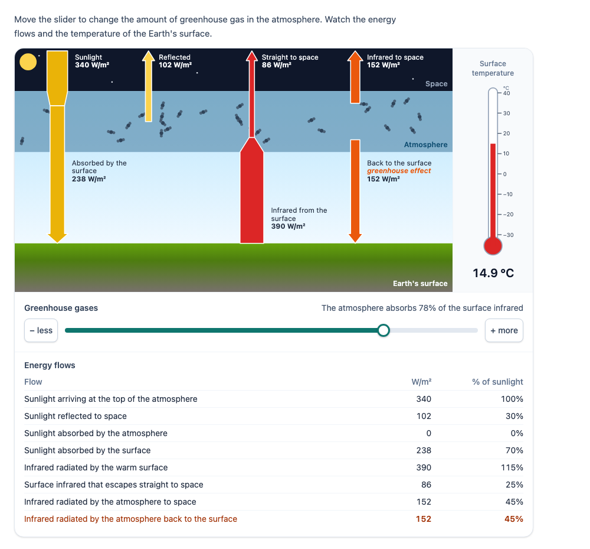

# @citolab/pci-greenhouse-effect

> [!WARNING]
> **Experimental (alpha).** This PCI is a rewrite of an open-source PCI of the French DEPP. It is offered as is,
> without any warranty, and has never been used in an assessment. Try it out with candidates and check its content and
> scoring before you use it in one.

A QTI 3 Portable Custom Interaction (PCI) about the greenhouse effect: the energy flows of the Earth as arrows whose
widths follow the flows, a thermometer with the surface temperature, and a slider for the amount of greenhouse gas. The
numbers come from the classic one-layer atmosphere model. As a tool, or with a question that the PCI scores: "set the
greenhouse gas so that the surface is 20 °C", or "what happens to the temperature when there is more greenhouse gas?".
English, Dutch and French. Made with [tspci](https://github.com/Citolab/tspci).

<p align="center">
  
</p>

## Source and licence

This PCI is a derivative work of
[`EffetDeSerrepci`](https://github.com/janfix/extension-wiquid-depp/tree/master/views/js/pciCreator/ims/EffetDeSerrepci)
("Effet de serre et évolution du climat") in [janfix/extension-wiquid-depp](https://github.com/janfix/extension-wiquid-depp),
© DEPP (Ministère de l'Éducation nationale) / Jean-Philippe Rivière (Wiquid). That extension is licensed under the GNU
General Public License version 2 only (`GPL-2.0-only`, as stated in its `composer.json`; its files carry the GPL-2
header of OAT's PCI template), so this PCI is too: see [LICENSE](LICENSE). This differs from the MIT licence of most
other examples in this repository.

The original: a diagram (PNG and inline SVG) with fixed French labels (100 % sunlight; 30 % reflected to space, 20 %
absorbed by the atmosphere, 50 % absorbed at the surface; infrared from the ground and from the atmosphere; "Effet de
serre") and one jQuery UI slider "moins – plus". The slider value *v* (0 to 1) swapped the arrow of infrared sent back
to the ground between four sizes and made the atmosphere whiter (opacity *v* − 0.1). No number changed. The response
was every slider value while dragging, as a JSON string `{"sliderValue":"0.01,0.02,…"}`; there was no scoring and the
state did not restore.

What changed, by Stichting Cito Instituut voor Toetsontwikkeling (2026). It is a rewrite, not a translation of the
jQuery code; none of the original images is used:

- **A quantitative model** instead of four fixed pictures: the one-layer atmosphere model (below), with the solar
  constant, the albedo and the sunlight the air absorbs as settings. The slider sets the share ε of the surface
  infrared the atmosphere absorbs; the default 78 % gives 14.9 °C, close to today's 15 °C.
- **Arrows proportional to the flows** (0.1 px per W/m²), with W/m², % of the sunlight, both or no numbers; where a flow
  is split (sunlight reflected, infrared absorbed) the arrow narrows. Greenhouse gas molecules and haze in the
  atmosphere grow with ε. Everything is inline SVG drawn for this PCI.
- **A thermometer** with the surface temperature in °C, K or both (the number can be hidden), and a table of all flows.
- **Questions**, scored by the PCI: a target temperature with a tolerance, or a prediction of the direction of change
  (with the slider locked until the candidate predicted).
- **A structured response** (a record: level, ε, temperature, the levels tried, prediction, correct, score) instead of
  every slider pixel; the full state and an action log are saved and restored.
- Keyboard and screen reader access (a native slider with value text, − and + buttons, a live region, a described
  picture, a real table), review and solution status, `qti-interaction-changed` events, three languages, settings in
  `src/config.json` for authoring systems.

## What it does

- **The model** (`src/model.ts`, tested with `npm test`): per m², averaged over the Earth, sunlight *S*/4 comes in. A
  share *a* (albedo) is reflected; the atmosphere absorbs a share *f* (default 0); the surface absorbs the rest, *Fs*.
  The surface radiates σ*Ts*⁴. The atmosphere is one layer that absorbs a share ε of that infrared and radiates
  εσ*Ta*⁴ up and the same down. In equilibrium

  σ*Ts*⁴ = (*Fs* + *Fa*/2) / (1 − ε/2), with *Fa* = *f* · *S*/4

  With *f* = 0 that is the textbook *Ts* = [*S*(1 − *a*)/4 / (σ(1 − ε/2))]^¼. With *S* = 1361 W/m² and *a* = 0.30:
  −18.6 °C without greenhouse gas, 14.9 °C at ε = 0.78, 29.6 °C at ε = 1. Energy is conserved at the top of the
  atmosphere, in the layer and at the surface (tested). It is a teaching model: one layer, no convection, no
  feedbacks, and ε is not a gas concentration.
- **The flows on the picture**: sunlight in, reflected, absorbed by the air (only with *f* > 0), absorbed by the
  surface; infrared from the surface, straight to space (1 − ε), from the atmosphere to space and back to the surface
  ("greenhouse effect"). More greenhouse gas: the arrow back to the surface and the arrow from the surface grow, the
  one straight to space shrinks, and the thermometer rises. `atmosphereSolar` = 0.2 gives the 30 / 20 / 50 % of the
  original diagram (that needs ε ≈ 0.95 for 15 °C).
- **Controls**: a native range input (arrow keys one step, Page Up/Down, Home/End) and − / + buttons. While the
  candidate drags, the picture follows; letting go (or a key or button) puts the level in, and a live region says
  "Greenhouse gases 79%: surface temperature 15.5 °C.". The slider's value text has the temperature too, unless the
  temperature is hidden.
- **Questions**: `target`: a task line with the target (and its tolerance) above the picture and a mark on the
  thermometer. `direction`: radio buttons "It rises / It stays the same / It falls" for "more" (or "less") greenhouse
  gas; with `predictFirst` the slider unlocks only after a prediction, and the prediction is fixed once the candidate
  has used the slider.

## What can be configured

| data- attribute       | default | what                                                                                       |
| --------------------- | ------- | ------------------------------------------------------------------------------------------ |
| `prompt`              | a text  | instruction above the simulation                                                           |
| `question`            | `none`  | `none` (a tool), `target` or `direction`                                                   |
| `target-temperature`  | `20`    | target question: the surface temperature to set, °C                                        |
| `tolerance`           | `0.5`   | target question: correct when the temperature shown is within this many °C of the target   |
| `direction`           | `more`  | direction question: `more` (correct: up) or `less` greenhouse gas (correct: down)          |
| `predict-first`       | `true`  | direction question: slider locked until predicted; prediction fixed once the slider is used |
| `start-level`         | `78`    | ε at the start, in % (snapped to the step)                                                  |
| `level-step`          | `1`     | step of the slider, in %                                                                    |
| `solar-constant`      | `1361`  | *S*, W/m²                                                                                   |
| `albedo`              | `0.30`  | *a*, 0 to 1 (or a percentage: `30`)                                                        |
| `atmosphere-solar`    | `0`     | *f*, share of the sunlight the atmosphere absorbs (at most 1 − *a*); `0.2` as the original |
| `numbers`             | `wm2`   | numbers on the arrows: `wm2`, `percent` (of the sunlight), `both` or `none`                |
| `show-table`          | `true`  | the table of all flows (W/m² and %)                                                        |
| `show-temperature`    | `true`  | the temperature as a number (and in the slider's value text); the thermometer stays       |
| `show-level`          | `true`  | "The atmosphere absorbs 78% of the surface infrared" above the slider                      |
| `temperature-unit`    | `C`     | `C`, `K` or `both` (the target and the response stay in °C)                                |
| `decimals`            | `1`     | decimals of the temperature, 0 to 3                                                         |
| `language`            | `en`    | `en`, `nl` or `fr` (decimal comma in Dutch and French)                                     |

## Response and scoring

The response is a record (`cardinality="record"`, fields in `package.json` → `config.tspci.response`). Nothing until
the candidate set a level or chose a prediction.

| field         | base type | value                                                                                    |
| ------------- | --------- | ---------------------------------------------------------------------------------------- |
| `level`       | float     | the greenhouse gas level on the slider: ε in %                                            |
| `epsilon`     | float     | ε, 0 to 1                                                                                 |
| `temperature` | float     | surface temperature in °C, rounded to `decimals` as shown                                 |
| `tried`       | string    | JSON: every level the candidate stopped at, in order, with its temperature                |
| `prediction`  | string    | direction question only: `up`, `same`, `down` or empty                                    |
| `correct`     | integer   | with a question: 1 when correct, else 0                                                   |
| `score`       | integer   | with a question: 1 or 0                                                                   |

```json
{ "record": [
  { "name": "level", "base": { "float": 86 } },
  { "name": "epsilon", "base": { "float": 0.86 } },
  { "name": "temperature", "base": { "float": 19.8 } },
  { "name": "tried", "base": { "string": "[{\"level\":85,\"temperature\":19.2},{\"level\":86,\"temperature\":19.8}]" } },
  { "name": "correct", "base": { "integer": 1 } },
  { "name": "score", "base": { "integer": 1 } }
] }
```

Scoring is `custom` (the PCI computes `score`) or `human`:

- **Target**: correct when |temperature shown − target| ≤ tolerance, for the level the candidate ended at.
- **Direction**: correct when the prediction is `up` for `more` (`down` for `less`). The slider levels in `tried` show
  whether the candidate then checked it.
- **Tool** (`question="none"`): no `correct` or `score`; `tried` is what the original logged, compacted: the levels the
  candidate stopped at instead of every value while dragging (the same level twice in a row once, at most 200; the
  state's log keeps every action).

```xml
<qti-response-declaration identifier="RESPONSE" cardinality="record"/>
…
<qti-response-processing>
  <qti-response-condition>
    <qti-response-if>
      <qti-not><qti-is-null>
        <qti-field-value field-identifier="score"><qti-variable identifier="RESPONSE"/></qti-field-value>
      </qti-is-null></qti-not>
      <qti-set-outcome-value identifier="SCORE">
        <qti-field-value field-identifier="score"><qti-variable identifier="RESPONSE"/></qti-field-value>
      </qti-set-outcome-value>
    </qti-response-if>
  </qti-response-condition>
</qti-response-processing>
```

**State, review and solution.** `getState()` holds the level, the levels tried and the prediction, plus the action
log; the state restores exactly. `setResponse` takes the record back (the last of `tried`, or `level`, and the
prediction). In `review` and `closed` status the controls are disabled. In `solution` status the PCI shows the solution
of its settings: the slider step whose temperature is closest to the target (86 % for 20 °C), or the correct prediction.

## Using it

```sh
npm install @citolab/pci-greenhouse-effect
```

| file                                         | what                                                         |
| -------------------------------------------- | ------------------------------------------------------------ |
| `dist/index.js`                              | the PCI (AMD module, everything bundled)                     |
| `dist/authoring.json`                        | settings, response and scoring, for authoring systems        |
| `dist/sbom.cdx.json`                         | CycloneDX SBOM of the bundle                                 |
| `dist/tao-pci-greenhouseEffect_<version>.zip` | the PCI for TAO (`npm run package-tao`)                     |
| `greenhouseEffect.svg`, `example.png`        | icon and screenshot                                          |

```xml
<qti-portable-custom-interaction response-identifier="RESPONSE" module="pci" custom-interaction-type-identifier="greenhouseEffect"
  data-question="target" data-target-temperature="20" data-tolerance="0.5" data-language="fr">
  <qti-interaction-modules>
    <qti-interaction-module id="pci" primary-path="../resources/pci/index"></qti-interaction-module>
  </qti-interaction-modules>
  <qti-interaction-markup></qti-interaction-markup>
</qti-portable-custom-interaction>
```

Development: `npm test` (the model, settings and numbers in node), `npm run test:stories` (Storybook play functions in
a browser), `npm run storybook`, `npm run prod`.
