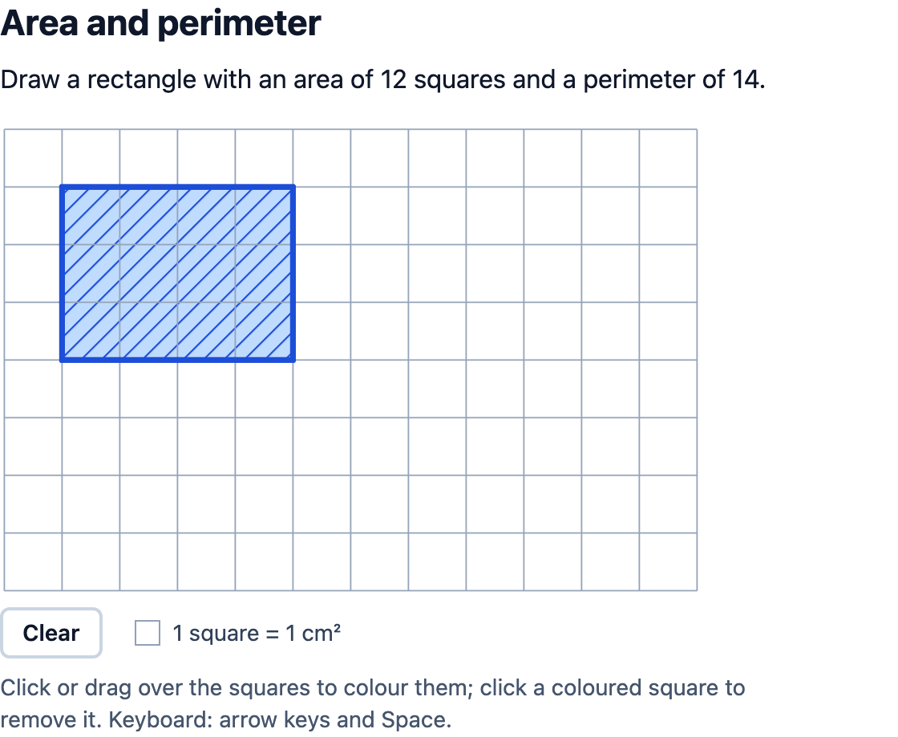

# @citolab/pci-grid-area

> [!WARNING]
> **Experimental (alpha). Just for inspiration.** This PCI is a technical showcase, made by software developers without
> much knowledge of the subject it could be used for. Its content, terms and scoring have not been checked by subject
> experts or assessment specialists, and it has never been used in an assessment. It is offered as is, without any
> warranty.

A QTI 3 Portable Custom Interaction (PCI) for area and perimeter on squared paper (Dutch: *oppervlakte en omtrek op
ruitjespapier*), as Dutch primary schools teach it. The pupil colours squares on a grid to draw a shape with a given
area or perimeter, writes the area and perimeter of a shape the author drew, or says which of two shapes is larger.
Many drawings can be right, so the PCI does not compare a drawing with an answer: it measures it and checks the rules
of the item. A fourth task puts it to use: **covering a floor** (*een kamer stofferen*), after SLO's example for
praktijkonderwijs "Ik kan een plan en een prijsberekening maken voor het stofferen van mijn kamer": the floor area of a
room, strips of carpet off a roll laid on its plan, and the bill. Made with [tspci](https://github.com/Citolab/tspci).

<p align="center">
  
</p>

## What it does

- **Squared paper** of 2 to 24 by 2 to 16 squares (12 × 8 by default), drawn as SVG, with an optional unit under it
  ("1 hokje = 1 cm²").
- **Four tasks** (`task`):
  - `draw`: the pupil draws a shape. The item asks for an area, a perimeter or both ("a rectangle with area 12 and
    perimeter 14", "any shape with area 10"), and the PCI checks the rules.
  - `measure`: the author's shape is shown and the pupil writes its area and/or perimeter in boxes.
  - `compare`: the author's shapes A and B side by side, and the pupil chooses the one with the larger area (or
    perimeter), or "both the same".
  - `cover`: the floor plan of a room; the pupil writes its area, lays strips of carpet or vinyl on it and fills in the
    bill (below, "Covering a floor").
- **Drawing.** A click on an empty square colours it, a click on a coloured square removes it. A drag from an empty
  square colours every square it passes, a drag from a coloured square erases. **Clear** empties the grid.
- **Half squares** (`halves`): a square cut along a diagonal. A second click on a coloured square makes it a half (the
  top-left triangle), the next clicks turn it clockwise (top right, bottom right, bottom left), and one more empties
  the square. A half counts 0.5 for the area.
- **Keyboard.** The grid is an ARIA grid with one square in the tab order: the arrow keys (and Home, End) move a dashed
  cursor, Space or Enter is a click, Delete or Backspace empties the square. A grid that cannot be drawn on (measure,
  compare, review) can be explored the same way.
- **Not only colour.** Coloured squares are hatched (shape B in a comparison: dotted, in another colour) and the shape
  has a dark outline: the line the perimeter measures. Every square has an accessible name with its row, column and
  what it holds ("Row 3, column 4: half coloured, top-left half"), and is `aria-selected` when coloured.
- **The pupil does not see the measurements**: no counter of squares or edges, as that would give the answer away.
- **Texts** in English or Dutch (`language`): the hint under the grid, the button, the labels and the screen reader
  names.

### What the PCI computes

All of it in [src/grid.ts](./src/grid.ts), without a DOM, tested in node (`npm test`):

| check | what it is |
| --- | --- |
| area | the number of squares; a half counts 0.5 |
| perimeter | the length of the outline in grid units: every grid line with the shape on one side only, so the inside of a ring counts too. **Only along grid lines**: a shape with half squares has slanting sides, which are not a whole number of units (√2 each), and then it has no perimeter (the field is left out of the response, and a target perimeter is never met) |
| connected | one piece: two squares belong together when they share a side; squares that only touch at a corner are two pieces. A half joins a neighbour only along a side it covers |
| holes | empty parts the shape encloses. Squares that touch at a corner close a hole (the corner point is part of the shape); against the edge of the grid nothing is closed, the outside goes on beyond it |
| rectangle | an upright rectangle of whole squares (a square too); a tilted square of halves is not one |
| meets the rules | something is drawn, as one piece without holes, with the area and perimeter of the settings (where given), and a rectangle when that is asked |

## Covering a floor (`task: cover`)

- **The plan.** The author's room (an L, a bay window, a chimney breast: any one piece of whole squares without holes)
  on squared paper at a scale of 1 square = 1 m or 0.5 m, shown under the plan ("1 square = 0.5 m"). Every wall has
  its length in metres outside the room (a label that would cover another one slides along its wall or moves further
  out), the door is a gap in its wall with the swing of the door and its width ("door 0.8 m"). For a screen reader the
  plan is described in words: where the room is on the paper and its walls clockwise, with the door.
- **What the pupil does** (`coverParts`): everything (default), or only the area, only the strips, or only the bill (then
  the author's plan, or else the one with the least waste, is laid already and cannot be moved). With more than one part
  they are numbered 1, 2, 3, in the order of the work, which is also the tab order.
  1. **The floor area**: a box, in m² ("26", "17,25", "26 m²").
  2. **The strips.** Carpet or vinyl comes on a roll of a fixed width (`rollWidth`, a whole number of squares) and is
     sold per running metre. **Add a strip** lays one at the first square of the floor not covered yet, the same way
     round as the last one, as long as the roll is wide. A strip lies left to right or top to bottom, always on the grid,
     and may stick out over the walls: that is waste. On the plan a strip is **dragged** to move it (it snaps to the
     squares) and its **round handle** at the end is dragged to make it longer or shorter, with a mouse or a finger
     (`touch-action: none` on the strips and the handle only, so a finger still scrolls the page from the rest of the
     plan; a tap chooses a strip, a cancelled drag or a second finger puts it back). Under the plan every strip is a
     button with its place in words ("Strip 1: top to bottom, 5 m long and 4 m wide, 1 m from the left and 1 m from the
     top of the paper"); with the focus on it the **arrow keys** move it, **+** and **−** change its length, **R** turns
     it and **Delete** removes it. The chosen strip has **− + Turn Remove** buttons (36 px and more), a dashed outline on
     the plan and its handle. Every change is said in a live region. Strips are striped and outlined in blue, with their
     number and an arrow for their direction ("1 ↓"): not only a colour.
  3. **The bill**: a table with a line for the floor covering (metres × price per metre), the skirting (metres around the
     walls minus the door × price per metre; without `skirtingPrice` no line), a threshold strip (one piece; without
     `thresholdPrice` no line) and the total; a box for each metres and each amount. Amounts as in tspci-money: "€7.35"
     in English, "€ 7,35" in Dutch; the pupil may write "319,60", "319.6", "€ 319,60" or "319,-".
- **What the PCI computes** ([src/cover.ts](./src/cover.ts), tested in node):

  | check | what it is |
  | --- | --- |
  | area | the squares of the floor × scale² |
  | covered | every square of the floor lies under a strip |
  | waste | the m² of the strips that are not on the floor, or on it twice |
  | least waste | the plan covers the floor with no more running metres than the best plan with all strips the same way round (as a fitter lays carpet: the pile and the pattern run one way). With strips left to right every column of squares needs its own pieces of the roll's width, so the least is the sum over the columns, and the same top to bottom; the smaller of the two counts. A pupil who does better by mixing directions also has the least waste. No offcuts are used again: every strip is the full width of the roll |
  | the bill | per line the metres and the amount right **for the pupil's own plan** (in `all`) or the given plan (in `bill`) and the prices, the amounts rounded to the cent |
  | the total | the sum of the **pupil's own** amounts, also when a line is wrong: a pupil who makes one mistake is not marked down twice |

## Settings

| setting | editor | what it does |
| --- | --- | --- |
| `title`, `question` | `text`, `textarea` | above the grid; empty: none |
| `task` | `enum` | `draw` (default), `measure`, `compare` or `cover` |
| `language` | `enum` | `en` or `nl`: the PCI's own texts |
| `columns`, `rows` | `integer` | the squares across (2–24) and down (2–16) |
| `unitLabel` | `text` | the unit under the grid, e.g. `1 hokje = 1 cm²`; empty: none |
| `halves` | `boolean` | half squares |
| `targetArea`, `targetPerimeter` | `number` | draw: the area and perimeter the shape must have; empty: any |
| `mustBeRectangle` | `boolean` | draw: the shape must be a rectangle |
| `ask` | `enum` | measure: `both` (default), `area` or `perimeter` |
| `compareBy` | `enum` | compare: `area` (default) or `perimeter` |
| `shape` | `pci` | draw: an example answer, shown as the solution; measure: the shape to measure; compare: shape A |
| `shapeB` | `pci` | compare: shape B |
| `coverParts` | `enum` | cover: `all` (default), `area`, `strips` or `bill` |
| `scale` | `enum` | cover: `1` (default) or `0.5`: metres per square |
| `material` | `enum` | cover: `carpet` (default) or `vinyl` |
| `rollWidth` | `number` | cover: the width of the roll in metres, a whole number of squares (default 4) |
| `price` | `number` | cover: euros per running metre (default 39.95) |
| `skirtingPrice` | `number` | cover: skirting, euros per metre (default 2.50); empty: no skirting on the bill |
| `thresholdPrice` | `number` | cover: a threshold strip, euros (default 12.95); empty: none |
| `doorWidth` | `number` | cover: the door in metres (default 0.8) |
| `room` | `pci` | cover: the floor, as squares (the text of a shape, below) |
| `door` | `pci` | cover: the wall with the door, numbered clockwise from the room's top-left corner (default 5); empty: no door |
| `strips` | `pci` | cover: a plan, "down 1 1 5; down 5 1 3" (direction, left, top and length in metres); the plan of the bill when the pupil only does the bill, and the solution's plan when it is as good as the best one; empty: the plan with the least waste |

The defaults are the example above: draw a rectangle with area 12 and perimeter 14 on a 12 × 8 grid, with a 4 × 3
rectangle as the example answer. With `task: cover` the defaults give an L-shaped room of 6 m by 5 m without a corner of
2 m by 2 m (26 m²), the door of 0.8 m in the bottom wall of 4 m, a roll of 4 m: the least is two strips top to bottom of
5 m and 3 m (8 running metres, waste 6 m²; left to right it would be 12 m), and the bill € 319,60 + € 53,00 skirting
(21.2 m) + € 12,95 = € 385,55.

**A shape as text.** `shape`, `shapeB` and the `shape` field of the response are the rows of the grid, top to bottom,
separated by `/`, one character per square: `.` empty, `#` coloured, and the halves `a` (top left), `b` (top right), `c`
(bottom right) and `d` (bottom left), clockwise. Empty squares at the end of a row and empty rows at the end are left
out: `//..####/..####/..####` is a 4 × 3 rectangle from the third column of the third row.

### Authoring mode

`shape` and `shapeB` have `"editor": "pci"`: the authoring system's "Draw the shapes…" button opens the PCI's own editor
(`getAuthoringInstance`), the grid of the item's settings where the author draws the shape (and shape B in a
comparison) as a pupil draws. Next to each shape it shows what the PCI computes of it (area, perimeter, one piece, holes,
rectangle and, for a drawing task, whether it meets the rules) and, in a comparison, the correct answer. `validate()`
keeps Done from finishing, in the author's language, when there is nothing to measure or compare, when a perimeter is
asked of a shape with slanting sides, when the example answer does not meet the rules, or when no shape on the grid can
meet them (a rectangle of 12 with perimeter 15, an odd perimeter, a perimeter too short or too long for the area).
Without the editor the PCI works with the text of the settings, or the defaults.

With `task: cover` the same button opens the room editor: the author draws the floor (whole squares) on the grid of the
settings, chooses the wall with the door from a list ("Wall 5: bottom, 4 m"; the door appears on the plan), and may lay a
plan of strips next to it, with the pupil's own controls, or with **Lay the plan with the least waste**. It shows the
floor area, the perimeter, the skirting, the least running length (and which way round), the author's plan (covered,
running metres, waste) and the bill with its total. `validate()` keeps Done from finishing when there is no room, the
room is not one piece or has holes, the roll is not a whole number of squares or fits nowhere on the grid, the door's
wall does not exist or is narrower than the door, the bill has no price, or the plan does not cover the floor (or, when
the pupil lays strips, has more waste than needed). It writes `room`, `door` and `strips`.

## Response and scoring

The response is a `record`, with the fields of the task (`when` in `config.tspci.response`). Nothing is reported until
the pupil drew a square, typed a number or chose a shape.

| field | type | task | what it is |
| --- | --- | --- | --- |
| `area` | `float` | draw | the area in squares (`7.5` with halves) |
| `perimeter` | `float` | draw | the perimeter in grid units; **left out** when the shape has slanting sides |
| `connected` | `boolean` | draw | one piece |
| `noHoles` | `boolean` | draw | no holes |
| `rectangle` | `boolean` | draw | an upright rectangle of whole squares |
| `meetsRules` | `boolean` | draw | one piece without holes, with the target area and perimeter, and a rectangle if asked |
| `shape` | `string` | draw | the drawing as text (above), for a rater and to restore it |
| `areaAnswer` | `float` | measure (`ask` area or both) | the number the pupil wrote: `12`, `7,5`, `7.5`, `7½` or `7 1/2`; left out while it is not a number |
| `perimeterAnswer` | `float` | measure (`ask` perimeter or both) | the same, for the perimeter |
| `choice` | `identifier` | compare | `A`, `B` or `same` |
| `area` | `float` | cover (`all`, `area`) | the floor area the pupil wrote, in m²; left out while it is not a number |
| `areaCorrect` | `boolean` | cover (`all`, `area`) | it is the room's area |
| `covered` | `boolean` | cover (`all`, `strips`) | the strips cover the whole floor |
| `waste` | `float` | cover (`all`, `strips`) | m² of the strips off the floor or twice on it; left out without strips |
| `runningMetres` | `float` | cover (`all`, `strips`) | the length of all strips together; left out without strips |
| `leastWaste` | `boolean` | cover (`all`, `strips`) | covered, with no more running metres than the best plan |
| `strips` | `string` | cover (`all`, `strips`) | the plan as text, sorted ("down 1 1 5; down 5 1 3"), for a rater and to restore it |
| `billCorrect` | `boolean` | cover (`all`, `bill`) | every line (metres and amount) right for the plan and the prices |
| `total` | `float` | cover (`all`, `bill`) | the total the pupil wrote, in euros |
| `totalCorrect` | `boolean` | cover (`all`, `bill`) | the total adds up the pupil's own amounts |
| `bill` | `string` | cover (`all`, `bill`) | the boxes of the bill that hold a number, "coveringMetres=8; coveringAmount=319.6; …", for a rater and to restore them |
| `correct` | `boolean` | cover | every part asked is right: the area, the strips covered with the least waste, the bill and the total |

```json
{ "record": [
  { "name": "area", "base": { "float": 12 } }, { "name": "perimeter", "base": { "float": 14 } },
  { "name": "connected", "base": { "boolean": true } }, { "name": "noHoles", "base": { "boolean": true } },
  { "name": "rectangle", "base": { "boolean": true } }, { "name": "meetsRules", "base": { "boolean": true } },
  { "name": "shape", "base": { "string": "//..####/..####/..####" } }
] }
```

`getCorrectResponse` (`"correctResponse": "properties"`) gives the correct response from the settings:

- **measure**: `areaAnswer` and/or `perimeterAnswer` of the author's shape (none without a shape, or when a perimeter is
  asked of a shape with slanting sides). The answer is unique, so `match_correct` works: the pupil's record is the
  correct one when every asked number is right.
- **compare**: `choice`, the larger shape (none when there is no perimeter to compare). `match_correct` works.
- **cover**: the response of the solution: the room's area, the solution's plan (the author's when it is as good as the
  best one, else the plan with the least waste) and its bill, with every check true. Many plans are right, and their
  `strips` (and `waste` of a mixed plan) differ, so score it with `custom`, on `correct` or on the checks one by one (a
  point for `areaCorrect`, one for `covered` and `leastWaste`, one for `billCorrect`, one for `totalCorrect`). With only
  the area or only the bill (`coverParts`) the answer is unique and `match_correct` works too. None without a room, a plan
  that covers it, or a price for a bill.
- **draw**: many shapes are right, so there is no single response. It gives **only the fields that must be true**:
  `connected`, `noHoles`, `meetsRules`, and `rectangle` when a rectangle is asked. That is not a response a pupil's
  record can match: the pupil's record also holds the area, the perimeter and the shape, which differ from drawing to
  drawing, so `match` on the whole record fails for every pupil. **Score a drawing with `custom`**: response processing
  that tests the fields one by one, for example `meetsRules` alone, or a point per field of the correct response.
  `match_correct` (the author draws one shape in a preview) would only give a point for that one drawing in that one
  place; do not use it for `draw`.

**A drawing (`custom`)**: one point when the drawing meets the rules.

```xml
<qti-response-declaration identifier="RESPONSE" cardinality="record"/>
…
<qti-response-processing>
  <qti-response-condition>
    <qti-response-if>
      <qti-match>
        <qti-field-value field-identifier="meetsRules"><qti-variable identifier="RESPONSE"/></qti-field-value>
        <qti-base-value base-type="boolean">true</qti-base-value>
      </qti-match>
      <qti-set-outcome-value identifier="SCORE"><qti-base-value base-type="float">1</qti-base-value></qti-set-outcome-value>
    </qti-response-if>
  </qti-response-condition>
</qti-response-processing>
```

A rule can also give part of the score, e.g. a point for the right area (`qti-equal` on the `area` field) and a point for
`meetsRules`, or look at `connected` and `noHoles` for feedback. A missing field (no `perimeter` with slanting sides) is
NULL in response processing, so a comparison with it is not true.

**Measuring**: `match_correct` with the correct response from the settings, or, to give a point per number and to stay
clear of comparing floats with `match`, a `custom` rule with `qti-equal` per field:

```xml
<qti-response-condition>
  <qti-response-if>
    <qti-equal tolerance-mode="exact">
      <qti-field-value field-identifier="areaAnswer"><qti-variable identifier="RESPONSE"/></qti-field-value>
      <qti-base-value base-type="float">6</qti-base-value>
    </qti-equal>
    <qti-set-outcome-value identifier="SCORE">
      <qti-sum><qti-variable identifier="SCORE"/><qti-base-value base-type="float">1</qti-base-value></qti-sum>
    </qti-set-outcome-value>
  </qti-response-if>
</qti-response-condition>
```

`human`: the `shape` field and the state hold the drawing, for a rater; for a floor, the `strips` and `bill` fields.

### State, restore and solution

- `getState()` holds the drawing, the typed answers and the choice, and for a floor the area, the strips and the boxes
  of the bill as typed (and the log of actions). A state of a grid of another size is ignored; a state saved before the
  floor covering existed still restores.
- `setResponse` and `boundTo` restore a response: the `shape` field of a drawing, the numbers of a measurement, the
  choice of a comparison, the area, `strips`, `bill` and `total` of a floor. The other fields follow from these.
- `status: "solution"` shows the correct response, read-only: the declared correct response of the item, or the one from
  the settings. For a drawing: the `shape` field of the declared correct response if it has one, else the author's
  example shape (the `shape` setting), else nothing. For a floor: the plan, the area and the bill of the solution.
- Every change fires `qti-interaction-changed`, also one that does not change the response (a typed `7,` that is not a
  number yet), so the player saves the state. Several instances on one page each keep their own grid.

## Development

```bash
npm install
npm run dev           # the dev page, with the settings
npm test              # the geometry, rules and response (src/grid.ts) in node
npm run test:stories  # the Storybook tests
```
