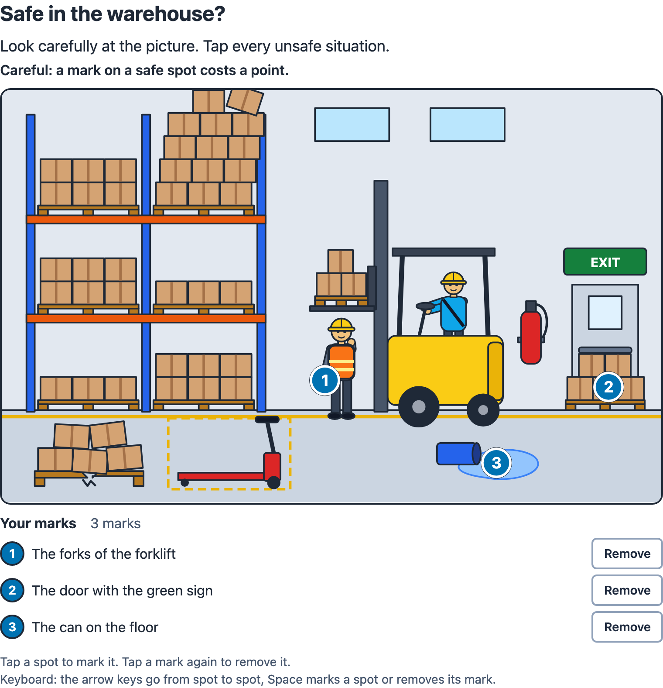

# @citolab/pci-hazard-spotting

> [!WARNING]
> **Experimental (alpha). Just for inspiration.** This PCI is a technical showcase, made by software developers without
> much knowledge of the subject it could be used for. Its content, terms and scoring have not been checked by subject
> experts or assessment specialists, and it has never been used in an assessment. It is offered as is, without any
> warranty.

A QTI 3 Portable Custom Interaction (PCI) for hazard spotting (Dutch: *gevaren herkennen*), for VCA safety training
and *praktijkonderwijs* (practical education). The pupil sees a drawn workplace and taps every unsafe situation: a
numbered marker appears where they tap, and a tap on it removes it again. After answering, the picture shows which
hazards were found and which were not, and every hazard is explained: why it is unsafe and what should be done. Made
with [tspci](https://github.com/Citolab/tspci).

<p align="center">
  
</p>

## What it does

- **Four drawn scenes** (`scene`), simple and clear, with 5 or 6 hazards each and some safe look-alikes. The texts in
  the pictures (signs, labels) follow the `language` setting.
- **Hazards and look-alikes.** Every hazard has an unsafe and a safe version in the picture. A hazard the author leaves
  out is drawn **safe** (a helmet on, the railing in place), so the picture never shows something unsafe that does not
  count; it becomes one more look-alike.
- **Tapping.** A tap on a spot marks it (one mark per spot); a tap on a marker, or anywhere on a marked spot, removes
  the mark. A tap where nothing is counts too: it is a mark on a safe spot. A finger may move up to 10 px; a swipe
  scrolls the page, two fingers zoom, and a tap just next to a spot still counts (12 px for a finger, 3 for a mouse).
  Markers are at least 26 px across, also in a narrow item.
- **The list of marks** under the picture names each mark neutrally ("the ladder", "a spot at the top right"), with a
  Remove button (36 px high). It never says what is wrong.
- **Keyboard.** Tab to the picture; the arrow keys go from spot to spot in reading order (hazards and look-alikes
  alike), Home and End to the first and last; Space or Enter marks the spot or removes its mark, Delete removes it. The
  spot is outlined and named under the picture.
- **Screen readers.** The picture is an `application` named after the scene. A spot is read as "Spot 3 of 9: the
  ladder. Not marked." in a live region, and so is what a tap or a key did ("Mark 2 placed: the ladder."). The names of
  the hazards are only read after answering.
- **A limit** (`maxMarks`): "Find 5 unsafe situations": the pupil is told the number and cannot place more marks
  (removing one is always possible).
- **After answering** (status `review` and `solution`): every hazard that counts is outlined and numbered as in the
  response (solid when found, dashed when not), each mark shows a check mark (on a hazard) or a cross (on a safe spot),
  and under the picture a summary, a legend and a list of the hazards with their explanation, then the marks on a safe
  spot with why that spot is safe. Colour is never the only cue: solid or dashed, a check mark, an exclamation mark or
  a cross, in Okabe-Ito colours.
- **English and Dutch** (`language`).

### The scenes

The hazards in the order of the response (`h1`, `h2`, …, when they all count), with their ids for the `hazards`
setting:

| `scene` | hazards | safe look-alikes |
| --- | --- | --- |
| `scaffold`: a building site with a mobile scaffold | `railing` no guard rail and toe board, `materials` bricks on the edge of the platform, `wheels` wheels not on the brake, `ladder` ladder on a bucket and not tied, `helmet` a worker without a helmet, `hole` an open hole without a fence | a sign "helmet on", a worker with a wheelbarrow (helmet, vest, safety shoes), a low stack of bricks on a pallet |
| `warehouse`: racking and a forklift | `overloaded` an overloaded, crooked stack on the top shelf, `underForks` a person under the raised forks, `exit` boxes in front of the emergency exit, `spill` a tipped-over can and a puddle, `damagedPallet` a broken pallet | a normal stack on the top shelf, the forklift (driver with a seat belt), the fire extinguisher, a pallet truck parked in its place |
| `kitchen` | `cable` a mixer's cable through the washing-up water, `knife` a knife sticking out over the edge, `panHandle` a pan handle sticking out, `oven` the oven door open, `wetFloor` a wet floor without a sign, `cleaner` a cleaning spray next to the bread | a fire blanket, a pot with its handles in, a knife block |
| `workshop` | `grinderGuard` a bench grinder without guards, `goggles` its user without safety goggles, `clothing` a scarf near a running drill, `cables` cables across the walkway, `gasBottle` a gas bottle not chained | the tool board, the first aid kit, the drill (with a chuck guard), a chained gas bottle |

The pictures are drawn for this PCI in SVG; nothing is copied from photos or from safety sign designs (ISO 7010): the
signs are plain shapes with text.

## Settings

| setting | editor | what it does |
| --- | --- | --- |
| `title`, `question` | `text`, `textarea` | above the picture; an empty question shows the instruction ("Look carefully at the picture. Tap every unsafe situation.", with a limit "Find 5 unsafe situations, and tap them.") |
| `language` | `enum` | `en` or `nl`: the PCI's own texts and the texts in the pictures |
| `scene` | `pci` | `scaffold` (default), `warehouse`, `kitchen` or `workshop` |
| `hazards` | `pci` | the hazards that count: `all` (default), `none`, or their ids separated by commas (`railing, wheels, ladder`). A list without any id of the scene (made for another one) is all of them |
| `extraHazards` | `pci` | areas of the author's own that count as a hazard: a JSON list of rectangles in scene units (800 × 500), `[{"name":"Hot water tap","label":"the tap","why":"…","x":96,"y":176,"w":56,"h":40}]`. `name` and `why` are shown after answering, `label` is the neutral description for the list and the screen reader |
| `maxMarks` | `integer` | the marks the pupil may place; `0` (default) is no limit |
| `penalty` | `boolean` | on (default): the pupil is told that "a mark on a safe spot costs a point", and `correct` needs no such marks; off: such marks do not matter for `correct` |

At most 8 hazards count, scene and areas together (the response has `h1` … `h8`).

### Authoring mode

"Choose the scene and the hazards…" (`getAuthoringInstance`) opens in the author's language:

- the four scenes to pick from, as small pictures;
- the picture as the pupil will see it, with every hazard that counts outlined and numbered as in the response, the
  hazards left out (drawn safe) dashed, the look-alikes dotted. A tap on a hazard in the picture ticks it or leaves it
  out;
- a checkbox per hazard, with its name, its explanation, its `h` number and its id;
- areas of your own: "Add an area", then drag on the picture to draw it (or type its position), with a name, a neutral
  description and an explanation;
- how many hazards count, and a note when that differs from `maxMarks`. Done waits while no hazard counts, more than 8
  count, or an area has no name.

It writes `scene`, `hazards` and `extraHazards`. Without them (another authoring system) the PCI shows the building
site with every hazard.

## Response and scoring

The PCI does not score: it reports a `record`, and the item's scoring decides the points. Nothing is reported until
the pupil placed a mark.

| field | type | what it is |
| --- | --- | --- |
| `found` | `integer` | the hazards that count and have a mark |
| `total` | `integer` | the hazards that count |
| `wrong` | `integer` | the marks on a safe spot: a look-alike, a hazard drawn safe, or no spot at all |
| `correct` | `boolean` | every hazard found and no mark on a safe spot (with `penalty` off: every hazard found) |
| `h1` … `h8` | `boolean` | per hazard that counts, in the order of the scene and then the author's areas: it has a mark |
| `marks` | `string` | the marks, the same for the same answer whatever the order of tapping: the ids of the marked spots in reading order, then the marks on no spot as `x,y`: `railing; sign; ladder; 700,150` |

`marks` is how a response is restored (`setResponse`, `boundTo`) and shown in review: a marked spot gets its marker
where the spot's marker goes, a mark on no spot where it was. The state (`getState()`) keeps every mark where it was
tapped, in the order of tapping, and is restored only for the same scene and hazards.

- **`match_correct`**: `getCorrectResponse` gives the correct response from the settings: a mark on every hazard that
  counts and nothing else (`found` = `total`, `wrong` 0, `correct` true, every `h` true, and their `marks`). An
  authoring system that supports it fills it in and keeps it up to date. The whole record must be equal, so it means
  "all found, no mark on a safe spot". Not every engine compares records with `qti-match`; a rule on `correct` (below)
  gives the same score.
- **`custom`**: 1 point per hazard found, minus 1 per mark on a safe spot, never below 0 (with `penalty` off, leave out
  the subtraction and score `found`). The maximum score is `total`:

```xml
<qti-response-declaration identifier="RESPONSE" cardinality="record"/>
<qti-outcome-declaration identifier="SCORE" cardinality="single" base-type="float">
  <qti-default-value><qti-value>0</qti-value></qti-default-value>
</qti-outcome-declaration>
…
<qti-response-processing>
  <qti-response-condition>
    <qti-response-if>
      <qti-not><qti-is-null><qti-variable identifier="RESPONSE"/></qti-is-null></qti-not>
      <qti-set-outcome-value identifier="SCORE">
        <qti-max>
          <qti-base-value base-type="integer">0</qti-base-value>
          <qti-subtract>
            <qti-field-value field-identifier="found"><qti-variable identifier="RESPONSE"/></qti-field-value>
            <qti-field-value field-identifier="wrong"><qti-variable identifier="RESPONSE"/></qti-field-value>
          </qti-subtract>
        </qti-max>
      </qti-set-outcome-value>
    </qti-response-if>
  </qti-response-condition>
</qti-response-processing>
```

  Other rules: 1 point when `correct` is true; a point per `h` field for the hazards that matter most; or full credit
  at `found` ≥ `total` − 1 and `wrong` ≤ 1.
- **`human`**: `marks` and the review show a rater exactly what was marked.

With no limit and `penalty` off, a pupil could mark everything; give such an item a limit, or keep the penalty.

## Logic and tests

`src/hazards.ts` has the logic without imports: the shapes and hit testing (the smallest spot under the point, then the
nearest within a finger's reach), what a tap or a key does, reading order, the settings, the `marks` notation and the
response. `src/scenes.ts` has the spots and texts of the scenes (also without imports), `src/drawings.tsx` the
pictures. `npm test` runs `test/hazards.test.ts` in node, without a build, including a check that every spot of every
scene is inside the picture and is found where its marker goes, with every hazard drawn unsafe and drawn safe. The
stories (`src/hazardSpotting.stories.ts`) test the PCI as a player and an authoring system use it: mouse and touch taps
(a moving finger, a swipe, a pinch, a cancelled touch), the keyboard, a narrow item, the limit, review, solution,
restoring, two instances on a page, and the authoring mode. "Hazard spotting, to try" has no test, to try it by hand.

## Development

```bash
npm install
npm run dev           # the dev page, with the settings
npm test              # the logic, in node
npm run test:stories  # the Storybook tests
```
