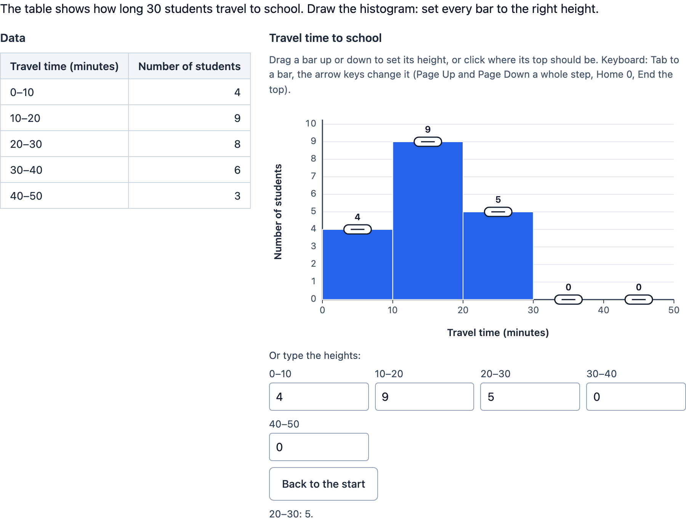

# Histogram

> [!WARNING]
> **Experimental (beta).** This PCI is a new implementation of an open-source PCI (see "Source and licence"). It is
> offered as is, without any warranty, and has never been used in an assessment. Try it out with candidates and check
> its content and scoring before you use it in one.

A PCI in which the candidate **draws a histogram or a bar chart**: every bar's height is set by dragging it, with the
keyboard (each bar is a slider) or by typing it. The data can be shown next to the chart as a frequency table, or as a
list of observations the candidate first has to count per class or per label.

The default item: the travel time of 30 students to school, in classes of 10 minutes (0–10: 4, 10–20: 9, 20–30: 8,
30–40: 6, 40–50: 3), shown in a frequency table.

<p align="center"></p>

Unlike `tspci-data-chart` (the PCI shows a chart and the candidate reads it) and `tspci-graph-builder` (the candidate
plots points of measurements), here the candidate builds the chart: the heights of the bars.

## What the candidate does

- **Reads the data**: a frequency table (a row per bar), or a list of observations (numbers that fall in the classes, or
  labels of the bars) to tally. The data can also be left out, when the prompt or the item has it.
- **Sets every bar's height**:
  - **drag** a bar up or down, or click (tap) where its top should be: the whole column is the target, the height snaps
    to the author's grid;
  - **keyboard**: every bar is a tab stop with `role="slider"` (`aria-valuenow`, `aria-valuetext`, the axis as
    `aria-valuemin`/`aria-valuemax`); the arrow keys change it by one snap, Page Up/Page Down by one step of the axis,
    Home to 0, End to the top;
  - **type** it in the number field of the bar under the chart (a decimal comma is fine; a value off the axis is not
    taken and the field says why; on leaving the field the value is rounded to the grid).
- **Back to the start** puts every bar back at its start height.
- Every change is announced (`role="status"`). Given (locked) bars are hatched, read only, and say so to a screen reader.

A histogram has adjacent bars with the class boundaries on the axis; a bar chart has gaps and a label under every bar
(turned when the labels do not fit). The chart scales with the width of the item, down to a phone.

## Settings

Every setting is a `data-` attribute (text). Empty texts mean the travel time example in the candidate's language.

| setting | default | what |
| --- | --- | --- |
| `prompt` | travel time instruction | the instruction above the item |
| `chartType` | `histogram` | `histogram` (adjacent bars, the classes on the axis) or `bar` (bars with gaps, a label each) |
| `classes` | `0;10;20;30;40;50` | the class boundaries, separated by `;` (2 to 21 increasing numbers): a bar per class `[lo, hi)`, the last one `[lo, hi]`. A histogram always uses them; a bar chart only when it has no labels |
| `bars` | | a bar chart: a label per line (at most 20) |
| `title` | Travel time to school | the title above the chart |
| `valueTitle`, `categoryTitle` | Number of students, Travel time (minutes) | the titles of the vertical and horizontal axis |
| `max` | `10` | the top of the vertical axis |
| `step` | `1` | a gridline and a number every step (at most 50 of them) |
| `snap` | the step | the heights snap to multiples of this (e.g. `0.5`; at most 1000 positions) |
| `startHeights` | all 0 | heights at the start, separated by `;` |
| `locked` | | given bars the candidate cannot change: their numbers (1 = the first), separated by `;` |
| `colors` | `#2563eb` | colours of the bars, repeated (`colorList`) |
| `showValues` | `true` | the value above every bar |
| `dataDisplay` | `table` | `table` (a value per bar), `list` (observations to count) or `none` |
| `data` | `4;9;8;6;3` | table: a value per bar, separated by `;`. List: numbers (separated by spaces, `;`, new lines or `, `; `12,5` is a decimal comma) or labels of the bars (separated by `;`, new lines or commas; not case sensitive) |
| `correct` | from the data | the correct heights, separated by `;`; empty: the table, or the tally of the list |
| `tolerance` | `0` | PCI scoring: how far a height may be from the correct one, in units of the axis |
| `scoring` | `match` | `match`: the response is the heights; `pci`: the PCI scores and reports a record |
| `pciScore` | `all` | PCI scoring: `all` 1 point when every bar is right, `bar` 1 point per right bar |
| `language` | `en` | `en`, `nl` or `fr`; numbers with a decimal comma in nl and fr (typing accepts both) |

Locked bars keep their start height, also in the correct response, and do not count in the PCI's score.

## Response and scoring

`scoring` in `package.json`: `match_correct` (the default), `custom`, `human`.

**`data-scoring="match"`** (default): an **ordered list of floats**, the height of every bar in bar order (on the
grid; a locked bar its start height):

```json
{ "list": { "float": [4, 9, 8, 6, 3] } }
```

```xml
<qti-response-declaration identifier="RESPONSE" cardinality="ordered" base-type="float">
  <qti-correct-response>
    <qti-value>4</qti-value><qti-value>9</qti-value><qti-value>8</qti-value><qti-value>6</qti-value><qti-value>3</qti-value>
  </qti-correct-response>
</qti-response-declaration>
```

Use the `match_correct` template, or your own rules (`qti-index` for one bar). The heights are snapped, so an exact
comparison works. `getCorrectResponse(properties)` gives this list for an authoring system
(`config.tspci.correctResponse: "properties"`): the `correct` setting, or else the table or the tally of the list.

**`data-scoring="pci"`**: the PCI compares the heights with the correct ones (within `tolerance`) and reports a
**record**; response processing can copy `score` to `SCORE` and `maxscore` to `MAXSCORE`:

| field | type | what |
| --- | --- | --- |
| `score` | integer | `pciScore="all"`: 1 when every bar the candidate could change is right; `bar`: the right bars |
| `maxscore` | integer | 1, or the number of bars the candidate could change |
| `correct` | integer | 1 when every such bar is right |
| `barsCorrect` | integer | the right bars (not counting locked ones) |
| `heights` | string | JSON: the heights, `[4,9,8,6,3]` |

Until the candidate changes a height, `getResponse()` reports nothing (after "Back to the start" it reports the start
heights). A response handed back (`boundTo`, a list or the record) restores the heights. The state (`getState`) has the
heights and a log of every change (bar, height, and how: drag, key or typed); it is restored when the candidate comes
back.

**Review**: in `status="review"` and `closed` the bars and the fields are read only. In `status="solution"` the PCI
shows the correct response from the response declaration (`{ value: ["4", "9", …] }`, or a record with a `heights`
field), or else the correct heights of the settings.

## Using it

```xml
<qti-response-declaration identifier="RESPONSE" cardinality="ordered" base-type="float"/>
…
<qti-portable-custom-interaction response-identifier="RESPONSE" module="pci" custom-interaction-type-identifier="histogram"
  data-chart-type="bar" data-bars="Apple&#10;Banana&#10;Pear" data-data-display="list"
  data-data="apple, banana, apple, pear, apple" data-max="5">
  <qti-interaction-modules>
    <qti-interaction-module id="pci" primary-path="../resources/pci/index"></qti-interaction-module>
  </qti-interaction-modules>
  <qti-interaction-markup></qti-interaction-markup>
</qti-portable-custom-interaction>
```

```sh
npm test               # the model (src/histogram.ts) in node
npm run test:stories   # the stories' play functions, headless
npm run prod           # dist/index.js
npm run package-qti3   # or package-tao
```

## Source and licence

This PCI is a derivative work of
[`histogramInteraction`](https://github.com/parcc/extension-parcc-tei/tree/master/views/js/pciCreator/dev/histogramInteraction)
in [parcc/extension-parcc-tei](https://github.com/parcc/extension-parcc-tei) (the PARCC TEI extension for TAO), by
Sam Sipasseuth (Open Assessment Technologies), © 2014-2017 Parcc, Inc. That extension is licensed under the GNU General
Public License version 2 only (`GPL-2.0-only`): its `LICENSE` file is the GPL-2.0, its `manifest.php` says `GPL-2.0`,
and the headers of its files say "under version 2 of the License (non-upgradable)". Its `composer.json` says
`"license": ["PARCC"]`, which is not a known licence; we follow the GPL-2.0-only stated in `LICENSE`, `manifest.php` and
the file headers. So this PCI is GPL-2.0-only too: see [LICENSE](LICENSE). This differs from the MIT licence of most
examples in this repository.

What changed, by Stichting Cito Instituut voor Toetsontwikkeling (2026):

- The original is an unfinished scaffold: its manifest (`pciCreator.json`) names a histogram with a `single` `integer`
  response, but its runtime renders nothing, `getResponse()` always returns `{ base: { integer: 0 } }`, and
  `setResponse`, `getSerializedState` and its creator form are empty (the creator still has the default properties of
  the Likert template it was copied from). There is no response processing for it in the extension. This PCI takes the
  idea, the name and the response's place in the item, and builds the interaction from scratch in TypeScript with
  Preact and Tailwind in a shadow DOM (the original uses jQuery); no code or images of the original are used.
- The bars, classes or labels, the value axis (max, step, snapping, titles), start heights, locked bars, colours, the
  data (a frequency table or observations to tally) and the scoring are settings; the texts are in English, Dutch and
  French.
- Dragging, clicking, keyboard (slider semantics) and typing; announcements for a screen reader.
- **The response**: a single integer is too little for the heights of several bars, and the original's was always 0.
  This PCI reports an ordered list of floats (the heights, for `match_correct`), or a record with the PCI's score and
  the heights. The state and a log of every change are saved and restored.
