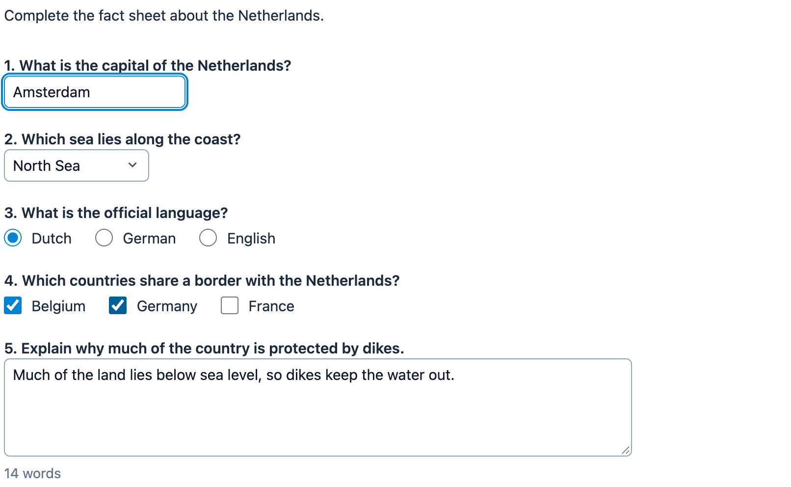

# @citolab/pci-html-template

A QTI 3 Portable Custom Interaction (PCI) made of the item author's own HTML: text fields, text areas, drop-downs, radio
buttons and checkboxes, laid out and styled as the author likes. Every input marked with `data-response` is part of
the response. The author writes the HTML in the PCI itself, next to a live preview. Made with
[tspci](https://github.com/Citolab/tspci).

<p align="center">
  
</p>

## Source and licence

This is a port of [html-template-interaction-pci](https://github.com/oatymart/html-template-interaction-pci) by
Martin Nicholson, written for TAO (Open Assessment Technologies). This port is licensed under the
**GPL-2.0-only** ([LICENSE](LICENSE)), with modifications by Stichting Cito Instituut voor Toetsontwikkeling (2026).

Why GPL-2.0 and not MIT: the original repository's
[LICENSE](https://github.com/oatymart/html-template-interaction-pci/blob/master/LICENSE) is MIT (© 2024 Martin
Nicholson), but its source files carry a GPL-2.0 header of Open Assessment Technologies SA. GPL-2.0-only is correct in
both cases: if the original is MIT, a derived work may be released under the GPL; if it is GPL-2.0, this port complies.
Should the original authors confirm that MIT applies to the whole repository, this port can be MIT as well.

What changed:

- **IMS PCI v1.0 via tspci** instead of a TAO-only AMD/creator bundle; a TAO package is still built (`npm run
  package-tao`), and a QTI 3 package (`npm run package-qti3`).
- **The same contract and response**: `data-response` + `name` mark the response elements, `data-wordcount-for` shows a
  word count, and the response is the same `record` with the same entries.
- **Sanitised HTML in the PCI's shadow root** instead of a sandboxed iframe: scripts, event handlers, `javascript:`
  URLs and external loads are removed; the author's styles stay inside the interaction, and the inputs are part of the
  page for the keyboard and screen readers.
- **A modern look for the inputs** (Tailwind), which the author's own CSS always overrides.
- **An authoring mode** with an HTML editor, a live preview, the response fields and what is wrong with the HTML,
  instead of a one-line text property and a CLI script to inline images.
- en/nl texts, state save and restore, a review mode.

## What it does

- **The author's HTML**: a whole document or only some body content. `<style>` elements and images as `data:` URLs
  are kept. Rules for `html`, `:root` and `body` apply to the interaction, so a template made as a page still works.
- **Response elements**: an `input` (`text`, `number`, `email`, `url`, `search`, `checkbox`, `radio`), a `textarea` or a
  `select` (not `multiple`) with `data-response` and a `name`. Names are unique, except within a radio group.
  ```html
  <label for="capital">Capital</label> <input type="text" id="capital" name="capital" data-response>
  <textarea name="dikes" aria-label="Your explanation" data-response></textarea>
  <p data-wordcount-for="dikes"></p>
  ```
- **Word count**: an element with `data-wordcount-for="name"` shows the number of words in that text field.
- **Safe**: scripts, `iframe`/`object`/`embed`, `on…` handlers, `javascript:` URLs, form `action`s and `@import`s are
  removed; a form never submits and a link opens in a new tab. Text values are cut off at 10,000 characters, as in
  the original.
- **Accessible**: the inputs are the author's own native elements, so the keyboard works as on any web page; they get a
  clear focus ring. The authoring mode warns about a response element without a label.
- **Authoring mode**: "Edit the HTML…" opens the editor (`getAuthoringInstance`) in an authoring system that supports it
  (qti-construction, TAO with tspci-tao, the dev page). Insert a text field, text area, drop-down, radio buttons,
  checkbox or image at the cursor; the preview, the list of response fields and the problems update as you type.
  The editor blocks HTML without response elements, with a duplicate name or a response element without a name.
- **Delivery**: the values are saved as the item's state and restored (also from a state of the original PCI,
  `{ "response": { "record": … } }`). In review (`status: "review"` or `"solution"`) the inputs are read-only.

## What can be configured

Every setting is a `data-` attribute of the interaction, as text. `dist/authoring.json` describes them for authoring
systems.

| setting                           | attribute       | default                         | what                                       |
| --------------------------------- | --------------- | ------------------------------- | ------------------------------------------ |
| HTML of the interaction           | `data-html`     | empty: the example fact sheet   | written by the authoring mode              |
| Instruction above the interaction | `data-prompt`   | empty                           | also the accessible name of the interaction |
| Language                          | `data-language` | `en`                            | `en` or `nl`: the word count               |

## Scoring

The PCI is made for `custom` scoring (`authoring.json`: `"scoring": ["custom", "human"]`), like the original, which had
no response processing.

**The response** is a record (`cardinality="record"`) with one entry per name, in the order of the HTML, as in the
original:

| element                         | entry                                                          |
| ------------------------------- | -------------------------------------------------------------- |
| text field, text area           | `{ "name": "capital", "base": { "string": "Amsterdam" } }`     |
| drop-down                       | `{ "name": "sea", "base": { "identifier": "north_sea" } }`     |
| radio group                     | `{ "name": "official_language", "base": { "identifier": "dutch" } }` (the checked `value`) |
| checkbox                        | `{ "name": "border_be", "base": { "boolean": true } }`         |
| empty text, nothing chosen      | `{ "name": "dikes", "base": null }`                            |

A field starts with what the HTML gives it (a `value`, a `checked` box, a `selected` option, or else the first option
of a drop-down). `package.json` `config.tspci.response.fields` lists the fields of the example; your own HTML has its
own, which the authoring mode lists.

- **CUSTOM**: score a field with `qti-field-value` in the item's response processing:
  ```xml
  <qti-response-condition>
    <qti-response-if>
      <qti-and>
        <qti-string-match case-sensitive="false">
          <qti-field-value field-identifier="capital"><qti-variable identifier="RESPONSE"/></qti-field-value>
          <qti-base-value base-type="string">Amsterdam</qti-base-value>
        </qti-string-match>
        <qti-match>
          <qti-field-value field-identifier="sea"><qti-variable identifier="RESPONSE"/></qti-field-value>
          <qti-base-value base-type="identifier">north_sea</qti-base-value>
        </qti-match>
      </qti-and>
      <qti-set-outcome-value identifier="SCORE"><qti-base-value base-type="float">1</qti-base-value></qti-set-outcome-value>
    </qti-response-if>
  </qti-response-condition>
  ```
- `match_correct` is not offered: QTI's `match` cannot compare records.
- `human`: use the PCI without automatic scoring, for instance for a human rater.

## Using it

```sh
npm install @citolab/pci-html-template
```

| file                                      | what                                                                      |
| ----------------------------------------- | ------------------------------------------------------------------------- |
| `dist/index.js`                           | the PCI (AMD module, everything bundled: the package has no dependencies) |
| `dist/authoring.json`                     | settings, response, scoring and the authoring mode, for authoring systems |
| `dist/sbom.cdx.json`                      | CycloneDX SBOM of the bundle                                              |
| `dist/tao-pci-htmlTemplate_<version>.zip` | the PCI for TAO: Settings → Portable Custom Interactions → Add            |
| `htmlTemplate.svg`, `example.png`         | icon and screenshot                                                       |

In a QTI 3 item, with `index.js` at `resources/pci/index.js` of the package (the HTML is an attribute, so escape `<`,
`>`, `&` and `"`):

```xml
<qti-response-declaration identifier="RESPONSE" cardinality="record"/>
…
<qti-portable-custom-interaction response-identifier="RESPONSE" module="pci" custom-interaction-type-identifier="htmlTemplate"
  data-html="&lt;label&gt;Capital &lt;input name=&quot;capital&quot; data-response&gt;&lt;/label&gt;">
  <qti-interaction-modules>
    <qti-interaction-module id="pci" primary-path="../resources/pci/index"></qti-interaction-module>
  </qti-interaction-modules>
  <qti-interaction-markup></qti-interaction-markup>
</qti-portable-custom-interaction>
```

Source and the other examples: [Citolab/tspci-examples](https://github.com/Citolab/tspci-examples).
