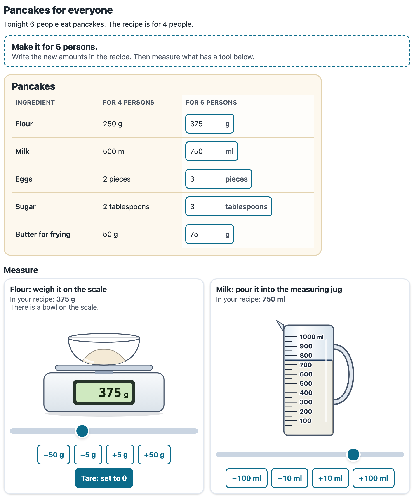

# @citolab/pci-kitchen-dosing

> [!WARNING]
> **Experimental (alpha). Just for inspiration.** This PCI is a technical showcase, made by software developers without
> much knowledge of the subject it could be used for. Its content, terms and scoring have not been checked by subject
> experts or assessment specialists, and it has never been used in an assessment. It is offered as is, without any
> warranty.

A QTI 3 Portable Custom Interaction (PCI) for scaling a recipe and dosing (Dutch: *recept omrekenen en doseren*), for
kitchen, cleaning and care in *praktijkonderwijs*. It follows SLO's example "Ik kan een gezonde maaltijd voor vier
personen klaarmaken" and the industry certificates "Werken in de keuken" and cleaning (choosing and dosing cleaning
agents). The pupil makes a recipe for 4 persons for 6, writes the new amounts in the recipe and measures them with
kitchen tools. Or the pupil chooses the cleaning product for a surface, computes how much goes into the bucket and
pours it with a dosing cup. Every tool is drawn in SVG. Made with [tspci](https://github.com/Citolab/tspci).

<p align="center">
  
</p>

## What it does

- **Two modes** (the `mode` setting):
  - `recipe`: a recipe for N persons has to be made for M persons. The pupil writes the new amounts in the recipe
    (a table: ingredient, the amount for N, a box for the amount for M, the unit). Then they measure the ingredients
    the author ticked, each with the tool of its unit.
  - `dosing`: a cleaning task ("Clean the floor. The bucket holds 5 litres of water."). The pupil chooses the right
    product from the labels on the shelf (optional), computes the ml of product for the bucket and pours it with a
    dosing cup into the bucket.
- **The tools**, one card per measured ingredient:
  - **kitchen scale** (g, kg): a bowl stands on it, so the display starts at 150 g. The pupil presses **Tare** to set
    it to 0, or adds the bowl's weight in their head. They add or take away ingredient until the display shows the
    amount, and the heap in the bowl grows. What counts is the weight of the ingredient, so both ways are right. The
    bowl is a setting.
  - **measuring jug** (ml, dl, l): the pupil pours until the line. The jug has lines and numbers in ml and no number
    for the level, because reading the jug is the skill. Its size follows the amount (250 ml to 5 l), with room to
    spare.
  - **spoons** (tablespoons, teaspoons): in halves; full spoons, and a half-full one for a half.
  - **pieces** (eggs, onions, apples, stock cubes, …): whole numbers, each drawn.
  - **dosing cup or cap** (dosing mode): 25, 50, 100 or 250 ml, with lines. "Pour the cup into the bucket" empties it
    into the bucket, so 80 ml with a 50 ml cap is a full cap and then 30 ml. "Empty the bucket" starts again.
- **Every tool works three ways**: a slider (a drag of its large thumb, or the arrow keys, Page Up/Down for a large
  step, Home and End), large − and + buttons (a small and a large step: "−50 g", "−5 g", "+5 g", "+50 g"; "−1", "−½",
  "+½", "+1" spoons), and for the jug and the cup a drag or tap on the drawing itself. Pouring and weighing never need
  a mouse.
- **The product labels** are stylised, without brands: a bottle in the product's colour, its name (Floor cleaner,
  All-purpose cleaner, Toilet and bathroom cleaner, Glass cleaner), what it is for, the dosage in a box ("1 : 100" or
  "20 ml per litre"), the GHS hazard pictograms with their names, and a safety sentence. The pictograms (flammable,
  corrosive, harmful, harmful to the environment) are drawn by the PCI as the GHS describes them: a red diamond on
  white with a black symbol. The chosen label gets a thick border and a "✓ Chosen" badge.
- **Simple language** and large targets: every button and the slider's thumb are at least 44 × 44 px.

### Touch, keyboard and screen reader

- Taps and drags work with a finger. Only the jug and the cup have `touch-action: none` (a finger on them pours);
  everywhere else a swipe scrolls the page. The slider is a native range input, which tablets handle well.
- Tab goes through the recipe boxes top to bottom, then through the tools in the same order (slider, −, +, Tare).
  In dosing: the product labels (a radio group: the arrow keys move the choice), the answer box, the cup, Pour,
  Empty. A − button that disables itself at 0 hands the focus to the + of its tool; Pour and Empty hand it to the
  cup's slider.
- Every box and control has a name: "flour: amount for 6 persons, in grams", "Flour on the scale", "Add 50 g of
  flour", "Tare: set the scale to 0", "Floor cleaner for the bucket, in ml". The slider's value text is what the tool
  shows: "The scale shows 375 g", "750 ml in the jug", "1½ tablespoons", "Eggs: 3", "25 ml in the cup". After a button,
  a live region says it again ("The scale is set to 0.", "Poured 25 ml into the bucket.").
- Colour is never the only cue: the scale shows a number, spoons and pieces have their count in text, a box with
  something that is not a number gets a dashed red border and a ⚠ with a sentence, a label has its name and its
  pictograms have their names. The product colours are Okabe-Ito colours.

### Numbers and languages

The `language` setting is `en` or `nl` (the PCI's own texts, the names of the presets, and how numbers are written:
"37,5" in Dutch). A pupil may write `375`, `37,5`, `37.5`, `½`, `1½`, `1 1/2` or `3/4`, in either language: the comma
and the point are both a decimal separator, as kitchen amounts have no thousands. Anything else (`veel`, `3 g`) makes
the box invalid (`checkValidity()` is false) and is not a right amount.

## Settings

| setting | editor | what it does |
| --- | --- | --- |
| `title`, `question` | `text`, `textarea` | above the task |
| `mode` | `enum` | `recipe` (default) or `dosing` |
| `recipe` | `pci` | recipe: a preset (`pancakes`, `stamppot`, `soup`, `fruitSalad`) or JSON (below) |
| `persons` | `pci` | recipe: cook for this many persons, 1 to 100 (default `6`) |
| `bowl` | `pci` | recipe: `true` (default): a bowl of 150 g on the scale, so the pupil uses tare |
| `cleaning` | `pci` | dosing: a preset (`floor`, `worktop`, `sanitary`, `window`) or JSON (below) |
| `amountMargin` | `pci` | a computed amount in g or ml may be off by this many percent, besides rounding (default `0`) |
| `measureMargin` | `pci` | a weighed or poured amount may be off by this many percent (default `5`) |
| `language` | `enum` | `en` or `nl` |

The `pci` settings are written by the [authoring mode](#authoring-mode). An authoring system without it shows them as
text fields, and the PCI works without them: the pancakes for 6, or the floor.

**`recipe`** as JSON: the author's own, `{ "name": "Omelette", "persons": 2, "lines": [{ "name": "eggs", "amount": 4,
"unit": "piece", "measure": true, "icon": "egg" }, { "name": "milk", "amount": 50, "unit": "ml", "measure": false }] }`,
or a preset with other lines measured: `{ "preset": "pancakes", "measure": [true, false, true, true, false] }`.

- `unit`: `g`, `kg`, `ml`, `dl`, `l`, `tbsp`, `tsp` or `piece`. The tool follows from it: the scale for g and kg, the
  jug for ml, dl and l, spoons for tbsp and tsp, counting for pieces.
- `measure`: the pupil also measures this line. `icon` (pieces): `egg`, `onion`, `apple`, `orange`, `banana`, `cube`,
  `sausage` or `other`. `color` (`#rrggbb`): the ingredient on the scale, in the jug or on a spoon.
- At most 10 lines (the response has `line1` … `line10`).

| preset | for | ingredients (measured in bold) |
| --- | --- | --- |
| `pancakes` | 4 | **250 g flour**, **500 ml milk**, **2 eggs**, **2 tbsp sugar**, 50 g butter for frying |
| `stamppot` | 4 | **1 kg potatoes**, 500 g kale, **1 smoked sausage**, **150 ml milk**, **2 tbsp butter**, 1 tsp mustard |
| `soup` | 4 | **1 l water**, **2 stock cubes**, **300 g soup vegetables**, 1 onion, 50 g vermicelli, 1 tbsp oil |
| `fruitSalad` | 4 | **2 apples**, 2 bananas, 2 oranges, **400 g yoghurt**, **2 tbsp honey** |

**`cleaning`** as JSON: `{ "surface": "floor", "volume": 5, "products": ["floor", "allPurpose", "sanitary"],
"dosages": { "floor": "1:100" }, "choose": true, "cup": 100 }`.

- `surface`: `floor`, `worktop`, `sanitary` (toilet and washbasin) or `window`. `volume`: litres of water in the bucket.
- `products`: the labels on the shelf, in order, from `floor`, `allPurpose`, `sanitary` and `glass`. The right one is
  the first that is for the surface. `dosages` gives a product another dosage: `1:100` (1 part to 100 parts water) or
  `20 ml/l`.
- `choose`: `false` shows only the right product, and the response has no `product`.
- `cup`: 25, 50, 100 or 250 ml (25 and 50 are a dosing cap).

| preset | task | shelf | right product, dosage | cup | dose |
| --- | --- | --- | --- | --- | --- |
| `floor` | the floor, 5 l | floor, all-purpose, sanitary | Floor cleaner, 1 : 100 | 100 ml | 50 ml |
| `worktop` | the kitchen worktop, 2 l | floor, all-purpose, glass | All-purpose cleaner, 20 ml per litre | 50 ml | 40 ml |
| `sanitary` | the toilet and washbasin, 4 l | all-purpose, sanitary, floor | Toilet and bathroom cleaner, 1 : 50 | 50 ml | 80 ml |
| `window` | the windows, 3 l | sanitary, all-purpose, glass | Glass cleaner, 1 : 200 | 25 ml | 15 ml |

Settings the PCI cannot read are shown to the author above the task (a recipe or task that cannot be read, a line
without a name or amount, more than 10 lines, persons out of range, a dosage that cannot be read, no product for the
surface), and then there is no correct response.

## Authoring mode

The `pci` settings have an authoring mode ("Recipe or cleaning task…", `getAuthoringInstance`) for an authoring system
that supports it (AUTHORING.md, section 6). It edits the task of the item's mode:

- **recipe**: choose a preset or "Own recipe"; the name, the persons of the recipe and the persons to cook for; per
  ingredient its name, amount, unit, how a piece looks, and whether the pupil measures it (with the tool named: "on the
  scale", "in the jug", "with spoons", "by counting"); add (up to 10) and remove ingredients; the bowl on the scale.
  Ticking which lines are measured keeps the preset (its names then follow the item's language); any other change makes
  it the author's own recipe. A preview lists the correct amounts for the new number of persons.
- **dosing**: choose a preset task, then the surface, the litres in the bucket, the cup, whether the pupil chooses,
  and which products stand on the shelf with their dosages. A line says the right product and the dose.
- **the margins** for computing (recipe) and for measuring.

Below it, what keeps Done from finishing (`validate()`): an ingredient without a name or amount, persons out of range,
a margin that is not a number from 0 to 100, no product on the shelf, a dosage that cannot be read, no product for the
surface. Every control works with a tap, a mouse or the keyboard; the rows of options are radio groups (arrow keys),
and after adding an ingredient the focus goes to its name, after removing one to the next row.

## Response and scoring

The PCI reports a `record`. Nothing is reported until the pupil writes an amount, measures, chooses a product or pours.

| field | type | what it is |
| --- | --- | --- |
| `line1` … `line10` | `boolean` | per line of the recipe (dosing: `line1`): the amount is right, and when the line is measured, the measured amount is the amount the pupil wrote, within the margin |
| `amountsCorrect` | `boolean` | every amount (dosing: the dose) is right |
| `measuredCorrect` | `boolean` | every measured amount is within the margin of the amount **the pupil wrote**; left out when nothing is measured |
| `product` | `identifier` | dosing with a choice: the chosen product (`floor`, `allPurpose`, `sanitary`, `glass`) |
| `correct` | `boolean` | all amounts right, all measured right, and the right product |
| `work` | `string` | the work as JSON, for review and to restore it: `{"amounts":["375","750","3","3","75"],"measured":[380,750,3,3,null]}`; dosing: `{"amounts":["50"],"measured":[50],"product":"floor","pours":[25,25]}`. `measured` is in the unit of the line (`0.75` for l), `null` for a line that is not measured |

**A right amount** is the exact amount (amount × M / N) or a sensible rounding of it:

- grams and ml: the nearest whole gram or ml (37,5 g: 37, 37,5 or 38), or within `amountMargin` %;
- kg and l: the nearest hundredth; dl: the nearest tenth;
- spoons: the nearest half spoon (¾ teaspoon: ½, ¾ or 1), never 0;
- pieces: a whole number, the nearest (1,5 eggs: 1 or 2), never 0 (½ egg: 1). 3,5 eggs is never right.

When the amount lies exactly halfway, both neighbours are right.

**A measured amount** is right within `measureMargin` % of the pupil's own amount on the scale, in the jug and in the
bucket, and always within half a step of the tool (with steps of 5 g, 37,5 g is 35 or 40 g). Spoons and pieces are
counted exactly. The measuring is checked against the pupil's own number, not the correct one, as AGENTS.md asks for
working: a pupil who computed 350 g and weighed 350 g measured well, and `amountsCorrect` says the computing was wrong.
So the two skills can be scored apart; `line…` and `correct` need both.

- **`custom`** (the default): the item scores the fields, e.g. 1 point for `amountsCorrect`, 1 for `measuredCorrect`
  and 1 for `product`, or only `correct`.
- **`human`**: a rater looks at the recipe and the tools in review (status `review` shows the readings as text).
- `getCorrectResponse` (`"correctResponse": "properties"`) gives every check `true` and the right `product`, **without
  `work`**, because the work differs from pupil to pupil. That is not a response a pupil's record can match as a whole,
  so do not use `match_correct`; a `custom` rule can compare field by field.

**A response read back** (`setResponse`, `boundTo`) restores the work from its `work` field: the amounts, the measured
amounts (the scale tared, so it shows the weight) and the pours. In status `solution` the PCI shows the work of a pupil
who does everything right: the correct amounts written and measured, the right product, the dose poured in full cups
and the rest.

## Development

```bash
npm install
npm run dev           # the dev page, with the settings
npm test              # the arithmetic in node (test/kitchen.test.ts)
npm run test:stories  # the Storybook tests
```

`src/kitchen.ts` has the arithmetic, without imports: the presets, scaling, sensible rounding per unit, the tools and
their steps, the margins, the doses, the settings, the response and the correct response. `src/drawings.tsx` draws the
tools, the bucket, the bottles and the pictograms; `src/tools.tsx` is a tool card (slider, buttons, drag on a jug);
`src/interaction.tsx` the recipe and the cleaning task; `src/authoring.tsx` the authoring mode.
