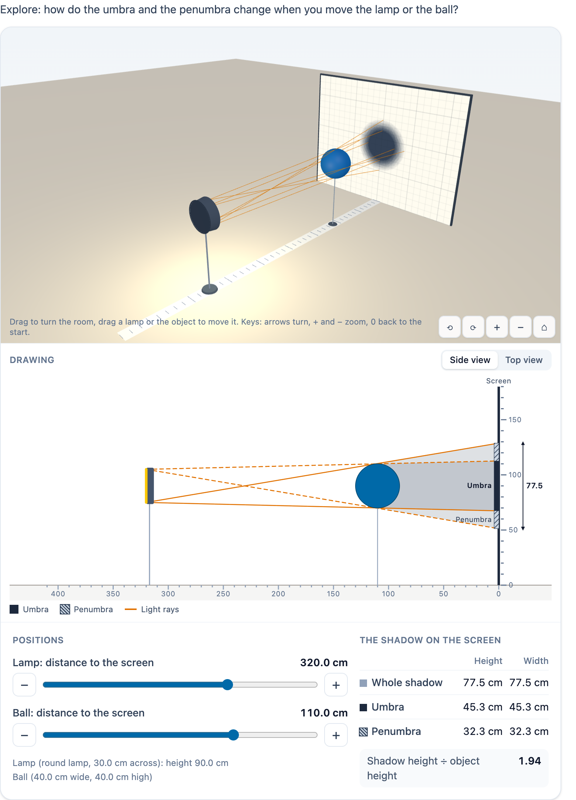

# @citolab/pci-light-shadow

> [!WARNING]
> **Experimental (alpha). Just for inspiration.** This PCI is a technical showcase, made by software developers without
> much knowledge of the subject it could be used for. Its content, terms and scoring have not been checked by subject
> experts or assessment specialists, and it has never been used in an assessment. It is offered as is, without any
> warranty.

A QTI 3 Portable Custom Interaction (PCI) about light and shadow ("licht en schaduw", umbra and penumbra:
"kernschaduw en halfschaduw"). A 3D room with a screen, one or two lamps and an object (a ball, a block or a cut-out
figure). The candidate moves the lamps and the object, in 3D, in a 2D side or top view, or with sliders. The PCI
computes the shadow on the screen exactly: the whole shadow, the umbra and the penumbra, in height and width. It scores
these values against the author's targets, with a margin. The item author sets up the scene, the targets and a solution
in the PCI itself. Made with [tspci](https://github.com/Citolab/tspci).

<p align="center">
  
</p>

## What it does

- **The scene**: a screen (a ruler with a line every 10 cm), a bench along the floor (a tick every 10 cm), one or two
  lamps and one object. A lamp is a point, or a round lamp of a given diameter facing the screen, which gives a
  penumbra. The object is a ball, a block or a flat cut-out figure. It stands on a thin rod, and the rod casts no
  shadow.
- **Moving**: the author decides what can move and how far. A lamp can move in distance to the screen, height and
  sideways, and the object in distance to the screen. Every move snaps to the scene's step. A lamp never comes closer
  to the screen than the object. You can:
  - drag a lamp or the object in the **3D view** (raycast picking, in the vertical plane along the bench; from above,
    in the floor plane);
  - drag them in the **2D drawing**;
  - use the **sliders**, with − and + buttons and keyboard support (arrow keys move one step, Page Up/Down five steps,
    Home and End go to the ends).
- **3D view** (three.js 0.180): drag with the mouse or a finger to turn the room. Pinch or Ctrl + wheel zooms (a plain
  wheel still scrolls the page). Keyboard: the arrow keys turn, `+` and `−` zoom, `0` goes back to the start view. The
  room also has buttons for all of these. The shadow on the screen is not a shadow map: for every cell of the screen
  (about 1.25 cm) the PCI traces whether each lamp point reaches it past the object, using the exact ray against a ball,
  a box or the figure's outline. So the umbra is dark, the penumbra fades, and with two lamps the half shadows show
  as half dark. The light rays past the object's edges are real 3D lines. It renders on demand, with no animation loop.
  When the element leaves the page, the renderer and its WebGL context are freed. Without WebGL the PCI shows the
  drawing and a note.
- **2D drawing**: the side view (distance and height) or the top view (distance and sideways), to scale, the more exact
  view for answering. It shows:
  - the rays from the lamp's edges past the object's edges (dashed from the second edge of a round lamp);
  - the shadow cone behind the object;
  - on the screen, the umbra (solid, labelled "Umbra") and the penumbra (hatched, labelled "Penumbra"), never colour
    alone;
  - a dimension line with the length of the whole shadow.
- **Measured**: a table with the height and width of the whole shadow, the umbra and the penumbra, and the
  magnification (shadow height ÷ object height). The author can hide it (`data-show-measurements="false"`); the
  candidate then reads the ruler on the screen.
- **Accessible**: the 3D view is an `application` with a description of its keys. The drawings are images with a text
  alternative. Every slider has a name and a value text. A live status line reads out every move ("Lamp: distance to
  the screen 200.0 cm. Shadow 80.0 cm high, 40.0 cm wide, umbra 80.0 cm high."). With two lamps, the lamps carry
  numbers. Transitions respect `prefers-reduced-motion`, and the PCI has no animation of its own.
- **Language**: `data-language` `en` or `nl`. In Dutch, numbers use a decimal comma. The response is language
  independent.
- **Tool or answer**: in answer mode the targets are scored. As a tool, the candidate explores and the response
  records where they stopped.
- **Authoring mode**: "Set up the scene…" (`getAuthoringInstance`) has three tabs:
  - **Scene**: the screen, the step, the object (shape, sizes, height of its bottom, start, whether and how far it
    moves), and one or two lamps (size, start, and per axis whether and how far it moves), with a live drawing.
  - **Targets**: up to 4, each a value of the response with a margin and points. Each shows whether the solution meets
    it, and the tab gives the QTI response processing for the targets.
  - **Solution**: the candidate's view; place everything as a candidate should.

  `validate()` reports, in the author's language:
  - a lamp that can come closer to the screen than the object;
  - nothing that can move;
  - a start outside its range;
  - no targets, or no solution;
  - a target the solution does not meet.
- **Delivery**: the positions are the item's state (every move in the log) and are restored. Several interactions of
  this type on one page each get their own object.

### How the shadow is computed

`src/optics.ts` has no imports and is tested in node with `npm test`. Distances are in cm. The screen is the plane
x = 0, x is the distance to the screen, y the height and z sideways.

- **Side view and top view**: in the side view (x, y) a lamp point casts the object's outline onto the screen along
  the two tangent rays: past the top and bottom of a ball (tangent to the circle), past the corners of a block, or past
  the ends of the figure. The top view (x, z) does the same for the width. Because a straight line's height and
  sideways position change independently with the distance, the heights come from the side view and the widths from
  the top view.
- **A round lamp** has two edge points in each view. Its whole shadow runs from the shadow of one edge to that of the
  other (the outer edges come from the lamp's opposite edges). Its umbra is what both points' shadows share. When the
  object is nearer the lamp than where the umbra cone ends, there is no umbra.
- **Two lamps**: the umbra is what every shadow shares, and the penumbra is what is in some shadow but not in the
  umbra. When the umbra is empty in one view, no point of the screen lies in every shadow, so both umbra values are 0
  and the whole shadow is penumbra.
- **Penumbra** values are both bands together (the total length of half shadow along the height or the width). One band
  is half of that when the set-up is symmetric.
- **Whole shadow** runs from outer edge to outer edge (with two separate shadows, the light between them included). All
  values are geometric, as if the screen were large enough. The pictures cut them off at the edge of the screen.

## What can be configured

Every setting is a `data-` attribute of the interaction, as text. `dist/authoring.json` describes them for authoring
systems.

| setting                     | attribute                | default                | what                                                          |
| --------------------------- | ------------------------ | ---------------------- | ------------------------------------------------------------- |
| Instruction above the scene | `data-prompt`            | the example's question |                                                               |
| Scene                       | `data-scene`             | empty: the example     | written by the authoring mode, as JSON (below)                |
| Use                         | `data-mode`              | `answer`               | `answer` (targets scored) or `tool` (explore, not scored)     |
| Views                       | `data-view`              | `both`                 | `both`, `3d` or `2d`                                          |
| Light rays                  | `data-show-rays`         | `true`                 | the rays past the edges, in 3D and in the drawing             |
| Measured shadow             | `data-show-measurements` | `true`                 | the table and the dimension line; off: read the ruler         |
| Language                    | `data-language`          | `en`                   | `en` or `nl`                                                  |

```json
{
  "screen": { "width": 240, "height": 180 },
  "step": 5,
  "lamps": [{ "x": 300, "y": 90, "z": 0, "size": 0, "move": { "x": [120, 400] } }],
  "object": { "type": "figure", "x": 100, "elevation": 70, "width": 20, "height": 40, "depth": 0, "move": null },
  "targets": [{ "field": "magnification", "value": 2, "margin": 0.05, "points": 1 }],
  "solution": { "lamps": [{ "x": 200, "y": 90, "z": 0 }], "objectX": 100 }
}
```

- `lamps`: one or two. `x`, `y`, `z` are where the lamp starts. `size` is 0 for a point, or the diameter of a round
  lamp. `move` holds the axes the candidate may move it along, each with a `[from, to]` range.
- `object`:
  - `type`: `ball` (`width` is the diameter), `block` (`width`, `height`, `depth`) or `figure` (flat: `width` and
    `height`);
  - `x`: the distance from its centre to the screen;
  - `elevation`: the height of its bottom;
  - `move`: a `[from, to]` range for `x`, or `null`.
- `targets`: at most 4. `field` is one of the response fields below, met when |value − `value`| ≤ `margin`.
- `solution`: the author's positions, shown in review.

Three example tasks:

- **"Twice as tall"**: the example above. The lamp moves, and the target is `magnification` 2 ± 0.05; the solution is
  the lamp at 200 cm, because a figure at 100 cm gives L / (L − 100) = 2.
- **"Make the shadow 60 cm wide"**: a target `shadowWidth` 60 ± 1.5.
- **"With two lamps, make the umbra disappear"**: two point lamps at `z` −30 and 30 and a block that moves. The target
  is `umbraWidth` 0 ± 0: further from the screen the two shadows part.

## Scoring

The PCI is made for `custom` scoring (`authoring.json`: `"scoring": ["custom", "human"]`) and can tell its correct
response from its settings (`"correctResponse": "properties"`: the record of the author's solution). The response is a
record (`cardinality="record"`):

| field                                         | type      | what                                                                  |
| --------------------------------------------- | --------- | --------------------------------------------------------------------- |
| `score`, `maxscore`                           | `integer` | answer mode: the points of the targets met, and of all targets        |
| `correct`                                     | `integer` | 1 when every target is met                                            |
| `check1` … `check4`                           | `integer` | 1 or 0 per target, in their order; only the targets there are         |
| `shadowHeight`, `shadowWidth`                 | `float`   | the whole shadow, outer edge to outer edge (cm, 0.1)                  |
| `umbraHeight`, `umbraWidth`                   | `float`   | the umbra (cm); 0 without one                                         |
| `penumbraHeight`, `penumbraWidth`             | `float`   | the penumbra, both bands together (cm)                                |
| `magnification`                               | `float`   | `shadowHeight` ÷ the object's height (0.01)                           |
| `lamp1Distance`, `lamp1Height`, `lamp1Side`   | `float`   | where lamp 1 is (cm); `lamp2…` with two lamps                         |
| `objectDistance`                              | `float`   | the object's centre to the screen (cm)                                |
| `tried`                                       | `string`  | tool mode only: every position the candidate stopped at (JSON, last 50) |

The shadow fields are missing when a lamp is not behind the object. That cannot happen in the candidate's view.

```json
{ "record": [
  { "name": "score", "base": { "integer": 1 } }, { "name": "maxscore", "base": { "integer": 1 } },
  { "name": "correct", "base": { "integer": 1 } }, { "name": "check1", "base": { "integer": 1 } },
  { "name": "shadowHeight", "base": { "float": 80 } }, { "name": "shadowWidth", "base": { "float": 40 } },
  { "name": "umbraHeight", "base": { "float": 80 } }, { "name": "umbraWidth", "base": { "float": 40 } },
  { "name": "penumbraHeight", "base": { "float": 0 } }, { "name": "penumbraWidth", "base": { "float": 0 } },
  { "name": "magnification", "base": { "float": 2 } },
  { "name": "lamp1Distance", "base": { "float": 200 } }, { "name": "lamp1Height", "base": { "float": 90 } },
  { "name": "lamp1Side", "base": { "float": 0 } }, { "name": "objectDistance", "base": { "float": 100 } }
] }
```

There are two ways to score:

- **The PCI's score**: copy `score` to `SCORE`. This is the simplest way, and the targets live in `data-scene`.
- **Margins in the item**: test the fields yourself with `qti-equal` and an absolute tolerance. The authoring mode's
  Targets tab writes this for the author's targets ("Response processing for the item"). For the example:

```xml
<qti-response-declaration identifier="RESPONSE" cardinality="record"/>
<qti-outcome-declaration identifier="SCORE" cardinality="single" base-type="float">
  <qti-default-value><qti-value>0</qti-value></qti-default-value>
</qti-outcome-declaration>
<qti-outcome-declaration identifier="MAXSCORE" cardinality="single" base-type="float">
  <qti-default-value><qti-value>1</qti-value></qti-default-value>
</qti-outcome-declaration>
<qti-response-processing>
  <!-- target 1: magnification = 2 ± 0.05 -->
  <qti-response-condition>
    <qti-response-if>
      <qti-equal tolerance-mode="absolute" tolerance="0.05 0.05">
        <qti-field-value field-identifier="magnification"><qti-variable identifier="RESPONSE"/></qti-field-value>
        <qti-base-value base-type="float">2</qti-base-value>
      </qti-equal>
      <qti-set-outcome-value identifier="SCORE">
        <qti-sum><qti-variable identifier="SCORE"/><qti-base-value base-type="float">1</qti-base-value></qti-sum>
      </qti-set-outcome-value>
    </qti-response-if>
  </qti-response-condition>
</qti-response-processing>
```

Some notes on the scoring:

- **No response**: `getResponse()` reports nothing until the candidate moves something.
- **Why not `match_correct`**: QTI's `match` cannot compare records, and a physical answer needs a margin. Moves snap
  to the step, so the author can set a target that is reachable exactly (margin 0).
- **`human`**, or `data-mode="tool"`: not scored. The record still holds the positions, the shadow and `tried`, for a
  human rater or for research.

**State and response.** `getState()` holds the positions, whether the candidate moved anything, the positions tried,
and the log. `setResponse` (and `boundTo` without a state) reads the position fields. The shadow and the score follow
from those positions, and `tried` is kept in tool mode. In `status: "solution"` the PCI shows the positions of the
declared correct response (record values with `lamp1Distance` …), or else the author's solution, read-only, marked
"Correct answer". `status: "review"` is read-only as well.

## Using it

```sh
npm install @citolab/pci-light-shadow
```

| file                                        | what                                                                      |
| ------------------------------------------- | ------------------------------------------------------------------------- |
| `dist/index.js`                             | the PCI (AMD module, everything bundled: the package has no dependencies) |
| `dist/authoring.json`                       | settings, response, scoring and the authoring mode, for authoring systems |
| `dist/sbom.cdx.json`                        | CycloneDX SBOM of the bundle                                              |
| `dist/tao-pci-lightShadow_<version>.zip`    | the PCI for TAO: Settings → Portable Custom Interactions → Add            |
| `lightShadow.svg`, `example.png`            | icon and screenshot                                                       |

In a QTI 3 item, with `index.js` at `resources/pci/index.js` of the package:

```xml
<qti-response-declaration identifier="RESPONSE" cardinality="record"/>
…
<qti-portable-custom-interaction response-identifier="RESPONSE" module="pci" custom-interaction-type-identifier="lightShadow"
  data-language="nl" data-scene="{&quot;lamps&quot;:[…],&quot;object&quot;:{…},…}">
  <qti-interaction-modules>
    <qti-interaction-module id="pci" primary-path="../resources/pci/index"></qti-interaction-module>
  </qti-interaction-modules>
  <qti-interaction-markup></qti-interaction-markup>
</qti-portable-custom-interaction>
```

Source and the other examples: [Citolab/tspci-examples](https://github.com/Citolab/tspci-examples).
