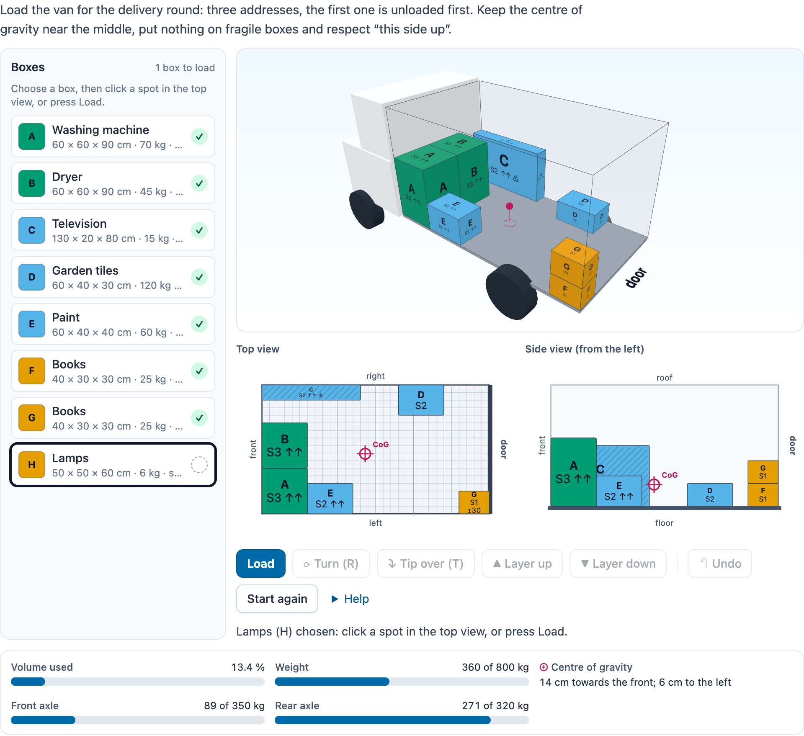

# @citolab/pci-load-planner

> [!WARNING]
> **Experimental (alpha). Just for inspiration.** This PCI is a technical showcase, made by software developers without
> much knowledge of the subject it could be used for. Its content, terms and scoring have not been checked by subject
> experts or assessment specialists, and it has never been used in an assessment. It is offered as is, without any
> warranty.

A QTI 3 Portable Custom Interaction (PCI) in which the candidate loads a van, a container or a euro pallet with boxes
("laden en lossen", a "beladingsplan" for vmbo logistics and economics). Boxes have a size, a weight, a label and
optionally "this side up", fragile and a delivery stop. The candidate places, turns, tips, stacks and unloads them in a
3D view and in a top and a side view; live metrics show the used volume, the weight, the centre of gravity and the
axle loads. The PCI checks the load itself against the author's checks, each worth points. The item author sets up the
cargo space, the boxes, the checks and an example solution in the PCI. Made with [tspci](https://github.com/Citolab/tspci).

<p align="center">
  
</p>

## What it does

- **The cargo space**, in cm: a van (with its cab and wheels, and optionally the axles for the axle loads), a
  container or a euro pallet (120 × 80, with the highest the load may come). x runs from the front (behind the cab) to
  the door, y from the left wall to the right one.
- **The boxes**: length × width × height, weight, label, and the flags "this side up" (turns around the vertical axis
  only), fragile (nothing on top) and a delivery stop (1 is unloaded first). The colour of a box is its stop
  (Okabe–Ito, colour-blind safe); the stop number (`S1`), `↑↑` (this side up) and `⚠` plus hatching (fragile) are
  always on the box as well.
- **Loading**: choose a box in the list, then click the floor in the top view or the 3D view, or press Load (the
  lowest, deepest free spot with enough support, not on a fragile box). Drag a box in the top view to pick it up and put
  it down elsewhere (on top of what is there); drag it in the side view to slide it along. Positions snap to the grid
  (10 cm, configurable) and stay within the walls.
- **Gravity**: every box rests on the floor or on the boxes under it; take a box away and what was on it falls.
  "Layer up" (PgUp) puts the chosen box on the next box above it, "Layer down" (PgDn) under the one it rests on.
- **Turning**: R turns 90° around the vertical axis, T tips the box over (not when "this side up"); together they reach
  all six orientations. Unload (Delete), Undo (Ctrl+Z) and Start again.
- **Keyboard**: the list is buttons (Enter chooses, Enter again loads). The top view and the side view are each one
  focusable element (`role="application"`, the chosen box in its name): arrow keys move the box a grid step, R turns,
  T tips, PgUp/PgDn change the layer, Delete unloads; in the side view up/down are the layers. The 3D view turns with
  the arrow keys and zooms with + and − (0 resets). Every step is told in a live status line.
- **3D view** (three.js 0.180, OrbitControls): drag or touch to turn, scroll or pinch to zoom; a click (a raycast)
  chooses a box or puts the chosen box on the floor. It draws only when something changes and frees its WebGL context
  when it is removed. Without WebGL it shows a message; the top and side view do everything. `data-view="2d"` leaves it
  out.
- **Metrics** (`data-show-metrics`): used volume %, weight against the maximum payload, the centre of gravity (cm
  towards the front or the door, to the left or right of the middle, and a marker ⊕ in all three views) and, for a van
  with axles, the payload on the front and rear axle (lever rule) against their limits. A meter over its limit is
  striped and says ⚠.
- **Checks shown** (`data-show-checks`, off by default because it gives the answer away): the checks with ✓/✗ and the
  boxes that fail them, for practice.
- **Authoring mode**: the item author makes everything in the PCI itself (`getAuthoringInstance`, "Make the load
  plan…") in four tabs: **Cargo space** (kind, which fills in typical sizes; size, payload, grid, axles, the least
  support, and whether the checks need every box), **Boxes** (a table, or paste from a spreadsheet: label, length,
  width, height, weight, this side up, fragile, stop, count; tabs or semicolons, a header line is skipped, decimal
  comma fine), **Checks** (type, points and, for the centre of gravity, the margins; ✓/✗ for the solution) and
  **Solution** (load it as a candidate would, with the checks live). `validate()` reports, in the author's language:
  no boxes, no checks, a box that fits in no orientation, a load heavier than the payload while the checks need every
  box, an axle check without axles, no solution, and every check the solution fails.
- **Delivery**: the placement is saved as the item's state (every change in the log) and restored. In review
  (`status: "solution"`) the PCI shows the correct response from the response declaration, or else the author's
  solution, read-only. Several interactions of this type on one page each get their own object.
- **Language**: `data-language` `en` or `nl`; numbers follow it (decimal comma in Dutch), the response does not.

## What can be configured

Every setting is a `data-` attribute of the interaction, as text. `dist/authoring.json` describes them for authoring
systems.

| setting                        | attribute            | default                | what                                                     |
| ------------------------------ | -------------------- | ---------------------- | -------------------------------------------------------- |
| Instruction above the plan     | `data-prompt`        | the example's question |                                                          |
| Load plan                      | `data-plan`          | empty: the example     | written by the authoring mode, as JSON (below)           |
| Views                          | `data-view`          | `3d`                   | `3d` (3D, top and side view) or `2d` (top and side view) |
| Show the metrics               | `data-show-metrics`  | `true`                 | volume, weight, centre of gravity, axle loads            |
| Show the checks live           | `data-show-checks`   | `false`                | gives the answer away; for practice                      |
| Language                       | `data-language`      | `en`                   | `en` or `nl`                                             |

```json
{
  "space": { "kind": "van", "length": 300, "width": 170, "height": 160, "maxPayload": 800, "grid": 10,
             "axles": { "front": -90, "rear": 210, "maxFront": 350, "maxRear": 320 } },
  "boxes": [
    { "id": "A", "label": "Washing machine", "length": 60, "width": 60, "height": 90, "weight": 70, "upright": true, "fragile": false, "stop": 3 },
    { "id": "H", "label": "Lamps", "length": 50, "width": 50, "height": 60, "weight": 6, "upright": true, "fragile": true, "stop": 1 }
  ],
  "checks": [
    { "type": "allLoaded", "points": 1 }, { "type": "stable", "points": 1 }, { "type": "fragile", "points": 1 },
    { "type": "unloadOrder", "points": 2 }, { "type": "cog", "points": 1, "x": 40, "y": 20 }
  ],
  "support": 70,
  "requireAll": true,
  "solution": [{ "id": "A", "x": 0, "y": 0, "z": 0, "o": "lwh" }, { "id": "H", "x": 250, "y": 120, "z": 0, "o": "lwh" }]
}
```

- **space**: `kind` `van`, `container` or `pallet`; sizes in cm (for a pallet `height` is the highest load); `maxPayload`
  in kg; `grid` in cm; `axles` (van only) the axle positions in cm from the front of the cargo space and the payload
  each may carry (0: no limit).
- **boxes**: at most 40; `stop` a number or `null`.
- **support**: the least part of a box's base, in %, that must rest on the floor or on boxes (check `stable`).
- **requireAll**: the checks other than `allLoaded` only pass when every box is loaded. Without boxes no check passes.
- **solution** / placements: `o` is which side of the box (l, w, h) lies along x, y and z; `lwh` is as described.

### The checks

At most 10, each worth `points` (default 1).

| check          | passes when                                                                                                  |
| -------------- | ------------------------------------------------------------------------------------------------------------ |
| `allLoaded`    | every box is loaded and inside the cargo space (under the roof / the highest load)                           |
| `stable`       | no two boxes overlap and every box rests on at least `support` % of its base                                 |
| `upright`      | every "this side up" box stands upright                                                                      |
| `fragile`      | nothing stands anywhere above a fragile box                                                                  |
| `maxWeight`    | the total weight is at most the maximum payload                                                              |
| `cog`          | the centre of gravity is at most `x` cm to the front or back and `y` cm to the side of the middle of the floor |
| `unloadOrder`  | no box for a later stop stands on a box or between it and the door (same width and height band); on a pallet only "on top" counts |
| `heavyBottom`  | no box rests on a lighter box                                                                                |
| `axles`        | (van with axles) the payload on each axle is at most its limit, and neither is negative                     |

## Scoring

The PCI is made for `custom` scoring (`authoring.json`: `"scoring": ["custom", "human"]`): it evaluates the author's
checks, the item's response processing turns them into points. The response is a record (`cardinality="record"`):

| field                 | type      | what                                                                         |
| --------------------- | --------- | ---------------------------------------------------------------------------- |
| `score`               | `integer` | the points of the checks that pass                                           |
| `maxscore`            | `integer` | the points of all checks                                                     |
| `correct`             | `integer` | 1 when every check passes (and there is at least one), else 0                |
| `check1` … `check10`  | `integer` | 1 or 0 per check, in the order of the checks; only the checks there are      |
| `loaded`              | `integer` | the number of loaded boxes                                                   |
| `volume`              | `float`   | used volume in % (one decimal)                                               |
| `weight`              | `float`   | total weight in kg                                                           |
| `cogx`, `cogy`        | `float`   | the centre of gravity in cm from the middle: + towards the door, + to the right (only with boxes) |
| `placement`           | `string`  | every loaded box with position, orientation and size, as JSON, for a rater  |

```json
{ "record": [
  { "name": "score", "base": { "integer": 9 } }, { "name": "maxscore", "base": { "integer": 9 } },
  { "name": "correct", "base": { "integer": 1 } }, { "name": "check1", "base": { "integer": 1 } }, …,
  { "name": "loaded", "base": { "integer": 8 } }, { "name": "volume", "base": { "float": 15.3 } },
  { "name": "weight", "base": { "float": 366 } }, { "name": "cogx", "base": { "float": -11.5 } }, { "name": "cogy", "base": { "float": -4.8 } },
  { "name": "placement", "base": { "string": "{\"space\":\"van\",\"boxes\":[{\"id\":\"A\",\"x\":0,\"y\":0,\"z\":0,\"o\":\"lwh\",\"dx\":60,\"dy\":60,\"dz\":90},…]}" } }
] }
```

- **One point per rubric line**: make a check per line and copy `score` to the outcome, as below.
- **Your own response processing**: test single fields (`<qti-field-value field-identifier="check5">` equal to 1), or the
  metrics (`cogx` with `qti-equal tolerance`, `volume` greater than 60) and give points as you like.
- `match_correct` is not offered: QTI's `match` cannot compare records, and a good load can be made in many ways.
- `human`: use the PCI without automatic scoring, for a human rater (`placement` has the whole load).
- **No response**: until the candidate loads a box, `getResponse()` reports nothing.

```xml
<qti-response-declaration identifier="RESPONSE" cardinality="record"/>
<qti-outcome-declaration identifier="SCORE" cardinality="single" base-type="float">
  <qti-default-value><qti-value>0</qti-value></qti-default-value>
</qti-outcome-declaration>
<qti-outcome-declaration identifier="MAXSCORE" cardinality="single" base-type="float">
  <qti-default-value><qti-value>9</qti-value></qti-default-value>
</qti-outcome-declaration>
…
<qti-response-processing>
  <qti-response-condition>
    <qti-response-if>
      <qti-not><qti-is-null>
        <qti-field-value field-identifier="score"><qti-variable identifier="RESPONSE"/></qti-field-value>
      </qti-is-null></qti-not>
      <qti-set-outcome-value identifier="SCORE">
        <qti-field-value field-identifier="score"><qti-variable identifier="RESPONSE"/></qti-field-value>
      </qti-set-outcome-value>
    </qti-response-if>
  </qti-response-condition>
</qti-response-processing>
```

**State and response.** `getState()` holds the placement (and the log), so the load can be restored. `setResponse`
(and `boundTo` without a state) reads the `placement` field, or a placement as a string (`{"boxes": […]}` or a list);
the other fields follow from it. Unknown boxes are left out, positions are clamped to the space and settled. In
`status: "solution"` the placement of the declared correct response is shown (a string, or a record value with the
field `placement`); without one, the author's solution.

## Using it

```sh
npm install @citolab/pci-load-planner
```

| file                                        | what                                                                      |
| ------------------------------------------- | ------------------------------------------------------------------------- |
| `dist/index.js`                             | the PCI (AMD module, everything bundled, three.js included)               |
| `dist/authoring.json`                       | settings, response, scoring and the authoring mode, for authoring systems |
| `dist/sbom.cdx.json`                        | CycloneDX SBOM of the bundle                                              |
| `dist/tao-pci-loadPlanner_<version>.zip`    | the PCI for TAO: Settings → Portable Custom Interactions → Add            |
| `loadPlanner.svg`, `example.png`            | icon and screenshot                                                       |

In a QTI 3 item, with `index.js` at `resources/pci/index.js` of the package:

```xml
<qti-response-declaration identifier="RESPONSE" cardinality="record"/>
…
<qti-portable-custom-interaction response-identifier="RESPONSE" module="pci" custom-interaction-type-identifier="loadPlanner"
  data-language="nl" data-plan="{&quot;space&quot;:{&quot;kind&quot;:&quot;van&quot;,…}">
  <qti-interaction-modules>
    <qti-interaction-module id="pci" primary-path="../resources/pci/index"></qti-interaction-module>
  </qti-interaction-modules>
  <qti-interaction-markup></qti-interaction-markup>
</qti-portable-custom-interaction>
```

Development: `npm test` runs the logic (`src/plan.ts`: geometry, gravity, metrics, checks, parsing) in node; the
stories in `src/loadPlanner.stories.ts` run in the repository's Storybook.

Source and the other examples: [Citolab/tspci-examples](https://github.com/Citolab/tspci-examples).
