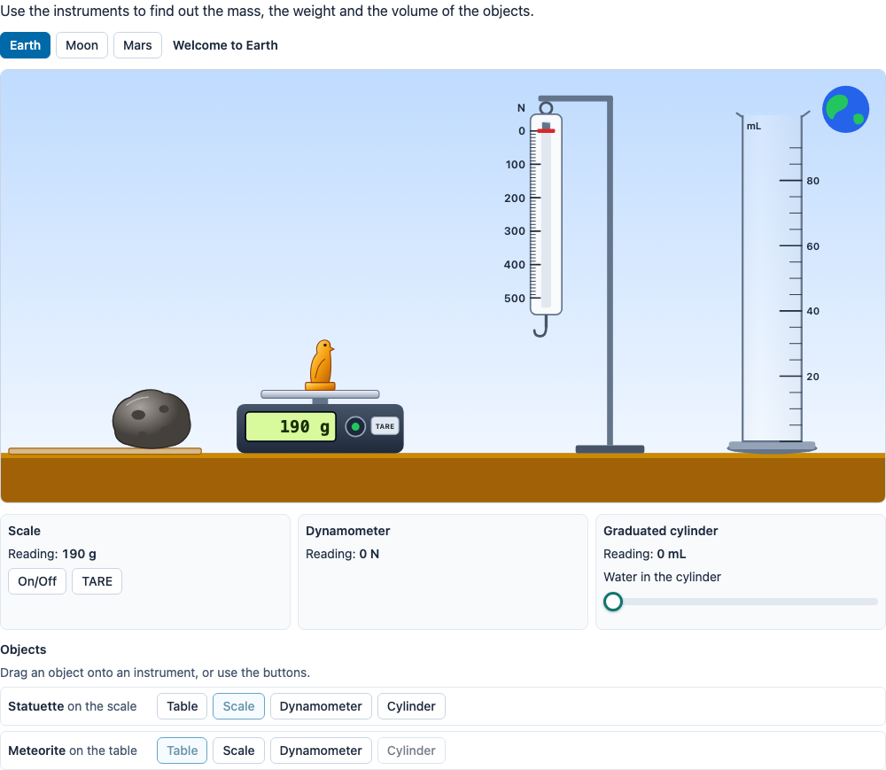

# @citolab/pci-mass-weight

> [!WARNING]
> **Experimental (alpha).** This PCI re-implements two PCIs of the French DEPP; it has never been used in an
> assessment. Try it out with candidates and check its content and scoring before you use it in one.

A QTI 3 Portable Custom Interaction (PCI) with a lab bench: objects on a shelf, a digital scale with a tare, a
dynamometer (spring scale) and a graduated cylinder with water. The candidate puts an object on an instrument by
dragging it or with a button, switches the lab between Earth, the Moon and Mars, and finds out that the mass stays the
same while the weight changes, and how to measure a volume by immersion. Optional answer fields (mass, weight, volume,
density) are scored by the PCI. Made with [tspci](https://github.com/Citolab/tspci).

It merges two PCIs of the DEPP (Ministère de l'Éducation nationale), by Jean-Philippe Rivière (Wiquid):
**ForceGravite** ("Mesure masse et poids": a 40 kg meteorite on a balance or a dynamometer, on Earth, the Moon and
Mars) and **Delor** ("Mesure masse volume": a 190 g statuette on a digital scale or in a graduated cylinder).

<p align="center">
  
</p>

## What it does

- **Objects**: by default the statuette of Delor (190 g, 10 mL: gold) and the meteorite of ForceGravite (40 kg, too
  big for the cylinder). Built in are also a stone and a metal cube; an author adds objects of their own with a name
  in three languages, a mass and a volume. All drawn in SVG.
- **Placing**: drag an object with a mouse, a pen or a finger onto the column of an instrument (the columns light up
  while dragging; red where it does not fit), or use the buttons in the list of objects ("Put the statuette on the
  scale", "Hang the meteorite on the dynamometer", "Put the statuette in the cylinder", "Put … back on the table").
  An instrument holds one object: what was on it goes back to the table.
- **Scale**: switched on and off by the candidate (or always on), with a TARE button; the display shows `190 g` or,
  from 1 kg, `40.000 kg`, `- OL -` above its capacity, and a negative mass when you take off what you tared, as on a
  real scale. By default it shows the mass, like ForceGravite's balance (the same on every planet); an author can make
  it a scale calibrated on Earth instead, which shows less on the Moon.
- **Dynamometer**: the marker and the hook go down with *F* = *m* · *g* of the place (40 kg: 392 N on Earth, 64 N on
  the Moon, 144 N on Mars with *g* = 9.8, 1.6 and 3.6 N/kg). Its range and graduation are settings; beyond the range
  it shows that it cannot read.
- **Graduated cylinder**: a slider pours water (0–140 mL in steps of 5 by default). The level follows one clean rule
  instead of the original's state machine: the object is a column of height *H* that takes a fraction *f* = *V*/*H* of
  the cross-section; with *W* mL of water it is under water once *W* ≥ (1 − *f*)·*H* and the level is *W* + *V*, with
  less water the level is *W*/(1 − *f*) and the object is only partly under water (the statuette: *H* = 60 mL, so
  below 50 mL the level is 1.2 · *W*, as in Delor). Above the top graduation the level cannot be read; above the brim
  the cylinder overflows (drawn with water running down). Taking the object out lowers the level again.
- **Places**: tabs for Earth, the Moon and Mars (or any of them; one place: no tabs) with their own sky and planet;
  optionally with *g* shown. The objects stay where they are when the candidate changes place, so the readings change
  in front of them.
- **Readings**: under each instrument as text (optional, the scale's display always shows its own); the picture's
  accessible name says what is on each instrument and what it shows, and a live region announces every change
  ("The statuette in the cylinder. Graduated cylinder: 60 mL.").
- **Answer fields** (optional): mass, weight, volume and/or density of one object, typed with a decimal point or
  comma, scored within a tolerance.
- **Languages**: English, Dutch and French (`data-language`), with a decimal comma in Dutch and French.
- **Delivery**: the bench, the readings and the answers are saved as the item's state (with every action in the log)
  and restored; a response handed back by the delivery system is restored too. In review (`review`, `solution`,
  `closed`) everything is shown but nothing can be changed.

## What can be configured

Every setting is a `data-` attribute of the interaction, as text. `dist/authoring.json` describes them for authoring
systems.

| setting | attribute | default | what |
| --- | --- | --- | --- |
| Instruction | `data-prompt` | empty | above the bench; empty: a standard instruction in the candidate's language |
| Language | `data-language` | `en` | `en`, `nl` or `fr` |
| Places | `data-places` | `earth, moon, mars` | any of them, in that order; one place: no tabs |
| *g* | `data-g-earth`, `-moon`, `-mars` | `9.8`, `1.6`, `3.6` | N/kg |
| Show *g* | `data-show-g` | `false` | next to the name of the place |
| Objects | `data-objects` | `statuette` and `meteorite` (two lines) | one per line, see below; at most 6 |
| Instruments | `data-show-scale`, `-dynamometer`, `-cylinder` | `true` | which instruments are on the bench |
| Scale on/off | `data-scale-on-off` | `true` | `false`: always on, no on/off button |
| Scale type | `data-scale-type` | `mass` | `mass` (a balance) or `earth` (calibrated on Earth: shows *m*·*g*/*g*Earth) |
| Scale capacity, resolution | `data-scale-capacity`, `-resolution` | `50` kg, `1` g | |
| Dynamometer | `data-dynamometer-max`, `-step` | `500`, `10` N | range and N between two ticks |
| Cylinder | `data-cylinder-capacity`, `-max`, `-step` | `100`, `90`, `5` mL | the brim (more overflows), the top graduation (higher cannot be read), between two graduations |
| Water slider | `data-water-max`, `-step` | `140`, `5` mL | |
| Readings as text | `data-show-readings` | `true` | `false`: the candidate reads the instruments in the picture (a screen reader still hears them) |
| Answer fields | `data-answers` | empty | `mass`, `weight`, `volume` and/or `density` |
| Object of the answers | `data-answer-object` | empty (the first) | a built-in name or the line number in the list |
| Place of the weight | `data-answer-place` | `earth` | |
| Units | `data-mass-unit`, `data-density-unit` | `g`, `g/mL` | `g` or `kg`; `g/mL`, `g/cm3` or `kg/m3` (weight is in N, volume in mL) |
| Tolerance | `data-tolerance` | `2` | percent of the right value |

**Objects**, one per line: a built-in name (`statuette`, `meteorite`, `stone`, `cube`; several on one line with
commas), optionally with another mass or volume (`statuette; 250 g`), or
`English | Nederlands | Français; mass; volume; height`, e.g. `Gold ring | Gouden ring | Bague en or; 12 g; 0,6 mL`.
The mass in g or kg; the volume in mL, cm³ or L (empty: it does not go in the cylinder; anything over half the
cylinder does not fit either); the height in the cylinder in mL is optional (by default six times the volume, at most
60 % of the cylinder). Custom objects get the ids `object<line number>`. Objects sink: there is no floating.

## Response and scoring

The response is a `record` (`package.json` `config.tspci.response`, `"scoring": ["custom", "human"]`); nothing until
the candidate does something.

| field | type | what |
| --- | --- | --- |
| `score`, `maxscore`, `correct` | integer | only with answer fields: the fields within the tolerance, the number of fields, 1 when all are right |
| `mass`, `weight`, `volume`, `density` | float | the numbers the candidate typed (only the fields of the item, only when they are numbers) |
| `used` | string | every instrument that had an object on it, per place, in the order of first use: `earth:scale moon:dynamometer` |
| `readings` | string | JSON: every reading the candidate saw, in order: `{ place, instrument, object, value, unit, note? }` |
| `bench` | string | JSON: the place, where each object is (`placements`), the water, the scale on/off and its tare at the end |

A reading is logged when what an instrument shows changes: the scale while it is on, the dynamometer with something
on it, the cylinder with water or an object. `value` is `null` when nothing can be read, with a `note`: `off`,
`overload` (scale), `overRange` (dynamometer), `aboveScale`, `overflow` (cylinder); `partly` marks a level with the
object partly under water. At most 300 readings are kept.

**Scoring.** The PCI computes the right values from the settings: the mass of the answer object (in g or kg), its
weight at the answer place (*m* · *g*, N), its volume (mL) and its density (*m*/*V*). A field is right when it is
within the tolerance (percent of the right value). Use `score` (or `correct`) in the item's response processing, e.g.
`<qti-set-outcome-value identifier="SCORE"><qti-field-value field-identifier="score"><qti-variable identifier="RESPONSE"/></qti-field-value></qti-set-outcome-value>`.
For process scoring (did the candidate use the dynamometer on the Moon?) test `used` with `qti-pattern-match` or
`qti-string-match` (`substring`), or score the readings by a human (`human`).

**Compared with the originals.** ForceGravite kept six hidden flags (`Terre_balanceAsw` … `Mars_dynamoAsw`,
`true` once the meteorite had been on that instrument on that planet); `used` holds the same information
(`earth:scale` is `Terre_balanceAsw`). Delor appended a snapshot to a JSON string on every action
(`statuette_balance`, `statuette_becher`, `volume_eau`, `valeur_balance`); `readings` holds what the instruments
showed, with the object and the place, and `bench` the final state. Neither original scored anything.

## Source and licence

This PCI is a derivative work of
[`ForceGravitepci`](https://github.com/janfix/extension-wiquid-depp/tree/master/views/js/pciCreator/ims/ForceGravitepci) and
[`Delorpci`](https://github.com/janfix/extension-wiquid-depp/tree/master/views/js/pciCreator/ims/Delorpci) in
[janfix/extension-wiquid-depp](https://github.com/janfix/extension-wiquid-depp), © DEPP (Ministère de l'Éducation
nationale) / Jean-Philippe Rivière (Wiquid), 2017-2023. That extension is licensed under the GNU General Public License
version 2 only (`GPL-2.0-only`, as stated in its `composer.json` and in the headers of its files), so this PCI is too:
see [LICENSE](LICENSE). This differs from the MIT licence of most other examples in this repository.

What changed, by Stichting Cito Instituut voor Toetsontwikkeling (2026):

- A rewrite, not a translation: TypeScript, Preact and Tailwind in a shadow DOM, an IMS PCI v1.0 module built with
  tspci; no jQuery, jQuery UI or Raphael. The two PCIs are merged into one bench.
- All drawings are new inline SVG; none of the original images (PNG, JPEG, base64) is used, and there is no text in
  images.
- Configurable: the objects (with names in three languages), the places and their *g*, which instruments, the scale
  (on/off, capacity, resolution, type), the range of the dynamometer, the cylinder and the water slider. The originals
  were hard-coded.
- The cylinder follows one rule (level = water + the part of the object under water) instead of the original's
  thresholds and special cases for putting the object in and taking it out.
- Keyboard and screen reader: buttons for every placement, a native slider, `aria-pressed` on the places and the
  scale's power, a live region, an accessible name for the picture with every reading. English, Dutch and French
  (the originals were French only).
- A structured `record` response with a log of readings, answer fields scored by the PCI, a state that is saved and
  restored (the originals' restore was broken), `qti-interaction-changed` events and a read-only review status.

## Using it

```sh
npm install @citolab/pci-mass-weight
```

| file | what |
| --- | --- |
| `dist/index.js` | the PCI (AMD module, everything bundled) |
| `dist/authoring.json` | settings, response and scoring, for authoring systems |
| `dist/sbom.cdx.json` | CycloneDX SBOM of the bundle |
| `dist/tao-pci-massWeight_<version>.zip` | the PCI for TAO: Settings → Portable Custom Interactions → Add |
| `massWeight.svg`, `example.png` | icon and screenshot |

In a QTI 3 item, with `index.js` at `resources/pci/index.js` of the package:

```xml
<qti-response-declaration identifier="RESPONSE" cardinality="record"/>
…
<qti-portable-custom-interaction response-identifier="RESPONSE" module="pci" custom-interaction-type-identifier="massWeight"
  data-objects="statuette" data-answers="mass, volume, density" data-tolerance="5">
  <qti-interaction-modules>
    <qti-interaction-module id="pci" primary-path="../resources/pci/index"></qti-interaction-module>
  </qti-interaction-modules>
  <qti-interaction-markup></qti-interaction-markup>
</qti-portable-custom-interaction>
```

Development: `npm run dev`; `npm test` (the model in node), `npm run test:stories` (the stories in Chromium),
`npm run prod` (both, then the build).

Source and the other examples: [Citolab/tspci-examples](https://github.com/Citolab/tspci-examples).
