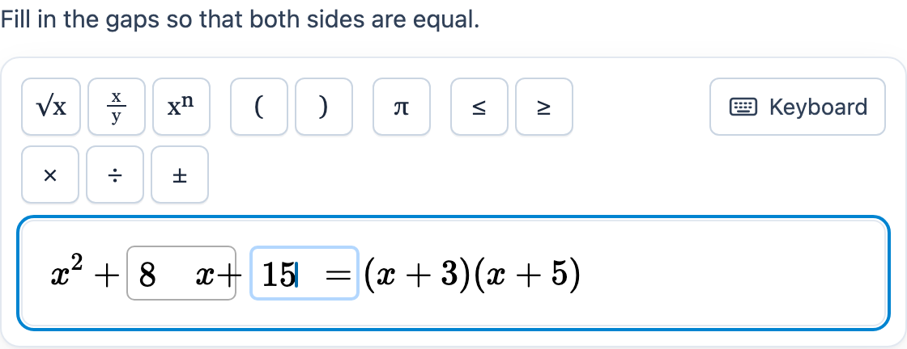

# @citolab/pci-math-entry

A QTI 3 Portable Custom Interaction (PCI) in which the candidate types a math formula ("solve for x"), or fills in the
gaps of an expression the author wrote ("x² + ▢x + ▢ = (x + 3)(x + 5)"). A toolbar holds the symbols the author
enabled, and an on-screen keyboard helps on touch screens. The response is LaTeX. Made with
[tspci](https://github.com/Citolab/tspci) and [MathLive](https://mathlive.io).

<p align="center">
  
</p>

## Source and licence

This PCI is a port of the **mathEntryInteraction** PCI of TAO:
[oat-sa/extension-tao-itemqti-pci](https://github.com/oat-sa/extension-tao-itemqti-pci/tree/develop/views/js/pciCreator/ims/mathEntryInteraction),
© 2016-2022 [Open Assessment Technologies SA](https://www.taotesting.com) (original author Christophe Noël), licensed
under the GNU General Public License version 2 only (`GPL-2.0-only`, as in the repository's `composer.json` and the
"version 2 of the License (non-upgradable)" headers of its source files).

Because it is a derivative work, **this example is licensed under `GPL-2.0-only` as well** (see [LICENSE](LICENSE)),
unlike the other examples in this repository, which are MIT. Modified by Stichting Cito Instituut voor
Toetsontwikkeling, 2026. What changed:

- **Ported to an IMS PCI made with tspci** (Preact, Tailwind, `@citolab/preact-store`) instead of a TAO-only AMD
  module with jQuery, lodash and TAO's creator widgets. It runs in any QTI 3 delivery system and in TAO
  (`npm run package-tao`).
- **MathLive instead of MathQuill**, and MathLive's on-screen keyboard: a number pad, the author's tools and letters.
- **A modern, responsive UI**: a toolbar with one tab stop (arrow keys move between the buttons), every button with a
  label for screen readers, an on-screen-keyboard button, English and Dutch texts.
- **Authoring mode** for the expression with gaps, in place of TAO's own creator state.
- The settings, the response format (LaTeX, or the gaps as a JSON array) and the response processing are kept, so
  items keep their meaning. See [Differences with the original](#differences-with-the-original).

Third-party: [MathLive](https://github.com/arnog/mathlive) 0.111.1 by Arno Gourdol, MIT licence, is bundled into
`dist/index.js` together with its KaTeX fonts (MIT); it is listed in `dist/sbom.cdx.json`.

## What it does

- **Free mode**: the candidate types a formula. Typing works as on paper (`/` starts a fraction, `^` an exponent);
  the toolbar inserts the author's symbols where the cursor is, around what is selected.
- **Gap mode** (`useGapExpression`): the author's expression is read only, and the candidate types in its gaps. The
  toolbar inserts into the gap the candidate is in. Gap size small, medium or large, as the original.
- **Keyboard**: the keyboard button shows MathLive's on-screen keyboard with a number pad, the enabled tools and
  letters. The physical keyboard always works.
- **Authoring mode**: "Write the expression with gaps…" opens a formula editor (`getAuthoringInstance`) with an
  **Insert gap** button; it writes `data-gap-expression` with `\taoGap` for every gap, as the original's TAO creator
  did. It needs at least one gap.
- **Delivery**: the response is saved as the item's state and restored; states saved by the original
  (`{ "response": { "base": { "string": … } } }`) are read too. In review (`status: "review"`, `"solution"` or
  `data-is-review-mode="true"`) the formula and the gaps are read only; in `"solution"` the PCI shows the correct
  response when the delivery system passes it.

## What can be configured

Every setting is a `data-` attribute of the interaction, as text, under the original's names. `dist/authoring.json`
describes them for authoring systems.

| setting | attribute | default | what |
| --- | --- | --- | --- |
| Instruction above the formula | `data-prompt` | `Solve for x: …` | new; leave empty when the item has its own prompt |
| Language | `data-language` | `en` | `en` or `nl`: the buttons and the texts for screen readers |
| Authorize white space | `data-authorize-white-space` | `false` | the space bar types a space; otherwise it is ignored |
| Use an expression with gaps | `data-use-gap-expression` | `false` | gap mode |
| Expression with gaps | `data-gap-expression` | `x^2+\taoGap x+\taoGap=(x+3)(x+5)` | LaTeX, `\taoGap` per gap, `\taoBr` a line break; written by the authoring mode |
| Gap size | `data-gap-style` | `math-gap-small` | `math-gap-small`, `math-gap-medium`, `math-gap-large` |
| Toolbar buttons | `data-tool_frac`, `data-tool_sqrt`, … | see below | `true` shows the button (54 tools) |
| (hidden) | `data-gap-response-is-json` | `true` | `false`: gaps separated by commas, for items made before the original's 3.0.0 |
| (hidden) | `data-is-review-mode` | `false` | read only |
| (hidden) | `data-allow-new-line`, `data-enable-auto-wrap` | `false` | experimental in the original; accepted, not supported (below) |

The tools, in the original's groups: **functions** `sqrt` `frac` `exp` `subscript` `log` `ln` `limit` `sum`
`nthroot`; **symbols** `e` `infinity` `lparen` `rparen` `lbrace` `rbrace` `lbrack` `rbrack` `integral` `colon` `to`
`degree` `percent`; **geometry** `angle` `triangle` `similar` `paral` `perp` `vline`; **trigonometry** `pi` `sin`
`cos` `tan`; **comparison** `lower` `greater` `lte` `gte` `approx`; **operators** `equal` `plus` `minus` `times`
`timesdot` `divide` `plusminus` `inmem` `ninmem` `union` `intersec` `congruent` `subset` `superset` `contains`;
**matrix** `matrix_2row` `matrix_2row_2col`. The original starts with none enabled; this example enables `sqrt`,
`frac`, `exp`, `lparen`, `rparen`, `pi`, `lte`, `gte`, `times`, `divide` and `plusminus`.

## Scoring

The PCI is made for `match_correct` (`authoring.json`: `"scoring": ["match_correct", "custom", "human"]`).

**The response** is a string (`cardinality="single" base-type="string"`), as in the original:

- free mode: the formula as LaTeX, `x=-\frac{12}{5}`;
- gap mode: the gaps as a JSON array of LaTeX strings, `["8","15"]` (or `8,15` with
  `data-gap-response-is-json="false"`).

Full-width digits and the dashes that look like a minus are written as ASCII (`１２` → `12`, `−` → `-`), as the
original did.

- **Setting the correct response**: answer the PCI. In TAO switch the interaction to *Response* and type the answer;
  in qti-construction or the dev page, type it and take it as the correct response.
- **What counts**: the exact LaTeX string. `2x` and `x\cdot2` are different answers; MathLive writes the LaTeX the way
  MathQuill did where they differ (`\sqrt{3}`, `e^x`, `\frac{1}{}` for an empty slot), but set the correct response
  of an item made for the original again by answering this PCI and check it.
- **More than one correct answer, or partial scores**: the original's TAO creator wrote a `map_response` with
  alternatives and scores per answer. Use `custom` and write that mapping in the item's response processing
  (`<qti-mapping>` with a `<qti-map-entry>` per accepted string).
- **No response**: until the candidate types something (in gap mode: fills in a gap), `getResponse()` reports
  nothing.
- `human`: use the PCI without automatic scoring, for instance for a human rater.

## Differences with the original

- The original's `\taoBr` line breaks in a gap expression are shown as lines; typing a line break
  (`allowNewLine`) and automatic wrapping of long formulas (`enableAutoWrap`), both experimental in the original, are
  not supported. The settings are accepted and ignored.
- MathML in the prompt is not converted to rendered math (the original's `mathInPrompt`): in QTI 3 the prompt
  belongs to the item, which renders its own MathML.
- The Japanese-specific behaviour (a vertical fraction button, `≦`/`≧`, the cursor in the denominator) and TAO's
  editor for alternative answers and their scores are not ported.

## Using it

```sh
npm install @citolab/pci-math-entry
```

| file | what |
| --- | --- |
| `dist/index.js` | the PCI (AMD module, everything bundled, MathLive and its fonts too: the package has no dependencies) |
| `dist/authoring.json` | settings, response, scoring and the authoring mode, for authoring systems |
| `dist/sbom.cdx.json` | CycloneDX SBOM of the bundle |
| `dist/tao-pci-mathEntry_<version>.zip` | the PCI for TAO: Settings → Portable Custom Interactions → Add |
| `mathEntry.svg`, `example.png` | icon and screenshot |

In a QTI 3 item, with `index.js` at `resources/pci/index.js` of the package:

```xml
<qti-response-declaration identifier="RESPONSE" cardinality="single" base-type="string">
  <qti-correct-response><qti-value>["8","15"]</qti-value></qti-correct-response>
</qti-response-declaration>
…
<qti-portable-custom-interaction response-identifier="RESPONSE" module="pci" custom-interaction-type-identifier="mathEntry"
  data-use-gap-expression="true" data-gap-expression="x^2+\taoGap x+\taoGap=(x+3)(x+5)" data-gap-style="math-gap-medium"
  data-tool_sqrt="true" data-tool_frac="true">
  <qti-interaction-modules>
    <qti-interaction-module id="pci" primary-path="../resources/pci/index"></qti-interaction-module>
  </qti-interaction-modules>
  <qti-interaction-markup></qti-interaction-markup>
</qti-portable-custom-interaction>
```

The build first runs `scripts/mathlive-fonts.mjs`, which writes `src/mathlive-fonts.generated.ts` (MathLive's KaTeX
fonts as data URLs): the PCI is a single file and cannot load fonts from a folder next to it.

Source and the other examples: [Citolab/tspci-examples](https://github.com/Citolab/tspci-examples).
