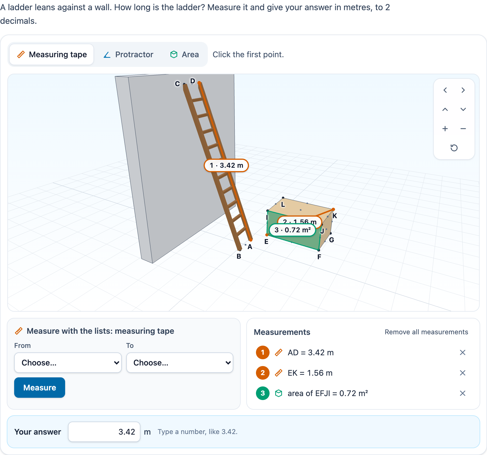

# @citolab/pci-measure-3d

> [!WARNING]
> **Experimental (alpha). Just for inspiration.** This PCI is a technical showcase, made by software developers without
> much knowledge of the subject it could be used for. Its content, terms and scoring have not been checked by subject
> experts or assessment specialists, and it has never been used in an assessment. It is offered as is, without any
> warranty.

A QTI 3 Portable Custom Interaction (PCI) for measuring in 3D ("meten in de ruimte"): a scene of simple objects (a
box or room, a ramp, a roof, a cylindrical tank, stairs, a ladder against a wall) and three tools: a measuring tape
between two points, a protractor on three points and an area tool for a face. The candidate answers "how long is the
ladder", "measure the space diagonal of the box" or "what is the slope angle of the ramp" with a typed value that is
scored with a margin. Or the PCI is a tool and the answer goes elsewhere in the item. The item author composes the
scene, names the points and sets the task in the PCI itself. Made with [tspci](https://github.com/Citolab/tspci).

<p align="center">
  
</p>

## What it does

- **A scene made of numbers**: every object is built in code from its type and its sizes (no models to download).
  Its vertices are the measurable points, named A, B, C … in the order of the objects (or as the author names them).
  The midpoints of the edges and the centres of the faces can be measured too. An object can be scenery (a wall): it
  is drawn, but has no points.
- **The tools**: the *measuring tape* (click two points), the *protractor* (a point on the first arm, the vertex, a
  point on the second arm) and the *area* tool (click a face). A click snaps to the nearest vertex, midpoint or centre
  within 14 pixels that is not hidden. Without one, it is a point on the face that was clicked. Picking is by
  raycasting. Each measurement is drawn as a dimension line (an arc, a coloured face) with a numbered label, and is
  listed with its value: "AD = 3.42 m", "∠CDF = 14°", "area of IJKL = 0.96 m²".
- **Exact or as a ruler** (`data-reading`): exact values with `data-decimals` decimals, or a tape with a tick every
  `data-tick-step` and a protractor with a tick every `data-angle-step` degrees. In ruler mode the value reads
  "between 3.4 and 3.5 m", so the candidate reads off and rounds.
- **Scale** ("schaal"): `data-scale` says what one unit of the scene is in `data-unit`. By default the tools apply it.
  With `data-tool-scale="false"` they read units, the scale is shown ("Scale: 1 unit = 50 cm") and the candidate
  converts.
- **Turning the scene**: drag (mouse, one finger) to turn and pinch or scroll to zoom. The buttons turn and zoom too.
  With the focus on the scene, the arrow keys turn it (Shift for 45°), + and − zoom, and Home goes back to the start.
- **Without a pointer**: every measurement can also be made with lists. For the tape these are *From* and *To*, for
  the protractor *First arm*, *Vertex* and *Second arm*, and for the area tool *Face*. The lists group the vertices,
  midpoints ("midpoint of AB") and centres of faces.
- **Accessible**: the scene is an application with a name and instructions. Every measurement is announced in a live
  status ("Measured: AD = 3.42 m."), and so is every step of one in progress ("A. Click the second point."). The
  colours are Okabe-Ito (colour-blind safe), and each measurement also has a number, an icon and a text. Labels in
  the scene are plain text. There are no animations, so `prefers-reduced-motion` has nothing to stop.
- **Without WebGL**: a clear message instead of the scene, and the lists still measure everything.
- **The answer** (answer mode): a text field that only takes a number ("3,42" in Dutch, "3.42" in English), with the
  unit of the task (m, m², m³ or °).
- **Dutch** (`data-language="nl"`): the texts, the tools (Meetlint, Gradenboog, Oppervlakte) and `3,42 m`. The response
  is the same in every language.
- **Authoring mode**: "Compose the scene…" in an authoring system that supports it (`getAuthoringInstance`). The
  *Scene* tab adds objects (type, id, name, sizes, position, rotation, measurable), the *Point names* tab gives
  vertices their own names, and the *Task* tab sets the mode, the tools, what the candidate measures (pick the points
  in the preview or in the lists) and the margin. It shows the correct answer, computed from the geometry, and the
  response processing for the item. `validate()` reports, in the author's language: no objects to measure, no task in
  answer mode, points that are not in the scene, a ladder's volume, duplicate names, and a required measurement whose
  tool is not given.
- **Delivery**: the measurements and the answer are the item's state (every step in the log) and are restored. In
  review (`status: "solution"`) the PCI shows the correct answer and draws the task's measurement, dashed. The PCI
  frees its WebGL context on `oncompleted`, and also when the page removes it.
- **Several on a page**: each interaction gets its own instance, store, scene and settings.

## What can be configured

Every setting is a `data-` attribute of the interaction, as text. `dist/authoring.json` describes them for authoring
systems.

| setting                 | attribute                  | default               | what                                                                    |
| ----------------------- | -------------------------- | --------------------- | ----------------------------------------------------------------------- |
| Instruction             | `data-prompt`              | the ladder question   | the example's is translated                                             |
| Scene                   | `data-scene`               | empty: the example    | written by the authoring mode, as JSON (below)                          |
| Task                    | `data-target`              | empty: the ladder     | written by the authoring mode, as JSON (below)                          |
| Mode                    | `data-mode`                | `answer`              | `answer`: the candidate types the value; `tool`: the answer is elsewhere |
| Tools                   | `data-tools`               | `tape,protractor,area`| any of them, comma separated                                            |
| Reading                 | `data-reading`             | `exact`               | `exact` or `ruler`                                                      |
| Decimals                | `data-decimals`            | `2`                   | 0 to 4 for lengths and areas; angles get one less                       |
| Ruler: tick every       | `data-tick-step`           | `0.1`                 | in the unit                                                             |
| Protractor: tick every  | `data-angle-step`          | `5`                   | degrees                                                                 |
| Unit                    | `data-unit`                | `m`                   | the unit of length (areas m², volumes m³)                               |
| Scale                   | `data-scale`               | `1`                   | one unit of the scene in the unit                                       |
| Tools apply the scale   | `data-tool-scale`          | `true`                | `false`: the tools read units, the candidate converts                   |
| Show the scale          | `data-show-scale`          | `false`               | always shown when the tools do not apply it                             |
| Margin                  | `data-margin`              | `0.05`                | in the unit of the answer; for the response processing and PCI scoring  |
| Scoring                 | `data-scoring`             | `margin`              | `margin`: a float; `pci`: a record with a score (below)                 |
| Require the measurement | `data-require-measurement` | `false`               | PCI scoring: 1 point only when the right measurement was made too       |
| Names of the vertices   | `data-show-point-labels`   | `true`                | in the scene; the lists always have them                                |
| Height                  | `data-height`              | `420`                 | of the scene, in pixels                                                 |
| Language                | `data-language`            | `en`                  | `en` or `nl`                                                            |

```json
{
  "objects": [
    { "id": "wall", "type": "box", "name": "Wall", "size": { "width": 0.3, "depth": 3, "height": 3.4 }, "position": [-0.3, 0, -1.5], "measurable": false },
    { "id": "ladder", "type": "ladder", "size": { "reach": 1.2, "height": 3.2, "width": 0.45 }, "position": [1.2, 0, 0], "rotation": 180 }
  ],
  "names": { "ladder.v0": "P" }
}
```

`data-scene`: the objects with their sizes in the units of the scene. y is up. `position` is the corner with the
smallest x, y and z (the middle of the bottom of a tank, the middle of the foot of a ladder), and `rotation` is in
degrees about the vertical axis. The types and their sizes:

| type       | sizes                                    | volume                         |
| ---------- | ---------------------------------------- | ------------------------------ |
| `box`      | `width` (x), `depth` (z), `height`       | w · d · h                      |
| `ramp`     | `length` (x), `width` (z), `height` at the high end | l · w · h / 2         |
| `prism`    | `length` (x), `width` (z), `height` of the ridge (a roof) | l · w · h / 2   |
| `cylinder` | `radius`, `height` (a tank)              | π r² h                         |
| `stairs`   | `steps`, `run`, `rise`, `width`          | width · run · rise · n(n+1)/2  |
| `ladder`   | `reach` (to the wall), `height`, `width` | none                           |

Point ids are `<object>.v<n>` (vertices), `<object>.e<a>-<b>` (midpoints), `<object>.f<n>.c` (centres), and for a
tank `.b0`–`.b3`, `.t0`–`.t3`, `.top` and `.bottom`. Faces are `<object>.f<n>`, or `.top`, `.bottom` and `.side`
for a tank. The authoring mode shows them.

`data-target`: `{ "kind": "length", "points": ["ladder.v0", "ladder.v3"] }`,
`{ "kind": "angle", "points": ["ramp.v2", "ramp.v3", "ramp.v5"] }` (at the middle point),
`{ "kind": "area", "face": "crate.f1" }` or `{ "kind": "volume", "object": "crate" }`. The PCI computes the correct
value from the geometry, with the scale applied: lengths × scale, areas × scale², volumes × scale³. The task is in
the item's markup, where a curious candidate could read it, but so is the scene the answer follows from.

## Scoring

The PCI is made for `match_correct` with a margin, and optionally `custom` (`authoring.json`:
`"scoring": ["match_correct", "custom", "human"]`). It can tell its correct response from its settings
(`"correctResponse": "properties"`): `getCorrectResponse(properties)` is the value from the geometry, to 4 decimals.

**Answer mode, `data-scoring="margin"`**: the response is `cardinality="single" base-type="float"`, the typed value
(`3.42`), or no response until it is a number. Two candidates who read the same ladder type 3.41 and 3.42, so the
item compares with a margin (`AUTHORING.md`: "Margins live in the item"). The authoring mode writes this:

```xml
<qti-response-declaration identifier="RESPONSE" cardinality="single" base-type="float">
  <qti-correct-response><qti-value>3.4176</qti-value></qti-correct-response>
</qti-response-declaration>
<qti-outcome-declaration identifier="SCORE" cardinality="single" base-type="float">
  <qti-default-value><qti-value>0</qti-value></qti-default-value>
</qti-outcome-declaration>
<qti-outcome-declaration identifier="MAXSCORE" cardinality="single" base-type="float">
  <qti-default-value><qti-value>1</qti-value></qti-default-value>
</qti-outcome-declaration>
<qti-response-processing>
  <qti-response-condition>
    <qti-response-if>
      <qti-equal tolerance-mode="absolute" tolerance="0.05">
        <qti-variable identifier="RESPONSE"/>
        <qti-correct identifier="RESPONSE"/>
      </qti-equal>
      <qti-set-outcome-value identifier="SCORE"><qti-base-value base-type="float">1</qti-base-value></qti-set-outcome-value>
    </qti-response-if>
  </qti-response-condition>
</qti-response-processing>
```

3.37 to 3.47 is correct. Without a response, `qti-equal` is NULL: 0 points.

**Answer mode, `data-scoring="pci"`** (`custom`): the response is a record, scored by the PCI with `data-margin`:

| field          | type    | what                                                                            |
| -------------- | ------- | ------------------------------------------------------------------------------- |
| `score`        | integer | 1 when the value is within the margin (and, with `data-require-measurement`, the right measurement was made) |
| `maxscore`     | integer | 1                                                                               |
| `correct`      | integer | 1 when the value is within the margin                                           |
| `measured`     | integer | 1 when the task's measurement was made (below)                                  |
| `value`        | float   | the typed value                                                                 |
| `measurements` | string  | the measurements, as in tool mode                                               |

The right measurement: for a length, the tape between the two points (either way); for an angle, the protractor with
the same vertex and the same two arms; for an area, that face; for a volume, at least one length on the object. A
point on a face counts when it is exactly at the named point. The response processing sets
`SCORE` to `<qti-field-value field-identifier="score">`; the authoring mode shows it too.

**Tool mode** (`human`): the measurements as a JSON string (declare the response `single`/`string`), for research:

```json
{ "unit": "m", "scale": 1, "measurements": [
  { "tool": "tape", "points": [{ "id": "crate.v0" }, { "id": "crate.v6" }], "names": ["E", "K"], "value": 1.562 },
  { "tool": "area", "face": "crate.f1", "names": ["IJKL"], "value": 0.96 }
] }
```

A point on a face (a click away from any vertex) is `{ "face": "crate.f1", "pos": [x, y, z] }`, named
`@crate.f1`. `value` is in the unit (or `"units"` without the scale) to 4 decimals, angles in degrees. In ruler mode there is also
`reading: [low, high]`. The same rules are in `src/geometry.ts` (`correctValue`, `madeTarget`) and `src/scoring.ts`
(`scoreAnswer`, `responseProcessingXml`), where `npm test` checks them.

## Using it

```sh
npm install @citolab/pci-measure-3d
```

| file                                     | what                                                                      |
| ---------------------------------------- | ------------------------------------------------------------------------- |
| `dist/index.js`                          | the PCI (AMD module, everything bundled, three.js too: no dependencies)   |
| `dist/authoring.json`                    | settings, response, scoring and the authoring mode, for authoring systems |
| `dist/sbom.cdx.json`                     | CycloneDX SBOM of the bundle                                              |
| `dist/tao-pci-measure3d_<version>.zip`   | the PCI for TAO: Settings → Portable Custom Interactions → Add            |
| `measure3d.svg`, `example.png`           | icon and screenshot                                                       |

In a QTI 3 item, with `index.js` at `resources/pci/index.js` of the package:

```xml
<qti-response-declaration identifier="RESPONSE" cardinality="single" base-type="float">
  <qti-correct-response><qti-value>3.4176</qti-value></qti-correct-response>
</qti-response-declaration>
…
<qti-portable-custom-interaction response-identifier="RESPONSE" module="pci" custom-interaction-type-identifier="measure3d"
  data-language="nl" data-margin="0.05">
  <qti-interaction-modules>
    <qti-interaction-module id="pci" primary-path="../resources/pci/index"></qti-interaction-module>
  </qti-interaction-modules>
  <qti-interaction-markup></qti-interaction-markup>
</qti-portable-custom-interaction>
```

Source and the other examples: [Citolab/tspci-examples](https://github.com/Citolab/tspci-examples).
