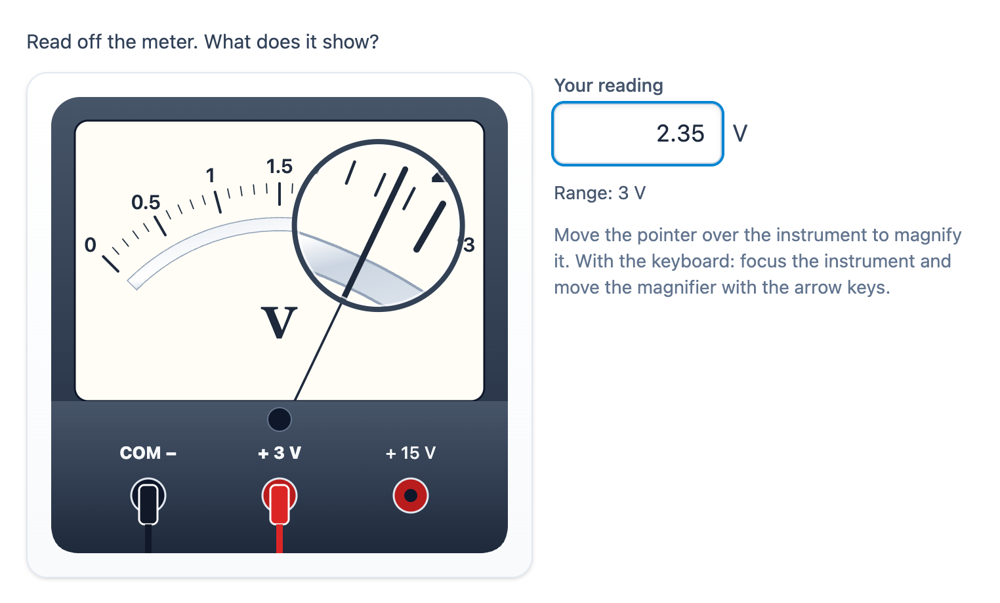

# @citolab/pci-measuring-instrument

> [!WARNING]
> **Experimental (alpha). Just for inspiration.** This PCI is a technical showcase, made by software developers without
> much knowledge of the subject it could be used for. Its content, terms and scoring have not been checked by subject
> experts or assessment specialists, and it has never been used in an assessment. It is offered as is, without any
> warranty.

A QTI 3 Portable Custom Interaction (PCI) with measuring instruments as they are used in physics, nask, care and
technology lessons: a thermometer, a measuring cylinder, a voltmeter or ammeter, a kitchen scale, a ruler, a vernier
caliper, a clock, a stopwatch and a tyre pressure gauge. The candidate **reads off** the instrument and types the value,
**sets** it to a given value by dragging the liquid, the needle or the jaw, or **chooses the range** of a meter for a
value they expect. The item author picks the instrument, sets up its scale and drags the value on a live preview, in
the PCI itself. Made with [tspci](https://github.com/Citolab/tspci).

<p align="center">
  
</p>

## What it does

- **The instruments**, hand-drawn in SVG, realistic but clean:
  - **thermometer** (°C): a red liquid column, labelled every 10 °C with 1 °C divisions and a middle tick;
  - **measuring cylinder** (mL): the liquid with a **meniscus** that bends up at the glass, read at its bottom;
  - **meter** (V, A or mA, by its unit): a mirror scale on a 90° arc, terminals for COM and every **range**, the leads
    plugged in; the scale and its divisions follow from the range (3 V: 0.5 and 0.1; 15 V: 5 and 0.5);
  - **kitchen scale** (g): a round dial from 0 to its maximum, as a letter scale or a kitchen scale;
  - **ruler** (cm): a pencil lying with its end on the 0;
  - **vernier caliper** (mm): a main scale in mm numbered in cm, a **vernier** of 10, 20 or 50 divisions (0.1, 0.05,
    0.02 mm) and a block between the jaws;
  - **clock**: an hour hand and a minute hand;
  - **stopwatch** (s): the big hand once round per minute in 0.2 s, a small dial for the minutes;
  - **pressure gauge** (bar): a brass tyre pressure gauge on a 270° dial.
- **Read off** (`data-mode="read"`): the instrument shows `data-value`, the candidate types what they read in a field
  with the unit next to it. The field takes only what makes a number: in Dutch a point becomes a decimal comma, in
  English a comma becomes a point; a minus only on a scale below 0. A clock is read as `h:mm` (`10.35` becomes `10:35`).
- **Set** (`data-mode="set"`): the candidate drags on the instrument (the liquid level, the needle, the pencil point,
  the jaw, the minute hand) and the value snaps to the reading precision. The hand of a clock or a stopwatch goes on
  into the next hour or minute when dragged past the top. Nothing is set until the candidate moves it.
- **Choose the range** (`data-mode="range"`, a meter): "you expect about 4.5 V: which range do you choose?" The
  candidate chooses one of `data-ranges` with buttons; the lead goes into that socket and the scale changes with it.
  The needle stays at 0: the meter is not connected yet.
- **The magnifier** (`data-zoom`): a lens of 2.5× follows the pointer over the instrument. With the keyboard: Tab to the
  instrument, the lens is at the reading point; the arrow keys move it (Shift for bigger steps), Escape hides it.
- **Keyboard**: in set mode the instrument is a **slider** (`role="slider"` with `aria-valuemin`, `-max`, `-now` and a
  value text with the unit, "25 °C", "10:35"): the arrow keys move one reading step, Page Up and Page Down a labelled
  step (an hour on a clock, 5 s on a stopwatch), Shift + arrow too, Home and End the ends. The range buttons are a radio
  group with the arrow keys.
- **Accessible**: the drawing has a name with the instrument and its scale ("Thermometer, scale from −10 to 50 °C"),
  never its value; the answer field is named with its unit ("Your reading (°C)"); every change is announced in a live
  region ("Set to 25 °C.", "Range 15 V chosen.", "Your reading: 18 °C."). Nothing is told by colour only: the plugged
  socket has a lead in it and a bold label, the chosen range a filled dot. The magnifier's fade is off with
  `prefers-reduced-motion`. Reading off a drawn scale is a visual task: in set mode a screen reader hears the value it
  sets; for read mode a blind candidate needs an adapted item.
- **Dutch** (`data-language="nl"`): the texts, the instruments' names (maatcilinder, schuifmaat,
  bandenspanningsmeter, stroommeter) and `2,4 V` on the scales and in the field. The response is the same in every
  language.
- **Authoring mode**: the item author sets everything up in the PCI (`getAuthoringInstance`), via "Configure…" ("Set
  up the instrument…") in an authoring system that supports it (qti-construction, TAO with tspci-tao, the dev page):
  the instrument, the task, the scale (from, to, labelled every, divisions, unit, reading precision; ranges for a
  meter, the vernier for a caliper) and the margin. The value is **dragged on the live preview** (or typed); the panel
  shows the correct response and the response processing for the item. `validate()` reports, in the author's
  language: a scale that ends below its start, a labelled step that does not fit, too many divisions, a value off the
  scale or between reading steps, a range task on another instrument, fewer than two ranges, or no range large enough.
- **Delivery**: what the candidate typed, set or chose is saved as the item's state (every step in the log) and
  restored. `boundTo` and `setResponse` show a response. In review (`status: "solution"`) the PCI shows the correct
  response from the response declaration, or else the one from its settings, read-only.
- **Several on a page**: each interaction gets its own instance, store and settings.

## What can be configured

Every setting is a `data-` attribute of the interaction, as text. `dist/authoring.json` describes them for authoring
systems. Empty means the instrument's own (in the table: the thermometer's).

| setting              | attribute         | default           | what                                                                    |
| -------------------- | ----------------- | ----------------- | ----------------------------------------------------------------------- |
| Instruction          | `data-prompt`     | empty             | empty: a question for the instrument and the task, translated; in set mode with the value |
| Instrument           | `data-instrument` | `thermometer`     | `thermometer`, `cylinder`, `meter`, `scale`, `ruler`, `caliper`, `clock`, `stopwatch`, `manometer` |
| Task                 | `data-mode`       | `read`            | `read`, `set` or `range` (a meter only; otherwise `read`)               |
| Scale from, to       | `data-min`, `data-max` | `-10`, `50`  | the printed scale; not for a meter (0 to its range), a clock or a stopwatch |
| Labelled every       | `data-major`      | `10`              | a number at every …; it must fit a whole number of times                |
| Divisions            | `data-minor`      | `10`              | divisions between two numbers (10: every 1 °C); a middle tick at 5      |
| Unit                 | `data-unit`       | `°C`              | `V`, `mV`, `A` or `mA` make a meter a voltmeter or an ammeter           |
| Value                | `data-value`      | `18`              | shown (read), to set (set) or expected (range); a clock: minutes after 12 o'clock (635 is 10:35) |
| Reading precision    | `data-precision`  | one division      | the step of dragging and the keyboard; the value must be a multiple     |
| Ranges               | `data-ranges`     | `3 15`            | a meter: the ranges, separated by spaces                                |
| Range plugged in     | `data-range`      | the best          | a meter in read and set mode; empty: the smallest range the value fits  |
| Vernier              | `data-vernier`    | `10`              | a caliper: `10`, `20` or `50` divisions                                 |
| Magnifier            | `data-zoom`       | `true`            | the lens on hover and focus                                             |
| Margin               | `data-tolerance`  | `0`               | for the response processing the authoring mode writes; delivery ignores it |
| Language             | `data-language`   | `en`              | `en` or `nl`: texts and numbers                                         |

The other instruments: cylinder 0–50 mL (1 mL), meter 0–3 V (0.1 V), scale 0–1000 g (10 g), ruler 0–15 cm (1 mm),
caliper 0–60 mm (0.1 mm), clock (1 minute), stopwatch 0–30 min (0.2 s), pressure gauge 0–4 bar (0.1 bar).

## Scoring

The PCI is made for `match_correct`, or for `custom` response processing with a margin (`authoring.json`:
`"scoring": ["match_correct", "custom", "human"]`, `"tolerance": "range"`), and can tell its correct response from its
settings (`"correctResponse": "properties"`, `getCorrectResponse`): the value in read and set mode, the best range (the
smallest one the value fits in) in range mode.

**The response** is `cardinality="single" base-type="float"`, in the unit of the instrument and the same in every
language:

| task    | the response                                  | example                                             |
| ------- | --------------------------------------------- | --------------------------------------------------- |
| `read`  | the number the candidate typed                | `18.5` for "18,5"; a clock: minutes, `635` for 10:35 |
| `set`   | the value set, on a reading step              | `25`; a stopwatch: seconds, `83.4`                  |
| `range` | the range chosen                              | `15`                                                |

Nothing typed (or something that is not a number yet, such as `-`), nothing set or nothing chosen is no response.

**Exact**: with set mode (always on a reading step) or a range, the exact match works. The correct response is the
value from the settings:

```xml
<qti-response-declaration identifier="RESPONSE" cardinality="single" base-type="float">
  <qti-correct-response><qti-value>18</qti-value></qti-correct-response>
</qti-response-declaration>
…
<qti-response-processing template="https://purl.imsglobal.org/spec/qti/v3p0/rptemplates/match_correct.xml"/>
```

**A margin**: reading off has a reading error, so a rubric often accepts half a division either way (18 °C ± 0.5).
The margin lives in the item's response processing, not in the PCI (`AUTHORING.md`: "Margins live in the item"). The
authoring mode writes it for the author's margin (`data-tolerance`), under "Response processing for the item":

```xml
<qti-response-processing>
  <qti-response-condition>
    <qti-response-if>
      <qti-equal tolerance-mode="absolute" tolerance="0.5">
        <qti-variable identifier="RESPONSE"/>
        <qti-correct identifier="RESPONSE"/>
      </qti-equal>
      <qti-set-outcome-value identifier="SCORE">
        <qti-base-value base-type="float">1</qti-base-value>
      </qti-set-outcome-value>
    </qti-response-if>
  </qti-response-condition>
</qti-response-processing>
```

`qti-equal` includes both bounds by default, so 17.5 and 18.5 count. Without a response, `RESPONSE` is NULL and the
score stays 0. The same rules are in `src/instrument.ts` (`isCorrect`, `responseProcessingXml`), where `npm test`
checks them.

- **Setting the correct response**: an authoring system that supports `"correctResponse": "properties"` fills it from
  `data-value` (and `data-ranges` in range mode); otherwise answer the PCI (the dev page, TAO's *Response*).
- **The value must be visible**: in read mode the instrument shows it, in set mode the default prompt says it, in range
  mode the prompt says the expected value. With a prompt of your own, put the value in it.
- `human`: use the PCI without automatic scoring, for practice.

## Using it

```sh
npm install @citolab/pci-measuring-instrument
```

| file                                               | what                                                                      |
| -------------------------------------------------- | ------------------------------------------------------------------------- |
| `dist/index.js`                                    | the PCI (AMD module, everything bundled: the package has no dependencies) |
| `dist/authoring.json`                              | settings, response, scoring and the authoring mode, for authoring systems |
| `dist/sbom.cdx.json`                               | CycloneDX SBOM of the bundle                                              |
| `dist/tao-pci-measuringInstrument_<version>.zip`   | the PCI for TAO: Settings → Portable Custom Interactions → Add            |
| `measuringInstrument.svg`, `example.png`           | icon and screenshot                                                       |

In a QTI 3 item, with `index.js` at `resources/pci/index.js` of the package:

```xml
<qti-response-declaration identifier="RESPONSE" cardinality="single" base-type="float">
  <qti-correct-response><qti-value>15</qti-value></qti-correct-response>
</qti-response-declaration>
…
<qti-portable-custom-interaction response-identifier="RESPONSE" module="pci" custom-interaction-type-identifier="measuringInstrument"
  data-instrument="meter" data-mode="range" data-value="4.5" data-ranges="3 15 30" data-language="nl">
  <qti-interaction-modules>
    <qti-interaction-module id="pci" primary-path="../resources/pci/index"></qti-interaction-module>
  </qti-interaction-modules>
  <qti-interaction-markup></qti-interaction-markup>
</qti-portable-custom-interaction>
```

Source and the other examples: [Citolab/tspci-examples](https://github.com/Citolab/tspci-examples).
