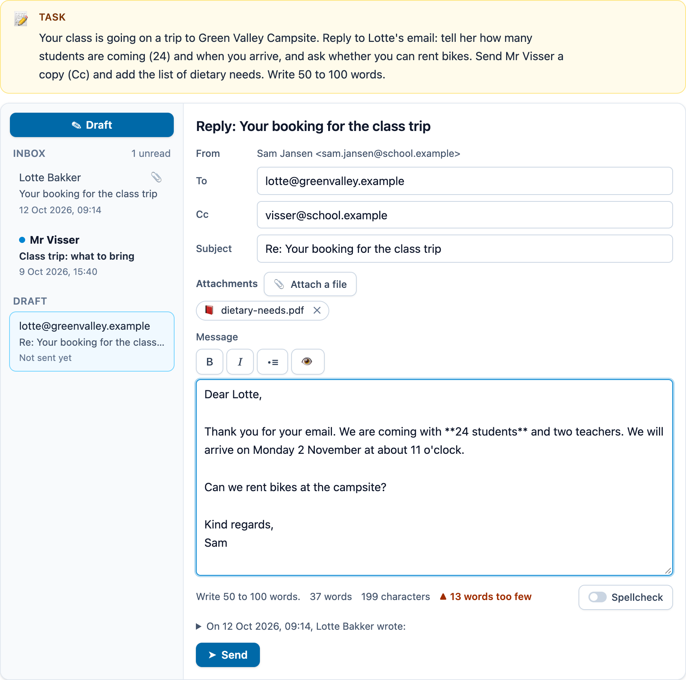

# @citolab/pci-message-writing

> [!WARNING]
> **Experimental (alpha). Just for inspiration.** This PCI is a technical showcase, made by software developers without
> much knowledge of the subject it could be used for. Its content, terms and scoring have not been checked by subject
> experts or assessment specialists, and it has never been used in an assessment. It is offered as is, without any
> warranty.

A QTI 3 Portable Custom Interaction (PCI) in which the candidate writes in a realistic communication environment: they
reply to an email in a mail client, chat in a class chat whose scripted messages react to what they write, or reply to
a forum thread or social-media post. Made for language skills in context (Dutch, English, German, French; "write an
email to …", "reply to the customer", "post a message in the class chat"). A human rater scores the message by
default; the PCI can also score the objective parts itself (the right recipient, the attachment, the word count,
required words, a greeting and a closing). The item author writes the scenario in the PCI itself. Made with
[tspci](https://github.com/Citolab/tspci).

<p align="center">
  
</p>

## What it does

- **Three environments** (`data-environment`):
  - **Email** (`email`): a mailbox with the inbox (sender, subject, date, unread marks, a paperclip for attachments),
    a message opened (From, To, Cc, date, the text, attachments as named files with an optional image preview), and the
    candidate's message: From, To and Cc (addresses, or names from the address book; suggestions from the address book
    and the inbox), Subject, attachments chosen from the author's files, and the text with simple formatting.
    **Reply** fills To and `Re: subject`, **Reply all** also the Cc, and keeps the original as a quote under the text.
    **Send** (only with a recipient) shows the message as sent; **Edit the message** reopens it. The author can let the
    candidate start in the inbox, with a new message, or with a reply already open.
  - **Chat** (`chat`): a conversation with scripted messages. Each step of the script brings one or more messages
    ("Noor is typing…" first, `data-chat-delay` milliseconds each), then waits for the candidate's reply; the reply
    picks the next step by keywords (`drink*|lemonade` → "drinks"), or else the step's default. A step can end the chat.
    After the script, the candidate can still write; nobody answers. `Enter` sends, `Shift` + `Enter` starts a new line.
  - **Post** (`post`): a forum thread (title, a first post and replies) or a social-media feed, and a reply box. With a
    character limit the Post button stays off while the text is too long, as on a real platform; **Edit** reopens a
    placed post.
- **Formatting** (email and forum): a toolbar with Bold, Italic, List and Preview (the arrow keys move within it), and
  `Ctrl`+`B` / `Ctrl`+`I`. The text keeps light marks (`**bold**`, `*italic*`, `- ` for a list item); the preview, the
  sent view and the response's `html` show the formatting. Marks do not count as words or characters.
- **Writing aids**: the word count and character count (`data-show-word-count`), the author's limits ("Write 50 to 100
  words.", "53 of 400 characters" with a bar), and "13 words too few" / "5 characters too many" with a ▲ sign, so not
  in colour only. The browser's own spellcheck (`data-spellcheck`: off, a switch for the candidate, or always on) in
  the language of `data-writing-language`, which is also the `lang` of the text boxes and of the scenario's texts.
  Every message has a time stamp; the candidate's carry the time they sent them.
- **Accessibility**: real structure for a screen reader: the mailbox is a `nav` with a list of messages (each a button
  that says "unread" and the number of attachments), an opened mail an `article`, the composer a `form` with labelled
  fields; the chat is a `log` with an ordered list; the thread an ordered list of `article`s. Everything works with the
  keyboard. A status line tells what happened ("Reply to Lotte Bakker.", "dietary-needs.pdf attached.", "Your message
  has been sent."). Animations (the typing dots, the switch) stop with `prefers-reduced-motion`.
- **Time spent**: the seconds from the start until the last change, over every session (the state keeps it).
- **Delivery**: everything is saved as the item's state and restored; chat messages the candidate saw before do not
  arrive again. In review (`status: "solution"`) the PCI shows the correct response from the response declaration, or
  else the author's model answer, read-only. Several interactions of this type on one page each get their own object.
- **Authoring mode**: the item author sets everything up in the PCI itself (`getAuthoringInstance`), via "Configure…"
  ("Write the scenario…") in an authoring system that supports it, in six tabs: **Task** (the environment, the task,
  the language the candidate writes in, the limits), **Content** (the address book, the inbox and the files to
  attach; the chat's members and script; the thread), **Model answer**, **Checks** (each shows whether the model answer
  passes it, with its score), **Preview** (the candidate's view) and **JSON** (the whole scenario, to copy or paste).
  `validate()` reports, in the author's language: no task, a reply to a mail that is not there, a chat step without
  messages or going to a step that does not exist, a check without an address, file or phrases, a minimum above the
  maximum, and every check the model answer does not pass.

## What can be configured

Every setting is a `data-` attribute of the interaction, as text. `dist/authoring.json` describes them for authoring
systems.

| setting                    | attribute               | default            | what                                                                  |
| -------------------------- | ----------------------- | ------------------ | --------------------------------------------------------------------- |
| Task                       | `data-prompt`           | empty              | the task above the environment; empty: the task in the scenario       |
| Environment                | `data-environment`      | `email`            | `email`, `chat` or `post`                                             |
| Scenario                   | `data-scenario`         | empty: the example | written by the authoring mode, as JSON (below)                        |
| Writing language           | `data-writing-language` | `en`               | `en`, `nl`, `de`, `fr`: spellcheck, `lang`, default greetings/closings |
| Spellcheck                 | `data-spellcheck`       | `toggle`           | `off`, `toggle` (the candidate can switch it on) or `on`              |
| Word and character count   | `data-show-word-count`  | `true`             | the limits show anyway                                                |
| Chat delay                 | `data-chat-delay`       | `1200`             | milliseconds before each scripted message                             |
| Language                   | `data-language`         | `en`               | `en` or `nl`: the buttons and labels of the environment               |

The scenario holds all three environments; only the one of `data-environment` is shown. A part left out is the
example's.

```json
{
  "me": { "name": "Sam Jansen", "address": "sam.jansen@school.example" },
  "contacts": [{ "name": "Lotte Bakker", "address": "lotte@greenvalley.example" }],
  "email": {
    "task": "Reply to Lotte's email …",
    "start": "inbox",
    "inbox": [{ "id": "m1", "from": { "name": "Lotte Bakker", "address": "lotte@greenvalley.example" }, "to": "sam.jansen@school.example",
      "subject": "Your booking", "date": "2026-10-12T09:14", "body": "Dear Sam, …", "attachments": [{ "name": "map.png", "image": "https://…" }] }],
    "files": [{ "name": "dietary-needs.pdf", "size": "48 kB" }],
    "limits": { "minWords": 50, "maxWords": 100 },
    "checks": [{ "type": "recipient", "address": "lotte@greenvalley.example" }, { "type": "words" }],
    "model": { "to": "lotte@greenvalley.example", "subject": "Re: Your booking", "body": "Dear Lotte, …", "attachments": ["dietary-needs.pdf"] }
  },
  "chat": {
    "task": "…", "title": "Class 3B", "members": [{ "name": "Noor", "color": "#7c3aed" }],
    "steps": [
      { "id": "start", "messages": [{ "from": "Noor", "text": "Drinks or snacks?" }],
      "branches": [{ "keywords": "drink*|lemonade", "next": "drinks" }], "next": "unclear" },
      { "id": "drinks", "messages": [{ "from": "Noor", "text": "How many bottles?" }], "branches": [], "end": true }
    ],
    "limits": {}, "checks": [{ "type": "replies", "min": 2 }], "model": ["I'll bring lemonade.", "Four."]
  },
  "post": {
    "task": "…", "platform": "forum", "title": "Which book should I read next?",
    "posts": [{ "author": "BookwormBo", "handle": "@bookwormbo", "date": "2026-10-20T19:02", "text": "Any tips?" }],
    "limits": { "maxChars": 400 }, "checks": [{ "type": "chars", "min": 80 }], "model": "Read Holes, because …"
  }
}
```

- **start** (email): `inbox`, `new` (a new message open) or `reply:<id>` (a reply to that mail open, To and Subject
  filled in).
- **Dates** are local times without a zone, shown in the candidate's language ("12 Oct 2026, 09:14").
- **Images** (attachments, posts) are URLs, also `data:` URLs; the example's map is an inline SVG.
- **Keywords and phrases**: case-insensitive whole words in any script (`fiets` does not match `motorfiets`); `*` is
  any letters (`bike*` matches `bikes`), `|` separates alternatives, words in a phrase may have spaces or punctuation
  between them.

### The checks

At most 8 per environment, each worth `points` (default 1). A check that does not belong to the environment (an
attachment in a chat) never passes.

| check        | passes when                                                                                          | in      |
| ------------ | ---------------------------------------------------------------------------------------------------- | ------- |
| `recipient`  | `address` (or a contact's name) is in To (`field`: `to`, `cc` or `any`); with `exact` the only one    | email   |
| `subject`    | the subject has more than `Re:`/`Fw:`; with `phrases`, it contains each                              | email   |
| `attachment` | the file `name` is attached; with `exact` the only one                                               | email   |
| `words`      | the number of words is within `min`–`max` (missing: the limits) and not 0                            | all     |
| `chars`      | the number of characters is at most `max` (missing: `maxChars`) and at least `min`, and not 0        | all     |
| `phrases`    | the text contains each of `phrases` (or at least `need` of them)                                     | all     |
| `greeting`   | the first line (chat: of the first reply) starts with one of `phrases`; missing: the default list    | all     |
| `closing`    | one of the last three lines starts with one of `phrases` (chat: the last reply contains one)          | all     |
| `replies`    | the candidate sent at least `min` chat messages                                                      | chat    |

The default greetings and closings follow `data-writing-language`: English `Dear`, `Hello`, `Hi` … / `Kind regards`,
`Best wishes`, `Yours sincerely` …; Dutch `Beste`, `Geachte`, `Hallo`, `Hoi` … / `Met vriendelijke groet`, `Groetjes`
…; German `Sehr geehrte`, `Liebe`, `Hallo` … / `Mit freundlichen Grüßen`, `Viele Grüße` …; French `Madame`,
`Bonjour`, `Cher` … / `Cordialement`, `Bien à vous`, `Amicalement` … (`src/message.ts`).

## Scoring

The PCI is made for a human rater (`human`, the default in `authoring.json`: `"scoring": ["human", "custom"]`), with
optional `custom` checks for the objective parts. The response is a record (`cardinality="record"`):

| field                | type      | what                                                                                  |
| -------------------- | --------- | ------------------------------------------------------------------------------------- |
| `score`              | `integer` | the points of the checks that pass (0 without checks)                                 |
| `maxscore`           | `integer` | the points of all checks                                                              |
| `correct`            | `integer` | 1 when every check passes (and there is at least one)                                 |
| `check1` … `check8`  | `integer` | 1 or 0 per check, in their order; only the checks there are                           |
| `environment`        | `string`  | `email`, `chat` or `post`                                                             |
| `message`            | `string`  | **the whole message as plain text, for a rater** (below)                             |
| `text`               | `string`  | what the candidate wrote: the mail's text, the post, or the chat replies (blank lines between) |
| `html`               | `string`  | the text with its formatting as HTML (`<p>`, `<strong>`, `<em>`, `<ul>`; the rest escaped) |
| `subject`, `to`, `cc`, `attachments` | `string` | email only; addresses in lower case and file names, comma separated   |
| `transcript`         | `string`  | chat only: the whole conversation as JSON (`[{ "from", "text", "time", "me" }]`)       |
| `draft`              | `string`  | chat only: text typed but not sent                                                    |
| `sent`               | `integer` | 1 when the mail was sent or the post placed (chat: when there is a reply)            |
| `words`, `chars`     | `integer` | the counts of `text`, without the formatting marks                                   |
| `seconds`            | `integer` | the time spent until the last change                                                  |
| `spellcheck`         | `integer` | 1 when the browser's spellcheck was on                                                |

**For a rater.** An authoring or rating system shows the response as the message: `message` is the message as the
recipient would get it, in English labels whatever the item's language (so the response does not depend on it):

```text
To: lotte@greenvalley.example
Cc: visser@school.example
Subject: Re: Your booking for the class trip
Attachments: dietary-needs.pdf

Dear Lotte,
…
```

A message not sent yet starts with `(not sent)`; a chat is `[10:15] Noor: …` / `[10:16] Sam Jansen: …` per line.
Show `html` instead of `text` to keep the bold, italics and lists. The rater scores in the item's own outcome (a
rubric), next to or instead of the checks.

**Checks.** Copy `score` to `SCORE` as below, or test single fields (`check2` = 1) and give points as you like (no
points for the word count when the recipient is wrong). `match_correct` is not offered: writing has no single correct
response. No response: until the candidate writes something (or changes the header), `getResponse()` reports nothing.

```xml
<qti-response-declaration identifier="RESPONSE" cardinality="record"/>
<qti-outcome-declaration identifier="SCORE" cardinality="single" base-type="float">
  <qti-default-value><qti-value>0</qti-value></qti-default-value>
</qti-outcome-declaration>
…
<qti-response-processing>
  <qti-response-condition>
    <qti-response-if>
      <qti-not><qti-is-null>
        <qti-field-value field-identifier="score"><qti-variable identifier="RESPONSE"/></qti-field-value>
      </qti-is-null></qti-not>
      <qti-set-outcome-value identifier="SCORE">
        <qti-field-value field-identifier="score"><qti-variable identifier="RESPONSE"/></qti-field-value>
      </qti-set-outcome-value>
    </qti-response-if>
  </qti-response-condition>
</qti-response-processing>
```

**State and response.** `getState()` holds everything (what is open, what was read, the chat, the spellcheck switch,
the time) and the last 50 steps. `setResponse` (and `boundTo` without a state) reads `text` and, per environment, `to`,
`cc`, `subject`, `attachments` and `sent`, or the chat's `transcript` (the script answers the replies again); a plain
string is the text. A response of another environment is ignored. In `status: "solution"` the declared correct
response is shown (a record value with these fields, or a string), or else the scenario's model answer.

## Using it

```sh
npm install @citolab/pci-message-writing
```

| file                                         | what                                                                      |
| -------------------------------------------- | ------------------------------------------------------------------------- |
| `dist/index.js`                              | the PCI (AMD module, everything bundled: the package has no dependencies) |
| `dist/authoring.json`                        | settings, response, scoring and the authoring mode, for authoring systems |
| `dist/sbom.cdx.json`                         | CycloneDX SBOM of the bundle                                              |
| `dist/tao-pci-messageWriting_<version>.zip`  | the PCI for TAO: Settings → Portable Custom Interactions → Add            |
| `messageWriting.svg`, `example.png`          | icon and screenshot                                                       |

In a QTI 3 item, with `index.js` at `resources/pci/index.js` of the package:

```xml
<qti-response-declaration identifier="RESPONSE" cardinality="record"/>
…
<qti-portable-custom-interaction response-identifier="RESPONSE" module="pci" custom-interaction-type-identifier="messageWriting"
  data-language="nl" data-environment="email" data-writing-language="de" data-scenario="{&quot;email&quot;:{…}}">
  <qti-interaction-modules>
    <qti-interaction-module id="pci" primary-path="../resources/pci/index"></qti-interaction-module>
  </qti-interaction-modules>
  <qti-interaction-markup></qti-interaction-markup>
</qti-portable-custom-interaction>
```

**Limits.** Formatting is kept as light marks in a plain text box (no rich-text editor): the candidate sees the marks
while writing and the formatting in the preview. The spellcheck is the browser's own: whether and how well it works
depends on the browser and its installed dictionaries. The screens are in English and Dutch; the scenario's texts are
in any language.

Source and the other examples: [Citolab/tspci-examples](https://github.com/Citolab/tspci-examples).
