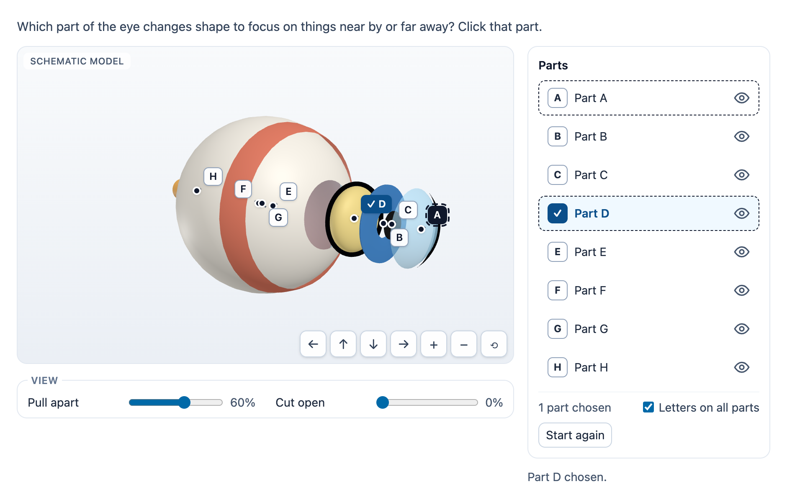

# @citolab/pci-model-hotspot

> [!WARNING]
> **Experimental (alpha). Just for inspiration.** This PCI is a technical showcase, made by software developers without
> much knowledge of the subject it could be used for. Its content, terms and scoring have not been checked by subject
> experts or assessment specialists, and it has never been used in an assessment. It is offered as is, without any
> warranty.

A QTI 3 Portable Custom Interaction (PCI) in which the candidate clicks or labels the parts of a 3D model that they can
turn, zoom, pull apart and cut open: "click the part of the eye that changes shape", "put the names on the parts of
the flower", "which part of the bicycle passes the force on to the rear wheel?". It is the 3D version of "click the
part of the cell". Four schematic models are built in (an eye, a flower, a plant cell and a bicycle); the author can
also give a glTF file, whose named meshes become the parts. Scored with `match_correct` (and `MAP_RESPONSE` for labels).
Made with [tspci](https://github.com/Citolab/tspci).

<p align="center">
  
</p>

## What it does

- **Built-in models**, made in code from simple shapes and marked "Schematic model" (they are recognisable, not
  anatomically exact):
  - **Eye**: cornea, iris, pupil, lens, vitreous body, retina, sclera, optic nerve.
  - **Flower**: petal, sepal, filament, anther, stigma, style, ovary, receptacle, stem (five petals, sepals and stamens
    are one part each). A stamen is filament + anther, a pistil stigma + style + ovary; rename the parts if you want.
  - **Plant cell** (a box with an open top): cell wall, cell membrane, cytoplasm, vacuole, nucleus, chloroplast,
    mitochondrion.
  - **Bicycle**: frame, front wheel, rear wheel, front fork, handlebar, saddle, pedals and cranks, chainring, chain,
    rear sprocket.
- **Own model**: `data-gltf` is the URL of a `.glb` or `.gltf` (three.js `GLTFLoader`). Every mesh or node with a name
  in the file is a part (the identifier is the name with spaces as `_`); the setup can name the parts, then only those.
  The file has to be reachable from the delivery system (CORS). A file that does not load shows a message; the list
  still works.
- **Parts are letters**: A, B, C … in the list and in the model, without names (a name would give away "click the
  lens"); `data-show-names` shows them in click mode. In label mode the labels carry the names.
- **Click mode**: one part (cardinality single; another click replaces it) or more (`data-cardinality="multiple"`, with
  `data-max-choices`). Clicking a chosen part again takes it back.
- **Label mode**: the labels (by default one per part, with the part's name; the author can write their own and add
  distractors) are dragged onto a part in the model or in the list, or picked and then placed with a click, or chosen in
  the list next to each part. One label per part: a label pushed off goes back to the bank.
- **The 3D view** (three.js, rendered on demand): drag to turn (mouse, touch, pen), wheel or two fingers to zoom,
  buttons for both. A click without dragging picks the part under the pointer (raycasting). **See-through parts**
  (the cornea, the pupil, the lens, a volume such as the vitreous body or the cytoplasm) do not hide what lies behind
  them: the first click on a spot chooses the front part, another click on the same spot the part behind it (the iris
  behind the cornea; the lens behind cornea and pupil), and so on until the first part that is not see-through; then
  it starts at the front again. A volume comes after the parts inside it. The second click means "the one behind": it
  takes back what the first click chose (in label mode it moves the label it placed). Turning, zooming or another spot
  starts at the front. The hover shows the part a click will choose, with "click again for the part behind" when there
  is one. (The other way, preferring the opaque part behind a see-through one, would leave the cornea unclickable: an
  opaque part always lies behind it.) A hovered or
  focused part gets a thin dark outline and a dashed tag; a chosen part a thick blue outline and a tag with a check
  mark; a labelled part a tag with its label. Tags that would cover each other move aside with a line to their part.
- **Viewing aids**: "Pull apart" (explode) moves every part along its own direction; "Cut open" (a clipping plane that
  turns with the model) removes the near half of the model, step by step, so inner parts can be seen and clicked; per
  part a show/hide toggle (hidden parts cannot be picked), and "Letters on all parts". Each can be switched off.
- **Accessibility**: the list of parts is the accessible alternative to the model, with the same choices and the same
  letters; hovering or focusing a part in one highlights it in the other. The model is an application: the arrow keys
  turn it, `+`/`−` zoom, `Home` resets, `Page Down`/`Page Up` go from part to part (announced) and `Enter` or space
  chooses or places the picked label. Every step is told in a live status line. Highlights are outlines, tags and check
  marks, never colour only; the colours are colour-blind safe. Nothing moves by itself (`prefers-reduced-motion` only
  has the button transitions to switch off). Without WebGL a message replaces the model and the list does everything.
- **Delivery**: the answer is saved as the item's state (every step in the log) and restored; several interactions of
  this type on one page each get their own object. The WebGL context is freed when the interaction leaves the page.
  In review (`status: "solution"`) the correct response of the declaration is shown, or else the one of the settings,
  read-only.
- **Authoring mode** (`getAuthoringInstance`, "Set up the model…"): choose a built-in model or a glTF URL (Load reads
  its parts), the mode, one or more parts and the maximum; per part whether it can be chosen, the English and Dutch
  name, and whether it is correct (or click the part in the 3D preview); in label mode the labels (text in both
  languages, the part they belong on or none for a distractor). It shows the response declaration for the item and
  `validate()` lists, in the author's language: no part can be chosen, no correct part, more correct parts than the
  maximum, a label without text, a label on a part that cannot be chosen, two labels on one part, no glTF URL.

## What can be configured

Every setting is a `data-` attribute of the interaction, as text. `dist/authoring.json` describes them for authoring
systems.

| setting                  | attribute            | default    | what                                                                     |
| ------------------------ | -------------------- | ---------- | ------------------------------------------------------------------------ |
| Question                 | `data-prompt`        | empty      | empty: the model's example question for the mode                         |
| Built-in model           | `data-model`         | `eye`      | `eye`, `flower`, `cell`, `bike`                                          |
| Own model                | `data-gltf`          | empty      | URL of a glTF file; replaces the built-in model                          |
| What the candidate does  | `data-mode`          | `click`    | `click` or `label`                                                       |
| How many parts           | `data-cardinality`   | `single`   | click mode: `single` or `multiple`                                       |
| At most                  | `data-max-choices`   | `0`        | click mode with more parts; 0: no limit                                  |
| Parts, labels, answer    | `data-setup`         | empty      | JSON written by the authoring mode (below); empty: every part, the example answer |
| Show the names           | `data-show-names`    | `false`    | click mode: "Part D: Lens" instead of "Part D"                           |
| Pull apart               | `data-explode`       | `true`     | the explode slider                                                       |
| Cut open                 | `data-cutaway`       | `true`     | the cut-away slider                                                      |
| Show and hide parts      | `data-visibility`    | `true`     | a toggle per part                                                        |
| Language                 | `data-language`      | `en`       | `en` or `nl`: the texts, the part and label names                        |

```json
{
  "parts": [{ "id": "sclera", "selectable": false }, { "id": "lens", "nl": "Lens" }],
  "labels": [
    { "id": "lens", "en": "Lens", "nl": "Ooglens", "part": "lens" },
    { "id": "L9", "en": "Tear gland", "nl": "Traanklier", "part": null }
  ],
  "correct": ["lens"]
}
```

- **parts**: per part its `id` (of the model, or of the glTF), names `en`/`nl` where they differ from the model's, and
  `"selectable": false` for a part that is only there to look at (it gets no letter). Parts that are not listed can be
  chosen. For a glTF the list is the parts (the authoring mode writes it when it loads the file).
- **labels** (label mode): without it, one label per part that can be chosen, with the part's name and identifier.
  `part: null` is a distractor.
- **correct** (click mode): the correct parts; without a setup, the model's example (eye: `lens`, flower: `anther`,
  cell: `chloroplast`, bike: `chain`).

## Scoring

The PCI is made for `match_correct` (`authoring.json`: `"scoring": ["match_correct", "human"]`,
`"correctResponse": "properties"`: `getCorrectResponse(properties)` gives the correct response of the settings).

| mode                 | declaration                                         | response                                                       |
| -------------------- | --------------------------------------------------- | -------------------------------------------------------------- |
| click, one part      | `cardinality="single" base-type="identifier"`       | `{ "base": { "identifier": "lens" } }`                        |
| click, more parts    | `cardinality="multiple" base-type="identifier"`     | `{ "list": { "identifier": ["cornea", "retina"] } }` (in the order of the parts) |
| label                | `cardinality="multiple" base-type="directedPair"`   | `{ "list": { "directedPair": [["lens", "lens"], ["L9", "iris"]] } }` (label, part; in the order of the labels) |

Until the candidate chose or placed something, `getResponse()` reports nothing. The authoring mode shows the
declaration; for labels it adds a mapping, so `MAP_RESPONSE` gives a point per label on the right part (a distractor
placed scores 0; with `match_correct` it makes the answer wrong).

```xml
<qti-response-declaration identifier="RESPONSE" cardinality="multiple" base-type="directedPair">
  <qti-correct-response>
    <qti-value>lens lens</qti-value>
    <qti-value>retina retina</qti-value>
  </qti-correct-response>
  <qti-mapping default-value="0" lower-bound="0">
    <qti-map-entry map-key="lens lens" mapped-value="1"/>
    <qti-map-entry map-key="retina retina" mapped-value="1"/>
  </qti-mapping>
</qti-response-declaration>
<qti-response-processing template="https://purl.imsglobal.org/spec/qti/v3p0/rptemplates/map_response"/>
```

For click mode use the `match_correct` template; for partial credit on more parts, a mapping on the identifiers works
the same way. `human`: use the PCI without automatic scoring (the response still says what was chosen).

**State and response.** `getState()` holds the answer (and the log). `setResponse` (and `boundTo` without a state) reads
the forms above, a list of `"label part"` strings (as in QTI XML), or identifiers separated by spaces; parts and labels
the settings do not have are dropped.

## Using it

```sh
npm install @citolab/pci-model-hotspot
```

| file                                        | what                                                                      |
| ------------------------------------------- | ------------------------------------------------------------------------- |
| `dist/index.js`                             | the PCI (AMD module, everything bundled, three.js included)               |
| `dist/authoring.json`                       | settings, response, scoring and the authoring mode, for authoring systems |
| `dist/sbom.cdx.json`                        | CycloneDX SBOM of the bundle                                              |
| `dist/tao-pci-modelHotspot_<version>.zip`   | the PCI for TAO: Settings → Portable Custom Interactions → Add            |
| `modelHotspot.svg`, `example.png`           | icon and screenshot                                                       |

In a QTI 3 item, with `index.js` at `resources/pci/index.js` of the package:

```xml
<qti-response-declaration identifier="RESPONSE" cardinality="single" base-type="identifier">
  <qti-correct-response><qti-value>anther</qti-value></qti-correct-response>
</qti-response-declaration>
…
<qti-portable-custom-interaction response-identifier="RESPONSE" module="pci" custom-interaction-type-identifier="modelHotspot"
  data-model="flower" data-language="nl" data-setup="{&quot;correct&quot;:[&quot;anther&quot;]}">
  <qti-interaction-modules>
    <qti-interaction-module id="pci" primary-path="../resources/pci/index"></qti-interaction-module>
  </qti-interaction-modules>
  <qti-interaction-markup></qti-interaction-markup>
</qti-portable-custom-interaction>
```

**Development**: `npm test` runs the node tests of the models and the logic (`src/models.ts`, `src/hotspot.ts`);
the stories (`src/modelHotspot.stories.ts`) run from the repository root with vitest.

Source and the other examples: [Citolab/tspci-examples](https://github.com/Citolab/tspci-examples).
