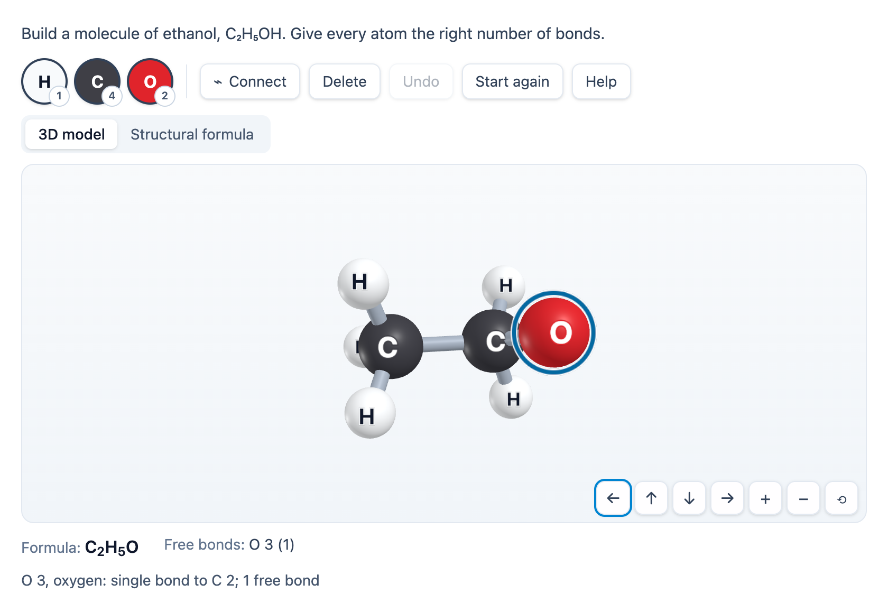

# @citolab/pci-molecule-builder

> [!WARNING]
> **Experimental (alpha). Just for inspiration.** This PCI is a technical showcase, made by software developers without
> much knowledge of the subject it could be used for. Its content, terms and scoring have not been checked by subject
> experts or assessment specialists, and it has never been used in an assessment. It is offered as is, without any
> warranty.

A QTI 3 Portable Custom Interaction (PCI) in which the candidate builds a molecule from atoms: they add hydrogen,
carbon, nitrogen, oxygen (and whatever else the author allows) from a palette, connect them with single, double and
triple bonds and see the molecule as a 3D ball-and-stick model with a VSEPR shape (tetrahedral, trigonal, linear,
bent), or as a structural formula. The response is the molecule as a canonical string, the same however and in
whatever order it was drawn, so a QTI response processing can score it with `match`; or the PCI scores the author's
checks itself. Made for chemistry in Dutch vmbo (nask2): H₂O, CO₂, CH₄, NH₃, O₂, C₂H₅OH. Made with
[tspci](https://github.com/Citolab/tspci).

<p align="center">
  
</p>

## What it does

- **Atoms**: H, C, N, O, F, Cl, Br, I, S and P, with their school valence (H 1, C 4, N 3, O 2, the halogens 1, S 2,
  P 3). The balls have the CPK colours and always the element's letter (in the palette, the 3D model and the
  structural formula), and the palette shows the number of bonds, so colour is never the only cue.
- **Building**: a palette button (or the element's key: `H`, `C`, `N`, `O`, `F`, `S`, `P`, `I`, `L` for Cl, `B` for
  Br) adds the atom with a single bond to the selected atom; the selection stays, so `C` `H` `H` `H` `H` is methane.
  With nothing selected, or when the selected atom has no bond free, the atom comes on its own. **Connect** (or
  `Space`/`Enter`) and then the other atom (a click, or select it and `Space`) bonds two atoms; doing it again makes the
  bond double, triple, and removes it. A click on a bond does the same. Delete, Undo (`Ctrl+Z`) and Start again.
- **3D model** (three.js 0.180): positions from a VSEPR-like layout (`src/geometry.ts`): bond lengths from the
  covalent radii (shorter for double and triple bonds), the angle between two bonds from the electron domains around
  the atom (bonds and lone pairs from the valence electrons): 180° linear (CO₂, C₂H₂), 120° trigonal (C₂H₄, flat), 109.5°
  tetrahedral (CH₄), 107° pyramidal (NH₃), 104.5° bent (H₂O). Double bonds keep their substituents in one plane. The
  model turns with a drag (mouse, touch, pen), the arrow keys or the buttons; `+`/`−` and the wheel zoom, `Home` resets.
  A click (no drag) picks an atom or a bond by raycasting. A change of shape glides into place, or jumps with
  `prefers-reduced-motion`. Without WebGL the structural formula takes over with a message. The renderer and its
  WebGL context are freed when the view changes, the PCI is removed or leaves the page.
- **Structural formula** (fully keyboard accessible): the atoms on a grid with their bonds as one, two or three
  lines. It is a listbox with the selected atom as its active descendant: the arrow keys go to the nearest atom in
  that direction, `Shift` + arrow moves the atom, `Home`/`End` the first and last atom. A screen reader hears every atom
  with its bonds ("C 1, carbon: single bond to C 2, single bond to H 3 …; 1 free bond"); a live status line tells every
  step. Drag an atom with the mouse to move it. Atoms get a place next to the atom they bond to (a chain to the right,
  hydrogens above, below and at the ends), as Dutch schools draw structural formulas.
- **Feedback** (both can be switched off): the molecular formula as pupils learn it (NH₃, HCl, H₂O, H₂SO₄,
  NaOH; carbon compounds in Hill order: CH₄, CO₂, C₂H₆O), or in Hill order with `data-formula-order="hill"`, and the free bonds per atom (a badge
  with the number on the atom, `!` and "bonds too many" when there are too many). With an atom selected the shape around
  it and its bond angle, in the candidate's language (104,5° in Dutch).
- **Canonical string** (`src/molecule.ts`, no imports, tested with `npm test`): `formula:SMILES`, the Hill formula (always
  Hill order, whatever the formula shown, so the response stays canonical: `H3N:N` for ammonia) and
  a canonical SMILES (`H2O:O`, `CO2:O=C=O`, `C2H6O:CCO`, `C2H6O:COC`). Hydrogens become counts on their atom; the
  atoms get a canonical labelling (partition refinement on element, hydrogens, degree and bonds; ties broken by trying
  each and keeping the smallest SMILES), so the drawing order, the atom numbers and the layout do not matter. Atoms with
  fewer hydrogens than their valence asks are written in brackets (`[CH3]`, `[OH]`), separate parts are joined with `.`.
- **Authoring mode**: the item author builds the correct molecule in the same builder, chooses the palette and the
  checks in the PCI itself (`getAuthoringInstance`), via "Configure…" ("Build the molecule…") in an authoring system
  that supports it (qti-construction, TAO with tspci-tao, the dev page), in three tabs: **Correct molecule**, **Atoms in
  the palette** and **Checks** (with ticks for what the correct molecule passes, its score and its correct response).
  `validate()` reports a missing molecule, an empty palette, a molecule with atoms that are not in the palette, and
  (with PCI scoring) no checks or a check the correct molecule fails, in the author's language.
- **Delivery**: the candidate's molecule (atoms, bonds and their places in the structural formula) is saved as the
  item's state, with every step in the log, and restored. In review (`status: "solution"`) the PCI shows the declared
  correct response, or else the author's molecule, read-only. Several interactions of this type on one page each get
  their own object.

## What can be configured

Every setting is a `data-` attribute of the interaction, as text. `dist/authoring.json` describes them for authoring
systems.

| setting                        | attribute            | default                | what                                                          |
| ------------------------------ | -------------------- | ---------------------- | ------------------------------------------------------------- |
| Instruction above the builder  | `data-prompt`        | build a water molecule | also part of the views' accessible names                       |
| Molecule                       | `data-molecule`      | empty: the example     | written by the authoring mode, as JSON (below)                |
| Scoring                        | `data-scoring`       | `match`                | `match`: a string for `match`; `pci`: a record with the checks |
| Show the molecular formula     | `data-show-formula`  | `true`                 |                                                               |
| Show the free bonds per atom   | `data-show-valence`  | `true`                 | the badges on the atoms and the list of free bonds             |
| Order of the formula shown     | `data-formula-order` | `common`               | `common`: NH₃, HCl, H₂SO₄; `hill`: H₃N, ClH, H₂O₄S. Only what is shown: the response and the checks use Hill order |
| View at the start              | `data-view`          | `3d`                   | `3d` or `2d` (structural formula); both are always there      |
| Atoms at most                  | `data-max-atoms`     | `24`                   | 2 to 60                                                       |
| Language                       | `data-language`      | `en`                   | `en` or `nl`: the texts and numbers of the PCI                |

```json
{
  "elements": "H C O",
  "solution": "CCO",
  "checks": [
    { "type": "formula", "points": 1 },
    { "type": "valence", "points": 1 },
    { "type": "isomer", "different": true, "points": 2 },
    { "type": "bond", "order": 2, "a": "C", "b": "O", "count": 1, "points": 1 }
  ]
}
```

- **elements**: the palette, symbols separated by spaces. Without it: H C N O.
- **solution**: the correct molecule as SMILES (the authoring mode writes the canonical one). Without it: water.
- **checks**: at most 8, each worth `points` (default 1); only used with `data-scoring="pci"`.

| check       | passes when                                                                                       | rubric line                                |
| ----------- | ------------------------------------------------------------------------------------------------- | ------------------------------------------ |
| `molecule`  | the canonical SMILES is the correct molecule's                                                    | "builds water"                             |
| `formula`   | the atoms are those of `formula` (`C2H6O`, `CH3CH2OH`, `H₂O`), or else of the correct molecule   | "the right atoms"                          |
| `valence`   | every atom has exactly its number of bonds                                                         | "every atom has the right bonds"           |
| `connected` | everything is one molecule                                                                         | "one molecule"                             |
| `isomer`    | the formula of `formula` (or the correct molecule), valences right, one molecule; with `different`, not the correct molecule itself | "an isomer of ethanol" |
| `bond`      | at least `count` bonds of `order` (1, 2, 3) between elements `a` and `b` (either may be left out)  | "a double bond between C and O"            |

## Scoring

Two ways (`authoring.json`: `"scoring": ["match_correct", "custom", "human"]`, `"correctResponse": "properties"`).

**`match_correct`** (`data-scoring="match"`, the default): the response is a string, `formula:SMILES`, which the item
compares with its correct response. The registered object has `getCorrectResponse(properties)`: the string of the
author's molecule, so an authoring system can fill in the correct response and keep it in line. The authoring mode
shows it too.

```xml
<qti-response-declaration identifier="RESPONSE" cardinality="single" base-type="string">
  <qti-correct-response><qti-value>H2O:O</qti-value></qti-correct-response>
</qti-response-declaration>
…
<qti-response-processing template="https://purl.imsglobal.org/spec/qti/v3p0/rptemplates/match_correct"/>
```

Want the formula only? Compare the part before the colon, for example with
`<qti-substring case-sensitive="true">` against `H2O:`, or use the PCI's checks.

**`custom`** (`data-scoring="pci"`): the PCI evaluates the author's checks and the response is a record:

| field                | type      | what                                                         |
| -------------------- | --------- | ------------------------------------------------------------ |
| `score`              | `integer` | the points of the checks that pass                           |
| `maxscore`           | `integer` | the points of all checks                                     |
| `correct`            | `integer` | 1 when every check passes (and there is at least one)        |
| `check1` … `check8`  | `integer` | 1 or 0 per check, in the order of the checks                 |
| `formula`            | `string`  | the Hill formula (`C2H6O`)                                   |
| `smiles`             | `string`  | the canonical SMILES (`COC`)                                 |
| `molecule`           | `string`  | the atoms (with their grid places) and bonds as JSON, for a rater |

```xml
<qti-response-declaration identifier="RESPONSE" cardinality="record"/>
<qti-outcome-declaration identifier="SCORE" cardinality="single" base-type="float">
  <qti-default-value><qti-value>0</qti-value></qti-default-value>
</qti-outcome-declaration>
…
<qti-response-processing>
  <qti-response-condition>
    <qti-response-if>
      <qti-not><qti-is-null>
        <qti-field-value field-identifier="score"><qti-variable identifier="RESPONSE"/></qti-field-value>
      </qti-is-null></qti-not>
      <qti-set-outcome-value identifier="SCORE">
        <qti-field-value field-identifier="score"><qti-variable identifier="RESPONSE"/></qti-field-value>
      </qti-set-outcome-value>
    </qti-response-if>
  </qti-response-condition>
</qti-response-processing>
```

Test single fields (`check3` equal to 1) for your own rules, or compare `smiles` with `qti-match`. `human`: use the PCI
without scoring, for a human rater (`molecule` has the whole drawing). Until the candidate adds an atom,
`getResponse()` reports nothing.

**State and response.** `getState()` holds the molecule (and the log). `setResponse` and `boundTo` (without a state)
read `formula:SMILES`, a SMILES, a molecule as JSON or a record (its `molecule` field, else `smiles`) and lay out a
structural formula when there are no places. In `status: "solution"` the declared correct response is shown (a string,
or a record value with the field `molecule` or `smiles`); without one, the author's molecule.

**Known limits.** No charges, isotopes, stereochemistry or aromatic SMILES (`c1ccccc1`; write benzene as
`C1=CC=CC=C1`). Rings get a structural formula that is a chain with a long closing bond: move the atoms. Atoms with
five or six bonds (PCl₅, SF₆) are only kept apart, not given exact angles. The tie-breaking search is capped, which only
matters for large, very symmetric molecules.

## Using it

```sh
npm install @citolab/pci-molecule-builder
```

| file                                           | what                                                                      |
| ---------------------------------------------- | ------------------------------------------------------------------------- |
| `dist/index.js`                                | the PCI (AMD module, everything bundled: the package has no dependencies) |
| `dist/authoring.json`                          | settings, response, scoring and the authoring mode, for authoring systems |
| `dist/sbom.cdx.json`                           | CycloneDX SBOM of the bundle                                              |
| `dist/tao-pci-moleculeBuilder_<version>.zip`   | the PCI for TAO: Settings → Portable Custom Interactions → Add            |
| `moleculeBuilder.svg`, `example.png`           | icon and screenshot                                                       |

In a QTI 3 item, with `index.js` at `resources/pci/index.js` of the package:

```xml
<qti-response-declaration identifier="RESPONSE" cardinality="single" base-type="string">
  <qti-correct-response><qti-value>C2H6O:CCO</qti-value></qti-correct-response>
</qti-response-declaration>
…
<qti-portable-custom-interaction response-identifier="RESPONSE" module="pci" custom-interaction-type-identifier="moleculeBuilder"
  data-language="nl" data-prompt="Bouw een molecuul ethanol, C₂H₅OH."
  data-molecule="{&quot;elements&quot;:&quot;H C O&quot;,&quot;solution&quot;:&quot;CCO&quot;}">
  <qti-interaction-modules>
    <qti-interaction-module id="pci" primary-path="../resources/pci/index"></qti-interaction-module>
  </qti-interaction-modules>
  <qti-interaction-markup></qti-interaction-markup>
</qti-portable-custom-interaction>
```

Source and the other examples: [Citolab/tspci-examples](https://github.com/Citolab/tspci-examples).
