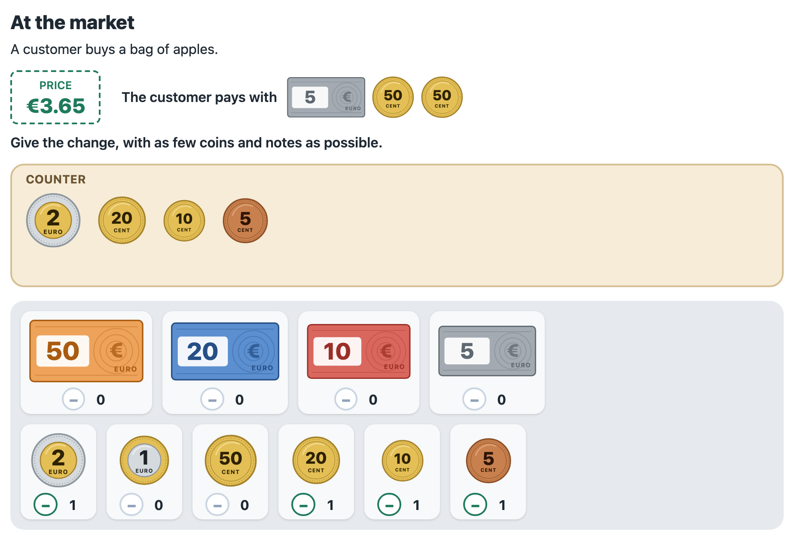

# @citolab/pci-money

> [!WARNING]
> **Experimental (alpha). Just for inspiration.** This PCI is a technical showcase, made by software developers without
> much knowledge of the subject it could be used for. Its content, terms and scoring have not been checked by subject
> experts or assessment specialists, and it has never been used in an assessment. It is offered as is, without any
> warranty.

A QTI 3 Portable Custom Interaction (PCI) for money sums (Dutch: *rekenen met geld*), as Dutch primary schools teach
them. The candidate pays an amount exactly, or with as few coins and notes as possible. Or they give the change, or
count the money on a counter. Or they work a cash register (*kassa*), as a shop assistant in training does (mbo-1
aankomend verkoopmedewerker): ring up the shopping, take the payment and give the change from the till's drawer. They
drag coins and notes from a supply onto a counter, or click them. The money is in
euros, US dollars, British pounds or a currency of the author's own, and in an authoring mode the author chooses the
coins and notes: which ones, coin or note, their colour and how many. Made with
[tspci](https://github.com/Citolab/tspci).

<p align="center">
  
</p>

## What it does

- **Six tasks** (the `task` setting):
  - `pay`: pay an amount exactly (€ 7,35), with any coins and notes;
  - `fewest`: pay it with as few coins and notes as possible;
  - `change`: the price and what the customer pays with; give the change (*wisselgeld*), with any coins and notes;
  - `changeFewest`: give the change with as few coins and notes as possible;
  - `count`: the counter holds the author's money; the candidate writes how much it is in an answer box;
  - `register`: a cash register: ring up the shopping, key in the total (or let the till calculate it) and what the
    customer pays, and give the change from the drawer. See [The cash register](#the-cash-register).
- **The task card** shows the amount on a price tag. For change it also shows the price and the customer's money.
  The amount is always visible, because the correct response depends on it.
- **The counter** is where the money goes. Notes lie on the first row and coins on the second, each kind together,
  from large to small, and every piece can be counted. A setting can show the total.
- **The supply** has a compartment for each coin and note:
  - The piece is a button. Drag it onto the counter, click it, or press Enter or Space on it to add one.
  - The **−** button takes one off the counter, and next to it is the number of that piece on the counter.
  - With a limited supply, the compartment also says how many are left.
  - To take a piece off the counter, you can also drag it off or click it.
- **Keyboard and screen reader.** You can do everything with the buttons in the supply. Every button has a name,
  such as "Add a coin of 50 cents" or "Een munt van 50 cent erbij". After every change, a live region says what is
  on the counter, such as "On the counter: 1 note of €5, 1 coin of €2, …". The money in the count task is a list of
  named images.
- **Four currencies** (the `currency` setting): euro, US dollar, British pound, or one of the author's own (its sign,
  before or after the amount, and a minor unit or none). See [Currencies](#currencies).
- **Amounts** are written the way the currency and the language write them: "€ 7,35" in Dutch and "€7.35" in English,
  "$7.35" and "35¢", "£7.35" and "35p", "7,35 kr" or "R$ 7,35". The answer box accepts the currency's forms: `7,35`,
  `7.35`, `€ 7,35`, `7`, `7,-`; `$7.35`, `35¢`; `£7.35`, `35p`; `7,35 kr`, `50 øre`. Something else makes the box
  invalid (`checkValidity()` is false) and is no answer.
- **Read-only** (review, solution): the counter or the answer box, without the supply.
- **The author sees what is wrong** with the settings, above the task: no amount, a customer who pays too little, an
  amount that these coins and notes can not make (€ 7,33 without 1 and 2 cent), money in the task that is not one of
  the coins and notes, or a currency of one's own without a sign.
- **An authoring mode** ("Coins, notes and shopping…") for the currency, its coins and notes, and the shopping of the
  register. See [Authoring mode](#authoring-mode).

### The coins and notes are drawings, not the real ones

Reproducing real coins and notes is restricted, so the PCI draws stylised pieces in SVG and uses none of the real
designs: no portraits, buildings, maps, flags or signatures.

- A **coin** is a plain disc with its value and its unit in words (50 CENT, 2 EURO, 25 CENTS, 1 POUND). It is copper,
  gold, silver, two metals (a silver centre in a gold ring, or a gold centre in a silver ring) or any colour the author
  picks. The euro's € 1 is silver in gold and its € 2 gold in silver, as the real ones.
- A **note** is a coloured rectangle with its value and unit in a white panel, the sign of the currency in a pattern of
  rings. The preset colours are close to the real ones: € 5 grey, € 10 red, € 20 blue, € 50 orange, € 100 green,
  € 200 yellow; every dollar note green; £ 5 teal, £ 10 orange, £ 20 purple, £ 50 red.

The sizes keep the proportions of the real coins and notes of the presets, so a coin of 50 cent is larger than one of
5 cent, and a 10 cent coin (or a dime, or a 5p) is smaller than a 5 cent one, as it is in your purse. All dollar notes
are the same size. A coin or note that is not one of a preset (of a currency of one's own, or added by the author) gets
a size by its value: a larger value, a somewhat larger piece.

The value is always written on the piece, so colour is never the only cue, and it stays readable on any colour the
author picks: the PCI chooses dark or white text by contrast (at least 4.5:1, WCAG AA), and the value on a note is a
dark shade of the note's colour on the white panel.

## Settings

| setting | editor | what it does |
| --- | --- | --- |
| `title`, `question` | `text`, `textarea` | above the task |
| `task` | `enum` | `pay` (default), `fewest`, `change`, `changeFewest`, `count` |
| `amount` | `text` | the amount to pay, or the price (change), in the currency: `7,35`, `7.35`, `€ 7,35`, `$7.35`, `35p` |
| `given` | `text` | change, register: what the customer pays with, coins and notes separated by `;`: `10`, `5; 2x 0,50` |
| `countPieces` | `text` | count: the money on the counter: `10; 2x 2; 0,50; 3x 0,20; 0,05` |
| `currency` | `pci` | `eur` (default), `usd`, `gbp` or `custom` |
| `currencySign` | `pci` | `custom`: the sign, any text: `kr`, `R$`, `₣` |
| `currencyPosition` | `pci` | `custom`: `before` (default, `R$ 7,35`) or `after` (`7,35 kr`) the amount |
| `minorUnit` | `pci` | `custom`: the minor unit (a hundredth) as written after a number: `øre`, `ct`, `¢`; empty: none, only whole amounts |
| `pieces` | `pci` | the coins and notes, as JSON (below). Empty: the usual ones of the currency |
| `items` | `pci` | register: the shopping, as JSON (below). Empty: milk, bread, apples and cheese, with two deals |
| `tillCalculates` | `boolean` | register: the till calculates the total and the change (default); off: the pupil does |
| `fewestChange` | `boolean` | register: give the change with as few coins and notes as possible (default off) |
| `cashRounding` | `enum` | register: round the total for cash to `1` (none, default), `5` (Dutch practice: € 8,48 → € 8,50), `10`, `50` or `100` hundredths, half up |
| `showTotal` | `boolean` | show the total on the counter (not in count) |
| `language` | `enum` | `en` or `nl`: the PCI's own texts and how amounts are written |

The `pci` settings are written by the [authoring mode](#authoring-mode). An authoring system without it shows them as
text fields, and the PCI works without them: the euro and its usual coins and notes.

The coins and notes in `given` and `countPieces` must be coins or notes of the currency (offered to the candidate or
not), written as amounts of it: `10; 2x 25¢` in dollars, `50p; 2x £2` in pounds. A coin or note that is not one of them
is left out, and the author sees a warning.

**`pieces`** is a JSON list, one entry per value, small to large:

```json
[
  { "value": 5, "kind": "coin", "color": "copper", "offered": true, "count": null },
  { "value": 200, "kind": "coin", "color": "goldInSilver", "offered": true, "count": 3 },
  { "value": 1000, "kind": "note", "color": "#d9675e", "offered": true, "count": null }
]
```

- `value`: in hundredths of the main unit, a whole number: `5` is 5 cent, `200` is € 2. Also for a currency without a
  minor unit (`500` is 5 kr), so the arithmetic is the same for every currency.
- `kind`: `coin` or `note`.
- `color`: a coin's `copper`, `gold`, `silver`, `silverInGold` or `goldInSilver`, or any colour as `#rrggbb`; a note's
  colour as `#rrggbb`.
- `offered`: the candidate can take it from the supply. One that is not offered can still be the customer's money or
  lie on the counter in the count task.
- `count`: how many the supply has, or `null` for as many as needed.

A field left out gets its default (the preset's kind and colour, offered, as many as needed). This replaces the
`supply` text setting of earlier alphas (`0,05; 0,10; 3x 2`): the package was not published with it.

## The cash register

The task `register`, for retail in praktijkonderwijs and mbo-1. Everything is drawn in SVG and HTML.

- **The shopping** lies on the counter: each item a plain drawing (a box, carton, bottle, can, jar, bag, bread or
  fruit, no brands) with its name, price, deal ("2 for €2.00", "−25%") and how many the customer buys ("3 ×"), and
  under it its code and how many are rung up. Next to it the customer's money (`given`), drawn with the coins and notes
  of the currency.
- **The till** has a display and a keypad: the digits, the decimal separator (`,` in Dutch, `.` in English; none for a
  currency without a minor unit), ← (back), C (clear), × (how many of the next item), Code, Price, Correction, Total and
  Cash. The pupil rings up an item by a tap on it, by `3` × and a tap (three of them), or by typing its code and Code.
  Price rings up an amount typed, as an item of its own. Correction undoes the last step: the payment, the total, or the
  last item rung up. Ringing up after Total opens the sale again.
- **Total**: the till calculates it (with the deals, and rounded for cash), or, with `tillCalculates` off, the pupil
  types the total and presses Total; the till then shows no subtotal and no change, only each item rung up.
- **Cash**: the pupil types what the customer pays and presses Cash. The till that calculates refuses less than the
  total, and shows the change. The drawer opens, and the receipt prints next to the till.
- **The change** comes from the drawer (the supply of the other tasks, with the author's coins and notes and their
  counts) onto the counter, as in the change tasks. Before Cash the drawer is closed: its coins and notes can not be
  taken, and it says why.
- **The receipt**: every item with all its lines together, its deal and the discount, the number of items, the
  subtotal before rounding, the total, the payment and the change. When the pupil calculates, it has no amounts of its
  own: each item as quantity × price and its deal, the total and the payment as keyed in.
- **Deals** apply to all of an item rung up, also when it is rung up one by one: two milk at € 1,15 with "2 for € 2,00"
  are € 2,00; three are € 3,15. A discount in % is taken off the line and rounded half up to a whole cent: 3 × € 0,45
  −25% is € 1,01.
- **Keyboard and screen reader.** The items and the keys are buttons, with a name ("Ring up Milk", "Cash: what the
  customer pays") and a description (price, deal, how many the customer buys, code, how many rung up). With the focus
  on a key, the keyboard's digits, comma or point, Backspace, Escape (C) and `*` (×) type on the till. The display is a
  live region: a screen reader reads what it shows after every key ("Milk 2 × €1.15, Subtotal €2.00"). The receipt is
  read out when it prints. Cash pressed with the keyboard takes the focus to the drawer, where the change comes from.
- **Colour is never the only cue**: a deal has its text and a sign, the quantity its "×", the keys their labels, a
  closed drawer a sentence.
- **Touch**: a tap on an item, a key, or a coin or note; a coin or note can also be dragged onto the counter. The
  items and keys keep the browser's scrolling (`touch-action` stays as it is), and every key is at least 44 px high.
- **Read-only** (review, solution): the shopping, the display, the receipt and the change, without the keypad and the
  drawer.

**`items`** is a JSON list, one entry per item, as the authoring mode writes it:

```json
[
  { "code": "101", "name": "Milk", "price": 115, "quantity": 2, "deal": { "kind": "multi", "count": 2, "price": 200 }, "look": "carton" },
  { "code": "104", "name": "Cheese", "price": 360, "quantity": 1, "deal": { "kind": "percent", "percent": 25 }, "look": "box" }
]
```

- `code`: 1 to 6 digits, to type on the till; two items with the same code are a problem for the author.
- `name`: as written on the item and on the receipt, in the language of the item.
- `price`: of one, in hundredths of the main unit, as `value` of a coin: `115` is € 1,15 (or $1.15, £1.15, 1,15 kr).
- `quantity`: how many the customer buys, 1 to 99.
- `deal`: `null`, `{ "kind": "multi", "count": 2, "price": 200 }` (2 for € 2,00) or `{ "kind": "percent", "percent": 25 }`.
- `look`: `box`, `carton`, `bottle`, `can`, `jar`, `bag`, `bread` or `fruit`.

An item without a whole price above 0 is left out (and the author sees a warning); another field that can not be read
gets its default. The author also sees when the customer pays too little, or when the change can not be given with the
drawer's coins and notes (€ 1,46 without 1 and 2 cent: choose `cashRounding` 5, or offer them).

## Currencies

| `currency` | coins | notes | offered by default |
| --- | --- | --- | --- |
| `eur` (default) | 1, 2, 5, 10, 20, 50 cent, € 1, € 2 | € 5, € 10, € 20, € 50, € 100, € 200 | all but 1 and 2 cent (Dutch practice: amounts are rounded to 5 cent) and € 100, € 200 |
| `usd` | 1¢, 5¢, 10¢, 25¢, 50¢ | $1, $2, $5, $10, $20, $50, $100 | all but 50¢ and $2 |
| `gbp` | 1p, 2p, 5p, 10p, 20p, 50p, £1, £2 | £5, £10, £20, £50 | all |
| `custom` | 1, 2, 5, 10, 20, 50 of the minor unit, 1 and 2 of the main unit | 5 to 100 | all |

The configuration is per value, so the dollar has one $1: a note by default. The author can make it a coin (gold), but
not have a $1 coin and a $1 note at the same time. Without a minor unit, a currency of one's own starts with coins of
1, 2, 5 and 10 and notes of 20 to 200.

How amounts are written:

| currency | English | Dutch | below 1 |
| --- | --- | --- | --- |
| euro | €7.35 | € 7,35 | €0.35, € 0,35 |
| dollar | $7.35 | $ 7,35 | 35¢ |
| pound | £7.35 | £ 7,35 | 35p |
| `custom`, sign after | 7.35 kr | 7,35 kr | 0,35 kr |
| `custom`, sign before | R$7.35 (CHF 7.35: a space after a sign that ends in a letter) | R$ 7,35 | R$ 0,35 |
| `custom`, no minor unit | ₣12 | ₣ 12 | (only whole amounts) |

## Authoring mode

The `pci` settings have an authoring mode ("Coins, notes and shopping…", `getAuthoringInstance`), for an authoring
system that supports it (AUTHORING.md, section 6). The author:

- **picks the currency**. A currency starts with its usual coins and notes; choosing another currency and then this one
  again gives back what the author set up for it, as long as the window is open. "Back to the usual coins and notes"
  starts over. For another currency: its sign, before or after the amount (with an example of each), and the minor
  unit.
- **sees every coin and note drawn** as the candidate will see it, and per coin or note sets whether the candidate can
  take it, whether it is a coin or a note, its colour (swatches for the metals or named colours, and the browser's
  colour picker for any other) and how many the supply has (empty: as many as needed);
- **adds** a coin or note of any value (typed as an amount of the currency: `0,25`, `25p`, `50 øre`) and **removes**
  one;
- for the task `register`, **sets up the shopping** above the coins and notes: per item its name, code, price, how many
  the customer buys, a deal (none, a number for a price together, or a discount in %) and its picture, and adds or
  removes items. Below the list: what the shopping comes to (and rounded for cash), and the change from the customer's
  money. After adding an item the focus goes to its name. The authoring mode writes the setting `items`; for the other
  tasks it leaves it as it is.

The authoring mode is one for the whole PCI ("Coins, notes and shopping…"): the shopping goes with the coins and notes,
because the change depends on both.

Below the list, what keeps Done from finishing (`validate()`): no coin or note offered (not in the count task), an
amount of the task that can not be paid with what is offered, for the register an item without a name, a code of 1
to 6 digits, a price, a number of 1 to 99 or a complete deal, no items, two items with the same code, a customer who
pays too little and a change that can not be given, money in the task (`given`, `countPieces`) that is not one
of the coins and notes, two coins or notes of the same value, a value that is not possible (0, or not whole without a
minor unit), and a currency of one's own without a sign. Every control works with a tap, a mouse or the keyboard: each
row of options is a radio group (arrow keys, Home, End), the colour swatches are buttons with a name, and after a
removal the focus goes to the next row.

## Response and scoring

The PCI reports a `record`, and the item's scoring decides what counts. Nothing is reported while the counter is
empty, or, in the count task, while the answer box does not hold an amount. The fields depend on the task:

| field | type | task | what it is |
| --- | --- | --- | --- |
| `amount` | `float` | pay, fewest, change, changeFewest | the money on the counter, in the main unit (euros, dollars, pounds: `7.35`) |
| `answer` | `float` | count | the amount written, in the main unit |
| `exact` | `boolean` | all but register | it is the asked amount: the price (pay, fewest), the change (change), the money on the counter (count) |
| `pieces` | `integer` | fewest, changeFewest | the number of coins and notes on the counter |
| `fewest` | `boolean` | fewest, changeFewest, register | they are as few coins and notes as possible **for the amount on the counter**, with the coins and notes of the supply (register: the change; no change at all is the fewest for none) |
| `itemsRungUp` | `integer` | register | how many items were rung up, all quantities together |
| `itemsTotal` | `float` | register | what the items rung up cost, with their deals, before the cash rounding (also when the till does not show it) |
| `total` | `float` | register | the total on the till: the till's, or the one the pupil keyed in; `0` before Total |
| `totalCorrect` | `boolean` | register | `total` is what the customer has to pay (the shopping with the deals, rounded for cash) |
| `paid` | `float` | register | what the pupil keyed in as paid by the customer; `0` before Cash |
| `change` | `float` | register | the change on the counter |
| `changeCorrect` | `boolean` | register | `change` is the customer's money minus what they have to pay |
| `correct` | `boolean` | register | everything right: as many items rung up as the customer buys and costing as much, `totalCorrect`, `paid` is the customer's money, `changeCorrect`, and `fewest` when `fewestChange` asks for it |

The PCI counts in hundredths (cents, pence; whole numbers), so 0,10 + 0,20 is 0,30 and never 0,30000000000000004.
The response is the same in every currency, so a score rule does not depend on it.

**The fewest pieces** are computed by the PCI with the coins and notes that are offered and their counts. For the full
euro, dollar or pound range, the largest coin or note that fits always gives the fewest. That is not true for every
supply:

- Without 10 cent, 60 cent is three coins of 20 cent.
- With only one coin of € 2, € 4 is € 2 and two coins of € 1.
- Without the 5 cent coin, 30¢ is three dimes, not a quarter and five pennies.

So the PCI searches every combination, largest first, and stops a branch as soon as it can no longer do better.

`fewest` does not depend on `exact`: a wrong amount in the fewest pieces is still `fewest`. A score rule combines the
two (see below). `pay` and `change` report no `pieces`, because the number of pieces is free there, and an exact match
on it would be wrong. The coins and notes themselves are saved in the state, so a rater (`human`) can see them.

- **`match_correct`** (the default): `getCorrectResponse` gives the correct response from the settings: the asked
  amount, `exact` true, and in `fewest` and `changeFewest` the minimum `pieces` and `fewest` true. Any exact payment
  matches in `pay` and `change`, the fewest pieces in `fewest` and `changeFewest`, and the right amount in `count`.
  When the settings ask for an amount that can not be paid (`settingsProblems`), there is no correct response.
- **`custom`**: for part of the score per field. For example, in `fewest` or `changeFewest`, 2 points for exact in
  the fewest pieces, 1 point for exact:

  ```xml
  <qti-response-processing>
    <qti-response-condition>
      <qti-response-if>
        <qti-and>
          <qti-field-value field-identifier="exact"><qti-variable identifier="RESPONSE"/></qti-field-value>
          <qti-field-value field-identifier="fewest"><qti-variable identifier="RESPONSE"/></qti-field-value>
        </qti-and>
        <qti-set-outcome-value identifier="SCORE"><qti-base-value base-type="float">2</qti-base-value></qti-set-outcome-value>
      </qti-response-if>
      <qti-response-else-if>
        <qti-field-value field-identifier="exact"><qti-variable identifier="RESPONSE"/></qti-field-value>
        <qti-set-outcome-value identifier="SCORE"><qti-base-value base-type="float">1</qti-base-value></qti-set-outcome-value>
      </qti-response-else-if>
      <qti-response-else>
        <qti-set-outcome-value identifier="SCORE"><qti-base-value base-type="float">0</qti-base-value></qti-set-outcome-value>
      </qti-response-else>
    </qti-response-condition>
  </qti-response-processing>
  ```

  A rule can also allow one piece too many (`pieces` ≤ the minimum + 1 with `qti-lte`), or give a point for an
  `amount` within a few cents (`tolerance: range`).
- **`human`**: a rater looks at the counter in review.

**The register**: nothing is reported until something is rung up, keyed in or put on the counter. The amounts are
counted in hundredths too. `itemsRungUp` and `itemsTotal` compare the value, not which items: an item rung up with
Price at its own price counts as well. `changeCorrect` is against the right total, not the pupil's own; a `custom`
rule can give part of the score for change that fits the pupil's own total (`change` = `paid` − `total`, with
`qti-subtract`). `getCorrectResponse` gives the whole sale done right, with `fewest` true (the fewest pieces for the
change). So with `match_correct` the change must be in the fewest pieces, also when `fewestChange` is off; to accept any
right change, score `correct` with `custom`:

```xml
<qti-response-condition>
  <qti-response-if>
    <qti-field-value field-identifier="correct"><qti-variable identifier="RESPONSE"/></qti-field-value>
    <qti-set-outcome-value identifier="SCORE"><qti-base-value base-type="float">1</qti-base-value></qti-set-outcome-value>
  </qti-response-if>
</qti-response-condition>
```

A register response read back says how many items and what they cost, not which: when that is the shopping, the
shopping is shown rung up; otherwise one amount for what they cost. The change gets the fewest coins and notes for it.

**A response read back** (`setResponse`, `boundTo`, the correct response in status `solution`) says how much, not
which coins and notes. So the counter gets the fewest coins and notes for that amount from the supply. In status
`solution` without a correct response in the item, the PCI shows the one from the settings.

## Development

```bash
npm install
npm run dev           # the dev page, with the settings
npm test              # the arithmetic, the till and the look in node (test/money.test.ts, test/till.test.ts, test/look.test.ts)
npm run test:stories  # the Storybook tests
```

`src/money.ts` has the arithmetic, without imports: the currencies and their coins and notes, amounts as text and back
per currency, totals, the fewest pieces, the shopping (deals, cash rounding), the task, the problems of the settings,
the response and the correct response. `src/till.ts` is the cash register without a screen: what each key does, the
receipt and the register's response; it imports only `money.ts`, so node tests it too. `src/shop.tsx` draws the
shopping, the till and the receipt.
`src/look.ts` has the sizes and the colours of the coins and notes, and the contrast of their text. The node tests
check the fewest pieces against a brute-force count for 300 random supplies and amounts, and the contrast of the text
for 425 colours. `src/authoring.tsx` is the authoring mode, `src/pieces.tsx` draws the coins and notes.
