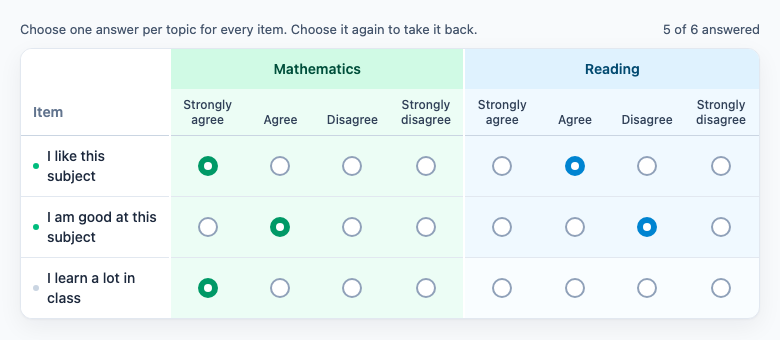

# @citolab/pci-multiple-match

A QTI 3 Portable Custom Interaction (PCI) for "three-dimensional" questions: several items (rows), each answered for
several topics (column groups) on the same categories (a Likert scale, for instance: "How much do you agree, for
mathematics and for reading?"). Made with [tspci](https://github.com/Citolab/tspci), as a port of the openPCI
*multiplematch* PCI.

<p align="center">
  
</p>

## Source and licence

- **Original**: [openPCI/openPCIs, `multiplematch`](https://github.com/openPCI/openPCIs/tree/master/multiplematch),
  by Jeppe Bundsgaard (jebu@edu.au.dk), Aarhus University, for the OpenPCI project.
- **Licence**: the original is under the GNU General Public License version 3 (the repository's
  [LICENSE](https://github.com/openPCI/openPCIs/blob/master/LICENSE) is the GPL v3 text, with no "or any later version"
  notice), so this port is too: `GPL-3.0-only`, see [LICENSE](LICENSE). Not MIT like the other examples here.
- **What changed** (Stichting Cito Instituut voor Toetsontwikkeling, 2026):
  - ported from TAO's older PCI format (AMD + jQuery, TAO creator widget) to the IMS PCI v1.0 API with tspci, Preact and
    Tailwind; the settings are `data-` attributes with the original's names, described in `src/config.json`;
  - a new UI: a table with sticky row headers on wide screens, a card per item with answer buttons on narrow ones;
    keyboard and screen-reader accessible, texts in English and Dutch;
  - a radio choice can be taken back by choosing it again; a progress line ("5 of 6 answered");
  - the response keeps the original's JSON string, with the keys in a fixed order (see Scoring) and nothing (NULL)
    until the candidate answers something;
  - the random order is saved in the state, so a restored item looks the same; multiple selections are restored too
    (the original restored only single ones); an unbiased shuffle.

## What it does

- **The matrix**: every topic is a group of columns, one per category; every item is a row. For every topic × item the
  candidate chooses one category (radio buttons) or, with *multiple selections*, any number (checkboxes).
- **Topics** can have a description, shown under the topic (`<br>` or `<p>` in it break the line; it is shown as text).
- **Order**: topics, categories and items can each be randomized per candidate. *Number of topics shown* shows only the
  first n topics (after randomizing: a random subset). *Reuse order and selection of topics*: as in the original, the
  first item stores its topic order in a session cookie (`topiclist`) and later items with this setting use the same
  order and selection.
- **Accessible**: every option is a real radio button or checkbox behind its label. Tab goes from choice to choice, the
  arrow keys move between the categories of one choice, Space chooses; a screen reader hears "Agree (I like this
  subject, Mathematics)". The layout follows the width the PCI gets, not the window.
- **Delivery**: the answers and the order are saved as the item's state and restored. In review (`status: "solution"`)
  the PCI shows the correct response when the delivery system passes it.

There is no drag and drop: the original is a matrix of choices, not a pairing of two lists, and buttons in a grid are
the faster and more accessible way to fill one in.

## What can be configured

Every setting is a `data-` attribute of the interaction, as text. `dist/authoring.json` describes them for authoring
systems. Lines in `topics`, `categories` and `items` are separated by newlines.

| setting                        | attribute                  | default                                                  | what                                                                       |
| ------------------------------ | -------------------------- | -------------------------------------------------------- | -------------------------------------------------------------------------- |
| Topics                         | `data-topics`              | `group1:Group 1` … `group3:Group 3`                      | `name:Topic` or `name:Topic:Description`; just `Topic`: the name is made from it |
| Categories                     | `data-categories`          | `4:Strongly agree` … `1:Strongly disagree`               | `value:Category`; just `Category`: the value is the text                    |
| Items                          | `data-items`               | `item1:Item 1` … `item3:Item 3`                          | `name:Item`; just `Item`: the name is the text in lower case, without non-word characters |
| Multiple selections            | `data-multiple`            | `false`                                                  | checkboxes instead of radio buttons                                        |
| Number of topics shown         | `data-topicsubset`         | `0`                                                      | `0`: all                                                                   |
| Randomize topics               | `data-randomizetopics`     | `false`                                                  |                                                                            |
| Reuse order and selection of topics | `data-reusetopics`    | `false`                                                  | the topic order of the first item in the session                           |
| Randomize categories           | `data-randomizecategories` | `false`                                                  |                                                                            |
| Randomize items                | `data-randomizeitems`      | `false`                                                  |                                                                            |
| Language                       | `data-language`            | `en`                                                     | `en` or `nl`: the instructions and the texts for screen readers            |

## Scoring

The PCI is made for `match_correct` (`authoring.json`: `"scoring": ["match_correct", "human"]`); for a questionnaire
(the default categories) use `human`.

**The response** is a string (`cardinality="single" base-type="string"`), the original's JSON:
`{"group1_item1":"4","group2_item1":"3","group1_item2":"",…}`: a key `<topic name>_<item name>` for every item and
every topic shown, with the chosen category value, or `""` when not answered. With multiple selections the value is a
list: `{"school_read":["3","2"],"home_read":[],…}`.

- **Fixed order**: the keys follow the authored order (items, then topics) and the values of a list the authored order
  of the categories, whatever order the candidate saw. Equal answers give an equal string, so `match_correct` works.
  With *Number of topics shown* the topics differ per candidate: score that with a custom rule.
- **What counts**: the names and values, not the texts. Correcting a typo in a label keeps the correct response;
  renaming a topic, item or value does not.
- **Setting the correct response**: answer the PCI, in TAO on the *Response* tab, in qti-construction or the dev page
  by taking the answer as the correct response.
- **No response**: until the candidate chooses something, `getResponse()` reports nothing.

## Using it

```sh
npm install @citolab/pci-multiple-match
```

| file                                       | what                                                                      |
| ------------------------------------------ | ------------------------------------------------------------------------- |
| `dist/index.js`                            | the PCI (AMD module, everything bundled: the package has no dependencies) |
| `dist/authoring.json`                      | settings, response and scoring, for authoring systems                     |
| `dist/sbom.cdx.json`                       | CycloneDX SBOM of the bundle                                              |
| `dist/tao-pci-multipleMatch_<version>.zip` | the PCI for TAO: Settings → Portable Custom Interactions → Add            |
| `multipleMatch.svg`, `example.png`         | icon and screenshot                                                       |

In a QTI 3 item, with `index.js` at `resources/pci/index.js` of the package:

```xml
<qti-response-declaration identifier="RESPONSE" cardinality="single" base-type="string" />
…
<qti-portable-custom-interaction response-identifier="RESPONSE" module="pci" custom-interaction-type-identifier="multipleMatch"
  data-topics="math:Mathematics&#10;read:Reading"
  data-categories="4:Strongly agree&#10;3:Agree&#10;2:Disagree&#10;1:Strongly disagree"
  data-items="like:I like this subject&#10;good:I am good at this subject">
  <qti-interaction-modules>
    <qti-interaction-module id="pci" primary-path="../resources/pci/index"></qti-interaction-module>
  </qti-interaction-modules>
  <qti-interaction-markup></qti-interaction-markup>
</qti-portable-custom-interaction>
```

The type identifier is `multipleMatch`, not the original's `multiplematch`: in TAO the port does not replace an
installed openPCI version, and TAO items made with that one keep using it.

Source and the other examples: [Citolab/tspci-examples](https://github.com/Citolab/tspci-examples).
