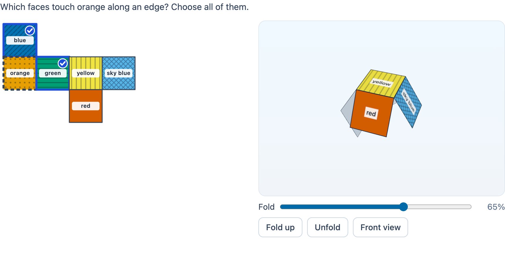

# @citolab/pci-net-folding

> [!WARNING]
> **Experimental (alpha). Just for inspiration.** This PCI is a technical showcase, made by software developers without
> much knowledge of the subject it could be used for. Its content, terms and scoring have not been checked by subject
> experts or assessment specialists, and it has never been used in an assessment. It is offered as is, without any
> warranty.

A QTI 3 Portable Custom Interaction (PCI) about nets of solids (in Dutch maths: *uitslagen*). The candidate works with
a net on a square grid: they build a net that folds into a cube or a box, find the face opposite or next to a given
face, fill in the empty faces of a net to match a solid, or pick the nets that fold into a cube. Next to the net, a 3D
view folds it into the solid, animated or step by step with a slider, and the candidate can turn the result around.
The folding is computed, not drawn: each face turns about the edge it shares with its parent face, and the PCI checks
whether the folded net closes. Triangular prisms and square pyramids work too. The item author picks the task, draws
the nets and labels the faces in the PCI itself. Made with [tspci](https://github.com/Citolab/tspci).

<p align="center">
  
</p>

## What it does

- **Five question types** (the author's choice):
  - **Build a net** (`build`): the candidate places squares on the grid (or rectangles for a box, triangles for a
    prism or pyramid) until the net folds into the solid. Scored by the PCI: does it fold closed, without gaps or
    overlap, and are these the solid's faces?
  - **Opposite face** (`opposite`): which face ends up opposite the marked face? One face.
  - **Adjacent faces** (`adjacent`): which faces share an edge with the marked face? All of them.
  - **Complete the net** (`complete`): some faces are empty; the candidate gives them labels so that the folded net
    shows the corner of the solid next to it (drawn in SVG, from the same folded geometry).
  - **Does it fold?** (`folds`): several nets; the candidate ticks the ones that fold into the solid.
- **Solids**: a cube, a box (length × width × height, 1 to 4 cells), a triangular prism (equilateral triangles, square
  sides) and a square pyramid (equilateral triangles).
- **Faces** carry letters (one or two letters or digits), dots (the pips of a die, 1 to 6) or colours. The colours are
  the Okabe–Ito colours, safe for colour blindness, and every colour also has its own pattern and its name on the
  face, so nothing depends on colour alone. A chosen face gets a check mark, the face in the question a dashed border.
- **Folding**: the net becomes a graph of faces with an edge where two faces share a whole side (a side that only
  partly touches is a cut). A breadth-first tree from the face with the most neighbours decides which face hangs from
  which; every face turns about its hinge by the fold angle of the solid (90° for a box, 120° between the sides of a
  prism, 125.3° and 70.5° for a pyramid) times the slider. At 100% the PCI compares every edge in 3D: an edge that
  meets no other face is a gap, an edge that meets two faces or two faces in the same place is an overlap.
- **The 3D view** (three.js): drag (mouse or finger) to turn, the wheel to zoom; with the keyboard, the view takes
  the arrow keys (turn) and `+` / `−` (zoom), `Home` for the front view. A click on a face (raycasting) chooses it,
  as a click on the face in the net does. The slider folds step by step; Fold up and Unfold animate, at once when the
  candidate prefers reduced motion. Without WebGL the view says so, and everything else still works. The renderer and
  its WebGL context are freed when the interaction ends (`oncompleted`) or is taken off the page.
- **Keyboard**: the build grid is a grid with an active cell: arrows move, `Enter` or `Space` place the chosen piece or
  take a face away, `R` turns (a rectangle, or a triangle to the next side with a square), `Delete` removes. In a net,
  the faces to choose are radio buttons or checkboxes (arrows move, `Space`/`Enter` choose); in the complete mode the
  empty faces are buttons: choose a label first, or type its letter or digit on the face; `Delete` empties it.
- **Screen readers**: every cell and face has a name ("Row 3, column 2: square", "Face 2, 4 dots"), the shown solid a
  description, the 3D view says how far it is folded and, at 100%, whether it closes. Changes go to a live status.
- **Several interactions on one page** each have their own net, state and response.
- **Languages**: English and Dutch (`data-language`); the response does not depend on the language.

## What can be configured

Every setting is a `data-` attribute of the interaction, as text. `dist/authoring.json` describes them for authoring
systems.

| setting                      | attribute          | default                      | what                                                                 |
| ---------------------------- | ------------------ | ---------------------------- | -------------------------------------------------------------------- |
| Instruction above the net    | `data-prompt`      | empty: a question that fits  | also part of the net's accessible name                               |
| Task and nets                | `data-puzzle`      | empty: build a net of a cube | written by the authoring mode, as JSON (below)                       |
| Fold in 3D                   | `data-show-fold`   | `true`                       | the 3D view and the fold slider; `false` for a question without help |
| Say whether it closes        | `data-show-result` | `false`                      | a visible line "It folds into a closed cube." (gives away a build)   |
| Language                     | `data-language`    | `en`                         | `en` or `nl`                                                         |

The 3D view lets the candidate see the answer by folding. That is the point of a learning task; for a test, set
`data-show-fold="false"`. The view's accessible description says at 100% whether the net closes, so that a screen
reader user gets what a sighted candidate sees.

```json
{
  "mode": "opposite", "solid": "cube", "box": [2, 1, 1], "columns": 6, "rows": 5, "labels": "letters",
  "nets": [[{ "x": 1, "y": 1, "label": "P" }, { "x": 2, "y": 1, "label": "Q" }, { "x": 2, "y": 2, "label": "R" },
            { "x": 3, "y": 2, "label": "S" }, { "x": 3, "y": 3, "label": "T" }, { "x": 4, "y": 3, "label": "U" }]],
  "ask": "f1", "blanks": [], "view": []
}
```

- **mode**: `build`, `opposite`, `adjacent`, `complete` or `folds`. **solid**: `cube`, `box`, `prism` or `pyramid`;
  **box**: the box's length, width and height in cells.
- **columns**, **rows**: the grid, 3 to 14 cells. **labels**: `letters`, `dots` or `colors` (`blue`, `orange`,
  `green`, `yellow`, `sky`, `red`, `purple`, `grey`).
- **nets**: lists of faces. A rectangle is `{ "x", "y" }` with `"w"` and `"h"` when it is larger than a cell; a
  triangle is `{ "x", "y", "base": "N" | "E" | "S" | "W" }`: it lies in that cell with its base on that side, against
  the square next to it. In `build` the first net is the example solution (shown in review; without one, a standard
  net); in `folds` there are up to 8 nets; the other modes use one net.
- **Face ids** follow from the net: `f1`, `f2` … in reading order (top to bottom, left to right). Nets are `n1`, `n2` ….
- **ask**: the face the question is about (`opposite`, `adjacent`). **blanks**: the empty faces of `complete` (at most
  4). **view**: the corner the solid shows in `complete`, three face ids that meet in a vertex.

### The authoring mode

"Draw the nets…" opens the PCI's own editor with three tabs. **Task**: the question type (switching starts from that
type's example), the solid and the box size, what the faces carry and the grid. **Net**: draw on the grid with the
pieces of the solid, the standard net, an empty grid, a label per face, and a 3D preview to fold; in `folds`, add and
remove nets, each marked "folds" or "does not fold". **Answer**: the face in the question, or the empty faces and the
corner; the correct answer is computed from the folded net and shown. `validate()` reports, in the author's language,
what keeps the item from working: a net that does not fold, no face asked, a face without an opposite (a prism's
side), more than one way to complete the net (the corner must show the empty faces), all or none of the nets folding.

## Scoring

The PCI is made for `match_correct` (`authoring.json`: `"scoring": ["match_correct", "custom", "human"]`), except the
build mode, which is `custom`.

**Opposite, adjacent, complete, does it fold?** The response is a list of identifiers (`cardinality="multiple"`,
`base-type="identifier"`), sorted. The correct response follows from the settings (`getCorrectResponse`,
`"correctResponse": "properties"`): the PCI folds the net and finds it.

| mode       | response                                  | example                        |
| ---------- | ----------------------------------------- | ------------------------------ |
| `opposite` | the chosen face (one)                      | `f4`                           |
| `adjacent` | the chosen faces                           | `f1 f3 f5 f6`                  |
| `complete` | the empty faces with the candidate's label | `f2-4 f3-2` (face 2: 4 dots)   |
| `folds`    | the chosen nets                            | `n1 n2`                        |

```xml
<qti-response-declaration identifier="RESPONSE" cardinality="multiple" base-type="identifier">
  <qti-correct-response><qti-value>f2-4</qti-value><qti-value>f3-2</qti-value></qti-correct-response>
</qti-response-declaration>
…
<qti-response-processing template="https://purl.imsglobal.org/spec/qti/v3p0/rptemplates/match_correct.xml"/>
```

For partial credit in `adjacent` or `folds`, use a `qti-mapping` with a value per identifier (and a negative one for
wrong choices) and the `map_response` template.

**Build a net.** Any of the eleven cube nets is right, so `match` cannot score it: the PCI checks the net and reports a
record (`cardinality="record"`), and the response processing copies `score`:

| field      | type      | what                                                                                |
| ---------- | --------- | ----------------------------------------------------------------------------------- |
| `score`    | `integer` | 1 when the net folds into the solid, else 0                                         |
| `maxscore` | `integer` | 1                                                                                   |
| `correct`  | `integer` | the same as `score`                                                                 |
| `closed`   | `integer` | 1 when the folded net is closed (one piece, no gaps, no overlap)                    |
| `overlap`  | `integer` | 1 when faces end up on top of each other                                            |
| `gaps`     | `integer` | the number of face edges that meet no other face                                    |
| `faces`    | `integer` | the number of faces                                                                 |
| `net`      | `string`  | the faces as JSON, for a rater and to restore the net                               |

```xml
<qti-response-declaration identifier="RESPONSE" cardinality="record"/>
…
<qti-response-processing>
  <qti-response-condition>
    <qti-response-if>
      <qti-not><qti-is-null><qti-variable identifier="RESPONSE"/></qti-is-null></qti-not>
      <qti-set-outcome-value identifier="SCORE">
        <qti-field-value field-identifier="score"><qti-variable identifier="RESPONSE"/></qti-field-value>
      </qti-set-outcome-value>
    </qti-response-if>
  </qti-response-condition>
</qti-response-processing>
```

`human`: use it without automatic scoring, for practice (with `data-show-result="true"`) or a human rater.

**Nothing answered, nothing reported**: `getResponse()` is `undefined` until the candidate placed a face or chose
something. **State**: `getState()` holds the candidate's net, choices and labels (and the log). `setResponse` and
`boundTo` (without a state) restore a response: the identifiers, or the `net` field of a build record. In
`status: "solution"` the PCI shows the declared correct response, or the computed one (in `build`: the author's
example net, or a standard net); the net is then read-only.

## Using it

```sh
npm install @citolab/pci-net-folding
```

| file                                       | what                                                                      |
| ------------------------------------------ | ------------------------------------------------------------------------- |
| `dist/index.js`                            | the PCI (AMD module, everything bundled, three.js too)                    |
| `dist/authoring.json`                      | settings, response, scoring and the authoring mode, for authoring systems |
| `dist/sbom.cdx.json`                       | CycloneDX SBOM of the bundle                                              |
| `dist/tao-pci-netFolding_<version>.zip`    | the PCI for TAO: Settings → Portable Custom Interactions → Add            |
| `netFolding.svg`, `example.png`            | icon and screenshot                                                       |

In a QTI 3 item, with `index.js` at `resources/pci/index.js` of the package:

```xml
<qti-response-declaration identifier="RESPONSE" cardinality="multiple" base-type="identifier"/>
…
<qti-portable-custom-interaction response-identifier="RESPONSE" module="pci" custom-interaction-type-identifier="netFolding"
  data-language="nl" data-puzzle="{&quot;mode&quot;:&quot;folds&quot;,…}">
  <qti-interaction-modules>
    <qti-interaction-module id="pci" primary-path="../resources/pci/index"></qti-interaction-module>
  </qti-interaction-modules>
  <qti-interaction-markup></qti-interaction-markup>
</qti-portable-custom-interaction>
```

**Limits**: letters and pips are not turned with their face, so a task about the direction of a letter on a face is
not possible; triangles go only against a square's side (the usual prism and pyramid nets, not a strip of four
triangles); there is no pinch zoom on touch screens (the wheel and `+` / `−` zoom).

Source and the other examples: [Citolab/tspci-examples](https://github.com/Citolab/tspci-examples).
