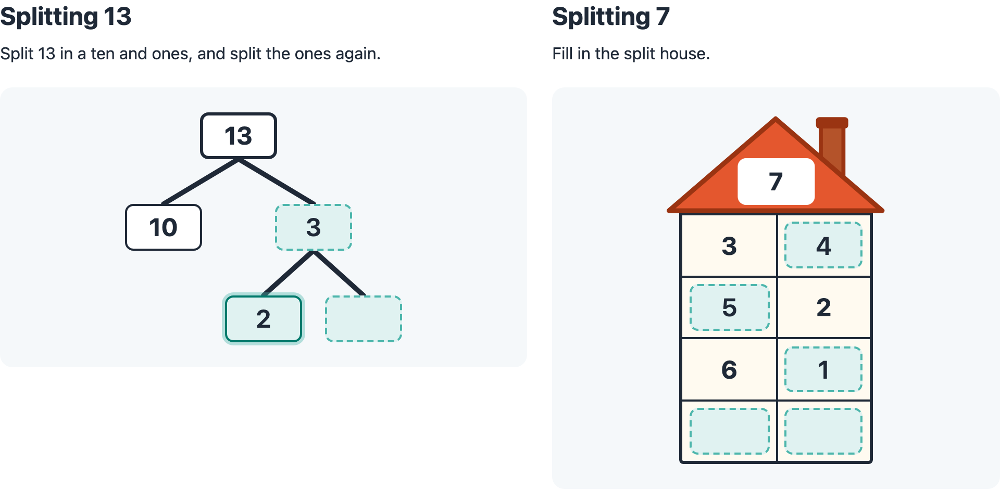

# @citolab/pci-number-bonds

> [!WARNING]
> **Experimental (alpha). Just for inspiration.** This PCI is a technical showcase, made by software developers without
> much knowledge of the subject it could be used for. Its content, terms and scoring have not been checked by subject
> experts or assessment specialists, and it has never been used in an assessment. It is offered as is, without any
> warranty.

A QTI 3 Portable Custom Interaction (PCI) with number bonds (Dutch: *splitsen*), in the two models Dutch primary
schools use for them: the **split house** (*splitshuis*), with the whole in the roof and rows of two parts below, and
the **number bond tree** (*splitsboom*, *splitsbeen*), with the whole on top and its parts on legs below. The author
gives some boxes and leaves the others empty; the pupil types the numbers in them. Made with
[tspci](https://github.com/Citolab/tspci).

<p align="center">
  
</p>

## What it does

- **The split house.** A red roof with a chimney and the whole in a window in it, warm white walls, and a row of two
  boxes per floor, as in the textbooks. Up to twelve rows. The roof can be a box for the pupil too: "which number is
  split here?"
- **All splits.** The task "all splits" gives the house a row for every split of the number in the roof: 0|7 to 7|0
  are eight rows. Two settings say what counts: whether 0 counts (0|7 and 7|0), and whether 3|4 and 4|3 are different
  splits. Every row must be a different split. The author may give a row or a box as an example.
- **The number bond tree.** The whole in a box on top, two (or three) legs down to its parts. A part can split again,
  up to three levels, for "via 10" strategies (8 + 5: split the 5 in 2 and 3) or tens and ones (47 → 40 and 7). Any box
  can be the pupil's: a missing part or a missing whole.
- **Numbers up to 9999**, and with `decimals` on, decimals for older pupils (1 → 0,3 and 0,7), with a decimal comma or
  point. Text that is not a number (or a decimal while decimals are off) makes the box red and invalid, and counts as
  empty.
- **No feedback**: the pupil does not see whether a row adds up; the response says so (below).
- **Keyboard and screen reader**: every box is a text field with a name: "roof", "row 2, left", "top",
  "split 1, right leg" (in Dutch "dak", "rij 2, links", "top", "splitsing 1, rechterbeen"). The given boxes are read but
  skipped by Tab.
- **The instruction.** Without a question in the settings, the PCI shows the instruction of its model in its language
  ("Fill in the split house: the two numbers in a row together make the number in the roof.").

## Settings

| setting | editor | what it does |
| --- | --- | --- |
| `title`, `question` | `text`, `textarea` | above the drawing; an empty question shows the instruction of the model |
| `language` | `enum` | `en` or `nl`: the PCI's own texts (instruction, screen reader names, messages) |
| `model` | `enum` | `tree` (number bond tree, the default) or `house` (split house) |
| `task` | `enum` | `fill` (default): fill in the empty boxes; `allSplits`: a row for every split of the roof (house only) |
| `house` | `pci` | the house: `7: 3\|?; ?\|2; ?\|?`, the roof, a colon, rows separated by `;`, the two boxes of a row by `\|`, `?` a box the pupil fills in; for all splits only the roof (`7`), or given boxes of the first rows (`7: 0\|7`) |
| `tree` | `pci` | the tree: `47(40\|?)`, a box and its two or three parts in brackets, separated by `\|`; a part can split again: `13(10\|3(?\|?))`, `?(5\|3)` |
| `countZero` | `boolean` | all splits: 0 counts (0\|7 and 7\|0); default on |
| `orderMatters` | `boolean` | all splits: 3\|4 and 4\|3 are different splits; default on |
| `decimals` | `boolean` | the pupil may type decimals (0,3); default off |

The notation of `house` and `tree` is the same as the `numbers` of the response, so an author who types it in a text
field (TAO) reads it back in a report. A layout that cannot be read is the default one.

### Authoring mode

"Fill in the boxes…" (`getAuthoringInstance`) opens the drawing the pupil will see, in the author's language. The
author picks the house or the tree and the task, and types the numbers the pupil gets; a box left empty (a dashed `?`)
is one the pupil fills in. The house gets **Add a row** and a remove button per row; for all splits it shows how many
rows the roof gives. Every part of the tree has a **Split** button, every split a choice of two or three legs and a
remove button. Below the drawing the author reads whether the layout has one answer (then match_correct can score it)
or more, and what keeps **Done** from finishing: a given row or split that does not add up, a part larger than its
whole, no box left for the pupil, a decimal while decimals are off, all splits without a whole number in the roof.

## Response and scoring

The PCI does not score: it reports a `record`, and the item's scoring decides what counts. Nothing is reported until
the pupil filled in a box.

| field | type | what it is |
| --- | --- | --- |
| `correct` | `boolean` | every box holds a number, and every row or split adds up to its whole |
| `correctRows` | `integer` | the number of rows (house) or splits (tree) that add up; for all splits, the number of different splits found |
| `complete` | `boolean` | all splits only: every split of the roof is there (and so none twice) |
| `numbers` | `string` | the numbers in the boxes, in the notation of the layout: `7: 3\|4; 5\|2`, `13(10\|3(2\|1))`, an empty box empty (`7: 3\|; \|2`), decimals with a point; for all splits the rows sorted (and with `orderMatters` off each row small first), so the same splits give the same numbers in any order |
| `row1` … `row12` | `boolean` | per row of the house, or per split of the tree (top first, in reading order): it adds up. For all splits: it adds up, it is a split that counts (no 0 while 0 does not count) and it is not one of an earlier row |

**The checks are on the pupil's own numbers.** A row with two empty boxes takes any split of the roof, a tree whose
parts are both the pupil's takes any parts that add up: `correct` is true for 7 = 3 + 4 and for 7 = 0 + 7. Given boxes
are locked, so they are always in the answer. When the whole is the pupil's (`?: 3|4; 5|?`), the rows are checked
against the number they wrote in the roof.

- **One answer**: when every empty box follows from the given ones (`7: 3|?; ?|2`, `?(5|3(?|1))`, and all splits),
  `getCorrectResponse` gives the correct response from the settings: every check true and the numbers. Then
  `match_correct` scores "everything right"; an authoring system that supports it fills it in and keeps it up to date.
- **More than one answer** (a row or split with two empty boxes): `getCorrectResponse` returns nothing, and the item
  scores with a rule (`custom`) on `correct`, or gives partial credit on `correctRows` or per row: 1 point when
  `correctRows` is at least 3, or a point for each of `row1` … `row4`. Answering the PCI in a preview would fix one of
  the many answers, so `match_correct` does not fit there.
- **All splits**: `complete` for full credit, `correctRows` for partial credit ("at least 6 of the 8 splits").
- In status **solution** the PCI shows the numbers of the item's correct response, read-only. Without one (or one
  without `numbers`, as in an item scored with a rule) it shows an answer of its own: the only one, or else one that
  adds up (47 in 40 and 7; different splits in the empty rows of a house).

The state keeps the text of every box as typed, also what is not a number yet; it is restored only for the same
layout, so an item whose author changed the boxes starts afresh.

## Logic and tests

`src/bonds.ts` has the logic without imports: the notation, the model, the checks, the response fields, the one answer
and the example answer, the problems of a layout and the layout of the tree. `npm test` runs `test/bonds.test.ts` on it
in node, without a build. The stories (`src/numberBonds.stories.ts`) test the PCI as a player and an authoring system
use it.

## Development

```bash
npm install
npm run dev           # the dev page, with the settings
npm test              # the node tests of src/bonds.ts
npm run test:stories  # the Storybook tests
```
