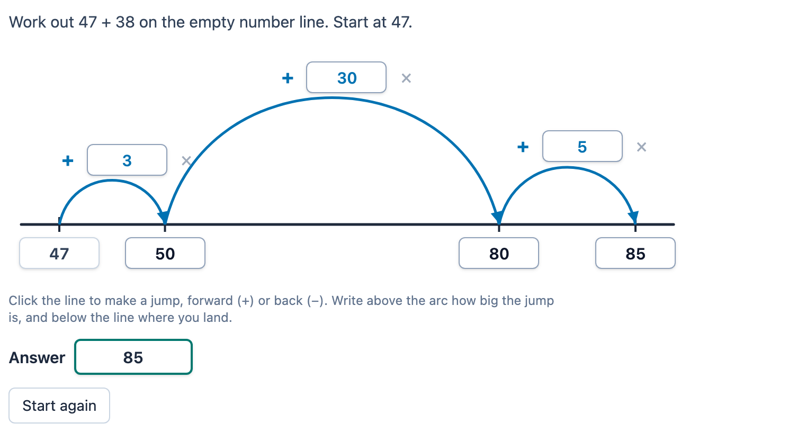

# @citolab/pci-number-line

> [!WARNING]
> **Experimental (alpha). Just for inspiration.** This PCI is a technical showcase, made by software developers without
> much knowledge of the subject it could be used for. Its content, terms and scoring have not been checked by subject
> experts or assessment specialists, and it has never been used in an assessment. It is offered as is, without any
> warranty.

A QTI 3 Portable Custom Interaction (PCI) with a number line (Dutch: *getallenlijn*) for arithmetic. The candidate
places points on the line, marks an interval, draws jumps for addition and subtraction, reads off values and fills in
missing numbers, works out a sum on an empty number line (*lege getallenlijn*) with jumps and numbers of their own, or
works out a percentage or a proportion on a double number line (*procentenstrook*, *dubbele getallenlijn*).
The numbers can be integers, decimals, fractions or negatives. The item author sets up the line and the correct answer
in the PCI itself. The response is the values, which a QTI response processing scores with a
margin, or a record with a score from the PCI. Made with [tspci](https://github.com/Citolab/tspci).

<p align="center">
  
</p>

## What it does

- **The line**: horizontal, or vertical like a thermometer (`data-orientation`). Ticks every `data-tick-step` (`1`,
  `0.1`, `1/4`, `1/3`). A number at every `data-label-step`, shown as decimals (`2.75`), fractions (`11/4`) or mixed
  numbers (`2 3/4`), with the fractions stacked. Negatives use a real minus sign. Arrows at both ends show that the
  line runs on. `data-hidden-labels` hides numbers that the candidate has to work out.
- **Place points** (`data-mode="points"`): the points (A, B, …) wait in a tray above the line. The candidate drags one
  onto the line, or chooses one and clicks the line (a click with nothing chosen places the next one). A placed point
  can be dragged along the line, or dragged away from it to take it off. Points snap to the ticks, to half ticks, or
  to a tenth of a tick, which is nearly free (`data-snap`).
- **Mark an interval** (`data-mode="interval"`): the candidate drags along the line. A click on an end, or the radio
  buttons, makes that end closed (● included), open (○ not included) or unbounded, so that it runs on with an arrow.
  This covers "x ≥ −2", "between 3 and 5" and "x < 4".
- **Jumps** (`data-mode="jumps"`): from the start (given, or placed by the candidate), every click on the line is a
  jump from where the candidate is. Additions are solid arcs, subtractions dashed ones. Both have an arrowhead and a
  label (`+4`, `−3`), so colour is never the only cue. A landing point can be dragged to change its jump.
- **Read off** (`data-mode="read"`): the line shows labelled points, and the candidate types their values in the
  boxes below. A box can also sit in place of a tick's number. Input accepts `3`, `−1,5`, `2.75`, `2 3/4`, `2¾` and
  `11/4`. Letters are refused while typing, and an input that is not a number gets a message.
- **Empty number line** (`data-mode="empty"`): a line without ticks or numbers, as Dutch primary schools use it for
  adding and subtracting (*lege getallenlijn*). The candidate adds jumps forward (+, solid) or back (−, dashed), writes
  above each arc how big the jump is and below the line where it lands, and writes the answer. Any route works:
  47 + 38 via the next ten (+3, +30, +5), via 77 (+30, +8), too far and back (+40, −2), or filling up (*aanvullen*)
  for 63 − 48 (from 48: +2, +10, +3 is 15). The line is not to scale, as on paper, but a bigger jump is a wider arc,
  and the same number is always at the same place. The start is given (the question's number, locked) or written by
  the candidate. A sign is a button that turns the jump around. Everything is a text box, in the order a candidate
  writes it; a new jump puts the focus on its size. See "The empty number line" below for what it reports.
- **Double number line** (`data-mode="double"`): two scales on the same positions, as Dutch schools use it for
  percentages (*procentenstrook*: 0 %–100 % above, € 0–€ 80 below) and for two quantities in proportion (km and
  minutes). The author gives some pairs (0 % ↔ 0, 100 % ↔ 80), locked on the strip, and asks for a missing number
  (25 % ↔ ?, or ? ↔ 60). The candidate adds marks (a click on the strip, or the button, which puts one in the middle of
  the widest free stretch), writes the numbers that belong together above and below each one (50 % ↔ 40, 25 % ↔ 20),
  and writes the answer. Any route works: halving twice, via 10 % (10 % ↔ 8, 5 % ↔ 4, 25 % ↔ 20), or 25 % at once. A
  mark is a slider: drag it, or move it with the arrow keys (Shift, Page Up/Down: a big step; Home, End; Delete removes
  it); a screen reader hears between which pairs it is. Units may be typed (`25%`, `€ 20`). Two looks: a **strip** (a
  bar, shaded and hatched up to the mark with the question's number, as in Dutch textbooks) or a plain **double number
  line**. The given marks are thicker, without a knob; the candidate's own marks have a knob (they can be moved), so
  colour is never the only cue. Marks close together get their numbers a row further out, with a dotted lead. The strip
  is not to scale: only the order counts. See "The double number line" below for what it reports.
- **Keyboard**: every point, interval end, start and landing point is a `slider`. The arrow keys move it one snap
  step. Shift + arrow, or Page Up/Down, moves it a labelled step (coarse). Home and End go to the ends of the line.
  Delete takes a point off the line, or removes the last jump. Enter or Space makes an interval end open or closed.
  Enter on a point in the tray puts it in the middle of the line. A live status line says what changed ("A at 2 3/4.",
  "Jump 2: −3, from 6 to 3.", "Interval: x ≥ −2.").
- **Values shown** (`data-show-values`, off by default because it gives the answer away): the value on each point's
  tag, the interval as an inequality, and the jumps as a sum ("2 + 4 − 3 = 3"). For accessibility, a screen reader
  always hears the value of a slider.
- **Language**: `data-language` `en` or `nl` sets the texts and how numbers look (`2,75` in Dutch). The response never
  depends on the language.
- **Authoring mode**: the item author sets up the line (from, to, tick distance, numbers at every, format) and clicks
  numbers on the line to hide them. The author places the correct points, interval or jumps on the same line the
  candidate gets, or lists the points and boxes to read off with their values. On the empty number line the author
  works out the sum as a candidate would: the start, the jumps (shown in review) and the answer (the correct answer).
  On the double number line the author names the two scales (`%` and `€`), chooses the look, puts the marks on the
  same strip and ticks the given ones, sets the question (the number above or below that is given) and works it out on
  the strip, with the answer below it. The author also sets the margin, and
  gets the response processing for it. `validate()` reports, in the author's language: a broken range or tick
  distance, too many ticks, numbers that are not on a multiple of the tick distance, a point without a label, place or
  room on the line, a duplicate label, a box not at a tick, a correct value the candidate cannot snap to, or a
  missing interval or jumps; on the double number line fewer than two given pairs, given pairs out of proportion or
  out of order, no question, no answer, an answer that does not fit the given pairs, or a working of the author's own
  that is not correct.
- **Delivery**: the candidate's answer is saved as the item's state (every change in the log) and restored. In review
  (`status: "solution"`) the PCI shows, read-only, the correct response from the response declaration, or else the
  one from the settings. Several interactions of this type on one page each get their own object.
- **Logic** (`src/numberline.ts`, no imports, tested in node with `npm test`): parsing and formatting numbers,
  fractions by continued fractions, ticks, snapping, intervals, jumps, the checks of the empty and the double number
  line, the response, the PCI's scoring, the authoring
  checks and the response processing.

## What can be configured

Every setting is a `data-` attribute of the interaction, as text. **Since 1.0.0-alpha.2 the default mode is the empty
number line** (`empty`); an item made with 1.0.0-alpha.1 that relies on the default `points` needs `data-mode="points"`. `dist/authoring.json` describes them for authoring
systems. The settings marked *(pci)* are written by the authoring mode.

| setting                     | attribute                 | default                 | what                                                                           |
| --------------------------- | ------------------------- | ----------------------- | ------------------------------------------------------------------------------ |
| Instruction                 | `data-prompt`             | the example's question  | also part of the line's accessible name; the example's text follows the mode; left at its default with the author's own `data-task`, there is none |
| What the candidate does     | `data-mode`               | `empty`                 | `empty`, `points`, `interval`, `jumps`, `read` or `double` (before 1.0.0-alpha.2 the default was `points`) |
| Start / end of the line     | `data-min`, `data-max`    | `-3`, `8`               | *(pci)* numbers, fractions allowed                                             |
| Distance between ticks      | `data-tick-step`          | `1/4`                   | *(pci)* at most 400 ticks                                                      |
| A number at every           | `data-label-step`         | `1`                     | *(pci)* a multiple of the tick distance; `0`: only at the ends                 |
| Numbers as                  | `data-number-format`      | `mixed`                 | *(pci)* `decimal`, `fraction` or `mixed`                                       |
| Hidden numbers              | `data-hidden-labels`      | empty                   | *(pci)* separated by semicolons: `2; 5 1/2` (a comma can be a decimal comma)   |
| Task and correct answer     | `data-task`               | empty: the example      | *(pci)* JSON, below                                                            |
| Points snap to              | `data-snap`               | `tick`                  | `tick`, `half` or `tenth` (of a tick); also the arrow keys' fine step          |
| Direction                   | `data-orientation`        | `horizontal`            | or `vertical`                                                                  |
| Length of the line          | `data-length`             | `640`                   | px, 240 to 1200                                                                |
| Show the values             | `data-show-values`        | `false`                 | gives the answer away                                                          |
| Scoring                     | `data-scoring`            | `qti`                   | `qti`: the values; `pci`: a record with the score (below)                      |
| Language                    | `data-language`           | `en`                    | `en` or `nl`: texts and numbers                                                |

```json
{
  "points": [{ "label": "A", "answer": 2.75 }, { "label": "B", "answer": -1.25 }],
  "interval": { "from": -2, "to": 8, "fromEnd": "closed", "toEnd": "none" },
  "jumps": { "givenStart": true, "answer": [2, 6, 3] },
  "read": [{ "kind": "point", "label": "A", "value": 4.5 }, { "kind": "tick", "label": "", "value": 6 }],
  "empty": { "givenStart": true, "start": 47, "jumps": [{ "size": 3, "landing": 50 }, { "size": 30, "landing": 80 }, { "size": 5, "landing": 85 }], "answer": 85 },
  "double": {
    "topLabel": "%", "bottomLabel": "€", "look": "strip",
    "given": [{ "top": 0, "bottom": 0, "at": 0 }, { "top": 100, "bottom": 80, "at": 1 }],
    "question": { "top": 25, "bottom": null },
    "marks": [{ "top": 50, "bottom": 40, "at": 0.5 }, { "top": 25, "bottom": 20, "at": 0.25 }],
    "answer": 20
  },
  "tolerance": 0
}
```

- Only the section of the item's mode counts. There are at most 8 points or read items.
- `interval`: an end is `closed`, `open` or `none` (unbounded, with no value). The text form `"[-2,inf)"` also works.
- `jumps.answer`: the start and every landing, at most 7 jumps. With `givenStart` the candidate starts at the first
  value, and that start is not scored.
- `read`: a `point` is drawn with its label and has an input box below the line. A `tick` hides that tick's number
  and puts an input box in its place.
- `empty`: `givenStart` with `start`: the candidate starts there; without it the candidate writes the start (so 38 + 47
  is as good as 47 + 38). `jumps` is the author's own working (a size with its sign, `-30` for a jump back, and where it
  lands, at most 8), shown in review; it is not the only route that counts. `answer` is the correct answer. The
  line's range, ticks and numbers do not apply.
- `double`: `topLabel` and `bottomLabel` name the scales (short: `%` and `€`, `km` and `min`); `look` is `strip` or
  `line`. `given`: the pairs the candidate gets (at least two, at most 6), each with its place `at` on the strip, from
  0 (the left end) to 1 (the right end). `question`: the number that is given, above (`{ "top": 25 }`: ? below) or
  below (`{ "bottom": 60 }`: ? above). `marks`: the author's own working (at most 10), shown in review; it is not the
  only route that counts. `answer`: the correct answer. A pair without `at` is placed to scale (along the given pairs
  that have a place, or over the numbers above, the question's included). The given pairs set how the scales belong
  together: both linear with the same ratio (`bottom = a + b × top`), so 0 ↔ 32 and 100 ↔ 212 (°C and °F) works too.
  The line's range, ticks and numbers do not apply.
- `tolerance`: the margin, absolute, for the PCI's scoring and the generated response processing.

## Scoring

`authoring.json`: `"scoring": ["match_correct", "custom", "human"]`, `"correctResponse": "properties"`.
`getCorrectResponse(properties)` gives the correct response from `data-task`.

**`data-scoring="qti"` (default): the values.** The response is reported once the answer is complete. Until then
`getResponse()` gives nothing, and `qti-interaction-changed` has `valid: false`.

| mode       | response                                                  | example                  |
| ---------- | --------------------------------------------------------- | ------------------------ |
| `points`   | `ordered` `float`: one per point, in the order of the task, once every point is placed | `[2.75, -1.25]` |
| `read`     | `ordered` `float`: one per read item, once every box holds a number | `[4.5, -1.75, 6]`  |
| `jumps`    | `ordered` `float`: the start and every landing             | `[2, 6, 3]`              |
| `interval` | `single` `string`: `[` / `(` for a closed / open end, `-inf` / `inf` for no end | `"[-2,inf)"`, `"(3,5]"` |

The numbers have a point and up to 9 decimals (a third is `0.333333333`), whatever the language.

- `match_correct` works when the points snap to the correct values (the default `data-snap="tick"`).
- **Margins and partial scores**: one point per value within the margin. The authoring mode writes this response
  processing (and copies it). For the example:

```xml
<qti-response-declaration identifier="RESPONSE" cardinality="ordered" base-type="float"/>
<qti-outcome-declaration identifier="SCORE" cardinality="single" base-type="float">
  <qti-default-value><qti-value>0</qti-value></qti-default-value>
</qti-outcome-declaration>
<qti-outcome-declaration identifier="MAXSCORE" cardinality="single" base-type="float">
  <qti-default-value><qti-value>2</qti-value></qti-default-value>
</qti-outcome-declaration>
…
<qti-response-processing>
  <!-- point A: 2.75 (± 0.25) -->
  <qti-response-condition>
    <qti-response-if>
      <qti-equal tolerance-mode="absolute" tolerance="0.25"><qti-index n="1"><qti-variable identifier="RESPONSE"/></qti-index><qti-base-value base-type="float">2.75</qti-base-value></qti-equal>
      <qti-set-outcome-value identifier="SCORE">
        <qti-sum><qti-variable identifier="SCORE"/><qti-base-value base-type="float">1</qti-base-value></qti-sum>
      </qti-set-outcome-value>
    </qti-response-if>
  </qti-response-condition>
  <!-- point B: -1.25 (± 0.25): the same with qti-index n="2" -->
</qti-response-processing>
```

  For jumps, each landing is one condition (and the start too, when the candidate places it). To check only where
  the candidate lands, compare the last index. For an interval, use a `<qti-match>` against the string. A margin on
  an interval needs `data-scoring="pci"`.

**`data-scoring="pci"`: a record (`custom`).** The PCI scores with the task's correct answer and margin. It reports as
soon as the candidate does anything, so a half-finished answer still gets partial credit. Declare
`cardinality="record"`.

| field               | type      | what                                                                                 |
| ------------------- | --------- | ------------------------------------------------------------------------------------ |
| `score`             | `integer` | the checks that pass                                                                 |
| `maxscore`          | `integer` | the number of checks                                                                 |
| `correct`           | `integer` | 1 when every check passes (jumps: also no jump more or less than the correct route)  |
| `check1` … `check8` | `integer` | 1 or 0: per point / read item; per end of the interval (the kind and, unless it has no end, the value); per position of the route (without a given start) |
| `answer`            | `string`  | the answer as text: `"2.75 ?"` (`?` not placed), `"[-2,inf)"`, `"2 6 3"`             |

Copy `score` to `SCORE` as in [tspci-circuit-builder](../tspci-circuit-builder/README.md#scoring), or test single
fields with `<qti-field-value field-identifier="check2">`. `human`: use the PCI without automatic scoring, for example for
practice.

**The empty number line (`data-mode="empty"`): a record, whatever `data-scoring` says.** As in
[tspci-ratio-table](../tspci-ratio-table/README.md#response-and-scoring), the PCI reports the answer and checks the
working against the candidate's own numbers, not against one model route. Nothing is reported until the answer box
holds a number. Declare `cardinality="record"`.

| field           | type      | what                                                                                                   |
| --------------- | --------- | ------------------------------------------------------------------------------------------------------ |
| `answer`        | `float`   | the number in the answer box (`85,0` is reported as `85`)                                               |
| `working`       | `boolean` | a start, at least one jump, every jump has a size and a landing and lands where it says (from the start or the landing before it, with its sign), and the answer follows: it is the last landing, or all the jumps together (filling up) |
| `answerCorrect` | `boolean` | the answer is the task's `answer` (within the margin); only when the task has one                       |

So `working` can be true with a wrong answer (the candidate started from a misread number), and false with a right one
(a jump that does not land where it says). `getCorrectResponse` gives `answer`, `working: true` and `answerCorrect:
true`, so `match_correct` means "right answer, correct working"; the authoring mode writes response processing with one
point for the answer (within the margin) and one for the working. The line itself is in the state, for a human rater.

**The double number line (`data-mode="double"`): the same record, whatever `data-scoring` says.** The working is
checked against the candidate's own numbers, whatever the route, as on the ratio table: nothing is reported until the
answer box holds a number. Declare `cardinality="record"`.

| field           | type      | what                                                                                                   |
| --------------- | --------- | ------------------------------------------------------------------------------------------------------ |
| `answer`        | `float`   | the number in the answer box (`€ 20,00` is reported as `20`)                                            |
| `working`       | `boolean` | at least one mark with both numbers; every mark with a number written has both, in proportion with the given pairs (the same linear relation, exactly: no rounding); from left to right all pairs, the given ones included, go the way the given pairs go, above and below (a mark in the wrong place breaks it); and the answer is one of the candidate's pairs: the other number at a mark with the question's number (25 % ↔ 20 for "25 % ↔ ?") |
| `answerCorrect` | `boolean` | the answer is the task's `answer` (within the margin); only when the task has one                       |

A mark with nothing written at it does not count, and a mark that repeats a given pair does no harm. The margin is for
the answer only. `getCorrectResponse` gives `answer`, `working: true` and `answerCorrect: true`; the authoring mode
writes response processing with one point for the answer and one for the working, as for the empty number line. The
strip itself (every mark's place and numbers) is in the state, for a human rater.

**State and response.** `getState()` holds the candidate's answer (and the log). `setResponse` (and `boundTo` without
a state) reads an ordered float list, an interval string, values as one text (`"2.75 -1.25"`), or the `answer` field
of a record. In `status: "solution"` the declared correct response is shown, in any of those forms. Without one, the
PCI shows the correct answer from `data-task`.

## Using it

```sh
npm install @citolab/pci-number-line
```

| file                                       | what                                                                      |
| ------------------------------------------ | ------------------------------------------------------------------------- |
| `dist/index.js`                            | the PCI (AMD module, everything bundled: the package has no dependencies) |
| `dist/authoring.json`                      | settings, response, scoring and the authoring mode, for authoring systems |
| `dist/sbom.cdx.json`                       | CycloneDX SBOM of the bundle                                              |
| `dist/tao-pci-numberLine_<version>.zip`    | the PCI for TAO: Settings → Portable Custom Interactions → Add            |
| `numberLine.svg`, `example.png`            | icon and screenshot                                                       |

In a QTI 3 item, with `index.js` at `resources/pci/index.js` of the package:

```xml
<qti-response-declaration identifier="RESPONSE" cardinality="ordered" base-type="float"/>
…
<qti-portable-custom-interaction response-identifier="RESPONSE" module="pci" custom-interaction-type-identifier="numberLine"
  data-language="nl" data-mode="points" data-min="-3" data-max="8" data-tick-step="1/4" data-label-step="1" data-number-format="mixed"
  data-prompt="Zet punt A bij 2,75 en punt B bij −1¼." data-task="{&quot;points&quot;:[{&quot;label&quot;:&quot;A&quot;,&quot;answer&quot;:2.75},{&quot;label&quot;:&quot;B&quot;,&quot;answer&quot;:-1.25}]}">
  <qti-interaction-modules>
    <qti-interaction-module id="pci" primary-path="../resources/pci/index"></qti-interaction-module>
  </qti-interaction-modules>
  <qti-interaction-markup></qti-interaction-markup>
</qti-portable-custom-interaction>
```

Source and the other examples: [Citolab/tspci-examples](https://github.com/Citolab/tspci-examples).
